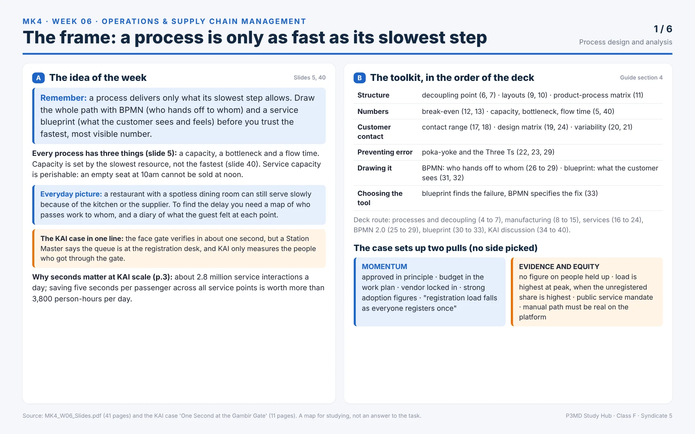
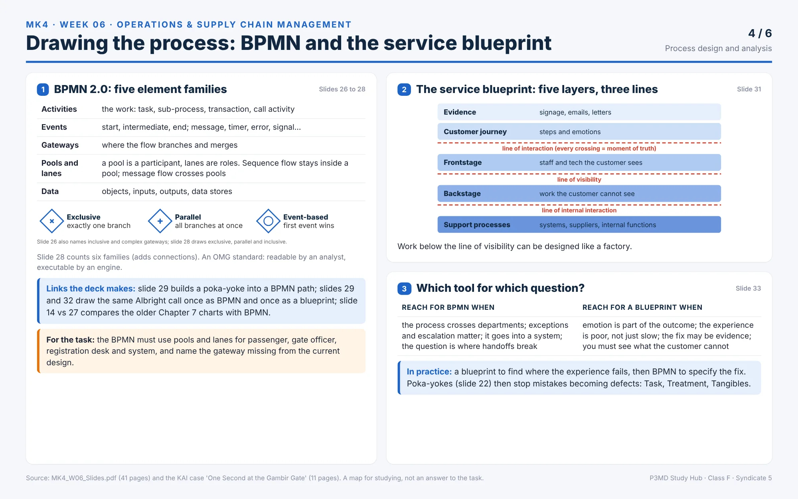
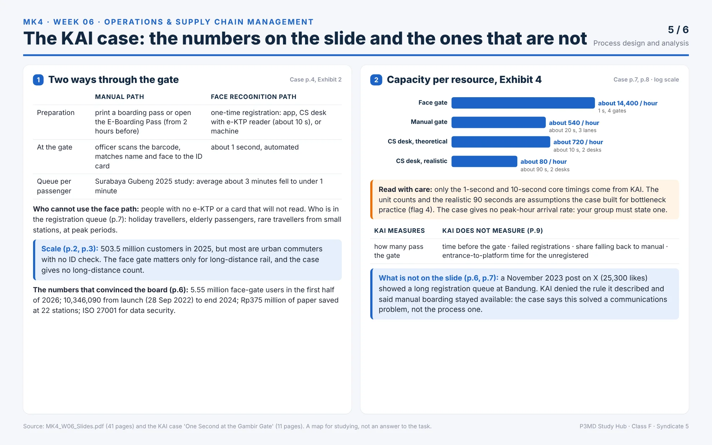

> [!NOTE] Operational Context
> **Course:** MK4 Operations & Supply Chain Management — Week 06  
> **Source Case:** PT Kereta Api Indonesia (Persero), One Second at the Gambir Gate (_SBM ITB Case Series SBM-ITB / OSCM / 2026-06_, 11 pages)  
> **Related Notes:** [[courses/mk4-operations-supply-chain-management/week-06/index|Process Design & Analysis (Lecture)]] · [[courses/mk4-operations-supply-chain-management/week-06/case-kai-gambir-gate|KAI Gambir Gate Case Analysis]] · [[courses/mk4-operations-supply-chain-management/week-06/diagnostic-questions|Diagnostic Problem Sets]]

---

## Visual Summary Posters

---

MK4 W06 Assignment Brief: KAI, One Second at the Gambir GateThis brief maps the assignment and the case so you can skim fast and pull the right details. It does not draw the blueprint, compute the capacity, model the BPMN, place the paths on the matrix, or pick an option. That part is your group's.

## The assignment at a glance

1

## The assignment at a glance

| Item                                   | Detail (from the task post and the case)                                                                                                                                |
| -------------------------------------- | ----------------------------------------------------------------------------------------------------------------------------------------------------------------------- |
| Type                                   | Group assignment on the case "One Second at the Gambir Gate" (SBM-ITB / OSCM / 2026-06), Meeting 6, Process Design and Analysis                                         |
| What to submit                         | A piece that "should include, but is not limited to" five parts: Case Summary, Process Analysis, Process Mapping, Decision Alternatives, Group Recommendation           |
| Guiding questions                      | The five bullets in the Assignment section on case page 11 guide the discussion. You do not need to answer them one by one, but the relevant issues should be reflected |
| Format                                 | Flexible. You may use the case materials and/or additional relevant references                                                                                          |
| First page                             | Names and student numbers of all participating group members                                                                                                            |
| Who submits                            | One representative per group on Google Classroom. Other members still click "Mark as done"                                                                              |
| Due                                    | Not specified in the files                                                                                                                                              |
| File name, word limit, grading weights | Not specified in the files                                                                                                                                              |

## What each part asks

2

## What each part asks

The post (Task.txt) and the case page 11 describe the task in two slightly different shapes. This section follows the post's five parts and attaches the case page 11 bullet to each.

**Part 1. Case Summary**

- Command word: _briefly summarize_.
- Scope: the key process design and boarding challenges KAI faces in implementing the Face Recognition Boarding Gate.
- Case feeds it from: page 2 (the meeting and Suhendro's objection), page 4 (the two boarding paths and registration), page 9 (the three pressures).
- Slides that help: 35 (the case in one slide).

**Part 2. Process Analysis**

- Command word: _apply_.
- Concepts named in the post: service blueprint, customer contact, decoupling point, bottleneck, process capacity. Evidence and calculations from the case are required.
- Case page 11 bullets that sit here: (a) draw a service blueprint covering all five layers, place the failure Suhendro describes on the correct layer, and say whether it is on the layer where it is felt; (b) using Exhibit 4, identify the system bottleneck and calculate effective boarding capacity at peak hour with 15 percent unregistered, then compare with 5 percent; (d) place both boarding paths on the service-system design matrix, explain why they cannot occupy the same position, and say what that implies for officer skill requirements.
- Case feeds it from: page 2 (Suhendro's description), page 4, page 5 (Exhibit 2), pages 7 to 8 (Exhibit 4), page 9.
- Slides that help: 31, 32, 33 and 36 (blueprint); 5, 35 and 40 (capacity, bottleneck); 17, 18, 19, 24 and 38 (contact, matrix, skills); 6, 7 and 37 (decoupling point).

**Part 3. Process Mapping**

- Command word: _develop a process mapping_.
- Scope: identify critical activities, failure points and decision gateways in the boarding process.
- Case page 11 bullet that sits here: (c) model the process in BPMN 2.0 with pools and lanes for the passenger, the gate officer, the registration desk and the system, and show which gateway is missing from the current design.
- Case feeds it from: page 4 (both paths and the three registration channels), page 5 (Exhibit 2, points of failure), page 7 (what happens when the ID card will not read).
- Slides that help: 26 to 29 (BPMN), 33 (when to use which).

**Part 4. Decision Alternatives**

- Command word: _critically evaluate_.
- Scope: all four options: Full Expansion (A), Phased Expansion with Instrumentation (B), Fix Registration First (C), Permanent Dual-Path Design (D).
- Case feeds it from: page 10 (the options table with supporting argument and principal risk for each), page 9 (the three pressures).
- Slide that helps: 37.

**Part 5. Group Recommendation**

- Command word: _take a clear position_.
- Scope: one option or a combination of options. Explain the reasoning and define measurable indicators or thresholds for judging success or failure.
- Case page 11 bullet that sits here: (e) choose one of the four options, defend it with three specific measures you would order collected before the decision is taken, and say what figure would change your mind.
- Case feeds it from: page 9 (what KAI does and does not measure), page 10.
- Slides that help: 37, 39, 40.

## The case in one minute

3

## The case in one minute

- **Who decides:** Anindita Prameswari, VP of Station Operations and Passenger Experience at PT Kereta Api Indonesia (Persero). She is an illustrative character in a case built from public secondary sources.
- **What she must hand over:** operational sign-off on expanding the Face Recognition Boarding Gate from 22 stations to 60 within two years, and a recommendation on whether the next 38 stations follow in one wave or in stages. Deadline in the story: the following Friday.
- **The situation:** 5,550,000 customers used the gate in the first half of 2026. The plan is approved in principle, the budget is in the work plan, the vendor is locked in.
- **The objection:** Suhendro Wibisono, Station Master at Bandung, says the gate really is one second but the queue is at the registration desk, and "we have never measured that desk".
- **What is missing:** KAI has numbers about those who got through the gate. It has none on the time people wait before the gate, failed registrations, fallbacks to manual inspection, or total time from station entrance to platform for an unregistered passenger.
- **The table she asks for (Exhibit 4):** capacity per hour of every path. The case comments on what the table showed (page 8); the assignment asks you to identify the bottleneck and show it with your own calculation.

## Timeline

4

## Timeline

| Date                                  | Event                                                                     | Page             |
| ------------------------------------- | ------------------------------------------------------------------------- | ---------------- |
| 28 September 2022                     | Face Recognition Boarding Gate first trialled at Bandung Station          | 4                |
| September 2022 to end 2024            | 10,346,090 passengers used the gate                                       | 6                |
| November 2023                         | Post on X about a long registration queue at Bandung                      | 6 to 7           |
| 2025                                  | KAI Group serves 503.5 million customers                                  | 2                |
| January to November 2025              | More than 10 million customers used the gate                              | 6                |
| First half 2026                       | 5,550,000 customers used the gate                                         | 2, 6             |
| Saturday 4 July 2026, 7:40 p.m.       | The meeting in the Bandung head office                                    | 2                |
| "Wednesday morning" after the meeting | Anindita writes the dilemma; her personal note is dated 8 July 2026       | 9                |
| The following Friday                  | Anindita's recommendation is due                                          | 2, 10            |
| August 2026                           | Business transformation briefing by KAI President Director Bobby Rasyidin | 2                |
| End of 2028                           | Target of 70 percent adoption among all long-distance rail passengers     | 2                |
| 2045                                  | Target of 1.4 billion passengers per year                                 | 2                |
| September 2026                        | Case publication date                                                     | 1                |
| Not specified                         | Deadline for the assignment                                               | Not in the files |

## Skim map: where to look for what

5

## Skim map: where to look for what

| Pages  | Section                                         | What is there                                                       | Feeds part |
| ------ | ----------------------------------------------- | ------------------------------------------------------------------- | ---------- |
| 1      | Cover                                           | Case number, session, core topics, case type, discussion length     | 1          |
| 2      | The Meeting That Would Not End; The Company     | The setting, Suhendro's quote, the 22 to 60 plan, KAI scale         | 1          |
| 3      | The Company; Exhibit 1                          | Urban versus long-distance split, financial and volume table        | 1          |
| 4      | The Process Under Debate                        | Conventional path, face recognition path, registration channels     | 1, 2, 3    |
| 5      | Exhibit 2                                       | Manual path versus face recognition path, side by side              | 2, 3       |
| 6      | The Numbers That Convinced the Board; Exhibit 3 | Adoption, paper savings, data handling, regional users              | 1, 5       |
| 6 to 7 | The Numbers That Are Not on the Slide           | The 2023 complaint, the Surabaya Gubeng study, who is in the queue  | 1, 2       |
| 7 to 8 | Exhibit 4                                       | Capacity per hour for each resource and the note on what is assumed | 2          |
| 9      | Anindita's Dilemma                              | Three pressures, what KAI does and does not measure                 | 1, 4, 5    |
| 10     | The options on the table                        | Options A to D with supporting argument and principal risk          | 4, 5       |
| 11     | Assignment; Source Notes                        | The five bullets, source groups, what is illustrative               | All        |

**Reading route**

- **Pass 1, about 10 minutes:** page 11 (the Assignment), page 10 (the options), page 9 (the dilemma). You now know the question and the choices.
- **Pass 2, about 15 minutes:** Exhibits 2 and 4 (pages 5, 7 and 8), and page 4. Copy the numbers into the table in section 6.
- **Pass 3:** the narrative pages, reading for evidence for each part. Then slides 31 to 33 (blueprint), 26 to 29 (BPMN) and 35 to 40.

## Key details to pull

6

## Key details to pull

Values exactly as stated in the files. The last column is for your own note.

| Data point                                       | As stated                                                                                                                                                         | Page   | Feeds part | Your note |
| ------------------------------------------------ | ----------------------------------------------------------------------------------------------------------------------------------------------------------------- | ------ | ---------- | --------- |
| Expansion plan                                   | From 22 stations to 60 within two years; next 38 stations                                                                                                         | 2      | 1, 4, 5    |           |
| Adoption target                                  | 70 percent of all long-distance rail passengers by the end of 2028                                                                                                | 2      | 1          |           |
| First half 2026 users                            | 5,550,000 customers, "up from 5.5 million in the same period the previous year"                                                                                   | 2      | 1          |           |
| Increase quoted                                  | 53,978 over the same period the previous year                                                                                                                     | 6      | 1          |           |
| KAI Group 2025                                   | 503.5 million customers, up 8.52 percent from 464 million in 2024                                                                                                 | 2      | 1          |           |
| Gate verification time                           | About 1 second (4 gates in Exhibit 4)                                                                                                                             | 4, 7   | 2          |           |
| Manual gate                                      | About 20 seconds, 3 lanes, about 540 per hour                                                                                                                     | 7      | 2          |           |
| Face Recognition Gate capacity                   | About 14,400 per hour                                                                                                                                             | 7      | 2          |           |
| CS registration desk, theoretical                | About 10 seconds core process, 2 desks, about 720 per hour                                                                                                        | 7      | 2          |           |
| CS registration desk, realistic                  | About 90 seconds including queue, explanation, failed ID reads; 2 desks; about 80 per hour                                                                        | 8      | 2          |           |
| Registration via application                     | Self-service, off-site, unlimited, no station load                                                                                                                | 8      | 2, 4       |           |
| What Exhibit 4 is                                | "a pedagogical illustration"; unit counts and realistic timings are assumptions, not KAI operational data                                                         | 8      | 2          |           |
| Unregistered conditions in the task              | 15 percent and 5 percent of passengers                                                                                                                            | 11     | 2          |           |
| Peak hour demand                                 | Not given in the case                                                                                                                                             |        | 2          |           |
| Queue time per passenger (Surabaya Gubeng, 2025) | Manual about 3 minutes; face recognition under 1 minute                                                                                                           | 5, 7   | 2          |           |
| Registration channels                            | App; Customer Service officer with e-KTP Reader (roughly ten seconds); vending machine or check-in counter with e-KTP Reader                                      | 4      | 2, 3       |           |
| Registration prerequisite                        | An electronic identity card; if missing or unreadable, the manual path                                                                                            | 4      | 2, 3       |           |
| Data retention                                   | Retained for one year, then deleted automatically; deletion on request                                                                                            | 6      | 1          |           |
| 2023 incident                                    | Post on X with 5,860 reposts, 1,961 quotes, 25,300 likes; ten minutes before departure claim, denied by KAI                                                       | 6 to 7 | 1, 2       |           |
| What KAI does not measure                        | Time standing before the gate; failed registration attempts; share of scans falling back to manual; total entrance-to-platform time for an unregistered passenger | 9      | 2, 5       |           |
| Paper savings                                    | Rp375 million; 25,576 rolls; 22 stations across 67 lines                                                                                                          | 6      | 1          |           |
| First-half on-time performance                   | 96.2 percent                                                                                                                                                      | 3, 10  | 1          |           |
| Option A                                         | Full expansion: all 38 stations in a single wave; risk: replicates the registration bottleneck across 38 sites at once                                            | 10     | 4, 5       |           |
| Option B                                         | Phased expansion with instrumentation: 8 stations first, with end-to-end measurement                                                                              | 10     | 4, 5       |           |
| Option C                                         | Fix registration first: app, partners, agents; expand gates afterwards                                                                                            | 10     | 4, 5       |           |
| Option D                                         | Permanent dual-path design: manual path with its own capacity standard and SLA                                                                                    | 10     | 4, 5       |           |
| Blueprint requirement                            | All five layers; place the failure Suhendro describes                                                                                                             | 11     | 2          |           |
| BPMN requirement                                 | Pools and lanes: passenger, gate officer, registration desk, system; show the missing gateway                                                                     | 11     | 3          |           |
| Recommendation requirement                       | Three specific measures to collect before the decision; the figure that would change your mind                                                                    | 11     | 5          |           |

## Visualizing Decision Alternatives

---

## Tensions the case sets up

7

## Tensions the case sets up

The case leaves these open on purpose. Each has two sides; neither is marked right here.

- **Momentum or measure (pages 2 and 9):** the plan is approved in principle and the budget exists; Anindita cannot settle the argument with evidence because KAI has no figure on people held up.
- **Average or peak (page 9):** "each customer registers only once" suggests the desk load falls over time; the case says stations operate at peak, when the unregistered share is highest.
- **Paper or platform (page 9):** the manual path is available as policy; the case asks whether it is available in practice if staffed more thinly.
- **Efficiency or equity (pages 9 and 10):** option D guarantees equity of access but forfeits part of the cost saving that underpins the business case.
- **Fix the constraint or fix the ID card (page 10):** option C moves registration off the station but does not solve unreadable identity cards and depends on digital literacy.
- **Two queue pictures (pages 5 and 7):** the Surabaya Gubeng study shows queue time falling; the 2023 Bandung post describes a huge registration queue.
- **Illustration or evidence (page 8):** Exhibit 4 is the only per-path capacity table, and the case says it is an illustration.

## Watch-outs

8

## Watch-outs

- **Exhibit 4 is illustrative:** unit counts and realistic timings are assumptions built for practice. Say so when you use the numbers.
- **No peak-hour demand is given:** the assignment asks for capacity at peak hour with 15 percent and 5 percent unregistered, but the case has no passenger count per hour. State your assumption.
- **Two descriptions of the task:** the post lists five parts (including Case Summary and evaluating all four options); the PDF lists five bullets (including choosing one option with three measures). Cover both.
- **Date detail on page 9:** "Wednesday morning, three days after the meeting" does not match a Saturday meeting. Do not copy it.
- **Adoption figures mix bases (page 6):** national, regional, cumulative and periodic figures are not equivalent, and the case says so.
- **The deck mentions other cases:** slides 3 and 39 refer to Albright and Groom. Only the KAI case is in the folder and in this task.
- **Slide 40 states a view** on the blueprint question. The assignment asks you to draw and justify it yourself.
- **Revenue detail:** Exhibit 1 shows consolidated revenue slightly lower in 2025 than 2024; the 2025 figures were unaudited.
- **Not specified in the files:** deadline, file name, word limit, grading weights.

## Recommendation Framework

---

## Before you submit

9

## Before you submit

- First page lists the names and student numbers of all participating group members
- Case Summary covers the key process design and boarding challenges at KAI
- Process Analysis uses service blueprint, customer contact, decoupling point, bottleneck and process capacity, with evidence and calculations from the case
- Blueprint covers all five layers and places the failure Suhendro describes
- Capacity at peak hour is shown for both the 15 percent and the 5 percent unregistered conditions, with the assumption stated
- Process mapping shows critical activities, failure points and decision gateways, with pools and lanes for the passenger, the gate officer, the registration desk and the system
- The missing gateway in the current design is shown
- Both boarding paths are placed on the service-system design matrix, with the reason they differ and the officer skill implication
- All four options are critically evaluated
- The recommendation takes a clear position on one option or a combination
- Three specific measures to collect before the decision are named, and the figure that would change your mind is stated
- Measurable indicators or thresholds for success or failure are defined
- Every figure used matches the case, and Exhibit 4 is described as an illustration
- Additional references, if any, are cited
- One representative submits on Google Classroom; everyone else clicks "Mark as done"

---
