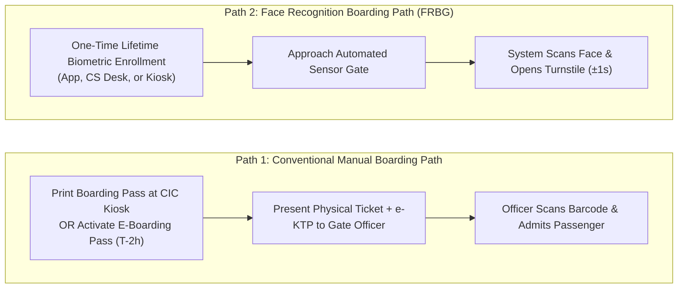
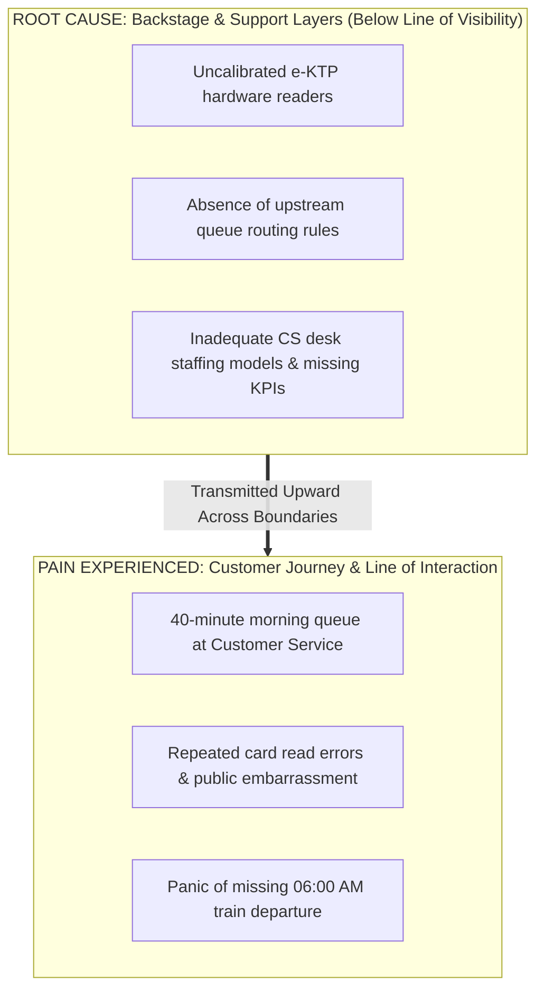
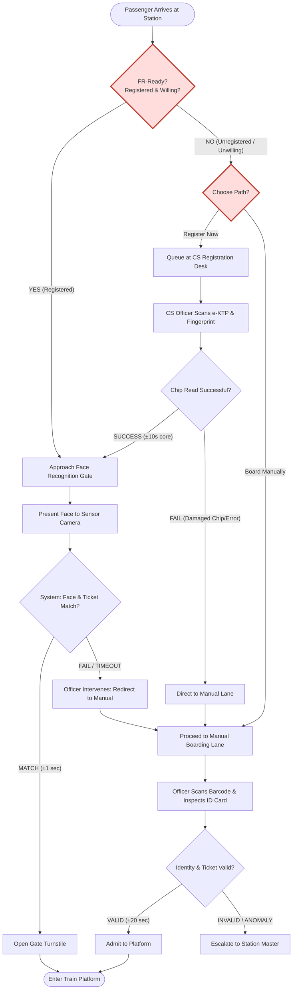
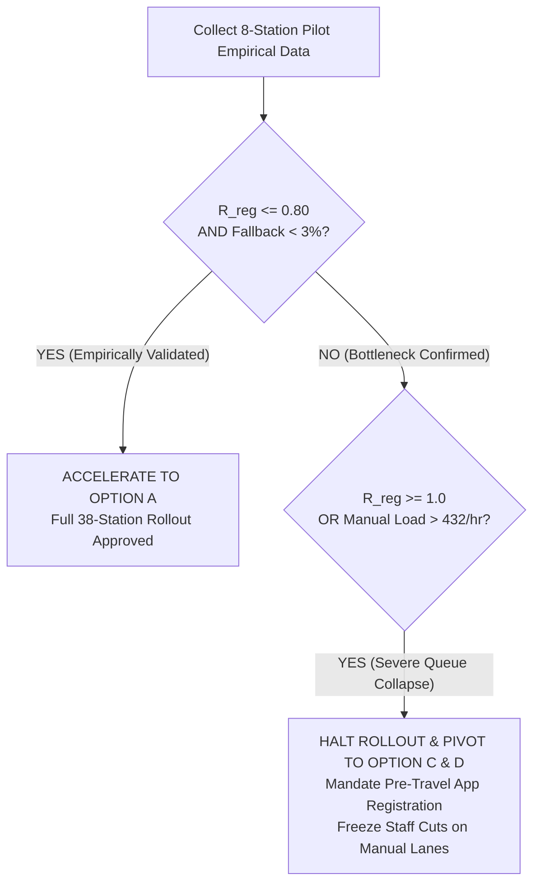

> [!NOTE] **Narrative Construction & Key Personas**
> The case uses three illustrative characters (synthesized from September 2026 public secondary sources including _Bisnis.com_, _Tempo_, _Koran Jakarta_, and _ANTARA News_) to personify the cross-functional conflicts within BUMN rail operations:
>
> - **Anindita Prameswari** _(VP of Station Operations & Passenger Experience)_: Focuses on frontstage passenger anxiety, demographic digital exclusion, dwell time, and the unmeasured registration queue.
> - **Reza Baskara** _(VP of Digital Technology & Innovation)_: Champions rapid modernization, biometrics momentum, 1-second physical gate clearance, and national digital infrastructure integration.
> - **Suhendro Wibisono** _(Station Master, Bandung Station)_: Ground-level operational commander dealing with platform crowding, elderly passenger confusion, scanner read errors, and manual lane bottlenecks.

## 🚨 The Executive Dilemma: Speeding the Gate or Moving the Queue?


On Saturday, 4 July 2026, at 7:40 p.m., the third-floor executive boardroom at the Bandung headquarters of **[[entities/pt-kereta-api-indonesia|PT Kereta Api Indonesia (Persero)]]** was locked in an intense, unresolved debate. On the projection screen, a prominent figure flashed: **5,550,000**—the cumulative number of rail passengers who had used the **Face Recognition Boarding Gate (FRBG)** across Java and Sumatra during the first half of 2026.

**Anindita Prameswari**, Vice President of Station Operations and Passenger Experience, faced an urgent deadline. The Board of Directors had approved in principle an expansion of the biometric boarding gates from **22 stations to 60 stations** over two years, targeting a 70% adoption rate among all long-distance rail passengers by 2028. The corporate capital expenditure budget was allocated, the vendor was contractually locked in, and **Reza Baskara**, VP of Digital Technology and Innovation, was demanding immediate operational sign-off to execute the rollout across the remaining 38 stations in a single wave.

What derailed the meeting was an unscripted intervention from **Pak Suhendro Wibisono**, a 20-year veteran Station Master at Bandung Station:

> [!CAUTION] The Station Master's Observation
> _"Ma'am, the gate really is one second. I see it every day. But try standing in front of the Customer Service desk at six in the morning before a long weekend. The queue is not at the gate. The queue is where people register their faces. And the people in that queue are precisely the ones least prepared: the ones whose ID card will not scan, the ones without a smartphone, the ones brought here by their grandchildren. We measure the gate, but we have never measured that desk."_
> — **Suhendro Wibisono**, Station Master, Bandung

Anindita had until the following Friday to submit her formal recommendation to the Board:

1. Should KAI proceed with **immediate full expansion** across all 38 stations to capture economies of scale and institutional momentum?
2. Or was KAI committing a classic process-design fallacy—accelerating an already fast sub-activity while unintentionally shifting a catastrophic, unmeasured queue to an upstream customer service bottleneck?

---

### Skim Map: Where to Look for What Across the Case

To navigate the 11-page case efficiently for assignment drafting, use this structural roadmap:

| Case Pages     | Case Section & Content Focus                  | Primary Data & Exhibit Anchor                      | Feeds Assignment Deliverable             |
| :------------- | :-------------------------------------------- | :------------------------------------------------- | :--------------------------------------- |
| **Page 1**     | Cover, central tension, dilemma statement     | "Are we speeding up the gate or moving the queue?" | **Part 1:** Case Summary                 |
| **Pages 2–3**  | Strategic background, 22-station rollout      | Approved expansion budget to 60 stations           | **Part 1 & 4:** Summary & Options        |
| **Pages 3–4**  | Physical layout, manual vs. Face Recognition  | 1-second face scan vs. 15-second manual check      | **Part 2:** Process Analysis             |
| **Pages 5–6**  | Registration channels & demographic friction  | 3 channels: Mobile App, CS Desk, Kiosk Reader      | **Part 2 & 3:** Blueprint & BPMN         |
| **Pages 6–7**  | Bandung Station controversy & public backlash | Pushback against mandatory biometrics              | **Part 1 & 5:** Summary & Recommendation |
| **Page 8**     | Operational Exhibit 4 & capacity parameters   | Station resource cycle times & hourly capacities   | **Part 2:** Bottleneck Calculations      |
| **Pages 9–10** | Unmeasured metrics & 4 Decision Alternatives  | Full Rollout, Phased, Fix Registration, Dual-Path  | **Part 4 & 5:** Alternatives & Decision  |
| **Page 11**    | Source notes & formal assignment questions    | Public secondary references & group tasks          | **All Parts:** Submission Alignment      |

## 🏢 Enterprise & Operational Context: The Arithmetic of Scale

PT Kereta Api Indonesia (Persero) is a state-owned enterprise (BUMN) operating nearly all passenger and freight rail networks on Java and Sumatra. In 2025, KAI Group served **503.5 million customers**—an 8.52% increase over 2024—generating **Rp35.7 trillion** in consolidated revenue, with **Rp12.9 trillion** derived from passenger transport and net profit reaching **Rp2.3 trillion**.

At KAI’s operational scale, with approximately **2.8 million daily customer interactions** and an executive mandate targeting **1.4 billion annual passengers by 2045**, small unit-level process changes compound massively:
$$\mathbf{\text{A 5-second saving per passenger}} \times 2.8\text{ million daily interactions} \approx \mathbf{3,888 \text{ person-hours saved per day.}}$$

```
                       503.5 MILLION TOTAL PASSENGERS (2025)
                                        │
           ┌────────────────────────────┴────────────────────────────┐
           ▼                                                         ▼
     URBAN TRANSIT (KRL / LRT)                             LONG-DISTANCE INTERCITY
  - Bulk of volume (Cards / QR)                             - Highest passenger revenue (Rp12.9T)
  - No passenger identity check                             - Mandatory legal identity matching
  - Commuter turnstile flow                                 - Visible holiday queues & biometric focus
```

However, the aggregate volume of 503.5 million conceals a crucial operational division. The vast majority of passengers ride urban commuter transit (**KAI Commuter**, **LRT Jabodebek**, **LRT South Sumatra**) where passengers tap cards or scan generic QR codes without identity matching. The Face Recognition Boarding Gate applies **exclusively to long-distance intercity rail**, where Indonesian transport regulations mandate that the name and national identification number on the passenger's ticket must strictly match the physical traveler holding it.

### Exhibit 1: KAI Operational and Financial Performance (2022–2025)

| Operational & Financial Indicator        |   2022   |     2024      |       2025        | Trend / Growth Context                 |
| :--------------------------------------- | :------: | :-----------: | :---------------: | :------------------------------------- |
| **KAI Group Passenger Volume**           |    —     |    464.0 M    |    **503.5 M**    | +8.52% annual growth                   |
| **Consolidated Revenue**                 |    —     |   Rp 35.9 T   |   **Rp 35.7 T**   | Sustained commercial base              |
| **Passenger Transport Revenue**          | Rp 7.0 T |   Rp 11.9 T   |   **Rp 12.9 T**   | +8.4% YoY; primary revenue engine      |
| **Operating EBITDA**                     | Rp 4.5 T |       —       |   **Rp 8.3 T**    | Robust cash-flow generation            |
| **Net Profit**                           |    —     |       —       |   **Rp 2.3 T**    | Post-pandemic turnaround               |
| **Freight Volume**                       |    —     | 69.2 M tonnes | **70.0 M tonnes** | Primarily South Sumatra coal transport |
| **State Contribution (Taxes/Dividends)** |    —     |   Rp 4.4 T    |   **Rp 6.8 T**    | +54.5% fiscal contribution             |
| **On-Time Performance (OTP, H1)**        |    —     |       —       |     **96.2%**     | Operational discipline benchmark       |

---

## 🔍 The Boarding Process Under Debate: Manual vs. Biometric

Boarding an intercity train requires verifying two distinct criteria simultaneously:

1. **Ticket Validity**: Has the passenger paid for an active reservation on this specific departing train?
2. **Identity Verification**: Is the person attempting to pass onto the platform the exact individual registered on the legal ticket?



### The Three Registration Channels & The Systemic Point of Failure

Face Recognition registration is designed as a **one-time, permanent lifetime enrollment** across three distinct channels:

1. **Access by KAI Mobile App**: Passenger enters Name, NIK, date of birth, and uploads a live selfie from home or outside the station.
2. **Customer Service (CS) Station Desk**: Passenger places their physical electronic identity card (**e-KTP**) onto an optical/chip e-KTP reader, then places an index finger onto an integrated biometric fingerprint scanner. The core transaction requires **±10 seconds**.
3. **Equipped Check-In Counters (CIC) / Vending Machines**: Dedicated self-service hardware kiosks with integrated e-KTP readers.

> [!CAUTION] The Systemic Failure Point: Electronic Identity Dependency
> The fatal vulnerability in the biometric process is its **absolute prerequisite**: the traveler must possess a valid, functioning Indonesian electronic identity card (**e-KTP**) whose internal microchip can be deciphered by the reader.
>
> If an e-KTP chip is demagnetized, damaged, or unreadable, the system errors out. Furthermore, children without e-KTPs, citizens with temporary administrative certificates, or passengers with low digital literacy **cannot complete digital registration**. They are involuntarily dumped into the manual boarding lane or trapped at the CS counter.

### Exhibit 2: Operational Comparison of the Two Boarding Paths

| Process Dimension                                             | Conventional Manual Boarding Path                                                                                                                   | Biometric Face Recognition Path                                                                   |
| :------------------------------------------------------------ | :-------------------------------------------------------------------------------------------------------------------------------------------------- | :------------------------------------------------------------------------------------------------ |
| **Preparation Step**                                          | Print physical boarding pass at Check-In Counter (CIC) up to 7 days before, or activate app E-Boarding Pass starting 2 hours prior ($T-2\text{h}$). | One-time permanent registration via Access by KAI app, station CS counter, or equipped CIC kiosk. |
| **Physical Documents Required at Gate**                       | Physical paper boarding pass or mobile barcode **plus** original legal identity card (e-KTP/passport).                                              | **None**. Completely hands-free travel.                                                           |
| **Transaction Time at Gate**                                  | **±20 seconds** (Officer scans barcode, reads physical card, inspects face, grants manual entry).                                                   | **±1 second** (Automated camera detection, optical feature extraction, database ticket match).    |
| **Observed Station Queue Time (Surabaya Gubeng Study, 2025)** | **Average ±3 minutes** per passenger during standard boarding windows.                                                                              | **Under 1 minute** per passenger.                                                                 |
| **Role of Frontline Officer**                                 | **Active Verifier**: Officer transaction speed directly sets line capacity and throughput.                                                          | **Exception Supervisor**: Officer monitors flow and manages technical fallbacks/errors.           |
| **Primary System Failure Points**                             | Officer cognitive fatigue, manual reading errors, physical document misplacement, scanner latency.                                                  | e-KTP chip unreadable, face undetected/lighting mismatch, passenger unregistered in database.     |
| **Prerequisites**                                             | Physical ticket/smartphone barcode and official government identity card.                                                                           | Functional e-KTP card, registered biometric profile, active digital ticket record.                |

---

## ⚠️ Public Controversy: The 2023 Bandung Station Crucible

The operational risk raised by Pak Suhendro was not theoretical; it had erupted into a national public relations storm in November 2023.

A viral thread on social media platform **X** posted by passenger **Fachrial Kautsar** (attracting **5,860 reposts, 1,961 quote tweets, and 25,300 likes**) exposed severe frontline operational breakdown at Bandung Station:

- Station officers had actively coerced passengers into registering for Face Recognition on the spot, creating a massive queue in front of customer service.
- Passengers who declined to provide biometric data were told they would only be admitted to the platform **ten minutes before departure**.
- Even registered travelers faced camera detection failures, forcing staff to scramble and manually re-inspect paper documents while passengers panicked about missing scheduled train departures.

While KAI corporate management clarified that no 10-minute punitive rule existed and attributed the incident to miscommunication between contracted security guards and station customer service officers, the event exposed a fatal architectural defect: **forcing registration to occur on the day of travel at peak departure hours turns customer service into an uncontrolled bottleneck**.

### Exhibit 3: Face Recognition Adoption and Environmental Metrics

| Operational Dimension / Region                   |  Cumulative Users  | Strategic Notes & Secondary Data Context                                                        |
| :----------------------------------------------- | :----------------: | :---------------------------------------------------------------------------------------------- |
| **National Adoption (Sep 2022 – Dec 2024)**      |   **10,346,090**   | Nationwide deployment across 22 major stations (Java and Sumatra).                              |
| **Jakarta Operational Region (2024 Full Year)**  |   **2,350,000**    | Concentrated at Gambir, Pasar Senen, and Bekasi stations.                                       |
| **Jakarta Operational Region (H1 2025)**         |   **1,820,000**    | Sustained adoption among regular business commuters.                                            |
| **National Deployment (Jan – Nov 2025)**         |  **> 10,000,000**  | Deployed across 67 operational boarding lines.                                                  |
| **National Deployment (First Half 2026)**        |   **5,550,000**    | Up 53,978 users over the prior corresponding period.                                            |
| **Jakarta Operational Region (First Half 2026)** |   **1,689,524**    | Long-distance intercity travelers only.                                                         |
| **Semarang Tawang Station (Cumulative)**         |    **475,885**     | Key Central Java junction hub.                                                                  |
| **Semarang Poncol Station (Cumulative)**         |    **236,493**     | Central Java economy/business corridor.                                                         |
| **Tegal Station (Cumulative)**                   |    **170,919**     | Regional North Coast transit center.                                                            |
| **Pekalongan Station (Cumulative)**              |    **168,558**     | Regional textile and intercity stop.                                                            |
| **Ticket Paper Savings (22 Stations)**           | **Rp 375,000,000** | **25,576 paper rolls saved**, equivalent to **21.36 tonnes of paper** and **363 mature trees**. |

---

## 🧮 Quantitative Exhibit 4: The Bottleneck Arithmetic

To resolve the dispute between Reza Baskara (full 38-station expansion) and Anindita Prameswari (measurement-driven pause), Anindita commissioned an end-to-end station capacity model for a representative major station (such as Gambir or Bandung) during peak departure periods:

### Exhibit 4: Station Boarding Resource Capacity Parameters

| Station Operational Resource                | Unit Count  | Service Time per Customer                                                      | Hourly Capacity per Resource                                | Total Hourly Station Capacity             |
| :------------------------------------------ | :---------: | :----------------------------------------------------------------------------- | :---------------------------------------------------------- | :---------------------------------------- |
| **Face Recognition Boarding Gates**         | **4 gates** | **1 second** (automated face verification)                                     | $\frac{3,600\text{ s}}{1\text{ s}} = 3,600 \text{ pass/hr}$ | $\mathbf{14,400 \text{ passengers/hour}}$ |
| **Manual Inspection Boarding Gates**        | **3 lanes** | **±20 seconds** (manual officer check)                                         | $\frac{3,600\text{ s}}{20\text{ s}} = 180 \text{ pass/hr}$  | $\mathbf{540 \text{ passengers/hour}}$    |
| **Customer Service Desks (Theoretical)**    | **2 desks** | **±10 seconds** (core chip read + scan)                                        | $\frac{3,600\text{ s}}{10\text{ s}} = 360 \text{ pass/hr}$  | $\mathbf{720 \text{ passengers/hour}}$    |
| **Customer Service Desks (Realistic Peak)** | **2 desks** | **±90 seconds** (greeting, failed chip reads, retries, confusion, explanation) | $\frac{3,600\text{ s}}{90\text{ s}} = 40 \text{ pass/hr}$   | $\mathbf{80 \text{ passengers/hour}}$     |
| **Registration via Mobile Application**     | Distributed | Self-service, asynchronous off-site                                            | Unlimited cloud server capacity                             | **0 station load** (Buffered upstream)    |

```
                               CAPACITY DISCREPANCY (PEAK HOUR)
      14,400/hr  ████████████████████████████████████████  [4 Face Recognition Gates]
         540/hr  ██                                        [3 Manual Inspection Lanes]
          80/hr  ▌                                         [2 CS Registration Desks - Realistic]
```

### 1. The Bottleneck Discrepancy

Under ideal assumptions, 4 Face Recognition gates process **14,400 passengers/hour**. However, the realistic registration capacity of 2 customer service desks is only **80 passengers/hour**:
$$\mathbf{\frac{C_{FR}}{C_{\text{reg}}^{\text{realistic}}} = \frac{14,400}{80} = 180\times}$$
The automated gate is **180 times faster** than the physical desk required to enroll an unregistered traveler.

Furthermore, the realistic registration capacity of 80/hour represents only:
$$\mathbf{\frac{80}{720} \times 100\% = 11.1\%}$$
of the theoretical 10-second task capacity. This 88.9% capacity degradation occurs because human encounters involve greeting, physical positioning, e-KTP microchip reading retries, verbal guidance, and digital literacy assistance.

---

### 2. Peak-Hour Effective Boarding Capacity Calculations

Let $Q$ represent total station passenger arrival flow per peak hour, and $u$ represent the proportion of passengers arriving at the station who are **unregistered**.

#### Condition 1: 15% Unregistered Passengers ($u = 0.15$)

Assuming that all unregistered passengers who wish to board must first register at Customer Service:
$$\mathbf{u \times Q \le C_{\text{reg}}^{\text{realistic}}}$$
$$0.15 \times Q \le 80$$
$$\mathbf{Q \le \frac{80}{0.15} = 533.33 \text{ passengers/hour}}$$

$$\mathbf{C_{\text{effective, 15\%}} \approx 533 \text{ passengers/hour}}$$

> [!IMPORTANT] The 14,400 Illusion
> If KAI attempted to run the station at the full gate capacity of 14,400 passengers/hour while 15% of arriving passengers were unregistered, the implied hourly demand on the customer service desk would be:
> $$\mathbf{14,400 \times 0.15 = 2,160 \text{ registrations/hour}}$$
> This exceeds actual registration capacity ($80/\text{hr}$) by **2,080 passengers/hour**. Within 60 minutes, the customer service lobby would face a queue of over 2,000 stranded travelers.

#### Condition 2: 5% Unregistered Passengers ($u = 0.05$)

If KAI aggressively promotes mobile app registration, lowering the station unregistered share to 5%:
$$0.05 \times Q \le 80$$
$$\mathbf{Q \le \frac{80}{0.05} = 1,600 \text{ passengers/hour}}$$

$$\mathbf{C_{\text{effective, 5\%}} = 1,600 \text{ passengers/hour}}$$

$$\mathbf{\frac{C_{\text{effective, 5\%}}}{C_{\text{effective, 15\%}}} = \frac{1,600}{533.33} = 3.0\times}$$

> [!TIP] The Upstream Capacity Multiplier
> **A 10-percentage-point reduction in on-site registration demand (from 15% down to 5%) triples station throughput capacity (from 533 to 1,600 pass/hr) without spending a single rupiah on new automated gates.**

---

### 3. Routing Sensitivity Analysis: Parallel Manual Fallback

What if the process is redesigned so that unregistered passengers are **not forced to register**, but are routed directly to the 3 manual boarding lanes?

Under this parallel routing architecture:

- Registered passengers $(1 - u)Q$ use the 4 FR gates ($C_{FR} = 14,400$).
- Unregistered passengers $uQ$ use the 3 manual lanes ($C_{\text{manual}} = 540$).

$$\mathbf{Q \le \min \left( \frac{14,400}{1 - u}, \frac{540}{u} \right)}$$

- **At $u = 15\%$**:
  $$Q \le \frac{540}{0.15} = \mathbf{3,600 \text{ passengers/hour}}$$
  _(Compared to 533 pass/hr when forced through the registration bottleneck!)_
- **At $u = 5\%$**:
  $$Q \le \frac{540}{0.05} = \mathbf{10,800 \text{ passengers/hour}}$$

This proves that **routing rules are themselves capacity decisions**. Designing an explicit routing gateway that allows unregistered travelers to proceed directly to manual inspection increases effective peak throughput by **6.75 times** ($3,600 \text{ vs } 533$).

---

## 🗺️ Process Mapping & Reconstructed Artifacts

### 1. Service Blueprint for Long-Distance Boarding

The service blueprint maps the five horizontal layers and exposes where Pak Suhendro's failure sits:

| Blueprint Layer                   | Pre-Travel Preparation                                                                      | Station Arrival & Path Selection                                                       | Registration Encounter (If Unregistered)                                                         | Boarding Verification                                                                         | Exception Recovery & Platform Entry                                                              |
| :-------------------------------- | :------------------------------------------------------------------------------------------ | :------------------------------------------------------------------------------------- | :----------------------------------------------------------------------------------------------- | :-------------------------------------------------------------------------------------------- | :----------------------------------------------------------------------------------------------- |
| **Physical Evidence**             | Access by KAI app, SMS confirmation, E-Boarding Pass, national digital identity interface.  | Station overhead signage, lane barriers, electronic departure display, queue markings. | CS counter, e-KTP card reader, optical fingerprint scanner, CIC kiosk touchscreen.               | Face recognition camera / automated gate turnstile; manual barcode scanner & inspection desk. | Red error strobe, officer instruction display, opened/closed turnstile gate, platform door.      |
| **Customer Journey / Actions**    | Purchase ticket; download boarding pass; self-enroll face biometrics via mobile app.        | Arrive at station; read directional signage; choose FR or manual lane; enter queue.    | Wait in line; present physical e-KTP card; place index finger on reader; follow officer prompts. | Step onto yellow line; look into camera lens (OR present paper ticket + ID to officer).       | Follow officer instructions; step through turnstile (OR divert to secondary inspection desk).    |
| **LINE OF INTERACTION**           |                                                                                             | _(Crossing 1: Arrival)_                                                                | _(Crossing 2: Registration)_                                                                     | _(Crossing 3: Boarding Check)_                                                                | _(Crossing 4: Exception)_                                                                        |
| **Frontstage (On-Stage) Contact** | Digital automated helpbot or contact center phone support if passenger requests assistance. | Roving queue marshall directs travelers to FR, registration, or manual lines.          | **CS Officer**: greets customer, positions card, explains errors, re-attempts scans.             | **FR Gate Officer**: monitors turnstile flow, assists face alignment, handles rejections.     | **Exception Officer**: manual ticket inspection, identity document cross-check, manual override. |
| **LINE OF VISIBILITY**            |                                                                                             |                                                                                        | _(Stage Curtain)_                                                                                |                                                                                               |                                                                                                  |
| **Backstage Contact**             | Synchronize ticketing database, user account, and national ID databases.                    | Query ticketing database; evaluate passenger biometric registration status.            | Read card microchip; extract biometric template; write record to central KAI profile.            | Execute facial feature extraction; match with passenger record; transmit gate trigger.        | Retrieve exception log; verify passenger manifest; process manual override sign-off.             |
| **LINE OF INT. INTERACTION**      |                                                                                             |                                                                                        | _(Internal Support Boundary)_                                                                    |                                                                                               |                                                                                                  |
| **Support Processes**             | Cloud infrastructure, app servers, payment gateway, national Dukcapil identity API.         | Queue management rules, station operational procedures, train scheduling system.       | **e-KTP Reader Driver**, hardware maintenance, biometric database, local LAN.                    | **Biometric matching algorithm**, local edge server, ISO 27001 data encryption engine.        | Incident logging database, station security protocol, workforce scheduling system.               |

#### Where the Failure Sits vs. Where It Is Felt



- **The Causal Layer**: The failure sits **below the line of visibility** in the **Support Processes** and **Backstage Contact Actions** (uncalibrated e-KTP readers, inadequate CS desk staffing models, and unmeasured registration cycle times).
- **The Experienced Layer**: The failure is felt **at the line of interaction** within the **Customer Journey** and **Frontstage Contact Actions** (standing in a 40-minute queue at 6:00 AM, experiencing multiple failed card scans, and panicking over missing the train).
- **Executive Takeaway**: **Adding 1-second automated gates does not touch the failure layer at all.** It optimizes turnstile mechanics while leaving the root constraint untouched.

---

### 2. BPMN 2.0 Process Model & The Missing Gateway

The process crosses organizational boundaries and involves handoffs between four distinct entities: the Passenger, the Gate Officer, the Customer Service Desk, and the System:



#### The Missing XOR Gateway

In the current as-is operation, station signage and contracted security officers funneled all arriving passengers toward the biometric gates. When unregistered passengers reached the gates, they were turned back and forced to customer service desks without an explicit decision gateway.

The process requires an **early Exclusive (XOR) Gateway**:
$$\mathbf{\text{"Is the passenger Face-Recognition Ready?"}}$$
Where _"Ready"_ means registered, possessing an eligible identity card, and willing to use biometric verification:

- If **Yes** $\implies$ proceed directly to the automated gate.
- If **No** $\implies$ present an explicit choice: **(A) Register now at CS** if time permits, or **(B) Proceed directly to manual boarding** with no penalty.

---

### 3. Service-System Design Matrix: Placement & Workforce Implications

Plotting the boarding encounters on Richard B. Chase’s Service-System Design Matrix demonstrates why the two paths cannot be managed under identical workforce assumptions:

```
               [Reactive]      │                                      CS Registration Desk
             (High Contact)    │                                     ┌─────────────────────┐
                               │                                     │ High verbal empathy │
                               │                                     │ Diagnostic guidance │
               [Permeable]     │                      Manual Lane    └─────────────────────┘
             (Medium Contact)  │                     ┌──────────────┐
                               │                     │ Procedural   │
                               │                     │ Verification │
               [Buffered]      │  FR Boarding Gate   └──────────────┘
              (Low Contact)    │ ┌──────────────────┐
                               │ │ 1-sec automation │
                               │ │ Exception super. │
                               │ └──────────────────┘
                               └─────────────────────────────────────────────────────────────►
                                LOW                                                       HIGH
                                                   DEGREE OF CUSTOMER CONTACT
```

| Operational Dimension      | Face Recognition Boarding Gate                                                                                           | Conventional Manual Lane                                                                                         | Customer Service Registration Desk                                                                                                                  |
| :------------------------- | :----------------------------------------------------------------------------------------------------------------------- | :--------------------------------------------------------------------------------------------------------------- | :-------------------------------------------------------------------------------------------------------------------------------------------------- |
| **Matrix Classification**  | **Buffered Core** (Internet & On-Site Technology)                                                                        | **Permeable System** (Face-to-Face Tight Specs)                                                                  | **Reactive System** (Face-to-Face Loose Specs)                                                                                                      |
| **Customer Contact Level** | **Low**. Customer presents face to automated sensor.                                                                     | **Moderate**. Face-to-face document inspection.                                                                  | **High**. Bi-directional dialog and technical guidance.                                                                                             |
| **Throughput Driver**      | Machine processing speed and server latency.                                                                             | Officer inspection dexterity and document verification.                                                          | Customer capability variability and card readability.                                                                                               |
| **Worker Skill Profile**   | **Procedural & Supervisory**: Monitoring turnstiles, interpreting system error codes, and troubleshooting camera angles. | **Procedural & Diagnostic**: Rapid document inspection, manual fraud detection, and calm conflict de-escalation. | **High Diagnostic & Interpersonal**: Managing technical chip read failures, guiding digitally hesitant elderly citizens, and demonstrating empathy. |

> [!CAUTION] The Permanent Dual-Path Principle
> You cannot staff the manual path with residual, low-morale officers while reallocating all elite staff to digital channels.
>
> Because automated gates siphon off all clean, standard transactions, **the manual path becomes an operational sponge for complex edge cases**. It requires dedicated, highly capable frontline staff and an independent Service Level Agreement (SLA).

---

## ⚖️ Strategic Alternatives Matrix


Anindita’s operations team structured four distinct strategic options for Board evaluation:

| Strategic Alternative                               | Core Operational Content                                                                                                   | Strategic Pros                                                                                                                          | Critical Process Weaknesses & Risks                                                                                            | Financial & Capex Impact                                                                 | Organizational Feasibility                                                       |
| :-------------------------------------------------- | :------------------------------------------------------------------------------------------------------------------------- | :-------------------------------------------------------------------------------------------------------------------------------------- | :----------------------------------------------------------------------------------------------------------------------------- | :--------------------------------------------------------------------------------------- | :------------------------------------------------------------------------------- |
| **Option A: Full Expansion**                        | Deploy FRBG across all remaining 38 stations in a single corporate wave as scheduled.                                      | Preserves corporate momentum; secures bulk vendor pricing; signals decisive digital transformation leadership.                          | Replicates the unmeasured registration bottleneck across 38 stations; risks massive public outcry during peak holiday seasons. | Capex pre-committed; lowest procurement unit cost.                                       | High initial pushback from station masters; vulnerable to operational paralysis. |
| **Option B: Phased Expansion with Instrumentation** | Roll out to **8 pilot stations first**, equipped with comprehensive end-to-end digital timestamps and tracking.            | Establishes the missing operational baseline; limits failure radius to 8 sites; scales based on objective data.                         | Extends program schedule by 3–6 months; risks loss of board attention or budget reallocation.                                  | Moderate capex staging; minor increase in phased vendor mobilization.                    | High operational support; converts rollout into an empirical learning system.    |
| **Option C: Fix Registration First**                | Move registration completely out of the station: super-app, retail partners (Indomaret/Alfamart), and ticket booking flow. | Attacks the structural root bottleneck; shifts registration load off peak station hours; triples throughput capacity.                   | Does not solve unreadable e-KTP microchips; relies on customer digital literacy; cannot eliminate walk-in exceptions.          | Shifts investment from station turnstiles to software UX, APIs, and partner integration. | Strong marketing and digital alignment; reduces physical station clutter.        |
| **Option D: Permanent Dual-Path Design**            | Treat manual boarding as an equal, first-class service with dedicated staffing, independent SLAs, and equal priority.      | Guarantees public service inclusivity and accessibility; preserves passenger dignity; ensures operational resilience during IT outages. | Forfeits part of the labor cost-saving business case; may leave manual lanes underutilized during off-peak hours.              | Preserves frontline staffing budgets ($OPEX$); retains paper printing equipment costs.   | Strongly supported by BUMN public-interest mandates and labor unions.            |

---

## 🎯 Executive Recommendation: The Governed Pilot Architecture


### 1. The Recommended Position

The executive analysis unequivocally recommends:
$$\mathbf{\text{Option B: Phased Expansion with Instrumentation}}$$
**strengthened by two non-negotiable operational conditions:**

1. **Upstream Registration Migration (Option C Logic)**: Registration must be aggressively shifted into the pre-travel ticketing window (Access by KAI app, web checkout, and retail partners), restoring the informational decoupling point.
2. **Capacity-Protected Manual Service Standard (Option D Logic)**: KAI must preserve a permanent, capacity-protected manual lane with an explicit service standard (maximum 3-minute queue wait) rather than treating manual service as a neglected fallback.

---

### 2. Three Specific Quantitative Governance Metrics

Before authorizing capital expenditure beyond the 8 pilot stations, the Board must require the collection of three mathematically grounded measures:

#### Measure 1: Peak Registration Demand-to-Capacity Ratio ($R_{\text{reg}}$)

$$\mathbf{R_{\text{reg}} = \frac{u_{\text{peak}} \times \lambda_{\text{peak}}}{C_{\text{reg}}^{\text{observed}}}}$$
Where:

- $u_{\text{peak}}$: Proportion of arriving passengers requiring on-site registration during peak departure hours.
- $\lambda_{\text{peak}}$: Total peak passenger arrival rate (passengers/hour).
- $C_{\text{reg}}^{\text{observed}}$: Measured hourly completion rate of successful registrations per staffed CS counter.

- **Threshold Rule**:
  - If $\mathbf{R_{\text{reg}} \ge 1.0}$: A catastrophic queue is mathematically inevitable; on-site capacity is structurally deficient.
  - **Proposed Management Target**: $\mathbf{R_{\text{reg}} \le 0.80}$ (providing a 20% operational safety buffer against arrival surges).

#### Measure 2: Observed Effective Registration Capacity ($C_{\text{reg}}^{\text{observed}}$)

$$\mathbf{C_{\text{reg}}^{\text{observed}} = \frac{\text{Total Successful Registrations Completed}}{\text{Total Staffed Counter Hours}}}$$

- Calculated from timestamped transaction logs across peak periods.
- Directly measures the empirical gap between the nominal 10-second core task and the realistic 90-second cycle, exposing e-KTP chip failure rates, retries, and explanation overhead.

#### Measure 3: Face-Recognition-to-Manual Fallback Load ($L_{\text{fallback}}$)

$$\mathbf{L_{\text{fallback}} = f_{FR \to M} \times \lambda_{FR}}$$
Where:

- $f_{FR \to M}$: Proportion of face-recognition attempts that fail to match and divert to manual inspection.
- $\lambda_{FR}$: Arrival rate of passengers attempting automated biometric boarding.
- **Management Insight**: Exposes the hidden human labor required to support an ostensibly automated gate system.

---

### 3. Falsifiable Change-My-Mind Criteria

To prevent bureaucratic paralysis, the decision framework establishes clear, empirical conditions that would alter management's strategy:



1. **Evidence Justifying Immediate Full Rollout (Option A)**:
   - If across four consecutive peak travel weekends, empirical measurement across the 8 pilot stations proves that $\mathbf{R_{\text{reg}} \le 0.80}$, observed registration cycle time is under 30 seconds, and fallback rates ($f_{FR \to M}$) remain below 3%.
   - In this scenario, the registration bottleneck is non-existent, and KAI should immediately accelerate full 38-station expansion to capture scale economies.
2. **Evidence Halting or Terminating Expansion**:
   - If peak registration demand persistently exceeds capacity ($\mathbf{R_{\text{reg}} \ge 1.0}$), or if combined manual load (voluntary manual users + biometric fallbacks) exceeds **432 passengers/hour** (80% of the 540/hour capacity of 3 manual lanes).
   - In this scenario, further turnstile expansion must be frozen, and all capital reallocated to software API integration (Option C) and permanent manual staffing preservation (Option D).

---

## 🎙️ Classroom Cold-Call & Boardroom Defense

### Question 1: "Using the service blueprint, which layer does this failure sit on, and does adding a 1-second gate touch that layer?"

- **Direct Executive Answer**:
  The failure root cause sits **below the line of visibility in the Support Processes layer** (e-KTP reader hardware calibration, driver stability, and unmeasured CS staffing models) and **Backstage Contact layer** (absence of automated exception routing). The pain is experienced **above the line of visibility at the line of interaction** (Customer Journey and Frontstage Contact) as a 40-minute queue.
- **The Core Mechanism**:
  A 1-second gate operates strictly at the downstream boarding verification stage. It reinforces a sub-process that is already running at 14,400 passengers/hour while doing nothing to resolve the 80-passenger/hour upstream bottleneck.

### Question 2: "Reza wants full expansion because momentum exists; Anindita wants to measure first. Who is right, and which three measures settle the argument?"

- **Direct Executive Answer**:
  Anindita is analytically correct on process design grounds; Reza is practically correct that open-ended delays destroy digital transformation momentum. The synthesis is **Option B (Phased Expansion with Instrumentation)**.
- **The Core Mechanism**:
  Decoupling-point theory dictates that building a high-speed downstream process on top of an unbuffered, unmeasured upstream stage inevitably creates system failure.
- **The Three Decisive Measures**:
  1. Peak Registration Demand-to-Capacity Ratio ($R_{\text{reg}} \le 0.80$).
  2. Observed Effective Registration Capacity ($C_{\text{reg}}^{\text{observed}}$).
  3. Face-Recognition-to-Manual Fallback Load ($L_{\text{fallback}}$).

### Question 3: "KAI is a state-owned enterprise with a public service mandate. If manual lanes are staffed more thinly following automation, is that choice real?"

- **Direct Executive Answer**:
  **No. An alternative that exists in corporate policy but lacks allocated operational capacity is a fiction on the platform.**
- **The Core Mechanism**:
  On the Service-System Design Matrix, the automated gate is a **Buffered Core** (low contact, procedural), while the manual lane is a **Permeable System** (moderate contact, diagnostic). Because the automated gate siphons off all easy transactions, the manual path is left with disproportionately complex edge cases. Reducing manual staffing violates the BUMN public service mandate by imposing an unconstitutional delay penalty on elderly and digitally marginalized citizens.

### Question 4: "Why does measurement always arrive last in corporate technology investments, and what did 5.55 million users actually prove?"

- **Direct Executive Answer**:
  Measurement arrives last because **technology creates its own supply-side metrics**: vendors can easily measure gate scans and paper savings, while the pre-gate queue belongs to no single executive's KPI.
- **What 5.55 Million Proved**:
  It proved that the automated gate works for registered, digitally literate passengers traveling during non-bottleneck conditions.
- **What 5.55 Million Did NOT Prove**:
  It proved nothing about total system throughput during holiday peaks, nothing about the number of travelers who missed trains due to card read errors, and nothing about the net travel time from station entrance to platform for the general public.

---

## 🔗 Knowledge Graph & Curriculum Bridges

- Master Lecture Note: [[courses/mk4-operations-supply-chain-management/week-06/index|MK 4 Week 06: Process Design, Analysis & Little's Law]]
- Core Academic Frameworks:
  - [[concepts/service-blueprinting|Service Blueprinting (5 Layers, 3 Boundaries & Fail Points)]]
  - [[concepts/customer-order-decoupling-point|Customer Order Decoupling Point (Informational Decoupling)]]
  - [[concepts/service-system-design-matrix|Service-System Design Matrix (Contact vs. Efficiency)]]
  - [[concepts/customer-introduced-variability|Customer-Introduced Variability (Capability & Arrival Friction)]]
  - [[concepts/littles-law|Little's Law (WIP, Flow Time & Queue Sizing)]]
- Featured Corporate Profiles:
  - [[entities/pt-kereta-api-indonesia|PT Kereta Api Indonesia (Persero)]]
  - [[entities/richard-b-chase|Richard B. Chase]]
- Return to **[[courses/mk4-operations-supply-chain-management/index|MK 4 Course Overview]]**
