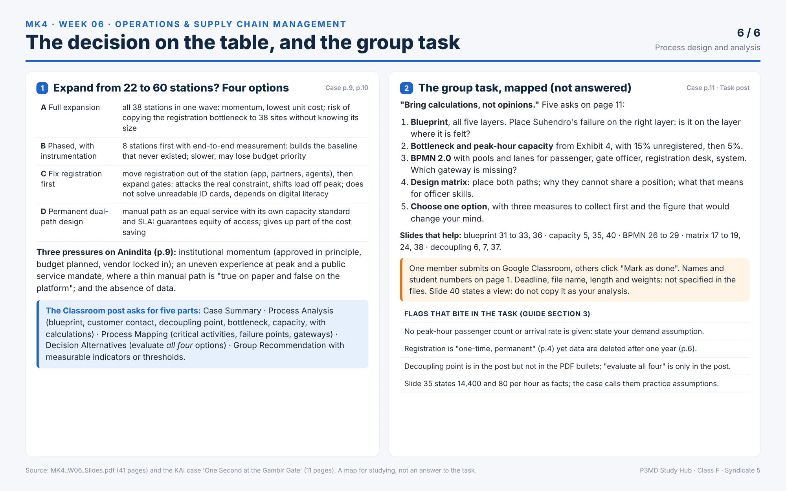

> [!NOTE] Purpose & Scope
> This diagnostic set tests operational calculation rigor, layout trade-offs, service blueprinting anatomy, BPMN notation standards, and real-world case diagnosis.
> **Related Notes:** [[courses/mk4-operations-supply-chain-management/week-06/index|Process Design & Analysis (Lecture)]] · [[courses/mk4-operations-supply-chain-management/week-06/case-kai-gambir-gate|KAI Gambir Gate Case Analysis]] · [[courses/mk4-operations-supply-chain-management/week-06/assignment-brief|Assignment Brief]]

---

## Synthesis Map & Conceptual Framework

---

## Diagnostic Questions & Full Mathematical Solutions

1. Use slide 12's numbers. Which way of getting the part is cheapest at 1,000 units, and what are the two break-even points?
2. Dell makes 17 components yield 384 configurations. What does the decoupling-point logic say to forecast, and why does moving the point closer to the customer cost more?
3. What happens to process efficiency and sales opportunity as customer contact rises, and which worker skills shift?
4. Name the five layers and the three lines of a service blueprint.
5. What is the difference between an exclusive and a parallel gateway, and between sequence flow and message flow?
6. What is a poka-yoke, and what are the Three Ts?
7. When would you reach for a service blueprint and when for BPMN?
8. Name two things the KAI case says KAI does not measure.

**Answer key**

1. The semiautomatic lathe. 1,000 is between 640 and 2,000 units. Point B is 640 units (80,000 / 125) and point A is 2,000 units (120,000 / 60). Below 640 buy; above 2,000 the machining centre wins. Slides 12 and 13.
2. Forecast the 17 components, not the 384 configurations. Closer to the customer means a quicker response but more expensive inventory, because finished goods carry both material and conversion cost. Slide 6.
3. Efficiency falls (High, Moderate, Low) and sales opportunity rises (Low, Moderate, High). Skills shift from clerical to verbal and procedural to diagnostic and trade. Slides 18 and 19.
4. Layers: Evidence, Customer journey, Frontstage, Backstage, Support processes. Lines: line of interaction, line of visibility, line of internal interaction. Slide 31.
5. Exclusive: exactly one outgoing branch. Parallel: all outgoing branches at once, and it waits for all incoming ones. Sequence flow stays inside a pool; message flow crosses pools. Slides 26 and 28.
6. A procedure that blocks a mistake from becoming a service defect, often failing-safe the customer as well as the worker. The Three Ts: Task, Treatment, Tangibles. Slide 22.
7. Blueprint: the customer's emotion is part of the outcome, a poor experience rather than a slow one, or the fix might be evidence rather than sequence. BPMN: the process crosses departments, exception paths matter, you need to hand the model to a system, or the question is where handoffs break. Slide 33.
8. Any two of: how long people stand before reaching the gate; how many registration attempts fail because an ID card will not scan; what proportion of face scans fall back to manual inspection; the total time from station entrance to platform for an unregistered passenger. Case page 9.

Reading mode: ELI5 and dosen boxes hidden &middot; R

---

---

## Analytical Formulas Reference Card

### 1. Equipment Choice Break-Even Volume

$$\text{Total Cost} = \text{Fixed Cost} + (\text{Variable Cost per Unit} \times Q)$$

When choosing between two process options $A$ and $B$:
$$Q^* = \frac{\text{Fixed Cost}_B - \text{Fixed Cost}_A}{\text{Variable Cost}_A - \text{Variable Cost}_B}$$

### 2. Little's Law (WIP, Throughput, and Cycle Time)

$$\text{Work-in-Process (WIP)} = \text{Throughput Rate } (\lambda) \times \text{Flow Time } (W)$$

### 3. Process Utilization

$$\text{Utilization } (\rho) = \frac{\text{Actual Output or Demand Rate}}{\text{Design Capacity}} = \frac{\lambda}{\mu}$$
