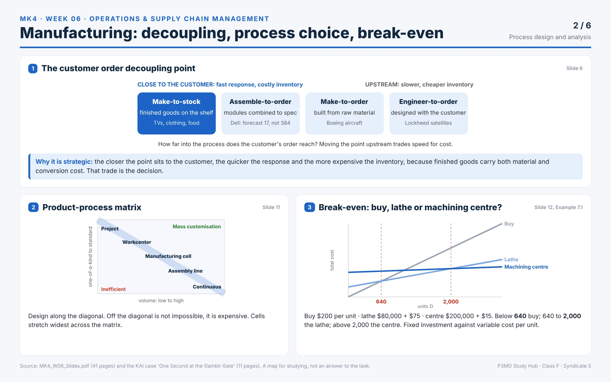
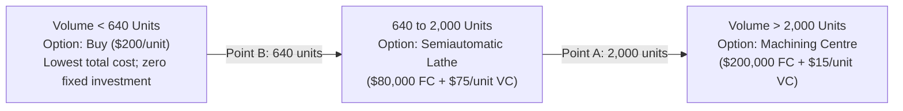
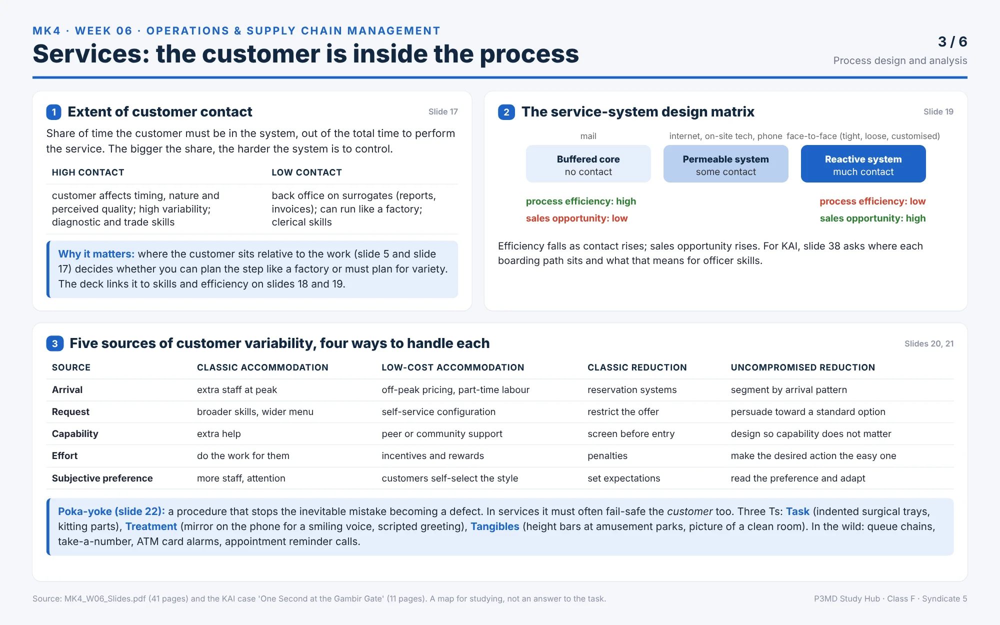
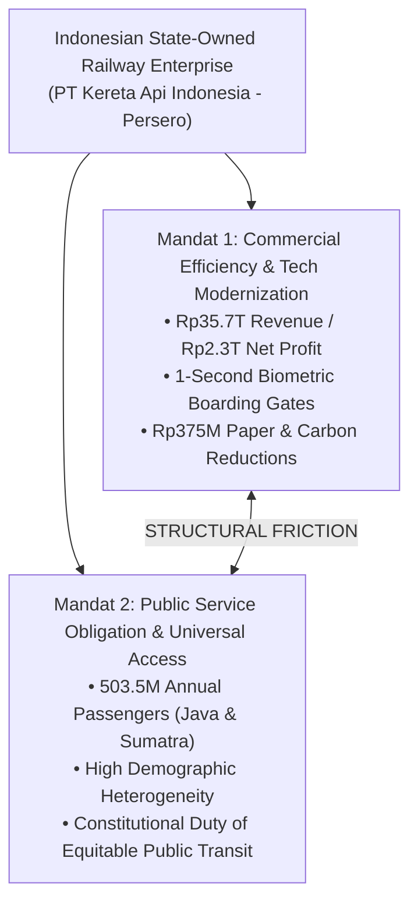
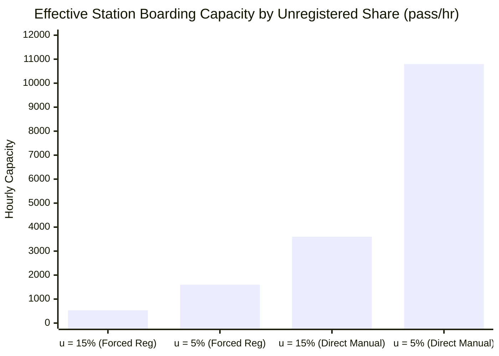

```mermaid
flowchart LR
    subgraph Foundation["Pillar 1: Operational Foundations"]
        direction TB
        DP["[[concepts/customer-order-decoupling-point|Customer Order Decoupling Point (CODP)]]<br/>(MTS vs. ATO vs. MTO vs. ETO)"]
        BE["Break-Even Equipment Analysis<br/>(Fixed Investment vs. Variable Unit Cost)"]
        PPM["Product-Process Matrix<br/>(5 Layouts: Project, Workcenter, Cell, Line, Continuous)"]
    end

    subgraph ServiceArch["Pillar 2: Service Architecture & Variability"]
        direction TB
        CC["Customer Contact Continuum<br/>(Buffered Core vs. Permeable vs. Reactive)"]
        SM["[[concepts/service-system-design-matrix|Service-System Design Matrix]]<br/>(Efficiency vs. Sales Opportunity vs. Worker Skill)"]
        VAR["[[concepts/customer-introduced-variability|Customer-Introduced Variability]]<br/>(5 Types & 4 Accommodation Strategies)"]
        POKA["Service Poka-Yokes<br/>(The 3 Ts: Task, Treatment, Tangibles)"]
    end

    subgraph Toolkits["Pillar 3: Process Modeling & Mathematics"]
        direction TB
        BP["[[concepts/service-blueprinting|Service Blueprinting]]<br/>(5 Layers, 3 Boundaries, Moment-of-Truth Auditing)"]
        BPMN["BPMN 2.0 Executable Notation<br/>(Pools, Lanes, Message Flows, Gateways)"]
        LL["[[concepts/littles-law|Little's Law: L = λW]]<br/>(WIP = Throughput Rate × Flow Time)"]
    end

    Foundation --> ServiceArch --> Toolkits
```

## 🎯 Act 1: The Executive Dilemma — The One-Second Fallacy & The Local Optimization Trap

In corporate boardrooms and digital transformation task forces, leaders routinely fall victim to the **Speed Illusion**: the seductive belief that automating a single high-visibility touchpoint accelerates the entire enterprise.

We invest billions in sub-second optical scanners, mobile self-service apps, and robotic workstations. We celebrate triumphant dashboards showing that a single activity now executes in **one second flat**. Yet on the frontlines, customer queues swell, complaints on social media multiply, and throughput grinds to an inexplicable halt.

```
       [ THE LOCAL OPTIMIZATION FALLACY ]
  Upstream Bottleneck           "Accelerated" Gate           Downstream Exit
 ┌───────────────────┐        ┌───────────────────┐        ┌─────────────────┐
 │ CS Desk / Enroll  │───────►│  Turnstile Camera │───────►│ Train Platform  │
 │   80 pass/hour    │        │  14,400 pass/hour │        │                 │
 └───────────────────┘        └───────────────────┘        └─────────────────┘
           ▲                            ▲
   THE SYSTEM CONSTRAINT       IRRELEVANT OVERCAPACITY
```

| The Technology Dashboard Assumption                                                                                                                        | The Systemic Operational Reality                                                                                                                                                                                                        |
| :--------------------------------------------------------------------------------------------------------------------------------------------------------- | :-------------------------------------------------------------------------------------------------------------------------------------------------------------------------------------------------------------------------------------- |
| **Local Velocity Maximization**: "Our biometric gate completes identity and ticket verification in ±1 second. We have solved station boarding congestion." | **Global Bottleneck Subjugation**: Total throughput is dictated strictly by the slowest resource in the chain. An 80-passenger/hour upstream registration desk caps total flow, rendering 14,400/hour gate speed completely irrelevant. |
| **Supply-Side Metric Blindness**: Measuring and celebrating the millions who pass through smoothly without recording those held up or turned away.         | **The Unmeasured Survivor Bias**: Every corporate metric measures the survivor who reached the platform; zero metrics record the elderly traveler stuck at customer service at 6:00 AM.                                                 |

> [!CAUTION] The Core Law of Process Design
> **A process can never run faster than its bottleneck.**
> Accelerating a non-bottleneck activity does not increase system throughput; it merely accelerates the rate at which Work-in-Process ($WIP$) piles up in front of the actual constraint or creates costly idle capacity.

In enterprise management—particularly across capital-intensive Indonesian state-owned enterprises (BUMN) managing millions of daily customer interactions—process design is not a narrow engineering exercise. It is a **strategic resource allocation decision** that dictates operating costs, capital expenditure payback, and public service equity.

---

## 🧭 Act 2: Theoretical Mechanism — Process Architectures, Analytical Toolkits & Little's Law

### 0. Essential Operations Vocabulary & Concept Lexicon

Before analyzing complex flows, operations managers must master the precise distinctions between process architectures, decoupling points, and variability controls:

| Term                          | Operational Definition & System Role                                                                                                                | Course & Slide Anchor |
| :---------------------------- | :-------------------------------------------------------------------------------------------------------------------------------------------------- | :-------------------- |
| **Process**                   | Conversion of inputs into outputs. In services, the customer is co-present inside the system during execution.                                      | Slide 5               |
| **Process Selection**         | Strategic matching of production layout to market demand; driven strictly by volume and standardization, not managerial whim.                       | Slides 8–11           |
| **Capacity & Bottleneck**     | Maximum throughput per unit of time. System capacity is dictated by the slowest resource (bottleneck), never the fastest.                           | Slides 5, 40          |
| **Decoupling Point (CODP)**   | The point in the supply chain where inventory is held to buffer upstream production from downstream customer demand.                                | Slide 6               |
| **Make-to-Stock (MTS)**       | Finished goods inventory buffers demand. Lowest response time; highest inventory holding cost.                                                      | Slide 6               |
| **Assemble-to-Order (ATO)**   | Standardized subassemblies combined on demand (e.g., Dell 17 components -> 384 configurations).                                                     | Slide 6               |
| **Product-Process Matrix**    | Framework aligning layout structures (Project, Workcenter, Cell, Assembly Line, Continuous) along the diagonal of volume vs. variety.               | Slide 11              |
| **Break-Even Volume ($Q^*$)** | The exact production volume where the total cost of two equipment options equalizes: $Q^* = \frac{\Delta \text{FC}}{\Delta \text{VC}}$.             | Slides 12–13          |
| **Customer Contact**          | Percentage of service creation time the customer must be physically or digitally in the system. High contact increases variability.                 | Slides 17–19          |
| **Service-System Matrix**     | Balances customer contact (buffered core vs. reactive system) against sales opportunity and production efficiency.                                  | Slide 19              |
| **Poka-Yoke (Fail-Safing)**   | Mechanisms blocking human errors from becoming defects across the **Three Ts: Task, Treatment, and Tangibles**.                                     | Slide 22              |
| **BPMN 2.0**                  | Executable OMG standard process modeling notation distinguishing Pools (participants), Lanes (roles), and Gateways.                                 | Slides 25–29          |
| **Service Blueprint**         | Customer-experience mapping tool featuring 5 layers separated by the **Line of Interaction, Line of Visibility, and Line of Internal Interaction**. | Slides 30–33          |
| **Perishable Capacity**       | Service capacity that expires instantaneously if unutilized (e.g., an empty seat on a departing train).                                             | Slide 5               |
| **Uncompromised Reduction**   | Accommodating customer variability without degrading service quality by engineering smarter procedures and self-service routing.                    | Slide 21              |

Process design defines how an organization converts inputs into finished goods or service experiences. The operational distinction between manufacturing and services is not merely physical vs. intangible—it is **where the customer sits relative to the work**:

$$
\begin{aligned}
\mathbf{\text{Manufacturing}} &\implies \text{Customer is outside the factory; inventory buffers demand mismatches.} \\
\mathbf{\text{Services}} &\implies \text{Customer is inside the system; capacity is perishable and cannot be stored.}
\end{aligned}
$$



---

### 1. The Customer Order Decoupling Point (CODP)

The **[[concepts/customer-order-decoupling-point|Customer Order Decoupling Point]]** determines how deeply a customer's order penetrates into the production system before work begins (Jacobs & Chase, Chapter 7):

1. **Make-to-Stock (MTS)**: Finished goods stored on forecast (e.g., packaged foods, consumer electronics). Fast delivery, high inventory holding cost.
2. **Assemble-to-Order (ATO)**: Subassemblies built to forecast and assembled upon order receipt (e.g., Dell PC modular assembly: 17 base components generate 384 configurations).
3. **Make-to-Order (MTO)**: Production begins from raw material inventory upon order receipt (e.g., Boeing commercial aircraft).
4. **Engineer-to-Order (ETO)**: Engineering design and fabrication executed jointly with the client (e.g., Lockheed Martin satellites, civil infrastructure).

```
Supplier ────► Raw Materials ────► Work in Process ────► Finished Goods ────► Customer
  [ETO]           [MTO]                 [ATO]                  [MTS]
```

> [!NOTE] The Informational Decoupling Point in Service Operations
> Because service capacity is perishable, organizations decouple service processes using **informational buffers**:
> $$\mathbf{\text{Asynchronous Biometric Enrollment}} \longrightarrow [\text{Verified Database Record}] \longrightarrow \mathbf{\text{Real-Time High-Speed Verification}}$$
> When registration is completed off-site in advance, downstream verification operates as a standardized, sub-second transaction. When registration is delayed to departure day, the buffer vanishes, forcing variable manual tasks into peak station queues.

---



> [!TIP] **ELI5 (Explain Like I'm 5): Decoupling Point**
> Think of ordering food: In a buffet (MTS), food is ready before you arrive. At Subway (ATO), vegetables and bread are pre-chopped, and you assemble your sandwich in 2 minutes. At a fine-dining steakhouse (MTO), raw meat is grilled after you order. The closer food sits to your mouth, the faster you eat, but the more wasted food the restaurant risks!

> [!NOTE] **Lecturer Cold-Call & Answer Strategy**
> **Q:** Dell offers 384 configurations from just 17 modular parts. What should Dell forecast, and why does shifting the decoupling point downstream increase cost?
> **A:** Dell forecasts the 17 parts, _never_ the 384 finished configurations. Moving the decoupling point downstream (closer to customer delivery) increases working capital and inventory write-down risk because finished PCs carry accumulated labor and component conversion costs.

### 2. Manufacturing Layout Structures & The Product-Process Matrix

Jacobs & Chase classify production facilities into five progressive layout formats:

| Layout Format                | Workflow Pattern                                                                       | Product Variety          | Production Volume | Equipment Type                | Classic Industry Example                                             |
| :--------------------------- | :------------------------------------------------------------------------------------- | :----------------------- | :---------------- | :---------------------------- | :------------------------------------------------------------------- |
| **1. Project Layout**        | Product remains fixed in a central hub; workers, tools, and equipment move to it.      | Extreme (one-of-a-kind)  | Very low          | General purpose, mobile       | Construction sites, commercial shipbuilding, movie shooting lots.    |
| **2. Workcenter (Job Shop)** | Similar equipment grouped together (all drilling in one bay, all stamping in another). | High variety             | Low volume        | General purpose               | Custom machine shops, hospital specialty departments.                |
| **3. Manufacturing Cell**    | Dissimilar machines grouped into dedicated U-shaped clusters for a family of parts.    | Moderate variety         | Moderate volume   | Specialized tooling           | Metal fabrication, aerospace components, computer chip assembly.     |
| **4. Assembly Line**         | Workstations arranged sequentially along a paced, progressive assembly track.          | Low variety              | High volume       | Dedicated, automated          | Automobile assembly (Toyota, Hyundai), consumer electronics.         |
| **5. Continuous Process**    | Highly automated, non-discrete chemical or fluid flow running 24/7.                    | Zero variety (commodity) | Very high         | Capital-intensive, monolithic | Petroleum refineries (Pertamina), chemical processing, power plants. |

The **Product-Process Matrix** maps volume against standardization: optimal operational economics occur along the **diagonal**. Operating off-diagonal introduces severe economic penalties: top-right represents costly under-standardization, while bottom-left represents inflexible, over-capitalized machinery for low-volume demand.

---

### 3. Equipment Break-Even Analysis

When evaluating whether to buy parts or invest in capital equipment, operations leaders model the intersection of **fixed capital investment ($FC$)** and **variable operating cost per unit ($VC$)**:

$$\mathbf{\text{Total Cost } (TC) = FC + (VC \times D)}$$



- **Point B (640 units)**: Semiautomatic lathe breaks even with Buy:
  $$\frac{\$80,000}{\$200 - \$75} = 640 \text{ units}$$
- **Point A (2,000 units)**: Machining centre breaks even with Semiautomatic lathe:
  $$\frac{\$200,000 - \$80,000}{\$75 - \$15} = \frac{\$120,000}{\$60} = 2,000 \text{ units}$$

---

> [!TIP] **ELI5 (Explain Like I'm 5): Break-Even Equipment Choice**
> If you make 10 custom cakes a year, buy a cheap hand whisk. If you make 10,000 cakes, buy an industrial automated mixing vat. The vat has a painful upfront fixed cost, but each cake costs pennies to mix. The break-even volume is the exact number of cakes where the expensive machine pays for itself!

> [!NOTE] **Lecturer Cold-Call & Answer Strategy**
> **Q:** Using standard equipment cost parameters (e.g. Slide 12), which machine is cheapest at 1,000 units, and what are the two break-even threshold points?
> **A:** The semiautomatic lathe is cheapest at 1,000 units. The two break-even inflection points are $Q_B = 640$ units ($\frac{80,000}{125}$, buy vs. semiautomatic lathe) and $Q_A = 2,000$ units ($\frac{120,000}{60}$, semiautomatic lathe vs. machining center). Below 640 buy externally; above 2,000 use the machining center.

### 4. Customer Contact & The Service-System Design Matrix

Developed by **[[entities/richard-b-chase|Richard B. Chase]]**, the **[[concepts/service-system-design-matrix|Service-System Design Matrix]]** demonstrates that the degree of customer contact dictates operating efficiency:

```
Efficiency High ◄───────────────────────────────────────────────► Efficiency Low
[Buffered Core]                 [Permeable System]               [Reactive System]
- Mail / Kiosk / Automated Gate - Phone / Face-to-Face Tight    - Face-to-Face Loose / Custom
- Low contact, clerical/system  - Moderate contact, procedural   - High contact, diagnostic
```

As customer contact increases:

1. **Operating Efficiency Decreases**: Customer presence introduces friction, pacing disruption, and variability.
2. **Sales & Customization Opportunity Increases**: Personal interaction enables relationship building and cross-selling.
3. **Worker Skill Requirements Escalate**: Roles evolve from **clerical/system maintenance** to **procedural adherence**, and finally to **diagnostic empathy and judgment**.

---

### 5. Managing Customer-Introduced Variability & Service Poka-Yokes

According to **Frances X. Frei**, customers inject five types of variability into service encounters:

1. **Arrival Variability**: Customers do not arrive at uniform intervals (peak surges vs. off-peak troughs).
2. **Request Variability**: Customers ask for customized permutations.
3. **Capability Variability**: Customers differ in digital literacy, physical capability, and understanding of procedures.
4. **Effort Variability**: Customers exert differing amounts of energy (e.g., forgetting ID cards).
5. **Subjective Preference**: Customers interpret identical service acts differently.

To handle variability without ballooning costs, organizations apply **Uncompromised Reduction**: re-engineering procedures so variability causes no harm (e.g., pre-populating digital ticket forms, biometric auto-enrollment).

Furthermore, service systems deploy **Service Poka-Yokes (The Three Ts)**:

- **The Task**: Failsafing work steps (e.g., indented surgical trays, mandatory document attachments in CRM).
- **The Treatment**: Failsafing interpersonal interaction (e.g., scripted greetings, eye-contact mirrors).
- **The Tangibles**: Failsafing physical evidence (e.g., height bars at amusement parks, queue guidance turnstiles).

---



### 6. Process Modeling: BPMN 2.0 vs. Service Blueprinting

| Analytical Dimension   | BPMN 2.0 Process Model                                                                      | Service Blueprint                                                                                 |
| :--------------------- | :------------------------------------------------------------------------------------------ | :------------------------------------------------------------------------------------------------ |
| **Primary Focus**      | Logic flow, handoffs, execution triggers, data objects, and system interfaces.              | Customer journey, emotional touchpoints, visible vs. invisible operational layers.                |
| **Organizational Use** | Best when handoffs cross departments or systems, and when the model must be executed by IT. | Best when diagnosing customer experience failures, service recovery, and frontstage empathy.      |
| **Boundary Notation**  | **Pools** (organizations/participants) and **Lanes** (roles/internal departments).          | **5 Horizontal Layers** separated by **3 Lines** (Interaction, Visibility, Internal Interaction). |
| **Exception Logic**    | Explicit gateways (Exclusive XOR, Parallel AND, Inclusive OR) and boundary events.          | Highlighted fail-points and recovery loops across frontstage/backstage swimlanes.                 |

---

### 7. Little's Law: The Mathematical Anchor of Process Analysis

Proven by **John D. C. Little** (1961), **[[concepts/littles-law|Little's Law]]** states that for any stationary operational system:

$$\mathbf{L = \lambda \times W} \quad \iff \quad \mathbf{WIP = \text{Throughput Rate} \times \text{Flow Time}}$$

Where:

- $\mathbf{L}$ ($WIP$): Average number of items, cases, or passengers inside the system or waiting buffer.
- $\mathbf{\lambda}$ ($R$): Long-term average arrival rate or processing throughput rate.
- $\mathbf{W}$ ($T$): Average time a unit spends inside the system (Flow Time / Cycle Time).

Rearranging for Flow Time demonstrates the operational danger of large queues:
$$\mathbf{W = \frac{L}{\lambda}}$$
If an on-site customer service desk completes $\lambda = 80 \text{ registrations/hour}$ ($1.33/\text{min}$), a queue of $L = 60 \text{ passengers}$ creates an average waiting time of:
$$\mathbf{W = \frac{60}{1.33} = 45 \text{ minutes!}}$$
No automated 1-second gate downstream can save a passenger who spent 45 minutes standing in the registration queue.

---

## 🏢 Act 3: Managerial Crucible — Indonesian BUMN & PT Kereta Api Indonesia (Persero)

Applying process design to Indonesian state-owned enterprises introduces severe institutional complexity:



### 1. The Scale of PT Kereta Api Indonesia (Persero)

Serving **503.5 million customers** annually across Java and Sumatra with **2.8 million daily customer touchpoints**, KAI’s operational margins are unforgiving. While commuter rail runs on generic tap-in cards, long-distance intercity rail requires mandatory legal matching between ticket records and passenger identity cards.

### 2. The November 2023 Bandung Station Controversy

At Bandung Station, frontline staff attempted to forcibly migrate travelers to Face Recognition gates, threatening unregistered passengers with late platform access (10 minutes before departure). The resulting viral outcry on social media (**X thread by Fachrial Kautsar: 25.3k likes, 5.8k retorts**) demonstrated the explosive danger of treating customer service registration as an afterthought.

### 3. Capability Variability & Demographic Realities

During national holiday peaks (Eid al-Fitr homecoming / _Mudik Lebaran_, Christmas, long weekends), KAI's passenger demographics change radically. Infrequent travelers, elderly rural citizens traveling to visit grandchildren, and citizens with worn or unreadable **e-KTP** microchips flood the stations. Forcing these passengers into digital self-service gates without an accessible, capacity-protected manual alternative violates the core **AKHLAK** ethical framework governing Indonesian BUMNs.

---

## 📝 Act 4: Group Discussion Debrief & Pre-Assignment Synthesis

During the Meeting 6 seminar, student consulting teams evaluated the **"One Second at the Gambir Gate"** case across four core operational questions:

### Q1: Blueprint Layer Analysis & Failure Containment

- **Where the failure sits**: Root causes sit **below the line of visibility** in **Support Processes** (uncalibrated e-KTP hardware readers, unmeasured CS staffing models, absence of queue routing logic) and **Backstage Contact** (ticketing API latency).
- **Where the pain is felt**: Felt **above the line of visibility at the line of interaction** within the **Customer Journey** (40-minute wait, repeated card errors, departure panic).
- **Does a 1-second gate touch that layer?**: **No.** It optimizes downstream verification ($14,400/\text{hr}$) while leaving the upstream support constraint ($80/\text{hr}$) completely unaddressed.

---

### Q2: Bottleneck Calculations & Effective Capacity

Using **Exhibit 4** pedagogical parameters:

- $C_{FR} = 4 \times \frac{3,600}{1} = \mathbf{14,400 \text{ pass/hr}}$
- $C_{\text{manual}} = 3 \times \frac{3,600}{20} = \mathbf{540 \text{ pass/hr}}$
- $C_{\text{reg}}^{\text{theor}} = 2 \times \frac{3,600}{10} = \mathbf{720 \text{ pass/hr}}$
- $C_{\text{reg}}^{\text{realistic}} \approx \mathbf{80 \text{ pass/hr}}$ (11.1% of theoretical due to 90s realistic customer interaction time).



1. **Effective Capacity at 15% Unregistered ($u = 0.15$)**:
   $$\mathbf{Q \le \frac{80}{0.15} \approx 533 \text{ passengers/hour}}$$
2. **Effective Capacity at 5% Unregistered ($u = 0.05$)**:
   $$\mathbf{Q \le \frac{80}{0.05} = 1,600 \text{ passengers/hour}}$$
3. **Managerial Leverage**: Reducing on-site registration demand by 10 percentage points **triples effective station capacity ($3.0\times$) without purchasing a single new gate.**
4. **Parallel Routing Alternative**: If unregistered passengers bypass registration and proceed directly to the 3 manual lanes, capacity jumps to **3,600 pass/hr at 15%** and **10,800 pass/hr at 5%**.

---

### Q3: BPMN Missing Gateway & Dual-Path Design

1. **The Missing Exclusive Gateway**: The current process lacks an early **XOR decision node** (_"Is passenger FR-ready?"_). Unregistered passengers must be granted an explicit, dignified choice between optional registration and direct manual boarding.
2. **Service-System Design Matrix**: The biometric gate is a **Buffered Core** (low contact, automated); the manual lane is a **Permeable System** (moderate contact, active verification); the CS desk is a **Reactive System** (high contact, diagnostic).
3. **The Staffing Insight**: Automated gates filter out standard passengers, concentrating difficult exceptions in the manual lane. Therefore, **manual lanes require higher diagnostic and verbal skills**, and cannot be staffed with residual, low-morale headcount.

---

### Q4: Strategic Recommendation & Governance Metrics

The cohort recommends **Option B: Phased Expansion with Instrumentation (8 pilot stations)** governed by two design conditions:

1. **Upstream Registration Migration (Option C Logic)**: Moving registration into the mobile app and ticket checkout flow.
2. **Capacity-Protected Manual Service Standard (Option D Logic)**: Enforcing a permanent manual capacity standard with dedicated staffing.

#### The Three Governance Measures:

1. **Peak Registration Demand-to-Capacity Ratio**:
   $$\mathbf{R_{\text{reg}} = \frac{u_{\text{peak}} \times \lambda_{\text{peak}}}{C_{\text{reg}}^{\text{observed}}} \le 0.80}$$
2. **Observed Effective Registration Capacity ($C_{\text{reg}}^{\text{observed}}$)**: Measured completions per staffed hour under live peak conditions.
3. **Face-Recognition-to-Manual Fallback Load**:
   $$\mathbf{L_{\text{fallback}} = f_{FR \to M} \times \lambda_{FR}}$$

#### Falsifiable Change-My-Mind Rule:

- **Accelerate to Full Expansion (Option A)**: If pilot data shows $R_{\text{reg}} \le 0.80$ and fallback rates remain $<3\%$ across consecutive holiday peaks.
- **Halt Expansion & Reallocate Capital (Options C & D)**: If $R_{\text{reg}} \ge 1.0$ or manual load exceeds 432 passengers/hour (80% of manual capacity).

---

## 📚 Required Readings & In-Depth Satellites

- [[courses/mk4-operations-supply-chain-management/week-06/assignment-brief|MK4 W06 Assignment Brief: PT KAI Gambir Gate]] — Complete 9-part field-based case study guide, skim map, metric inventory, and submission quality control checklist.
- [[courses/mk4-operations-supply-chain-management/week-06/diagnostic-questions|MK4 W06 Diagnostic Problem Sets]] — 8 comprehensive exam problems with step-by-step mathematical break-even solutions, Dell inventory decoupling analysis, and KAI unmeasured metric audits.
- [[courses/mk4-operations-supply-chain-management/week-06/case-kai-gambir-gate|Case Study: PT Kereta Api Indonesia (Persero) — One Second at the Gambir Gate]] — Deep-dive Harvard/ITB style case analysis covering biometric gate deployment, queuing trade-offs, and BUMN governance.

## 📂 Primary Source Media & Digital Archives

- `raw/courses/mk4/week-06/MK4_W06_Pre-Assignment_Task.txt` — Official Google Classroom announcement and group submission instructions.
- `raw/courses/mk4/week-06/MK4_W06_SafetyScan.txt` — Complete security, invisible text, and steganographic integrity scan report.
- `raw/courses/mk4/week-06/MK4_W06_Prompt_Case.txt` — AI prompting architecture for case analysis mapping.
- `raw/courses/mk4/week-06/MK4_W06_Prompt_Materi.txt` — AI prompting architecture for lecture slide deconstruction.
- `content/courses/mk4-operations-supply-chain-management/week-06/assets/` — 6 high-resolution infographic posters (Case Summary, Process Analysis, Process Mapping, Decision Alternatives, Recommendation Matrix, Synthesis Map).

## 🔗 Knowledge Graph & Curriculum Bridges

- **Dedicated Case Study Satellite**:
  - [[courses/mk4-operations-supply-chain-management/week-06/case-kai-gambir-gate|Case Study: PT Kereta Api Indonesia (Persero) — One Second at the Gambir Gate]]
- **Featured Frameworks in Knowledge Matrix**:
  - [[concepts/service-blueprinting|Service Blueprinting (5 Layers, 3 Boundaries, Failure Causal Analysis)]]
  - [[concepts/customer-order-decoupling-point|Customer Order Decoupling Point (MTS, ATO, MTO, ETO & Informational Buffers)]]
  - [[concepts/service-system-design-matrix|Service-System Design Matrix (Chase Contact Continuum)]]
  - [[concepts/customer-introduced-variability|Customer-Introduced Variability (Frei 5 Types & 4 Accommodation Strategies)]]
  - [[concepts/littles-law|Little's Law (WIP = Throughput Rate × Flow Time)]]
- **Theorist & Enterprise Profiles**:
  - [[entities/pt-kereta-api-indonesia|PT Kereta Api Indonesia (Persero)]]
  - [[entities/richard-b-chase|Richard B. Chase]]
- **Next Curricular Module**: Week 07: Waiting Line Analysis, Discrete Event Simulation & OSCM Gamification _(Scheduled / Ingestion Pending)_
- Return to **[[courses/mk4-operations-supply-chain-management/index|MK 4 Course Overview]]**
