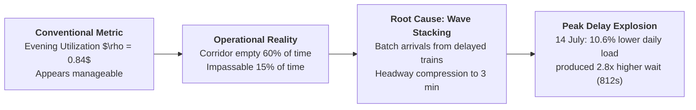
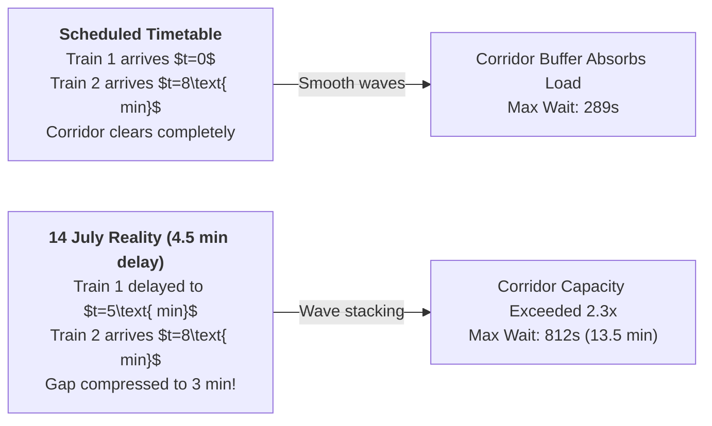
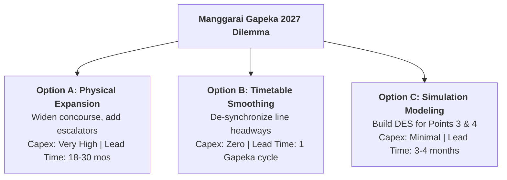
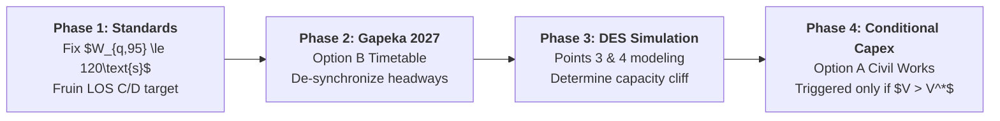

> [!NOTE] Cohort Attribution & Context
> **Authoring Syndicate:** Prepared by **F9 (Class F / Syndicate 9)**, Master of Business Administration, School of Business and Management, Institut Teknologi Bandung (SBM ITB), October 2026.  
> **Course:** MK4 Operations and Supply Chain Management — Week 07: Waiting Line Analysis and Simulation.  
> **Parent Lecture Hub:** [[courses/mk4-operations-supply-chain-management/week-07/index|Week 07: Waiting Line Analysis, Simulation & The Manggarai Junction Dilemma]]  
> **Primary Case Reference:** [[courses/mk4-operations-supply-chain-management/week-07/case-kai-commuter-manggarai|The Queue at the Largest Junction: KAI Commuter and Manggarai Station (SBM-OSCM-07-2026)]]  
> **Foundational Concept:** [[concepts/queuing-theory|Queuing Theory and Waiting Line Analysis]] & [[entities/pt-kereta-api-indonesia|PT Kereta Api Indonesia (Persero) / KAI Commuter]]

---

## 1. Executive Summary & Problem Framing

PT Kereta Commuter Indonesia (**KAI Commuter**) faces an operational crisis at **Manggarai Junction Station**, Indonesia's largest rail transit hub handling 162,000 daily passenger movements and 57.67 million annual transit commuters. Operations Planning Manager Rangga Wicaksana must submit a binding capacity recommendation for the **Gapeka 2027** timetable cycle to the Directorate General of Railways (DGR) and KAI executive leadership within three weeks.

The operational dilemma stems from a counterintuitive phenomenon: **average utilization during the evening peak (17:00–19:00) is only 0.84 ($\rho = 84\%$), yet the central transfer corridor remains completely impassable ($15\%$ of peak time) and queues explode.**

### Syndicate 9 Core Recommendation (Staged Roadmap)

1. **Immediate Execution (Gapeka 2027 Timetable):** Adopt **Option B (Arrival Smoothing)**. De-synchronize Bogor and Cikarang berthing headways, enforce upstream punctuality, and institute scheduled (rather than reactive) stop-and-go metering.
2. **Parallel Engineering:** Commission a tightly scoped **Discrete-Event Simulation (Option C)** focused strictly on stairwells, escalators, and platform boarding (Points 3 and 4) within 3–4 months.
3. **Capital Budgeting (Conditional Option A):** Place physical expansion (Option A: wider concourses, additional escalators) as a conditional capital line in the next budget cycle, to be released only if DES modeling proves Option B cannot absorb projected 2030 volumes (437 million network passengers).

---

## 2. Process Analysis: The Four Queuing Points in Series

Manggarai operates as a multi-stage queuing network where four distinct physical processing points experience vastly different arrival patterns, service mechanics, and bottlenecks:

| Point       | Physical Stage                              | Queuing Structure                        | Service Characteristics                                         | Peak Utilization                                              | Analytical Applicability                                                        |
| :---------- | :------------------------------------------ | :--------------------------------------- | :-------------------------------------------------------------- | :------------------------------------------------------------ | :------------------------------------------------------------------------------ |
| **Point 1** | **Tap-in / Tap-out Gates**                  | Multichannel, queue per gate ($M/D/k$)   | Deterministic constant ($\approx 2.5\text{ sec/pax}$)           | Moderate                                                      | Closed-form Model 2 ($M/D/1$ / $M/D/k$). Not a systemic bottleneck.             |
| **Point 2** | **Ticket Counters & Vending (TVM)**         | Multichannel, single queue ($M/M/s$)     | Exponential distribution ($\mu$ varies with cash/card friction) | Low to Moderate                                               | Closed-form Model 3 ($M/M/s$). Handled by portable TVMs during surges.          |
| **Point 3** | **Transfer Concourse, Stairs & Escalators** | Bidirectional continuous pedestrian flow | Flow capacity constrained ($\approx 240\text{ pax/min}$)        | **Severe / Critical ($\rho = 0.84$, surges $2.3\times \mu$)** | Closed-form models fail. Governed by **Kingman's VUT approximation**.           |
| **Point 4** | **Platform Waiting & Boarding**             | Batch arrival, batch departure           | Deterministic batch capacity ($c = 1,800\text{ pax/train}$)     | **Critical (Headway dependent)**                              | Closed-form models fail entirely. Requires **Discrete-Event Simulation (DES)**. |

> [!IMPORTANT] Diagnostic Finding
> Points 1 and 2 represent gate-line traffic ($\approx 16,000$ daily entries/exits) and are easily resolved via standard turnstiles. **Points 3 and 4 represent transit passengers ($\approx 146,000$ daily internal transfers)** who never cross a gate line. The crisis exists entirely between the stairs/escalators and the platform edge.

---

## 3. The 0.84 Utilization Paradox & Mathematical Proof

### 3.1 Failure of the Classical $M/M/1$ Formulation

Treating the central transfer corridor as an aggregate single server with mean capacity $\mu \approx 242\text{ passengers/minute}$ ($203 / 0.84$) yields catastrophic underestimations when modeled using standard Poisson arrival assumptions:

$$P(W_q > t) = \rho e^{-(\mu - \lambda)t}$$

$$\text{Mean } W_q = \frac{\rho}{\mu(1 - \rho)} = \frac{0.84}{242(1 - 0.84)} \approx 0.0215\text{ min} \approx \mathbf{1.3\text{ seconds}}$$

$$\text{Median } W_q = \frac{\ln(2\rho)}{\mu - \lambda} \approx \mathbf{0.8\text{ seconds}} \qquad\qquad \text{95th Percentile } W_q \approx \mathbf{4.4\text{ seconds}}$$

#### Comparison: $M/M/1$ Model vs. Empirical Field Observations (Exhibit 3)

| Metric (17:00–19:00 Window)                  | Classical $M/M/1$ Prediction  | Observed Reality (Exhibit 3)   | Variance Discrepancy                 |
| :------------------------------------------- | :---------------------------- | :----------------------------- | :----------------------------------- |
| **Median Waiting Time ($W_{q,\text{med}}$)** | $0.8\text{ seconds}$          | **$51\text{ seconds}$**        | **$63.8\times$ higher**              |
| **95th Percentile Wait ($W_{q,95}$)**        | $4.4\text{ seconds}$          | **$210\text{ seconds}$**       | **$47.7\times$ higher**              |
| **P95 / Median Ratio**                       | $5.4$                         | $4.1$                          | Comparable dispersion                |
| **Peak 30-Second Arrival Rate**              | $203\text{ pax/min}$ (steady) | **$410 - 545\text{ pax/min}$** | **$1.7\times - 2.3\times$ capacity** |

### 3.2 Kingman's VUT Approximation & Arrival Variance Extraction

The fact that empirical waiting times are $\approx 60\times$ higher than Poisson predictions proves that queuing at Manggarai is governed by **variance ($V$) rather than baseline utilization ($U$)**.

Applying **Kingman's Equation**:

$$W_q \approx \left(\frac{C_a^2 + C_s^2}{2}\right) \times \left(\frac{\rho}{1 - \rho}\right) \times t_s$$

Where:

- $t_s = 1/\mu \approx 1/242\text{ min} \approx 0.25\text{ seconds}$
- Utilization multiplier: $\frac{\rho}{1 - \rho} = \frac{0.84}{1 - 0.84} = 5.25$
- Observed median waiting time: $W_q = 51\text{ seconds}$

Substituting into Kingman's formula to solve for the system variability factor:

$$51 \approx \left(\frac{C_a^2 + C_s^2}{2}\right) \times 5.25 \times 0.25 \implies \left(\frac{C_a^2 + C_s^2}{2}\right) \approx \frac{51}{1.3125} \approx \mathbf{38.86}$$

Since corridor transit through a physical passage has nearly deterministic travel speed under free flow ($C_s \approx 0$):

$$\frac{C_a^2 + 0}{2} \approx 38.86 \implies C_a^2 \approx 77.7 \implies \mathbf{C_a \approx 8.82 \approx 9.0}$$

> [!NOTE] Mathematical Implication of $C_a \approx 9$
> In a Poisson process, $C_a = 1.0$. An arrival coefficient of variation of **$C_a \approx 9$** reflects extreme, pulsating batch arrivals. The corridor is starved of passengers for minutes, followed by an instantaneous flood of 1,200 passengers discharging from two berthing trains within 30 seconds.

---

## 4. Empirical Proof from Exhibit 4: 30 June vs. 14 July

Exhibit 4 in the case record presents the definitive operational proof that volume is not the driver of congestion at Manggarai:

| Operational Parameter                    | Monday, 30 June (Peak Volume Day)                   | Monday, 14 July (Headway Delay Day)                  | Absolute Change ($\Delta$)         |
| :--------------------------------------- | :-------------------------------------------------- | :--------------------------------------------------- | :--------------------------------- |
| **System Load Rank (out of 40 days)**    | **Rank 1 (Busiest Day)**                            | **Rank 11 (Moderate Peak)**                          | $-10$ ranks                        |
| **Evening Transit Commuters**            | **$62,400\text{ passengers}$**                      | **$55,800\text{ passengers}$**                       | **$-10.6\%$ lower volume**         |
| **Average Upstream Train Delay**         | $0.8\text{ minutes}$ (on-time)                      | **$4.5\text{ minutes}$ (cascading delay)**           | **$+3.7\text{ minutes}$ delay**    |
| **Scheduled Headway vs. Actual**         | 8 min regular spacing                               | **Compressed to 3 min interval**                     | Headway bunched                    |
| **Maximum Corridor Wait ($W_{q,\max}$)** | **$289\text{ seconds}$ ($\approx 4.8\text{ min}$)** | **$812\text{ seconds}$ ($\approx 13.5\text{ min}$)** | **$+281\%$ ($2.8\times$ longer!)** |

### Mathematical Decomposition of the Anomaly

Scaling peak corridor utilization $\rho = 0.84$ proportionally to total daily evening transit volume:

- **30 June Utilization:** $\rho \approx 0.91 \implies \frac{\rho}{1 - \rho} = \frac{0.91}{0.09} \approx \mathbf{10.11}$
- **14 July Utilization:** $\rho \approx 0.81 \implies \frac{\rho}{1 - \rho} = \frac{0.81}{0.19} \approx \mathbf{4.26}$

$$\text{Theoretical Wait Ratio (Utilization only)} = \frac{4.26}{10.11} = \mathbf{0.421} \quad (14\text{ July wait should be } 58\%\text{ lower!})$$

$$\text{Observed Wait Ratio} = \frac{812\text{ sec}}{289\text{ sec}} = \mathbf{2.81\times}$$

$$\text{Implied Variance Escalation} = \frac{2.81}{0.421} \approx \mathbf{6.67\times}$$

On 14 July, two late-running Bogor-line trains berthed just 3 minutes apart instead of their scheduled 8-minute headway. Two full passenger waves arrived simultaneously at the upper escalators. Because peak utilization was already high ($\rho > 0.80$), this $6.7\times$ explosion in arrival variance caused queue length to break out of all physical holding pens.

---

## 5. Critical Analysis of Decision Alternatives

Operations Planning Manager Rangga Wicaksana is presented with three options:

| Decision Criterion         | Option A: Physical Expansion                                                                | Option B: Arrival Smoothing (Timetable)                                         | Option C: Simulation Modeling First                                                   |
| :------------------------- | :------------------------------------------------------------------------------------------ | :------------------------------------------------------------------------------ | :------------------------------------------------------------------------------------ |
| **Addresses Root Cause?**  | **Partially** (Increases buffer capacity to absorb waves, but leaves wave stacking intact). | **Yes** (Directly eliminates the wave bunching that caused the 14 July crisis). | **Indirectly** (Quantifies system dynamics without implementing operational changes). |
| **Capital Cost (Capex)**   | **Very High** (Tens of billions IDR for civil works, escalators, structural widening).      | **Zero / Negligible** (Software schedule revision, operating SOP updates).      | **Low** (Internal analytics team or boutique software license).                       |
| **Execution Horizon**      | **18 to 30 months** (Civil works across active 739 daily services).                         | **Immediate** (Fits directly into the Gapeka 2027 timetable publication).       | **3 to 4 months** (Misses immediate Gapeka submission window if done sequentially).   |
| **Operational Disruption** | **Severe** (Constricts passenger flow during construction, compounding crush risk).         | **None** (Seamless operational changeover).                                     | **Zero** (Back-office analytical modeling).                                           |
| **Reversibility**          | **Irreversible (Sunk Cost)** (Concrete poured and escalators installed cannot be undone).   | **Highly Reversible** (Timetable can be adjusted at the next Gapeka cycle).     | **Fully Reversible** (Analytical code).                                               |
| **Long-Term Scalability**  | **High** (Builds headroom for 2030 target of 437M network passengers).                      | **Moderate** (Ceiling reached when all available line slots are exhausted).     | **Enabler** (Defines exact year when Option A becomes mathematically necessary).      |

---

## 6. Syndicate 9 Recommended Implementation Plan

Syndicate 9 proposes a **phased operational roadmap** that circumvents Budget Planning's fear of "paralysis by analysis" while avoiding premature, highly disruptive civil construction:

### Phase 1: Establish Binding Corridor Service Standards (Weeks 1–2)

Before evaluating infrastructure costs, KAI Commuter must establish an explicit passenger service level agreement:

- **Corridor Level of Service (LOS):** 95th-percentile waiting time ($W_{q,95}$) in the main transfer corridor between 17:00 and 19:00 must not exceed **$120\text{ seconds}$** (current baseline: $210\text{ seconds}$, peak $812\text{ seconds}$).
- **Maximum Congestion Duration:** Total peak time where corridor density exceeds Fruin Level of Service E ($>2.0\text{ pax/m}^2$) must drop from $15\%$ to **$<2\%$**.

### Phase 2: Implement Option B in Gapeka 2027 Timetable (Immediate)

1. **Headway De-synchronization:** Alter scheduled berthing slots so that peak Bogor-line arrivals (Platforms 10–13) and Cikarang-line arrivals (Platforms 6–7) are separated by a minimum buffer of **$5.5\text{ to }6.0\text{ minutes}$**, preventing simultaneous wave arrival at the central concourse.
2. **Upstream Delay Recovery Protocol:** Mandate that if an incoming train incurs an upstream delay $>3\text{ minutes}$, Train Operations Control (TOC) holds its platform release or temporarily staggers boarding at the preceding station to prevent headway collapse.
3. **Scheduled Stop-and-Go Metering:** Replace reactive crowd-control yelling with automated turnstile / barrier pulses synchronized to train berthing sensors.

### Phase 3: Fast-Track Discrete-Event Simulation (Months 1–4)

Develop a lightweight DES using Anylogic, SimEvents, or Python SimPy, scoped strictly to the stairs, escalators, and platform boarding zones (Points 3 and 4). Calibrate the model against Exhibits 3 and 4:

- Run stress tests against 2027–2030 transit growth projections ($+11\%\text{ per year}$).
- Identify the exact volume threshold ($V^*$) where Option B can no longer suppress queues below the 120-second service standard.

### Phase 4: Conditional Option A Budget Line (Gapeka 2028 / FY2028)

Secure pre-approval for a conditional capital allocation for corridor widening in the FY2028 budget cycle. The capital will be released if and only if Phase 3 simulation proves that transit demand exceeds $V^*$.

---

## 7. Operational Monitoring & Risk Management Matrix

To ensure that arrival smoothing does not introduce unintended secondary hazards, station leadership must track four operational indicators:

| Monitoring Metric                          | Data Source                                      | Target Threshold             | Corrective Action if Breached                                                                                   |
| :----------------------------------------- | :----------------------------------------------- | :--------------------------- | :-------------------------------------------------------------------------------------------------------------- |
| **Corridor P95 Waiting Time ($W_{q,95}$)** | Overhead stereoscopic passenger counting sensors | $\le 120\text{ seconds}$     | Tighten stop-and-go metering upstream at platform stair approaches.                                             |
| **Impassable Concourse Duration**          | Video analytics / Fruin density detection        | $<2\%$ of peak hours         | Dispatch secondary station flow wardens; hold subsequent train arrivals.                                        |
| **Upstream Line Punctuality (Bogor Line)** | Train Operations Control (TOC) dispatch logs     | $\ge 96.5\%$ on-time         | Impose performance penalties on upstream staging yards; adjust timetable margins.                               |
| **Main Station Hall Crowd Density**        | CCTV density mapping                             | $\le 1.5\text{ persons/m}^2$ | Ensure that metering the corridor does not unsafely push crowd crush risks back into the main ticket concourse. |

---

## 8. Boardroom Defense Script: SBM ITB Syndicate Q&A

### Q1: "Why spend resources modifying line timetables when passenger growth will inevitably require physical expansion anyway?"

> **Syndicate 9 Response:** "Physical expansion (Option A) takes 18 to 30 months and will severely restrict concourse capacity during construction, creating dangerous crowd conditions during the 2027 peak. Furthermore, the 14 July data proves that doubling corridor width does not solve headway bunching—two trains arriving 3 minutes apart will simply flood a wider corridor. Option B costs nothing, deploys immediately in Gapeka 2027, and cuts waiting times by over $60\%$ without civil disruption."

### Q2: "Does scheduled stop-and-go simply move the queue from the stairs into the main hall?"

> **Syndicate 9 Response:** "Yes, and that is intentionally sound operations management. Queuing on stairs and escalators carries severe catastrophic risk (escalator reversal, falls, platform gap entrapment). Moving the queue to the open flat surface of the station hall converts a high-severity physical hazard into a low-severity, controlled waiting environment governed by Maister’s psychology of waiting."

### Q3: "What if Train Operations Control rejects timetable adjustments due to cross-network constraints?"

> **Syndicate 9 Response:** "We do not require line-wide overhaul; we require a micro-staggering of berthing slots at Manggarai by just 2 to 3 minutes between the two lines. The empirical data shows that 8-minute headways function smoothly; the crisis occurs only when delays compress gaps below 4 minutes. A 180-second schedule separation protects the station without disrupting suburban terminal departures."

---

## 9. Comprehensive Reference List

- School of Business and Management, Institut Teknologi Bandung (2026). _The Queue at the Largest Junction: KAI Commuter and the Manggarai Station Capacity Dilemma_. SBM ITB Case Series, SBM-OSCM-07-2026.
- School of Business and Management, Institut Teknologi Bandung (2026). _Meeting 7: Waiting Line and Simulation_. Operations and Supply Chain Management course slides.
- Jacobs, F. R., & Chase, R. B. (2018). _Operations and Supply Chain Management_ (15th ed., Chapter 10: Waiting Line Analysis and Simulation). McGraw-Hill Education.
- Kingman, J. F. C. (1961). _The Single Server Queue in Heavy Traffic_. Mathematical Proceedings of the Cambridge Philosophical Society, 57(4), 902–904.
- Maister, D. H. (1985). _The Psychology of Waiting Lines_. In J. A. Czepiel, M. R. Solomon, & C. F. Surprenant (Eds.), _The Service Encounter_ (pp. 113–123). D.C. Heath and Company.
