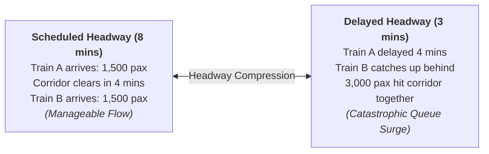
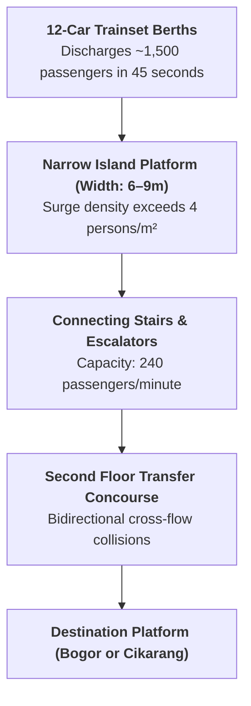
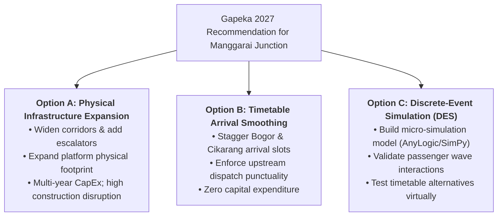

> [!NOTE] Case Overview & Pedagogical Metadata
>
> - **Case Code:** `SBM-OSCM-07-2026` (September 2026)
> - **Protagonists:** Rangga Wicaksana (Operations Planning Manager) & Sari Handayani (Station Head, Manggarai)
> - **Setting:** Manggarai Central Station, Jakarta (17:42 PM, Peak Rush Hour)
> - **Core Problem:** Formulating capacity recommendations for the Gapeka 2027 timetable when aggregate 20-hour utilization appears manageable ($\rho \approx 0.84$), yet a minor 4-minute train delay causes catastrophic platform crowd surges and dangerous passenger crush risks.
> - **Related Lecture Hub:** [[courses/mk4-operations-supply-chain-management/week-07/index|MK4 Week 07: Waiting Line Analysis & Simulation]]
> - **Cohort Working Solution:** [[courses/mk4-operations-supply-chain-management/week-07/assignment-kai-manggarai-queuing|Syndicate 9 (F9) Queuing Analysis Debrief]]

---

## 1. Executive Summary & The Platform 12 Dilemma

At 17:42 PM on a Monday evening from the second-floor mezzanine of Manggarai Station, Operations Planning Manager Rangga Wicaksana watched passenger congestion unfold. Below him, platforms 10 through 13—serving the dense **Bogor Line**—had been dangerously packed for eleven minutes. Meanwhile, platforms 6 and 7 (Cikarang Line) were comparatively empty. Between them, connecting stairwells and escalators carried opposing human torrents moving in both directions simultaneously.

Rangga faced an imminent deadline to submit operating capacity recommendations for the **Gapeka 2027 master train timetable**. The monthly operational report showed that Manggarai processed approximately **$162,000\text{ passenger movements per day}$ across 739 scheduled train services**. Spread evenly across 20 operating hours, average hourly utilization looked completely manageable ($\rho \approx 0.84$).

Yet Station Head Sari Handayani challenged his model with an undeniable frontline observation:

> _"The worst crowding isn't on the days with the most passengers. The worst crowding happens when one train runs four minutes late. Same passengers. The only thing that changed is the spacing."_

---

## 2. Enterprise Context: KAI Commuter at Manggarai Station

**PT Kereta Commuter Indonesia (KAI Commuter)**, a subsidiary of [[entities/pt-kereta-api-indonesia|PT Kereta Api Indonesia (Persero)]], operates Greater Jakarta’s suburban electrified commuter rail (KRL Jabodetabek), carrying over 1 million passengers daily.

**Manggarai Station** (originally opened in 1918) serves as Indonesia’s primary passenger transit hub:

- **Operating Pattern Shift (May 2022 Switch-Over)**: Centralized transfer junction. Passengers traveling between the Bogor Line and the Cikarang / Bekasi / Sudirman business corridor must physically change trains at Manggarai.
- **Internal Transit Explosion**: While station gate-in entries remained flat at $\approx 16,000\text{ passengers/day}$, **internal transit transfers exploded from $40.3\text{ million}$ in 2022 to $57.67\text{ million}$ in 2024 ($+43\%$)**. The growth is transit load that appears at no ticket gate.

---

## 3. The 162k Passenger Load & Headway Compression Dynamics

Transit surges occur in two compressed 3-hour windows: **06:00–09:00** and **16:00–19:00**. During these peaks, arrivals do not conform to smooth Poisson distributions; they arrive in **massive discrete batches** of $1,200\text{–}1,800$ passengers whenever a 10-to-12-car train opens its doors:

- When trains arrive at scheduled 8-minute intervals, the stairwells (capacity $\approx 240\text{ pax/minute}$) clear the platform surge in roughly 4–5 minutes before the next train arrives.
- When an upstream signal delay compresses headway to 3 minutes, **two full trainloads ($3,000\text{ passengers}$) arrive simultaneously**, overwhelming stairwell capacity ($545\text{ pax/min}$ peak surge vs. $240\text{ pax/min}$ capacity) and creating dangerous platform crush hazards.

---

## 4. Quantitative Exhibits: The 30 June vs. 14 July Natural Experiment

### Exhibit 1: Empirical Comparison of Load vs. Delay (Case Exhibit 4)

| Observed Date          |    Daily Transit Load Rank     |     Evening Transit Volume     | Average Upstream Train Delay | Maximum Queue Wait ($W_q$) | Operational Finding                                  |
| :--------------------- | :----------------------------: | :----------------------------: | :--------------------------: | :------------------------: | :--------------------------------------------------- |
| **Monday, 30 June**    |      **Rank 1 (Busiest)**      | **$62,400\text{ passengers}$** |     $0.8\text{ minutes}$     |    $289\text{ seconds}$    | High volume, but smooth spacing; queues cleared.     |
| **Friday, 4 July**     |             Rank 3             |   $60,100\text{ passengers}$   |     $1.2\text{ minutes}$     |    $331\text{ seconds}$    | Minor delays; queue manageable.                      |
| **Wednesday, 23 July** |             Rank 6             |   $58,200\text{ passengers}$   |     $1.0\text{ minutes}$     |    $254\text{ seconds}$    | Normal peak profile.                                 |
| **Monday, 14 July**    | **Rank 11 (10.6% Lower Load)** | **$55,800\text{ passengers}$** |   **$4.5\text{ minutes}$**   |  **$812\text{ seconds}$**  | **2.8x higher wait despite 10.6% FEWER passengers!** |

$$\mathbf{\text{Kingman VUT Insight:}\quad W_q \approx \left(\frac{\rho}{1 - \rho}\right) \left(\frac{C_a^2 + C_s^2}{2}\right) t_s}$$

On 14 July, although the utilization factor $\rho/(1-\rho)$ fell from $10.1$ to $4.4$, the arrival variability coefficient ($C_a^2$) exploded by **$6.5\text{ times}$** due to two consecutive late trains bunching together.

---

## 5. Strategic Decision Alternatives for Gapeka 2027

| Decision Option                         | Operational Mechanism                                                              | Financial & Capex Impact                                                             | Primary Limitation / Risk                                                                |
| :-------------------------------------- | :--------------------------------------------------------------------------------- | :----------------------------------------------------------------------------------- | :--------------------------------------------------------------------------------------- |
| **Option A: Physical Expansion**        | Widen transfer bridges; install additional high-speed escalators; widen platforms. | High CapEx ($\text{Rp } 250\text{–}400\text{ Billion}$); requires DGR state funding. | Construction takes 2–3 years; severely disrupts live train operations.                   |
| **Option B: Timetable Smoothing**       | De-synchronize Bogor and Cikarang berthing times in Gapeka 2027 by 3–4 minutes.    | **Zero CapEx**: achieved purely through train dispatch scheduling rules.             | Relies on strict upstream punctuality; easily disturbed by mainline failures.            |
| **Option C: Discrete-Event Simulation** | Model passenger agents, stairs, and train headways in a stochastic DES framework.  | Low CapEx ($\text{Rp } 1.5\text{–}2.5\text{ Billion}$ consulting/software fee).      | Does not fix the queue by itself; provides the analytical tool to optimize Option A & B. |

---

## 6. Cold-Call Preparation & Classroom Defense

### 1. "Why did the 14 July queue triple when total passenger volume was 10.6% lower than 30 June?"

- **Defense Script**: "Because transit queues are driven by arrival spacing, not aggregate daily headcount. On 14 July, two late Bogor trains compressed their headway from 8 minutes to 3 minutes, dumping 3,000 passengers onto the platform at once. Under Kingman's VUT approximation, arrival variance ($C_a^2$) jumped by 6.5 times. In queuing theory, when high utilization is hit with sudden arrival variance, the queue length does not increase gradually—it explodes."

### 2. "Why can't we just use classical M/M/s formulas to size Manggarai's corridors?"

- **Defense Script**: "Classical $M/M/s$ models make five assumptions that are completely violated at Manggarai: they assume continuous Poisson arrivals instead of discrete 1,500-passenger train batches; they assume exponential service times instead of fixed walking durations; they assume infinite physical waiting buffers; and they assume steady-state equilibrium. At Manggarai, space is finite and demand comes in transient waves. Using $M/M/s$ severely understates peak crowding by a factor of 60."

---

## 🔗 Cross-References & Study Navigation

- Lecture Context: [[courses/mk4-operations-supply-chain-management/week-07/index|MK4 Week 07: Waiting Line Analysis & Simulation]]
- Syndicate Solution: [[courses/mk4-operations-supply-chain-management/week-07/assignment-kai-manggarai-queuing|Syndicate 9 (F9) Queuing Debrief]]
- Enterprise Profile: [[entities/pt-kereta-api-indonesia|PT Kereta Api Indonesia (Persero)]]
- Theoretical Framework: [[concepts/queuing-theory|Queuing Theory & Waiting Line Analysis]]
