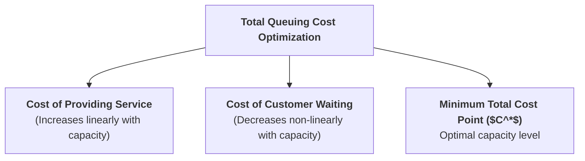
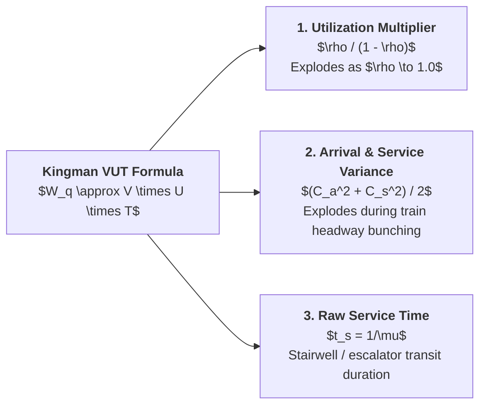

> [!NOTE] Curricular & Faculty Metadata
>
> - **Course:** MK4 Operations and Supply Chain Management — Week 07
> - **Teaching Team:** Noorhan Firdaus Pambudi, Ph.D. (Lead Lecturer), Dr. Yuanita Handayati
> - **Primary Curricular Spine:** `[STS] Meeting 7 - Waiting Line and Simulation.pptx.pdf` (45 Slides) & Jacobs & Chase (Ch. 7)
> - **Direct Satellites & Problem Sets:**
>   - [[courses/mk4-operations-supply-chain-management/week-07/case-kai-commuter-manggarai|The Queue at the Largest Junction: KAI Commuter and Manggarai Station (Case Dossier)]]
>   - [[courses/mk4-operations-supply-chain-management/week-07/assignment-kai-manggarai-queuing|Syndicate 9 (F9) Queuing Analysis & Kingman VUT Debrief]]

---

## 1. Executive Overview: The Mathematics and Psychology of Waiting

Waiting lines (queues) are an unavoidable feature of modern economic life. Whenever the instantaneous demand for a service exceeds the processing capacity of the server, a queue forms.

In executive operations management, analyzing waiting lines requires balancing two competing economic costs:

1. **The Cost of Capacity**: The financial expenditure of adding service facilities, equipment, turnstiles, and staff.
2. **The Cost of Waiting**: The economic and psychological penalty of keeping customers waiting—lost productivity, brand damage, customer defection, and dangerous crowd crush risks.

---

## 2. Theoretical Architecture: Closed-Form Queuing Models

As detailed in [[concepts/queuing-theory|Queuing Theory and Waiting Line Analysis]], systems are categorized using **Kendall's Notation ($A/B/s$)**:

### 2.1 The Single-Server Model ($M/M/1$)

For Poisson arrivals ($\lambda$) and exponential service times ($\mu$):

$$\mathbf{\text{Utilization:}\quad \rho = \frac{\lambda}{\mu}} \qquad\qquad \mathbf{\text{Idle Probability:}\quad P_0 = 1 - \rho}$$

$$\mathbf{L = \frac{\lambda}{\mu - \lambda}} \qquad\qquad \mathbf{L_q = \frac{\lambda^2}{\mu(\mu - \lambda)}} \qquad\qquad \mathbf{W = \frac{1}{\mu - \lambda}} \qquad\qquad \mathbf{W_q = \frac{\lambda}{\mu(\mu - \lambda)}}$$

### 2.2 Little's Law in Queuing Networks

Operating parameters reconcile strictly through [[concepts/littles-law|Little's Law]]:

$$\mathbf{L = \lambda W} \qquad\qquad \mathbf{L_q = \lambda W_q} \qquad\qquad \mathbf{W = W_q + \frac{1}{\mu}}$$

---

## 3. The Limits of Closed-Form Models: The Kingman VUT Equation

In real-world transit environments—such as [[entities/pt-kereta-api-indonesia|KAI Commuter]] at Manggarai Station—standard $M/M/1$ formulas fail dramatically because arrivals do not follow a smooth Poisson process; they arrive in **massive discrete batches** whenever a train empties hundreds of passengers onto the platform.

To analyze non-Poisson, general-distribution waiting lines, operations managers use **Kingman’s VUT Approximation**:

$$\mathbf{W_q \approx \underbrace{\left(\frac{\rho}{1 - \rho}\right)}_{\text{Utilization Factor } (U)} \times \underbrace{\left(\frac{C_a^2 + C_s^2}{2}\right)}_{\text{Variability Factor } (V)} \times \underbrace{t_s}_{\text{Service Time } (T)}}$$

Where:

- $C_a = \sigma_a / \mu_a$ is the coefficient of variation of arrival intervals.
- $C_s = \sigma_s / \mu_s$ is the coefficient of variation of service times.
- $t_s = 1/\mu$ is the mean service time.

> [!CAUTION] The Station Head's Paradox Explained
> Station Head Sari Handayani observed: _"The worst crowding doesn't happen on days with the most passengers; it happens when one train runs four minutes late."_
> **Kingman's equation explains why**: A 4-minute delay bunches two consecutive train arrivals into a single 3-minute window, causing the arrival variance coefficient ($C_a^2$) to skyrocket by $6.5\text{x}$. Multiplied by peak utilization ($\rho \approx 0.84$), maximum waiting time triples from 280 seconds to **812 seconds** with $10\%$ _fewer_ total daily passengers.

---

## 4. Discrete-Event Simulation (DES) vs. Closed-Form Equations

When systems exhibit batch arrivals, physical buffer limits, and feedback loops, closed-form equations break down:

| Characteristic        | Classical Analytical Model ($M/M/s$)    | Discrete-Event Simulation (DES)                               |
| :-------------------- | :-------------------------------------- | :------------------------------------------------------------ |
| **Arrival Pattern**   | Constant Poisson process ($\lambda$).   | Dynamic scheduled batch arrivals with random delays.          |
| **Queue Space**       | Assumed infinite buffer ($\infty$).     | Physical spatial boundaries (corridor width, platform edges). |
| **System State**      | Long-run steady state ($t \to \infty$). | Transient peak-hour dynamics (minute-by-minute waves).        |
| **Customer Behavior** | Patient; no balking or reneging.        | Balking, reverse routing, crowd panic, escalator bunching.    |

---

## 📚 Required Readings & In-Depth Satellites

| Document Title                                                            | Type / Focus                               | Core Operational Contribution                                                                                 | Study Note                                                                                                          |
| :------------------------------------------------------------------------ | :----------------------------------------- | :------------------------------------------------------------------------------------------------------------ | :------------------------------------------------------------------------------------------------------------------ |
| **The Queue at the Largest Junction: KAI Commuter and Manggarai Station** | SBM ITB Teaching Case (`SBM-OSCM-07-2026`) | Reconstructs 162k daily passenger flows, 0.84 utilization illusions, and headway compression.                 | [[courses/mk4-operations-supply-chain-management/week-07/case-kai-commuter-manggarai\|Open Case Dossier]]           |
| **Syndicate 9 (F9) Queuing Analysis & Kingman VUT Debrief**               | Cohort Case Debrief                        | Mathematical reconciliation of M/M/1 vs Kingman VUT, 30 June vs 14 July load data, and Gapeka recommendation. | [[courses/mk4-operations-supply-chain-management/week-07/assignment-kai-manggarai-queuing\|Open Syndicate Debrief]] |

---

## 📂 Primary Source Media & Digital Archives

| Material Title                              |   Media Type    | Staging / Archive Location                                                           |
| :------------------------------------------ | :-------------: | :----------------------------------------------------------------------------------- |
| **Waiting Line and Simulation Slide Deck**  | Slides (`.pdf`) | `archive/courses/mk4/week-07/[STS] Meeting 7 - Waiting Line and Simulation.pptx.pdf` |
| **Manggarai Junction Case Study (SBM ITB)** |  Case (`.pdf`)  | `archive/courses/mk4/week-07/Case_KAI_Commuter_Manggarai_EN.docx.pdf`                |
| **Week 7 Supplementary Reading Materials**  | Notes (`.pdf`)  | `archive/courses/mk4/week-07/BAHAN BACAAN MK 4 WEEK 7.pdf`                           |
| **Syndicate 9 Pre-Assignment Submission**   | Report (`.pdf`) | `archive/courses/mk4/week-07/Syndicate 9_Pre-Assignment Week 7_MK 4.pdf`             |

---

## 🔗 Knowledge Graph & Curriculum Bridges

- **Featured Analytical Frameworks**:
  - [[concepts/queuing-theory|Queuing Theory and Waiting Line Analysis (M/M/s)]]
  - [[concepts/littles-law|Little's Law: $L = \lambda W$]]
- **Enterprise Profiles**:
  - [[entities/pt-kereta-api-indonesia|PT Kereta Api Indonesia (Persero)]]
- **Previous Curricular Module**: [[courses/mk4-operations-supply-chain-management/week-06/index|Week 06: Process Design & Little's Law]]
- **Next Curricular Module**: [[courses/mk4-operations-supply-chain-management/week-08/index|Week 08: Lean Operations & Waste Elimination]]
- Return to **[[courses/mk4-operations-supply-chain-management/index|MK4 Course Overview]]**
