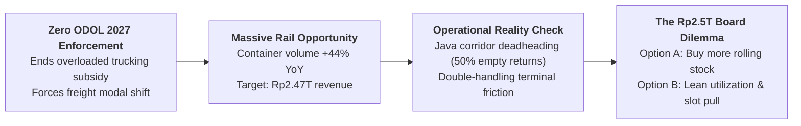
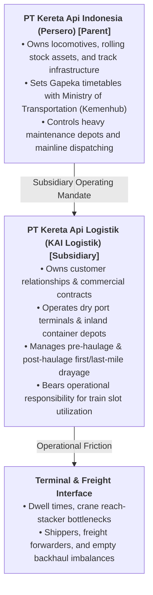
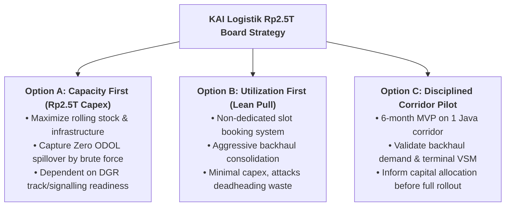
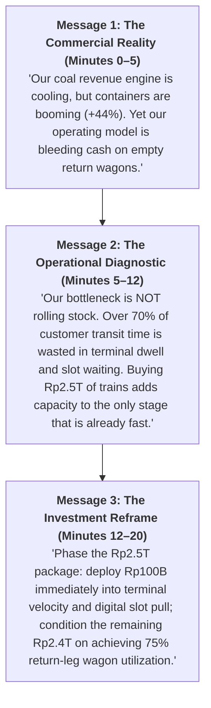

> [!NOTE] Case Overview & Pedagogical Framing
>
> - **Case Code:** `SBM-OSCM-26-08` (Revised 14 September 2026)
> - **Lead Authoring Body:** Operations and Supply Chain Management Teaching Team, SBM ITB
> - **Decision Protagonist:** **Yuskal Setiawan**, President Director of PT Kereta Api Logistik (KAI Logistik / KALOG)
> - **Parent Corporation:** [[entities/pt-kereta-api-indonesia|PT Kereta Api Indonesia (Persero)]]
> - **Curricular Module:** [[courses/mk4-operations-supply-chain-management/week-08/index|Week 08: Lean Operations & Supply Chain Management]]
> - **Core Theoretical Tools:** [[concepts/toyota-production-system|Toyota Production System (7 Wastes)]], Value Stream Mapping (VSM), Push vs. Pull Capacity Allocation, Eric Ries Lean Startup Methodology

---

## 1. Executive Summary & Strategic Context

In mid-August 2026, **Yuskal Setiawan**, President Director of **PT Kereta Api Logistik (KAI Logistik)**, had exactly three weeks to finalize the narrative framing for an indicative **Rp2.5 trillion freight investment package** before the Board of Directors of parent company PT Kereta Api Indonesia (Persero).

KAI Logistik was navigating a profound operational transition:

1. **The Coal Foundation Was Eroding:** Coal had long constituted the bedrock of KAI freight (reaching $89\%$ of volume in 2024). But by January 2026, coal’s share dropped to $53\%$ ($590,000\text{ tonnes}$) due to commodity price fluctuations and energy transition mandates.
2. **Container Freight Was Exploding:** Non-coal freight reached $47\%$ of handled volume. Container traffic surged $+44\%$ year-on-year, moving $1,193,688\text{ tonnes}$ between January and May 2026 (equivalent to removing nearly 60,000 heavy truck trips from national highways).
3. **The Empty Wagon Crisis (_Deadheading_):** Along the prime Java industrial rail corridor, **nearly half of all flat wagons returning from container ports ran completely empty**.
4. **The Regulatory Catalyst (Zero ODOL 2027):** Full enforcement of Indonesia's **Zero Over Dimension Over Loading (ODOL)** policy in January 2027 threatened to end the artificial economic subsidy enjoyed by overloaded trucking (which causes Rp10.21 trillion in annual road damage), creating a massive modal shift opportunity for rail.

---

## 2. Institutional Architecture: The Subsidiary Boundary

Understanding KAI Logistik's organizational boundary within the [[entities/pt-kereta-api-indonesia|PT KAI (Persero)]] ecosystem is vital for diagnosing where managerial authority genuinely lies:

As emphasized by Anne Purba, VP of Public Relations at PT KAI:

> _"Adding locomotives and wagons must be accompanied by readiness in track, signalling, terminals, maintenance facilities, and volume certainty from partners, so that available capacity can be used productively. Freight investment must be built as a single ecosystem."_

Of those five critical preconditions, **four belong entirely to the parent company or the government regulator**. The only preconditions resting inside Yuskal's operational span of control are **terminal velocity and commercial volume certainty**.

---

## 3. Operational Data & Empirical Exhibits

### Exhibit 1: KAI Logistik Freight Volume Composition (Jan 2025 vs. Jan 2026)

| Freight Segment                            | January 2025 Volume     | January 2026 Volume                   | YoY Growth Rate / Share                                       |
| :----------------------------------------- | :---------------------- | :------------------------------------ | :------------------------------------------------------------ |
| **Coal Haulage (South Sumatra)**           | Not Disclosed           | $590,000\text{ tonnes}$               | **$\approx 53\%$ of total volume** (Down from $89\%$ in 2024) |
| **Fuel Pre- & Post-Haulage**               | Not Disclosed           | $266,000\text{ tonnes}$               | Core liquid cargo segment                                     |
| **Container Freight**                      | $154,000\text{ tonnes}$ | **$222,000\text{ tonnes}$**           | **$+44.15\%$ YoY growth**                                     |
| **Cement Distribution**                    | Not Disclosed           | $32,000\text{ tonnes}$                | Steady industrial baseline                                    |
| **Courier / Retail Cargo (KALOG Express)** | $4,880\text{ tonnes}$   | $6,587\text{ tonnes}$                 | **$+34.98\%$ YoY growth**                                     |
| **Hazardous Waste (B3) Freight**           | $378\text{ tonnes}$     | $594\text{ tonnes}$                   | **$+57.14\%$ YoY growth**                                     |
| **TOTAL FREIGHT HANDLED**                  | —                       | **$\approx 1,100,000\text{ tonnes}$** | **$47\%$ Non-Coal Share**                                     |

### Exhibit 2: Internal Value Stream Mapping (Java Container Corridor)

An internal operational audit of an end-to-end container movement from an inland customer factory to the destination port terminal revealed severe structural waste:

```mermaid
flowchart LR
    S1["Stage 1: Feeder Truck to Terminal<br/>3–5 hrs (NVA)"] --> S2["Stage 2: Gate Queue & Unload<br/>4–8 hrs (NVA)"]
    S2 --> S3["Stage 3: Waiting Gapeka Slot<br/>6–20 hrs (NVA)"]
    S3 --> S4["Stage 4: Flat Wagon Loading<br/>2–4 hrs (NVA)"]
    S4 --> S5["<b>Stage 5: RAIL JOURNEY</b><br/><b>10–14 hrs (VALUE-ADD)</b>"]
    S5 --> S6["Stage 6: Unload at Terminal<br/>3–6 hrs (NVA)"]
    S6 --> S7["Stage 7: Waiting Delivery Truck<br/>5–15 hrs (NVA)"]
    S7 --> S8["Stage 8: Drayage to Warehouse<br/>2–4 hrs (NVA)"]
```

| Operational Stage                                       | Elapsed Duration | Lean Classification (_TPS Muda_) | Process Nature                 |
| :------------------------------------------------------ | :--------------- | :------------------------------- | :----------------------------- |
| 1. Feeder truck drayage to origin rail terminal         | 3–5 hours        | Transport / Non-Value-Add        | Road congestion & staging      |
| 2. Queue & reach-stacker unloading at terminal          | 4–8 hours        | Waiting & Motion / Non-Value-Add | Terminal gate congestion       |
| 3. Buffer dwell waiting for scheduled Gapeka train slot | 6–20 hours       | **Waiting / Inventory (Queue)**  | Fixed timetable rigidity       |
| 4. Loading container onto rail flat wagons              | 2–4 hours        | Handling / Non-Value-Add         | Reach-stacker crane cycle      |
| **5. LINE-HAUL RAIL RUN**                               | **10–14 hours**  | **VALUE-ADDING ACTIVITY**        | **Pure freight displacement**  |
| 6. Unloading flat wagon at destination terminal         | 3–6 hours        | Handling / Non-Value-Add         | Terminal dwell                 |
| 7. Staging and waiting for delivery drayage truck       | 5–15 hours       | Waiting / Inventory (Buffer)     | Dispatch coordination lag      |
| 8. Final-mile truck drayage to customer warehouse       | 2–4 hours        | Transport / Non-Value-Add        | Urban road congestion          |
| **TOTAL END-TO-END LEAD TIME**                          | **35–76 hours**  | **Total Elapsed Lead Time**      | **Value-Add Ratio: 18% – 29%** |

$$\mathbf{\text{Value-Add Ratio} = \frac{\text{Rail Journey (10 to 14 hrs)}}{\text{Total Lead Time (35 to 76 hrs)}} \approx 18.4\% - 28.9\%}$$

> [!CAUTION] The Capital Misallocation Trap
> Over **$70\%\text{ to }82\%$ of total container transit time is consumed while freight is stationary**—sitting in terminal buffer stacks, queuing at gates, or waiting for drayage trucks. Adding more locomotives or flat wagons accelerates or expands the one single stage that is already functioning efficiently, while leaving the massive non-value-adding terminal friction untouched.

### Exhibit 3: Macroeconomic & National Logistics Benchmark Indicators

| Macroeconomic Indicator                          | National Metric                     | Policy / Operational Implication                                                         |
| :----------------------------------------------- | :---------------------------------- | :--------------------------------------------------------------------------------------- |
| **National Logistics Cost as % of GDP**          | **14.2% – 23.0%** (Baseline 14.29%) | RPJMN target: 12.5% by 2029; 8.0% by 2045. Shippers demand aggressive cost cuts.         |
| **World Bank Logistics Performance Index (LPI)** | **3.0 / 5.0**                       | Tracking, tracing, and multi-modal terminal efficiency lag global peers.                 |
| **National Freight Modal Share (Road vs. Rail)** | **Road: 91.95% \| Rail: 0.26%**     | Extreme modal skew. Shifting even 1% of road cargo to rail quadruples rail freight load. |
| **National Road Damage Losses from ODOL**        | **Rp10.21 Trillion annually**       | Government will strictly enforce Zero ODOL 2027 to protect road budgets.                 |
| **KAI Logistik 2026 Corporate Targets**          | **Revenue: Rp2.47 Trillion**        | Target requires $+119\%$ growth over 2025 actual (Rp1.1 Trillion).                       |
| **Indicative Freight Investment Proposal**       | **Rp2.5 Trillion**                  | Equal to more than $200\%$ of KAI Logistik's entire 2025 revenue.                        |

---

## 4. Analysis of Decision Alternatives

Yuskal Setiawan and his planning leadership team narrowed their strategic choices to three distinct options:

| Dimension                | Option A: Capacity First (Full Rp2.5T Package)                                                                   | Option B: Utilization First (Lean Slot Pull Model)                                                       | Option C: Limited 6-Month Java Corridor Pilot                                                                       |
| :----------------------- | :--------------------------------------------------------------------------------------------------------------- | :------------------------------------------------------------------------------------------------------- | :------------------------------------------------------------------------------------------------------------------ |
| **Core Strategic Logic** | Buy assets in advance so rail has headroom when Zero ODOL forces road freight off highways.                      | Attack the largest source of waste (empty return wagons) by shifting from push to slot-based pull.       | Treat the strategy as an experiment; validate customer willingness to book rail slots before committing capex.      |
| **Capital Expenditure**  | **Rp2.5 Trillion** (Massive corporate balance sheet burden).                                                     | **Minimal (Rp50–100 Billion)** for digital platforms and commercial sales incentives.                    | **Low (Rp20–30 Billion)** internal reallocation.                                                                    |
| **Execution Speed**      | **18 to 36 months** (Procurement, assembly, regulatory certification).                                           | **3 to 6 months** (Software deployment, commercial restructuring).                                       | **Immediate** (6-month operational sprint).                                                                         |
| **Primary Failure Risk** | **Asset Idleness**: Rolling stock arrives but sits idle due to single-track bottlenecks or lack of return cargo. | **Commercial Friction**: Shippers refuse to share demand forecasts; return leg remains stubbornly empty. | **Strategic Preemption**: Road hauliers adapt to Zero ODOL before KAI finishes testing; Board views it as timidity. |
| **Alignment with TPS**   | **Anti-Lean (Overproduction)**: Builds excess asset capacity without addressing terminal flow buffers.           | **Pure Lean (Pull & Waste Elimination)**: Aligns capacity strictly to confirmed multi-shipper demand.    | **Lean Startup (Validated Learning)**: Deploys an MVP to test critical assumptions before capital expenditure.      |

---

## 5. Comprehensive Debrief of Case Preparation Questions

### Question 1: The Seven Wastes in KAI Logistik's Container Operations

**Prompt:** _Using the seven wastes framework, identify the largest form of waste in KAI Logistik's container operations. Support your answer with Exhibit 2 and explain why that waste is a root waste rather than a symptom._

> **Master Analysis:**
> The single largest and most economically destructive waste in KAI Logistik's operations is **Overproduction (_Muda of Overproduction_) manifesting as Transport Waste (Empty Wagon Deadheading)**.
>
> - **Empirical Proof:** In coal haulage, running empty wagons on the return leg is economically viable because coal tariffs are priced to cover the round-trip, and handling is fully automated via rotary car tipplers. In container logistics, running flat wagons empty on the Java return leg consumes diesel, track access charges (TAC), locomotive crew hours, and Gapeka track slots while generating zero revenue.
> - **Why it is a Root Waste:** Overproduction—operating a fixed train schedule regardless of whether return cargo exists—is a push behavior. Running empty wagons forces the organization to absorb massive fixed overheads. To compensate, KALOG raises its outbound freight tariffs, which makes rail uncompetitive against road trucking, driving container volumes down and perpetuating the empty return cycle.

### Question 2: Evaluating the 18–29% Value-Add Ratio

**Prompt:** _Exhibit 2 shows a value-add ratio of roughly a quarter of total lead time. If you could improve only one non-value-add stage, which would you choose, and why is that choice better than adding rolling stock?_

> **Master Analysis:**
> The highest-leverage intervention is **Stage 3: Waiting for Scheduled Gapeka Train Slot (6 to 20 hours)** combined with **Stage 2: Queue & Unload at Terminal (4 to 8 hours)**.
>
> - **The Leverage Rationale:** Together, terminal gate queuing and train slot waiting consume **10 to 28 hours**—longer than the entire 10–14 hour rail journey itself!
> - **Why This Beats Buying Rolling Stock:** Adding flat wagons or locomotives reduces the 10–14 hour rail journey by zero minutes, because train speed is governed by track geometry and passenger train priority in Gapeka. If an incoming container arrives at an inland terminal and waits 18 hours for the next scheduled freight train departure, adding 50 new flat wagons in the storage siding does not accelerate the container's arrival at the port. In contrast, introducing **flexible, semi-scheduled slot booking and cross-docking** eliminates up to 15 hours of idle buffer at a tiny fraction of the cost of new rolling stock.

### Question 3: Preconditions for the Shift from Push to Pull

**Prompt:** _The non-dedicated slot model is described as a shift from push to pull. What preconditions must be met for that shift to be real, and which of them does KAI Logistik currently lack?_

> **Master Analysis:**
> In the dedicated model, a single anchor shipper (e.g., a major cement or coal producer) charters the entire train consist; KAI bears zero utilization risk. In the **non-dedicated slot model (Pull System)**, KAI sells individual wagon slots to dozens of small and medium freight forwarders, bearing the utilization risk itself.
>
> **Required Preconditions:**
>
> 1. _Real-Time Demand Visibility & Booking API:_ Shippers must be able to view and book container slots digitally with guaranteed cutoff times.
> 2. _Dynamic Backhaul Pricing:_ Algorithmic pricing that heavily discounts return-leg slots from ports to industrial hubs to stimulate demand and eliminate deadheading.
> 3. _High Terminal Reliability & Rapid Turnaround:_ Reach stackers and terminal gates must operate under strict takt times to prevent missed train slots.
> 4. _Bufferless Drayage Coordination:_ Seamless last-mile trucking integration to move containers off platforms immediately upon arrival.
>
> **What KAI Logistik Currently Lacks:**
> KALOG completely lacks **real-time demand visibility across non-coal shippers** and has no dynamic pricing engine to balance directional freight flows. Operations planners still rely on rigid, manual contracting structures designed for dedicated coal consists.

### Question 4: Strategic Recommendation & 6-Month Falsification Metrics

**Prompt:** _Choose one of the three options on Yuskal's desk and defend it. State explicitly the assumptions that must hold for your recommendation to succeed, and what indicator would tell you within six months that those assumptions were wrong._

> **Master Analysis (The Hybrid Staged Strategy: B + C into Phased A):**
> Syndicate analysis recommends that Yuskal present **Option B (Utilization First) executed via an aggressive Option C (Corridor Pilot)**, while reframing Option A into a phased infrastructure release.
>
> **Core Assumptions That Must Hold:**
>
> 1. _Return-Leg Price Elasticity:_ Shippers currently trucking goods back from port cities (e.g., Surabaya/Semarang to Jakarta/Cikarang) will switch to rail if offered a $25\%\text{ to }30\%$ discount on return-leg wagon slots.
> 2. _Drayage Partner Reliability:_ Third-party trucking partners will adhere to tight terminal appointment windows.
> 3. _Terminal Operational Discipline:_ Terminal dwell times can be compressed by at least $40\%$ through 5S and standardized reach-stacker operating procedures without requiring new civil berths.
>
> **Falsification Metric (The Six-Month Stop Condition):**
> If after 6 months of running the slot-based pilot on the Jakarta–Surabaya corridor, **average return-leg wagon utilization remains below $60\%$** and terminal dwell time has not fallen by more than $15\%$, the assumption of price elasticity is falsified. This proves that freight forwarders prioritize departure flexibility over rail tariff savings, compelling KALOG to pivot toward dedicated customer contracts rather than open-market slot pools.

### Question 5: The 20-Minute Boardroom Defense Strategy

**Prompt:** _Draft three key messages — no more — that Yuskal should deliver in twenty minutes before the Board. Order them and explain why that order matters._

#### Why This Order Matters:

1. **Message 1 establishes immediate commercial alignment:** Acknowledging coal’s decline and container growth shows strategic realism and respects the Board’s fiduciary responsibility.
2. **Message 2 disrupts conventional capital assumptions:** Presenting the Value Stream Map before discussing capital expenditure permanently changes how the Board evaluates the problem. It proves that buying trains does not solve customer lead times.
3. **Message 3 offers a win-win capital roadmap:** It does not reject the Rp2.5T government-aligned agenda (which would alienate the parent company and the Ministry of Transportation). Instead, it acts as a prudent corporate guardian by conditioning heavy equipment purchases on verified terminal efficiency.

---

## 6. Strategic Takeaways for MBA Operations Leaders

1. **Beware the "Asset-First" Bias in BUMN Logistics:** State-owned enterprises frequently default to buying heavy civil infrastructure because capital expenditure is easily photographed, politically celebrated, and supported by government assignments. Lean leaders recognize that **software, process synchronization, and terminal velocity deliver higher returns than steel and diesel**.
2. **Double Handling Is Rail's Achilles' Heel:** Rail line-haul is unmatched in energy efficiency and safety. However, every time a container transfers between truck and train, the cost and time penalty of reach-stacker handling erodes rail's competitive advantage. Lean multi-modal transport must focus relentlessly on **cross-docking and container dwell compression**.
3. **Capacity Can Be Bought; Utilization Must Be Built:** Pouring money into new flat wagons produces zero enterprise value if those wagons spend $50\%$ of their service life returning empty across Java. True operational excellence lies in **balancing the supply chain network through backhaul commercialization**.

---

## 7. Comprehensive Reference List

- School of Business and Management, Institut Teknologi Bandung (2026). _The Wagons That Return Empty: Lean Supply Chain at KAI Logistik Ahead of Zero ODOL 2027_. SBM ITB Case Series, SBM-OSCM-26-08.
- Jacobs, F. R., & Chase, R. B. (2018). _Operations and Supply Chain Management_ (15th ed., Chapter 14: Lean Supply Chains). McGraw-Hill Education.
- Ohno, T. (1988). _Toyota Production System: Beyond Large-Scale Production_. Productivity Press.
- Ries, E. (2011). _The Lean Startup: How Today's Entrepreneurs Use Continuous Innovation to Create Radically Successful Businesses_. Crown Business.
- Womack, J. P., & Jones, D. T. (2003). _Lean Thinking: Banish Waste and Create Wealth in Your Corporation_. Free Press.
- Kementerian Perhubungan Republik Indonesia (2025). _Rencana Pembangunan Jangka Panjang Kementerian Perhubungan 2025–2045_.
