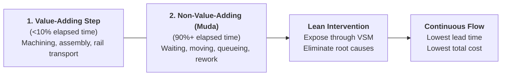
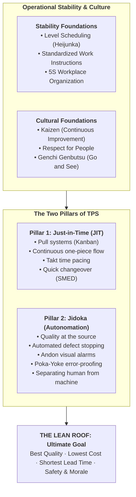
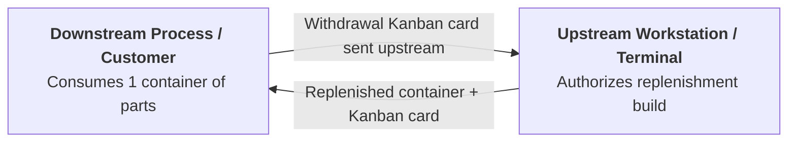
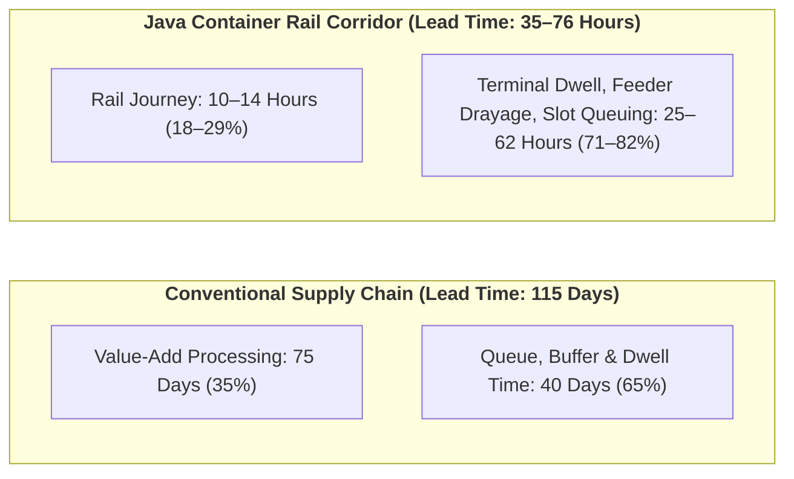
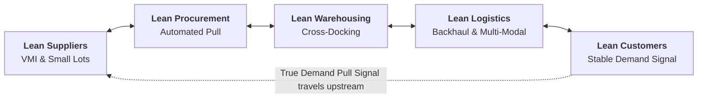
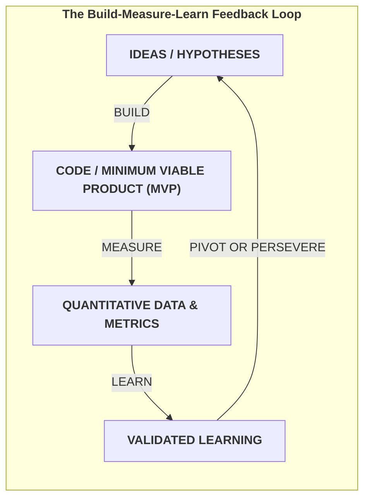

> [!NOTE] Curricular & Faculty Metadata
>
> - **Course:** MK4 Operations and Supply Chain Management — Week 08
> - **Teaching Team:** Noorhan Firdaus Pambudi, Ph.D. (Lead Lecturer), Dr. Yuanita Handayati
> - **Primary Curricular Spine:** `[STS] W8 - Lean Operations and Supply Chain.pptx.pdf` (68 Slides) & Jacobs & Chase (Ch. 14: Lean Supply Chains)
> - **Theoretical Frameworks:** [[concepts/toyota-production-system|Toyota Production System (TPS)]], [[concepts/toyota-production-system|Value Stream Mapping (VSM)]], Kanban Sizing Formula, Eric Ries Lean Startup Methodology
> - **Direct Satellites & Case Studies:**
>   - [[courses/mk4-operations-supply-chain-management/week-08/case-kai-logistik-lean|Case Dossier: KAI Logistik — The Wagons That Return Empty Ahead of Zero ODOL 2027 (SBM-OSCM-26-08)]]
>   - [[entities/pt-kereta-api-indonesia|PT Kereta Api Indonesia (Persero) / KAI Logistik]]

---

## 1. Executive Overview: Value, Waste, and the Lean Mindset

Lean operations is not a compilation of disconnected tactical tools; it is a fundamental philosophy for designing systems that **maximize customer value while ruthlessly eliminating waste (_Muda_)**.

As codified in classical operations research:

- **Value is defined externally by the customer**: Value represents exclusively the activities, transformations, and features for which the ultimate customer is willing to exchange capital.
- **Waste is defined internally by the process**: Waste constitutes any resource, elapsed time, physical movement, floor space, or inventory expenditure that does not directly contribute to the customer's perceived value.

$$\text{Lean Focus:}\quad \boxed{\text{Customer Defines Value}} \longrightarrow \boxed{\text{Identify \& Eliminate Waste}} \longrightarrow \boxed{\text{Cost Falls Naturally}}$$

> [!IMPORTANT] The Cost vs. Value Trap
> Conventional cost-reduction programs attack visible expenses—laying off front-line workers, slashing maintenance budgets, or squeezing suppliers. This often destroys value. Lean attacks internal friction and idle buffers; unit cost reductions emerge as an operational byproduct of compressed lead time and pristine process flow.

---

## 2. The Toyota Production System (TPS) & The House of Lean

The Toyota Production System, pioneered by Taiichi Ohno and Shigeo Shingo, organizes operational excellence into an interconnected architectural structure known as the **House of Lean**:

### 2.1 The Seven Classic Wastes (_TIMWOOD_) + The 8th Waste

1. **Transport:** Moving materials or finished goods without transforming them (e.g., hauling empty wagons or double-handling freight at terminals).
2. **Inventory:** Raw materials, WIP, or finished goods sitting idle, masking process breakdowns, scheduling unreliability, and supplier delays.
3. **Motion:** Unnecessary physical movement by human operators searching for tools, data, or materials.
4. **Waiting:** Idle operator or machine time caused by stockouts, processing delays, or scheduled timetable bottlenecks.
5. **Overproduction:** **The root waste.** Manufacturing items before they are required by downstream pull signals. Overproduction drives all other six wastes by occupying floor space and tying up working capital.
6. **Overprocessing:** Performing redundant inspections, excessive documentation, or tighter engineering tolerances than the customer demanded.
7. **Defects / Rework:** Scrap and quality errors that consume labor and machine capacity twice.
8. **Underutilized Talent (8th Waste):** Failing to engage front-line operational staff in Kaizen problem-solving and process design.

---

## 3. Mathematical Foundations: Sizing the Kanban Loop

A **Kanban system** is a physical or electronic visual authorization mechanism that enforces a strict **pull system**. Upstream workstations are prohibited from manufacturing parts unless authorized by an incoming Kanban card released by downstream demand.

The total number of Kanban card sets ($k$) circulating within a production or logistics loop represents the absolute ceiling on work-in-process (WIP) inventory.

### The Kanban Sizing Formula

$$\mathbf{k = \left\lceil \frac{D \times L \times (1 + S)}{C} \right\rceil}$$

Where:

- $\mathbf{k}$: Number of Kanban card containers (rounded up to nearest integer)
- $\mathbf{D}$: Expected average demand rate per unit of time (e.g., units per day or hour)
- $\mathbf{L}$: Replenishment lead time (including waiting time, processing time, and transit time)
- $\mathbf{S}$: Safety stock factor, expressed as a decimal proportion of demand during lead time (reflects process and demand uncertainty)
- $\mathbf{C}$: Capacity of a single standardized container or wagon slot

### Analytical Case Application: Lead Time Compression vs. Card Allocation

Consider a manufacturing or multi-modal assembly operation with:

- Daily demand $D = 200\text{ units/day}$
- Replenishment lead time $L = 0.5\text{ days}$
- Safety buffer $S = 10\%\text{ } (0.10)$
- Container capacity $C = 20\text{ units}$

$$\text{Initial Loop:}\quad k_1 = \frac{200 \times 0.5 \times (1 + 0.10)}{20} = \frac{110}{20} = 5.5 \implies \mathbf{6\text{ cards}} \quad (\text{WIP cap} = 6 \times 20 = 120\text{ units})$$

If an operational engineering team slashes replenishment lead time in half via SMED and cross-docking ($L \to 0.25\text{ days}$):

$$\text{Optimized Loop:}\quad k_2 = \frac{200 \times 0.25 \times 1.10}{20} = \frac{55}{20} = 2.75 \implies \mathbf{3\text{ cards}} \quad (\text{WIP cap} = 3 \times 20 = 60\text{ units})$$

> [!TIP] The River and the Rocks Principle
> Inventory acts like water in a river, concealing jagged rocks (defects, machine breakdowns, erratic lead times). Lowering inventory ($k$) exposes the rocks so that engineering teams can remove them permanently through Kaizen, rather than submerging them under excess safety stock.

---

## 4. Value Stream Mapping (VSM)

A **Value Stream Map** traces every step in an end-to-end process from raw material receipt to customer delivery, recording cycle time ($CT$), changeover time ($CO$), uptime, inventory queues, and information flows.

The central diagnostic metric of a VSM is the **Value-Add Ratio**:

$$\mathbf{\text{Value-Add Ratio} = \frac{\sum \text{Processing Time for Value-Adding Steps}}{\text{Total End-to-End Lead Time}} \times 100\%}$$

In traditional, un-lean manufacturing and logistics corridors, the value-add ratio is frequently **below $10\%$**; over $90\%$ of lead time is consumed by parts waiting in queues, sitting on transfer docks, or undergoing double-handling.

---

## 5. From Lean Plant to Lean Supply Chain

Extending lean beyond the four walls of a factory requires synchronizing five critical supply chain links:

| Supply Chain Link       | Lean Focus & Capabilities                                                                                                         | Risk of Traditional Squeezing                                                                          |
| :---------------------- | :-------------------------------------------------------------------------------------------------------------------------------- | :----------------------------------------------------------------------------------------------------- |
| **1. Lean Suppliers**   | Swiftly respond to demand shifts; continuous cost reduction through joint waste elimination rather than price concession battles. | Aggressive margin squeezing bankrupts suppliers or forces them to cut quality and safety buffers.      |
| **2. Lean Procurement** | Automated transaction execution; shared EDI visibility; Vendor-Managed Inventory (VMI); electronic Kanban triggers.               | Disconnected purchasing creates purchasing bullwhip effects and erratic batch ordering.                |
| **3. Lean Warehousing** | Elimination of non-value handling; direct cross-docking; dynamic slotting; visual picking layouts.                                | Excess stock suffocates floor operations, forcing secondary warehouse leasing and double-handling.     |
| **4. Lean Logistics**   | Continuous multi-stop routing; load pooling; backhaul freight optimization; freight rail integration.                             | High empty return-mileage (_deadheading_) that wastes fuel, rolling stock slots, and driver hours.     |
| **5. Lean Customers**   | Transparent sharing of demand forecasts; commitment to regular order cadences; joint root-cause reviews.                          | Erratic, speculative order cancellations that inject false demand volatility back up the value stream. |

---

## 6. Lean Service Operations: Eliminating Waste Without Inventory

Services cannot store finished goods inventory; therefore, service waste manifests primarily as **lost customer time, idle capacity, customer anxiety, and operational variance**.

Jacobs & Chase (Ch. 14) identify seven proven applications of lean principles to service delivery:

1. **Organize Problem-Solving Groups:** Front-line service staff analyze customer journey bottlenecks (e.g., bank tellers, train station staff).
2. **Upgrade Housekeeping (5S):** Standardized, immaculate workspaces prevent search friction (e.g., McDonald's kitchens, Disneyland maintenance).
3. **Upgrade Quality:** Zero-defect culture via Poka-Yoke error-proofing (e.g., hospital surgical instrument tray checklists).
4. **Clarify Process Flows:** Eliminate zigzag passenger/customer routings (e.g., FedEx hub-and-spoke sortation).
5. **Revise Equipment & Layout:** Customize infrastructure to the exact work motion (e.g., Speedi-Lube drive-through service pits instead of hydraulic hoists).
6. **Level the Load (Heijunka):** Smooth demand spikes via dynamic pricing, appointment scheduling, and limited-time menu structures.
7. **Eliminate Unnecessary Activities:** Remove redundant form-filling and handoffs. _(Crucial Counterpoint: Never eliminate activities that provide psychological reassurance to customers, even if they add physical motion)._

---

## 7. The Lean Startup Synthesis: Validated Learning as Anti-Waste

In highly uncertain market environments—where customer demand has not yet solidified—traditional Lean manufacturing principles face a fatal vulnerability: **you cannot level production (_Heijunka_) or pull inventory for a product nobody has agreed to buy.**

Eric Ries synthesized TPS with venture development into **The Lean Startup methodology**:

- **Classical Lean Definition of Waste:** Anything the customer will not pay for.
- **Lean Startup Definition of Waste:** **Any activity, capital expenditure, or code written that does not produce validated learning about customer behavior.**

> [!NOTE] Minimizing Loop Cycle Time
> The ultimate competitive metric of a lean enterprise is not how cheaply it produces an artifact, but **how rapidly it can traverse the Build-Measure-Learn feedback loop** to eliminate flawed assumptions before capital is exhausted.

---

## 8. Curricular Case Bridge: KAI Logistik Ahead of Zero ODOL 2027

In [[courses/mk4-operations-supply-chain-management/week-08/case-kai-logistik-lean|Case Dossier SBM-OSCM-26-08]], President Director Yuskal Setiawan faces a decisive test of lean leadership:

- **The Capital Proposal:** A proposed **Rp2.5 trillion** capital expenditure to purchase locomotives and flat wagons for freight rail expansion ahead of the **Zero ODOL 2027** truck regulation.
- **The Lean Reality:** A Value Stream Map of the Java container corridor demonstrates that **$71\%\text{ to }82\%$ of total transit lead time** is consumed by terminal dwell, drayage bottlenecks, and slot queuing, while rail transit is already efficient. Furthermore, **nearly $50\%$ of container flat wagons return empty (_deadhead_)** on the return leg from port terminals.
- **The Managerial Question:** Does spending Rp2.5T buy real market competitiveness, or does it merely add expensive rolling stock to the one segment that is already running lean while ignoring the massive waste at terminal interfaces?

---

## 9. Comprehensive Reference List

- Jacobs, F. R., & Chase, R. B. (2018). _Operations and Supply Chain Management_ (15th ed., Chapter 14: Lean Supply Chains). McGraw-Hill Education.
- Ohno, T. (1988). _Toyota Production System: Beyond Large-Scale Production_. Productivity Press.
- Ries, E. (2011). _The Lean Startup: How Today's Entrepreneurs Use Continuous Innovation to Create Radically Successful Businesses_. Crown Business.
- Shingo, S. (1989). _A Study of the Toyota Production System from an Industrial Engineering Viewpoint_. Productivity Press.
- Womack, J. P., & Jones, D. T. (2003). _Lean Thinking: Banish Waste and Create Wealth in Your Corporation_. Free Press.
- School of Business and Management, Institut Teknologi Bandung (2026). _The Wagons That Return Empty: Lean Supply Chain at KAI Logistik Ahead of Zero ODOL 2027_. SBM ITB Case Series, SBM-OSCM-26-08.
