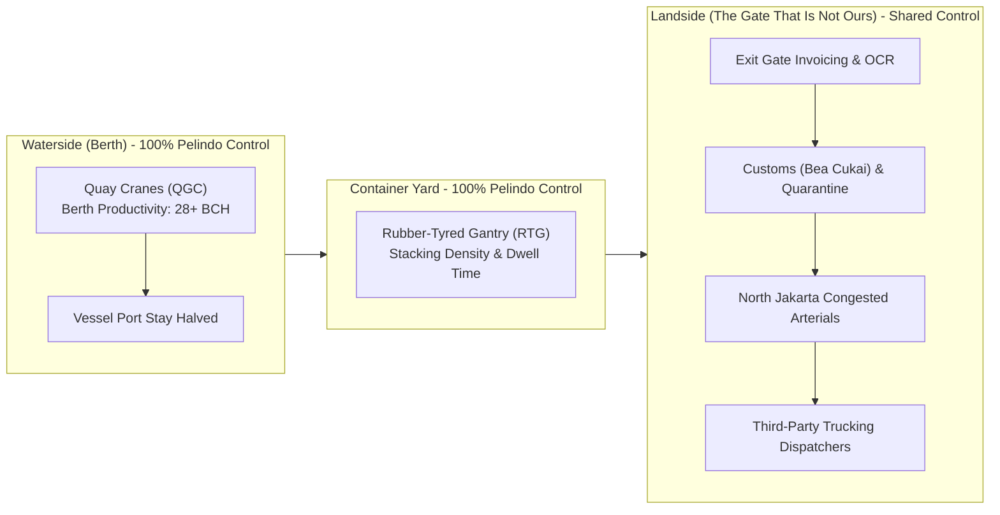
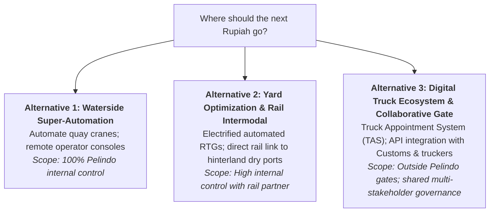

## 🚨 The Executive Dilemma

On Monday morning, July 6, 2026, in Pelindo Tower on Jalan Yos Sudarso, **Rangga Pradipta**, Senior Vice President of Operational Excellence at **PT Pelabuhan Indonesia (Persero)**, faced a career-defining board presentation. He had two hours to finalize his investment recommendation for Pelindo’s 2027 corporate improvement plan.

Two conflicting reports sat on his desk:

1. **The Internal Operational Audit**: Documenting the five-year transformation following the historic October 2021 merger of Pelindo I, II, III, and IV. Standardizing operating routines across 100+ ports had doubled berth productivity ($\text{Box Moves Per Hour}$), halved vessel port turnaround times, and unlocked trillions of Rupiah in verified post-merger efficiencies.
2. **The External World Bank / S&P Global Benchmark**: The recently released 2025 edition of the **Container Port Performance Index (CPPI)**. In the global rankings, Indonesia's flagship port, **Tanjung Priok, had plummeted from 23rd in the world to 121st**.

Rangga framed the executive paradox:

> _"If our berth productivity has not fallen, our port stay has not lengthened, and our container volumes have risen—how can our ranking drop almost 100 places in two years? Either our internal operational improvements are an illusion, or the external metric we celebrated three years ago was never measuring our performance."_

The Board demanded a single capital allocation decision: **Where should the next Rupiah of operational improvement be invested?** Rangga knew that only one of the potential answers lay entirely within Pelindo’s operational boundary.

---

## 📊 Macro Context: The Arithmetic of National Logistics

Indonesia is an archipelago of over 17,000 islands where maritime connectivity dictates macroeconomic growth. Port efficiency directly impacts **National Logistics Cost**:

- In 2022, Bappenas measured Indonesia's national logistics cost at **$14.29\%$ of GDP** (re-baselined from an earlier estimate of $23.5\%$), with national targets of **$12.5\%$ by 2029** and **$8.0\%$ by 2045**.
- In the public sphere, port efficiency is universally judged by **Dwelling Time**: the elapsed duration a container sits in the port terminal from vessel discharge to gate exit.
- While the public blames Pelindo for dwelling time spikes, empirical port logistics reveals three distinct operational zones:
  1. **Pre-Clearance** (Customs documentation submission by importers): $40\text{--}50\%$ of dwell time.
  2. **Customs Clearance** (Physical inspection and document approval by Bea Cukai / Quarantine): $20\text{--}30\%$ of dwell time.
  3. **Post-Clearance / Gate Out** (Truck dispatching and gate exit payment): $20\text{--}30\%$ of dwell time.

Only the physical handling within the terminal is managed by Pelindo; documentation and transport clearance are external.

---

## 🔍 Applying the Cost of Quality (CoQ) to Port Operations

The case forces participants to analyze Pelindo's spending through the [[concepts/lean-six-sigma-dmaic|Cost of Quality Framework]]:

| Cost of Quality Category   | Port Operational Manifestation at Tanjung Priok                                                                                                                | Strategic Lever / Risk                                                                                                   |
| :------------------------- | :------------------------------------------------------------------------------------------------------------------------------------------------------------- | :----------------------------------------------------------------------------------------------------------------------- |
| **Prevention Costs**       | Sensor predictive maintenance on Quay Cranes; operator simulation academies; automated terminal operating systems (TOS).                                       | Upfront capex investment that prevents equipment breakdown during vessel offloading.                                     |
| **Appraisal Costs**        | Optical character recognition (OCR) gate scanners; container weigh-in-motion scales; safety telemetry audits.                                                  | Monitoring and inspecting inbound and outbound flows before containers depart the terminal.                              |
| **Internal Failure Costs** | Crane breakdown during vessel berthing; container misplacement in the yard (_"hunting for boxes"_); yard congestion requiring multi-tier container restacking. | Absorbed directly by Pelindo in wasted fuel, wasted labor hours, and reduced berth turns.                                |
| **External Failure Costs** | Container ships idling at anchor; shipping lines issuing congestion surcharges; CPPI ranking collapse; public criticism from government ministries.            | Severe macroeconomic penalty; national reputation damage; shipping line route diversion to Singapore or Tanjung Pelepas. |

---

## 🧭 The Three Improvement Alternatives for the Board

Rangga must defend one of three strategic capital allocation pathways:

| Dimension             | Alternative 1: Waterside Automation        | Alternative 2: Yard & Rail Intermodal  | Alternative 3: Landside Digital Ecosystem                 |
| :-------------------- | :----------------------------------------- | :------------------------------------- | :-------------------------------------------------------- |
| **Operational Focus** | Ship-to-Shore Cranes & Quay Wall           | Container Stacking Yards & Rail Siding | Gate Out, Customs API & Truck Dispatch                    |
| **Pelindo Control**   | **$100\%$ Full Control**                   | **$80\%$ High Control**                | **$30\%$ Shared / Low Direct Control**                    |
| **Impact on CPPI**    | Marginal (Berth moves already world-class) | Moderate (Eliminates yard re-handles)  | **Massive** (Directly tackles truck queues & dwell time)  |
| **Execution Risk**    | Low technological risk; high capex cost    | Medium infrastructure capex            | **High political risk** (Multi-agency alignment required) |

---

## 🎓 Cold-Call Class Discussion Questions

1. **Measurement System Analysis (MSA)**: Why did Tanjung Priok's CPPI rank plunge from 23rd to 121st despite rising internal crane productivity? Is the CPPI measuring terminal operational capability or macroeconomic supply chain friction?
2. **The Definition of Quality**: Contrast **Design Quality** vs. **Conformance Quality** in the context of global shipping alliances (Maersk, MSC, CMA CGM). What do ocean carriers consider the primary Critical-to-Quality (CTQ) metric when selecting a hub port?
3. **The Limits of Operational Control**: If you were Rangga Pradipta, which alternative would you recommend to the Board? Defend whether a BUMN should spend its capital fixing operational bottlenecks that lie outside its legal property boundary.

---

## 🔗 Related Knowledge Bridges

- Master Curricular Hub: [[courses/mk4-operations-supply-chain-management/week-09/index|MK4 Week 09: Lean Six Sigma & Quality Management]]
- Flagship Concept: [[concepts/lean-six-sigma-dmaic|Lean Six Sigma & DMAIC Methodology]]
- Corporate Entity Profile: [[entities/pt-pelabuhan-indonesia|PT Pelabuhan Indonesia (Persero) Profile]]
- Prior Operations Module: [[courses/mk4-operations-supply-chain-management/week-08/index|Week 08: Lean Operations & Waste Elimination (Muda)]]
