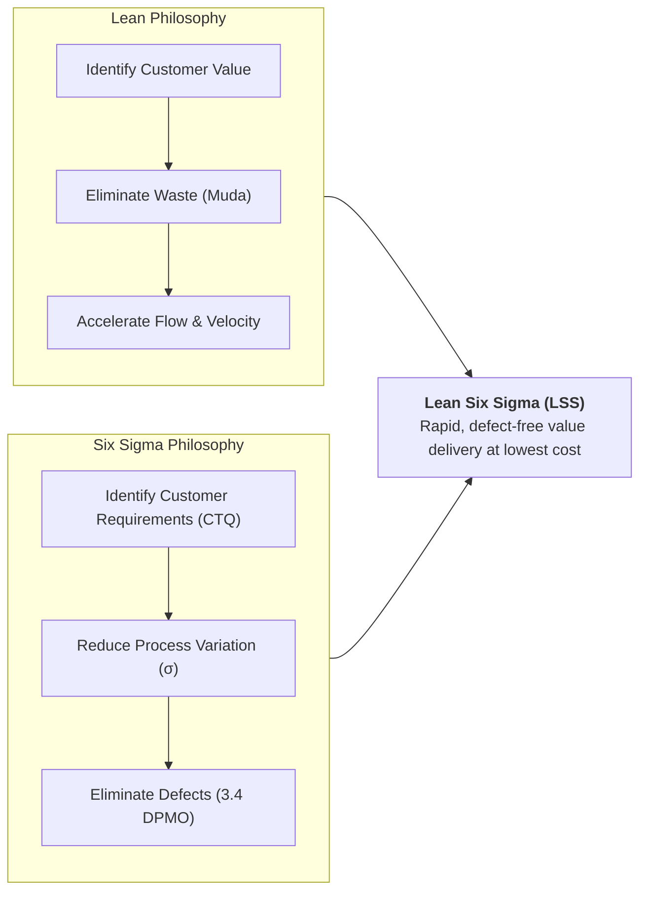
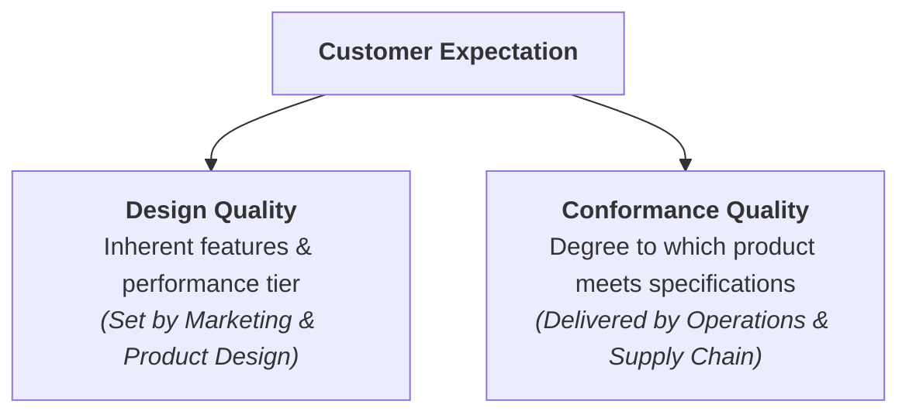
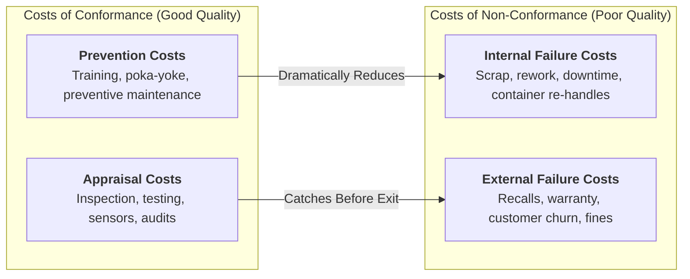
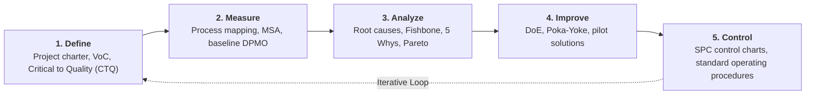
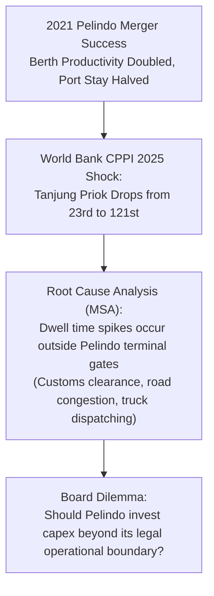

> [!NOTE] Curricular & Faculty Metadata
>
> - **Course:** MK4 Operations and Supply Chain Management — Week 09
> - **Teaching Team:** Noorhan Firdaus Pambudi, Ph.D. (Lead Lecturer), Dr. Yuanita Handayati
> - **Primary Curricular Spine:** `archive/courses/mk4/week-09/[STS] W9 - Lean Six Sigma.pdf` (SBM ITB Master Slide Deck)
> - **Direct Satellites & Case Studies:**
>   - [[courses/mk4-operations-supply-chain-management/week-09/case-pelindo-lean-six-sigma|Case Study: Pelindo — The Score, the Berth, and the Gate That Is Not Ours (SBM-OSCM-2026-03)]]
>   - Corporate Entity: [[entities/pt-pelabuhan-indonesia|PT Pelabuhan Indonesia (Persero)]]

---

## 1. Executive Overview: Unifying Speed and Precision

In classical industrial engineering, operational improvement frequently oscillated between two distinct schools of thought:

1. **The Lean School (Toyota Production System)**: Focuses on velocity, flow, lead-time reduction, and the systematic elimination of non-value-adding waste (_Muda_).
2. **The Six Sigma School (Motorola & GE)**: Focuses on variance reduction, statistical process capability, and eliminating product/service defects.

As codified in our curricular spine, modern enterprises cannot afford to choose between speed and accuracy. An operation that is fast but error-prone generates scrap at maximum velocity; conversely, an operation that is defect-free but weighed down by bureaucratic checking delivers products too late to capture market demand. **[[concepts/lean-six-sigma-dmaic|Lean Six Sigma (LSS)]]** unifies both paradigms into a single operational architecture.

---

## 2. Foundations of Quality: Design Quality vs. Conformance Quality

Operations leaders must rigorously distinguish between two independent dimensions of quality:

| Dimension               | Theoretical Definition                                                                                              | Operational Measurement                                                 | Strategic Executive Rule                                                                                                                     |
| :---------------------- | :------------------------------------------------------------------------------------------------------------------ | :---------------------------------------------------------------------- | :------------------------------------------------------------------------------------------------------------------------------------------- |
| **Design Quality**      | The deliberate tier of features, durability, luxury, and capabilities engineered into the offering.                 | Features, specifications, horsepower, materials, user experience.       | Driven by target customer segment and willing-to-pay. A basic economy product can have outstanding quality if built for that tier.           |
| **Conformance Quality** | The fidelity with which the operational process manufactures or delivers the service relative to design blueprints. | Defect rate, scrap percentage, rework hours, variance ($\sigma$), DPMO. | **Zero tolerance for variance**. Every enterprise, regardless of price point, must deliver $100\%$ conformance to its stated specifications. |

---

## 3. The Cost of Quality (CoQ) Architecture

The financial justification for quality investment is grounded in the **Cost of Quality (CoQ)** framework, which categorizes expenditures into **Costs of Conformance** and **Costs of Non-Conformance**:

### The 1-10-100 Economic Leverage Rule

The lecture emphasizes the non-linear cost escalation of quality failures:

- Spending **$\$1$ in Prevention** (designing error-proof fixturing or training operators) eliminates:
- **$\$10$ in Appraisal costs** (hiring inspectors to catch errors at end-of-line), which in turn prevents:
- **$\$100$ in External Failure costs** (catastrophic field failures, lawsuits, brand damage).

World-class enterprises reallocate capital away from post-hoc inspection toward upfront prevention.

---

## 4. The Six Sigma Empirical Engine & The DMAIC Methodology

Six Sigma defines operational perfection as **$3.4\text{ Defects Per Million Opportunities (DPMO)}$**.

### Understanding the $1.5\sigma$ Long-Term Drift

In a pure theoretical normal distribution, $6\sigma$ corresponds to $2$ parts per billion ($0.002\text{ DPMO}$). However, real-world manufacturing and logistics processes experience natural thermal drift, tool wear, and operator fatigue over extended time horizons. Six Sigma assumes that process means shift by up to **$1.5\sigma$** over the long run:

$$
Z_{\text{effective}} = 6.0\sigma - 1.5\sigma = 4.5\sigma \implies \text{Tail Area} = 3.4\text{ DPMO}
$$

---

## 5. Case Synthesis: Pelindo & The Limits of Operational Control

The class contextualizes Lean Six Sigma in Indonesian state infrastructure through [[courses/mk4-operations-supply-chain-management/week-09/case-pelindo-lean-six-sigma|Case Study: Pelindo — The Score, the Berth, and the Gate That Is Not Ours (SBM-OSCM-2026-03)]].

### Strategic Lessons from the Pelindo Case

1. **Measurement System Analysis (MSA) Trap**: When an external index changes its methodology or measures variables outside an organization's direct control, leaders must separate genuine process failure from measurement system artifacts.
2. **The Ecosystem Boundary**: In maritime supply chains, optimizing the waterside quay crane moves (where Pelindo has $100\%$ control) yields diminishing returns if the landside gate (where Pelindo shares control with Bea Cukai, Quarantine, and private trucking fleets) remains an operational bottleneck.
3. **BUMN Collaborative Governance**: Enterprise excellence in state-owned holding companies requires orchestrating multi-stakeholder digital integration (e.g. unified Truck Appointment Systems and API clearances) to eliminate supply chain friction.

---

## 🔗 Week 09 Direct Curricular Bridges

- Case Study Dossier: [[courses/mk4-operations-supply-chain-management/week-09/case-pelindo-lean-six-sigma|Pelindo: The Score, the Berth, and the Gate That Is Not Ours (SBM-OSCM-2026-03)]]
- Flagship Concept: [[concepts/lean-six-sigma-dmaic|Lean Six Sigma & DMAIC Methodology]]
- Corporate Entity Profile: [[entities/pt-pelabuhan-indonesia|PT Pelabuhan Indonesia (Persero) Profile]]
- Prior Operations Module: [[courses/mk4-operations-supply-chain-management/week-08/index|Week 08: Lean Operations & Waste Elimination (Muda)]]
- Return to [[courses/mk4-operations-supply-chain-management/index|MK4 Course Overview Hub]]
