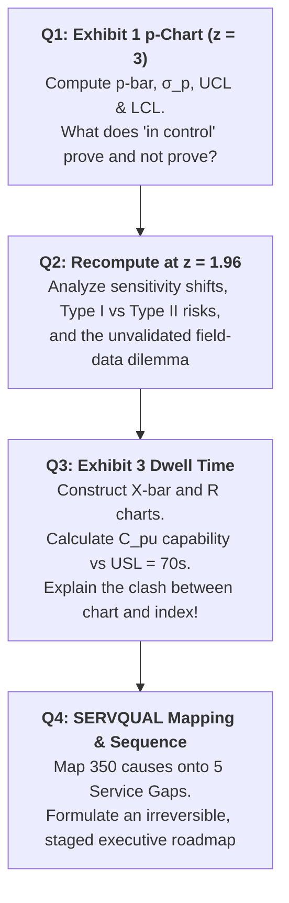
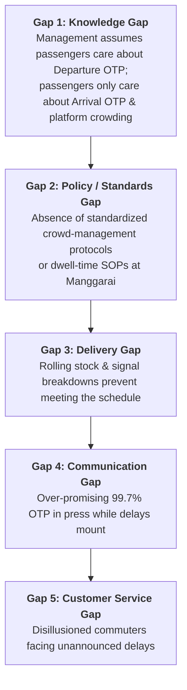

> [!IMPORTANT] Cohort Pre-Class Case Brief (_"Ini Peta, Bukan Jawaban"_)
> **Audience:** P3MD Batch I Soedirman Cohort  
> **Academic Mode:** Pre-Class Quantitative Case & Diagnostic Map  
> **Purpose:** This dossier compiles the complete 24-week journey data, Manggarai dwell-time measurements, PSO contract specifications, and root-cause distributions for the **KAI Commuter** case—**without prescribing final calculation solutions or syndicate recommendations**.

---

## 1. Case Protagonist & Decision Dilemma

At 6:40 a.m. on Monday, 2 March 2026, in the 4th-floor boardroom at Juanda Station, **Rania Prameswari** (VP Operations Quality and Performance at PT Kereta Commuter Indonesia) prepares for an unscheduled board confrontation with the Managing Director:

> _"One question, Rania. Is our process still under control or not? If it is, I can tell the Ministry that the two incidents were anomalies. If it is not, I need to know today—before somebody asks me in a room where I cannot check first."_

Rania faces an intricate statistical and managerial dilemma:

1. **The Punctuality Paradox:** Parent company KAI publicly celebrates **99.77% Departure OTP**, yet **Arrival OTP is 96.05%**—meaning 1 in 25 trains arrives late, touching hundreds of thousands of commuters daily.
2. **The Contract Penalty Ceiling:** The new Ministry Public Service Obligation (PSO) contract imposes financial penalties if late journeys on any line exceed **3.00% per month**.
3. **The Statistical Trap:** Does the data reveal a process in statistical control? If so, why is statistical stability dangerous news when the process is structurally incapable of meeting customer and contractual specifications?

---

## 2. Master Case Exhibits & Quantitative Data

### Exhibit 1: Journeys Not On Time per Week ($n = 500$ Journeys)

_Threshold:_ Arrival $> 5\text{ minutes}$ after timetabled schedule. Discrete attribute data with constant weekly sample size.

|   Week    | Not on Time | Proportion ($p$) |  Week   | Not on Time | Proportion ($p$) |   Week    | Not on Time |    Proportion ($p$)    |
| :-------: | :---------: | :--------------: | :-----: | :---------: | :--------------: | :-------: | :---------: | :--------------------: |
|  **W01**  |     20      |      0.0400      | **W09** |     22      |      0.0440      |  **W17**  |     32      |         0.0640         |
|  **W02**  |     17      |      0.0340      | **W10** |     25      |      0.0500      |  **W18**  |     29      |         0.0580         |
|  **W03**  |     23      |      0.0460      | **W11** |     19      |      0.0380      |  **W19**  |     31      |         0.0620         |
|  **W04**  |     19      |      0.0380      | **W12** |     21      |      0.0420      |  **W20**  |     33      |         0.0660         |
|  **W05**  |     21      |      0.0420      | **W13** |     28      |      0.0560      |  **W21**  |     32      |         0.0640         |
|  **W06**  |     18      |      0.0360      | **W14** |     31      |      0.0620      |  **W22**  |     34      |         0.0680         |
|  **W07**  |     24      |      0.0480      | **W15** |     29      |      0.0580      |  **W23**  |     35      |         0.0700         |
|  **W08**  |     20      |      0.0400      | **W16** |     30      |      0.0600      |  **W24**  |     37      |         0.0740         |
| **Total** |      —      |        —         |    —    |      —      |        —         | **Total** |   **630**   | **$\bar{p} = 0.0525$** |

$$\text{Summary Statistics: } \sum \text{Defective} = 630 \text{ out of } 12,000 \text{ journeys} \implies \bar{p} = \frac{630}{12,000} = \mathbf{0.0525} \quad (5.25\%)$$

---

### Exhibit 2: Performance Specifications in Public Service Contract

| Parameter                                 | Specified Value             | Operational & Financial Consequence                             |
| :---------------------------------------- | :-------------------------- | :-------------------------------------------------------------- |
| **Ceiling on journeys not on time**       | **$\le 3.00\%$**            | Direct reduction in performance payment component of PSO.       |
| **Delay threshold per journey**           | $> 5\text{ minutes}$        | Classified as non-conforming / defective journey.               |
| **Upper limit on interchange dwell time** | **$\le 70\text{ seconds}$** | Exceeding 70s causes delay propagation across following trains. |
| **Unit of assessment**                    | **Per line, per month**     | National/network average cannot offset single line failures.    |

---

### Exhibit 3: Morning Peak Dwell Time at Manggarai Station (Seconds, $n = 5$)

_Measurement:_ From complete train stop to door closure and starting signal across 20 consecutive working days. Continuous variable data.

|      Day       | Obs 1 | Obs 2 | Obs 3 | Obs 4 | Obs 5 |  Subgroup Mean ($\bar{X}$)  | Subgroup Range ($R$) |
| :------------: | :---: | :---: | :---: | :---: | :---: | :-------------------------: | :------------------: |
|     **1**      |  52   |  48   |  55   |  50   |  47   |            50.40            |          8           |
|     **2**      |  50   |  53   |  51   |  48   |  50   |            50.40            |          5           |
|     **3**      |  55   |  58   |  52   |  54   |  51   |            54.00            |          7           |
|     **4**      |  50   |  52   |  49   |  54   |  51   |            51.20            |          5           |
|     **5**      |  53   |  51   |  56   |  50   |  54   |            52.80            |          6           |
|     **6**      |  52   |  49   |  51   |  55   |  50   |            51.40            |          6           |
|     **7**      |  51   |  54   |  49   |  52   |  50   |            51.20            |          5           |
|     **8**      |  51   |  49   |  54   |  50   |  52   |            51.20            |          5           |
|     **9**      |  50   |  54   |  52   |  49   |  53   |            51.60            |          5           |
|     **10**     |  54   |  56   |  51   |  53   |  55   |            53.80            |          5           |
|     **11**     |  50   |  48   |  53   |  51   |  49   |            50.20            |          5           |
|     **12**     |  52   |  55   |  50   |  54   |  51   |            52.40            |          5           |
|     **13**     |  63   |  58   |  66   |  61   |  70   |          **63.60**          |        **12**        |
|     **14**     |  59   |  64   |  68   |  62   |  71   |          **64.80**          |        **12**        |
|     **15**     |  61   |  57   |  65   |  60   |  67   |          **62.00**          |        **10**        |
|     **16**     |  53   |  50   |  56   |  52   |  55   |            53.20            |          6           |
|     **17**     |  51   |  48   |  54   |  50   |  52   |            51.00            |          6           |
|     **18**     |  51   |  54   |  49   |  53   |  52   |            51.80            |          5           |
|     **19**     |  52   |  50   |  55   |  53   |  49   |            51.80            |          6           |
|     **20**     |  54   |  51   |  57   |  52   |  56   |            54.00            |          6           |
| **Grand Mean** |   —   |   —   |   —   |   —   |   —   | **$\bar{\bar{X}} = 53.64$** | **$\bar{R} = 6.50$** |

_Standard ASTM Control Factors for $n = 5$:_ $A_2 = 0.577, D_3 = 0, D_4 = 2.115, d_2 = 2.326$. Upper Specification Limit: $\text{USL} = 70.0\text{ seconds}$.

---

### Exhibit 4: Delay Cause Nominations ($n = 350$ Frontline Respondents)

| Cause Nominated                                            |  Count  | Share (%)  | Primary Operational Category |
| :--------------------------------------------------------- | :-----: | :--------: | :--------------------------- |
| **Rolling stock faults** (doors, braking, traction motor)  |   96    | **27.4%**  | Asset / Rolling Stock        |
| **Infrastructure faults** (overhead line, signals, points) |   74    | **21.1%**  | Asset / Infrastructure       |
| **Excess dwell time at interchange stations**              |   58    | **16.6%**  | Operational Process          |
| **Extreme weather and track flooding**                     |   41    |   11.7%    | External Environment         |
| **External interference** (crossing violations, trespass)  |   33    |    9.4%    | External Environment         |
| **Mismatch between timetable and running time**            |   27    |    7.7%    | Operational Planning         |
| **Late start from origin (inherited delay)**               |   21    |    6.0%    | Operational Dispatching      |
| **Total**                                                  | **350** | **100.0%** | —                            |

---

## 3. Question-by-Question Analytical Roadmap

---

### 🔍 Question 1: Building the $p$-Chart at $z = 3$ (Three-Sigma Limits)

1. **Mathematical Architecture:**
   - $\bar{p} = \frac{630}{12,000} = 0.0525$.
   - $\sigma_p = \sqrt{\frac{\bar{p}(1 - \bar{p})}{n}} = \sqrt{\frac{0.0525 \times 0.9475}{500}} = \sqrt{\frac{0.04974}{500}} \approx 0.009974$.
   - $\text{UCL}_{z=3} = 0.0525 + 3(0.009974) \approx 0.0824 \quad (8.24\%)$.
   - $\text{LCL}_{z=3} = 0.0525 - 3(0.009974) \approx 0.0226 \quad (2.26\%)$.
2. **Reading the Run Pattern:**
   - Notice that every single point from Week 1 to 24 sits between $0.0226$ and $0.0824$. No point crosses the three-sigma limit.
   - **Crucial Diagnostic Run:** Weeks 1–12 sit consistently _below_ the center line ($0.034 - 0.050$), while Weeks 13–24 sit consistently _above_ the center line ($0.056 - 0.074$). A run of 12 consecutive points on one side is statistically impossible by pure chance ($p = 0.5^{12} \approx 0.00024$)! The process mean has shifted.
3. **Managerial Conclusion:**
   - The process is stable _only_ if you ignore the run rule. But even if stable at $5.25\%$, **it is completely failing the contract specification of $\le 3.00\%$**!

---

### ⚖️ Question 2: Recomputing Control Limits at $z = 1.96$ ($95\%$ Limits)

1. **Mathematical Sensitivity:**
   - $\text{UCL}_{z=1.96} = 0.0525 + 1.96(0.009974) \approx 0.0720 \quad (7.20\%)$.
   - $\text{LCL}_{z=1.96} = 0.0525 - 1.96(0.009974) \approx 0.0330 \quad (3.30\%)$.
   - At $z = 1.96$, **Week 24 ($7.40\%$) crosses the upper control limit**!
2. **The Executive Dilemma:**
   - Did the underlying rail process change when Rania switched from $z = 3$ to $z = 1.96$? No. The trains ran at the exact same speeds. What changed was the **risk allocation between Producer Risk ($\alpha$) and Consumer Risk ($\beta$)**.
   - Tight limits ($z = 1.96$) trigger earlier alarms on deteriorating performance, but increase false alarms.
   - **The Measurement Integrity Caveat:** The data is entered manually by station masters whose performance reviews depend on reporting low delays. Before arguing over $z$-scores, management must audit the data collection protocol!

---

### ⏱️ Question 3: Manggarai Dwell Time ($\bar{X}, R$ Charts & $C_{pu}$)

1. **Constructing the Charts:**
   - $R$-Chart: $\text{UCL}_R = D_4 \bar{R} = 2.115 \times 6.50 = 13.75\text{s}, \quad \text{LCL}_R = D_3 \bar{R} = 0$.
   - $\bar{X}$-Chart: $\text{UCL}_{\bar{X}} = \bar{\bar{X}} + A_2 \bar{R} = 53.64 + (0.577 \times 6.50) = 53.64 + 3.75 = 57.39\text{s}, \quad \text{LCL}_{\bar{X}} = 49.89\text{s}$.
   - **The Violation:** On Days 13, 14, and 15, sample means spike to $63.60\text{s}, 64.80\text{s}, 62.00\text{s}$—**shattering the upper control limit of $57.39\text{s}$**!
2. **Process Capability Calculation ($C_{pu}$):**
   - Process standard deviation: $\sigma = \frac{\bar{R}}{d_2} = \frac{6.50}{2.326} \approx 2.795\text{s}$.
   - Upper capability index: $C_{pu} = \frac{\text{USL} - \bar{\bar{X}}}{3\sigma} = \frac{70.0 - 53.64}{3(2.795)} = \frac{16.36}{8.385} \approx \mathbf{1.95}$.
3. **The Clash: Chart Rejection vs. Index Approval:**
   - $C_{pu} = 1.95$ suggests near-Six Sigma capability ($> 1.33$).
   - Yet the control chart screams that the process is out of control on Days 13–15.
   - _Why?_ Process capability indices assume the process is in statistical control! Calculating capability on an unstable, out-of-control process is mathematically invalid and dangerously misleading.

---

### 🛠️ Question 4: Mapping SERVQUAL Gaps & Sequencing the Fix

#### The Irreversible Action Sequence for Rania:

1. **Step 1 (First Priority — Measurement & Truth):** Audit and automate the data recording system. Transition from manual field logs to electronic automated axle-counter and transponder time-stamping. You cannot manage what is corruptly measured.
2. **Step 2 (Root Cause Containment):** Tackle the top Pareto items: rolling stock door/braking faults ($27.4\%$) and infrastructure signaling points ($21.1\%$) before blaming platform passenger behavior.
3. **Step 3 (Operational Dwell-Time Protocols):** Standardize Manggarai interchange procedures to prevent dwell time from drifting beyond 55 seconds during peak crush hours.
4. **What Must Explicitly Wait:** Do NOT adjust timetables (relaxing the 5-minute threshold to 7 minutes) or initiate public PR campaigns until the physical assets and measurement systems are stabilized.

---

## 🔗 Related Portals

- Master Lecture Hub: [[courses/mk4-operations-supply-chain-management/week-10/index|Week 10: Statistical Quality Control]]
- Core Lattice Concept: [[concepts/statistical-process-control|Statistical Process Control (SPC) & Capability]]
- Enterprise Profile: [[entities/pt-kereta-commuter-indonesia|PT Kereta Commuter Indonesia]]
- Course Syllabus Hub: [[courses/mk4-operations-supply-chain-management/index|MK4 Course Index]]
