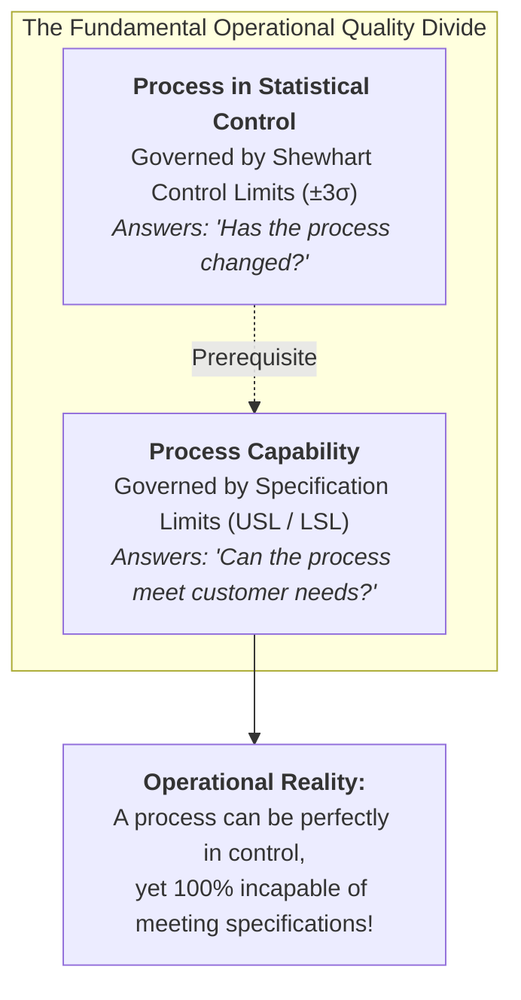
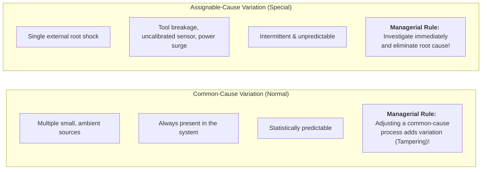
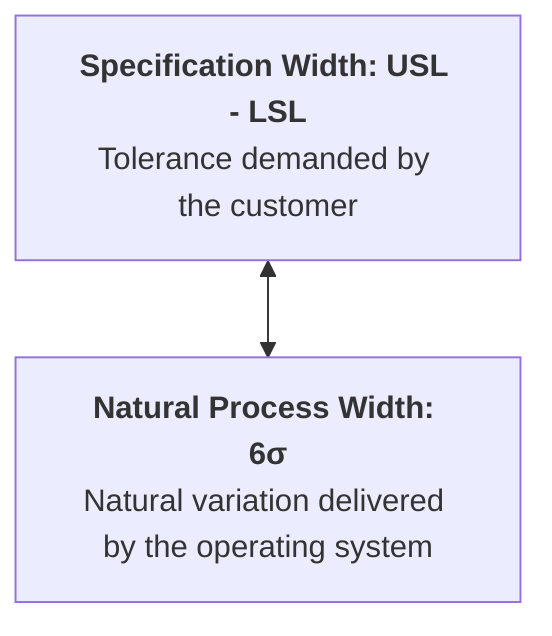
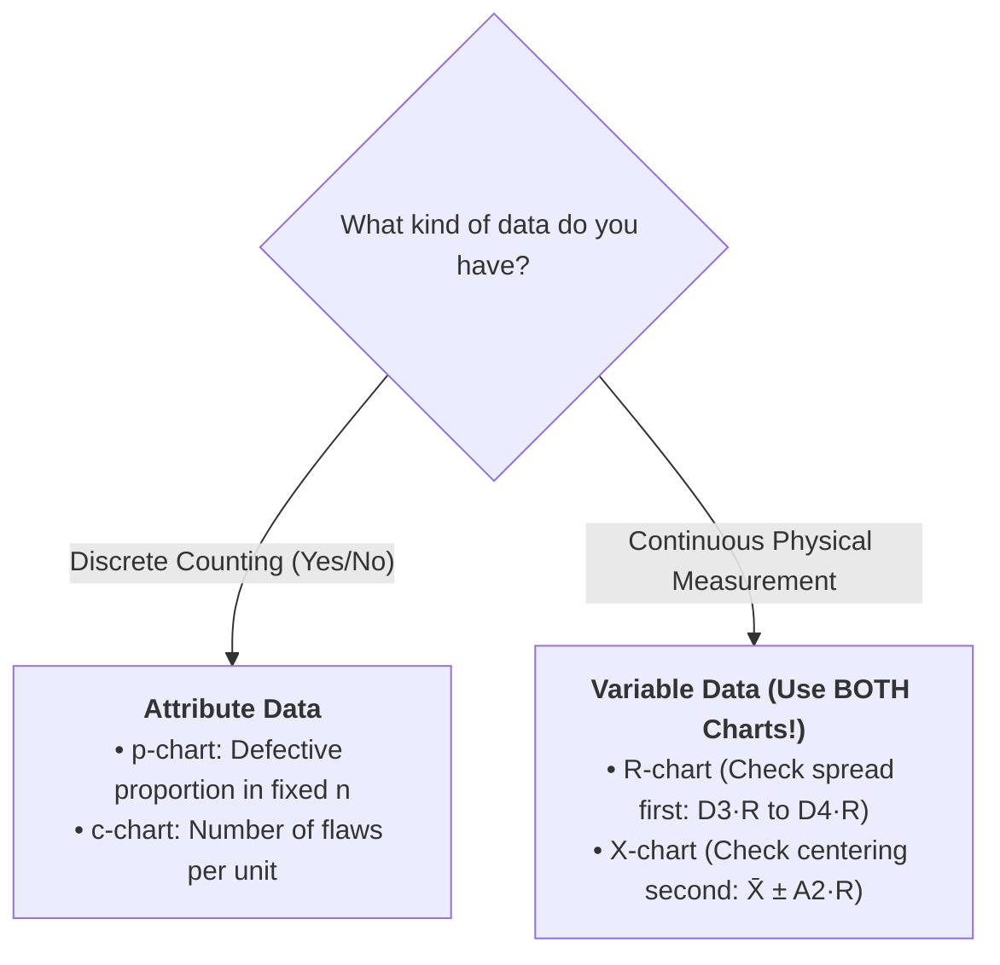
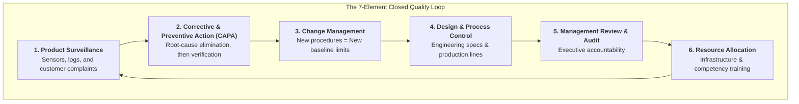
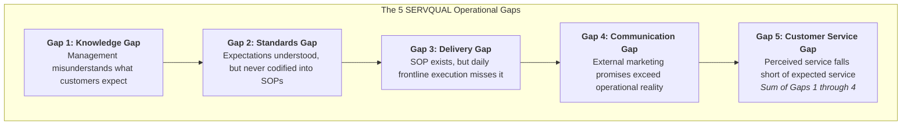

> [!NOTE] Curricular & Faculty Metadata
>
> - **Course:** MK4 Operations & Supply Chain Management — Week 10
> - **Teaching Team:** Dr. Ir. Gatot Yudoko, M.A.Sc., Akbar Adhiutama, S.T., M.A.B., Ph.D., Dr. Mursyid Hasan Basri, S.T., M.T.
> - **Primary Curricular Spine:** `archive/courses/mk4/week-10/[STS] W10 - Statistical Quality Control.pdf`
> - **Teaching Case Dossier:** [[courses/mk4-operations-supply-chain-management/week-10/case-kai-commuter-sqc|Case Study: KAI Commuter — On-Time Performance on Indonesia's Busiest Line (SBM-ITB 26-03)]]
> - **Core Lattice Concept:** [[concepts/statistical-process-control|Statistical Process Control (SPC) & Capability]]
> - **Primary Case Entity:** [[entities/pt-kereta-commuter-indonesia|PT Kereta Commuter Indonesia]]

---

## 1. The Opening Provocation: "Compute First, Conclude Second"

The lecture opens with a fundamental discipline for operations leaders:

> _"Bring the calculation, not an impression—and name the number that would change your mind."_

In operations management, quality is frequently conflated with subjective perceptions, marketing slogans, or executive defensiveness. When service failures occur, leaders reflexively blame frontline staff or dismiss crises as isolated anomalies.

**Statistical Quality Control (SQC)** provides the mathematical instrument to separate emotion from systemic reality. It equips leaders to answer two distinct, non-interchangeable questions:

1. **Is the process in statistical control?** (Are variations predictable and stable over time?)
2. **Is the process capable?** (Does that stable output actually meet customer and contractual specifications?)

---

## 2. Foundations: Shewhart's Two Kinds of Variation

Pioneered by Walter Shewhart and championed by W. Edwards Deming, all operational variation stems from two distinct sources:

### The Two Deadly Quality Sins

1. **Tampering (Rule 1 Violation):** Treating a common-cause fluctuation as an assignable cause. Reacting to routine daily noise by adjusting machine settings or scolding operators paradoxically widens process spread and increases defects.
2. **Neglect (Rule 2 Violation):** Treating an assignable-cause shock as common-cause noise. Ignoring special-cause signals allows processes to drift permanently into defect-generating chaos.

---

## 3. Specification Limits vs. Process Limits

- **Specification Limits (USL / LSL):** Determined by customer requirements, engineering blueprints, or legal service level agreements (SLAs). Set externally by designers or clients.
- **Process Limits ($\text{UCL} / \text{LCL} = \mu \pm 3\sigma$):** Determined by the natural statistical physics of the operating system. Measured internally from historical sample data.

### Quantifying Capability: $C_p$ and $C_{pk}$

$$C_p = \frac{\text{USL} - \text{LSL}}{6\sigma}$$

When the process distribution mean $\mu$ drifts away from the nominal midpoint, actual capability is evaluated against the closer specification limit:

$$C_{pk} = \min\left( \frac{\text{USL} - \mu}{3\sigma}, \, \frac{\mu - \text{LSL}}{3\sigma} \right)$$

- **$C_p$ (Potential Capability):** Measures whether the spread would fit inside tolerances if the process were perfectly centered.
- **$C_{pk}$ (Actual Capability):** Penalizes the process for being off-target relative to the nearest specification limit.
- **Benchmark Thresholds:** $C_{pk} < 1.0$ (Incapable; active defects); $C_{pk} \ge 1.33$ (Capable 4-Sigma baseline); $C_{pk} \ge 2.0$ (World-Class Six Sigma, generating $\le 3.4$ defects per million opportunities).

---

## 4. Control Charts, SPC & Acceptance Sampling

### Attribute vs. Variable Control Charts

The nature of the collected data dictates which control chart must be constructed:

| Data Type          | Measurement Nature                                        | Standard Control Charts                                                 | Control Limit Formulas                                                                                                           |
| :----------------- | :-------------------------------------------------------- | :---------------------------------------------------------------------- | :------------------------------------------------------------------------------------------------------------------------------- |
| **Attribute Data** | Discrete count (Pass/Fail, On-Time/Late, Go/No-Go)        | **$p$-chart** (fraction defective) **$c$-chart** (defects per unit) | $p\text{-chart: } \bar{p} \pm z \sqrt{\frac{\bar{p}(1-\bar{p})}{n}}$ $c\text{-chart: } \bar{c} \pm z \sqrt{\bar{c}}$         |
| **Variable Data**  | Continuous physical dimension (seconds, mm, kg, pressure) | **$\bar{X}$-chart** (centering) $+$ **$R$-chart** (dispersion)      | $\bar{X}\text{-chart: } \bar{\bar{X}} \pm A_2 \bar{R}$ $R\text{-chart: } \text{UCL} = D_4 \bar{R}, \text{LCL} = D_3 \bar{R}$ |

### The Hidden Rule: Inside the Limits $\ne$ "All Clear"

Even if every sample point falls strictly inside the upper and lower control limits, a process is **out of control** if non-random behavior appears:

- **Runs:** 7 or 8 consecutive points falling entirely on one side of the center line.
- **Trends:** 6 consecutive points steadily increasing or decreasing.
- **Hugging the Limit:** Multiple points clustering tightly against the $3\sigma$ boundaries.
- **Cycles:** Sinusoidal or recurring periodic swings.

### Acceptance Sampling & The Operating Characteristic (OC) Curve

Used when inspecting lots of existing parts rather than running lines:

- **Parameters:** Sample size $n$ and acceptance threshold $c$.
- **Producer's Risk ($\alpha$):** The probability of rejecting a good lot whose quality is $\le \text{AQL}$ (Acceptable Quality Level). Typically $\alpha = 0.05$.
- **Consumer's Risk ($\beta$):** The probability of accepting a bad lot whose quality is $\ge \text{LTPD}$ (Lot Tolerance Percent Defective). Typically $\beta = 0.10$.

---

## 5. Quality Management Systems (QMS) & Quality 4.0

A control chart is merely an instrument; the **Quality Management System (QMS)** is the institutional engine that acts upon its readings:

### Quality 4.0 & The Analytics Ladder

Quality 4.0 integrates IoT edge sensors, automated machine vision, and real-time streaming analytics to push quality management up the analytics hierarchy:

$$\text{Descriptive (What happened?)} \rightarrow \text{Diagnostic (Why did it happen?)} \rightarrow \text{Predictive (What will happen?)} \rightarrow \text{Prescriptive (How do we prevent it?)}$$

> [!CAUTION] The Quality 4.0 Illusion
> Collecting high-frequency automated data shows a failing process faster—**it does not make the process better**. A stable-but-incapable operating system remains incapable regardless of sensor density.

---

## 6. Service Quality: SERVQUAL, The 5 Gaps & RATER

Service operations differ from manufacturing because service production and consumption occur simultaneously. Pioneered by Parasuraman, Zeithaml & Berry, **service quality is a distance between expectation and perception, not an absolute score**.

### The 5 RATER Customer Dimensions

1. **Reliability:** Delivering the promised service dependably and accurately. _(Only Reliability fits on a statistical control chart)._
2. **Assurance:** Frontline knowledge, competence, and courtesy that inspire trust.
3. **Tangibles:** Physical facilities, rolling stock cleanliness, modern ticketing equipment.
4. **Empathy:** Caring, individualized attention given to passengers during disruptions.
5. **Responsiveness:** Prompt service recovery and willingness to assist.

---

## 7. Indonesian Infrastructure Case: KAI Commuter

In our [[courses/mk4-operations-supply-chain-management/week-10/case-kai-commuter-sqc|KAI Commuter Teaching Case]], SBM ITB analyzes urban rail transit across Greater Jakarta:

- **The Finding:** While the 24-week $p$-chart shows points inside $3\sigma$ limits, **Weeks 13–24 sit entirely above the mean ($5.25\%$)**, signaling a process shift following the introduction of a high-frequency 1,100-train daily timetable.
- **The Dilemma:** Even if stable, the process runs at $5.25\%$ late journeys—**violating the $\le 3.00\%$ Ministry PSO penalty threshold**.
- **The Lesson:** Fixing KAI Commuter requires capital expenditure on signaling interlocks and rolling stock door maintenance, rather than blaming frontline platform marshals at Manggarai Station.

---

## 🔗 Curricular Satellites & Further Study

- **Teaching Case Dossier:** [[courses/mk4-operations-supply-chain-management/week-10/case-kai-commuter-sqc|Case Study: KAI Commuter SQC Analysis]]
- **Core Concept Page:** [[concepts/statistical-process-control|Statistical Process Control (SPC) & Capability]]
- **Enterprise Profile:** [[entities/pt-kereta-commuter-indonesia|PT Kereta Commuter Indonesia]]
- **Course Syllabus Hub:** [[courses/mk4-operations-supply-chain-management/index|MK4 Course Index]]
