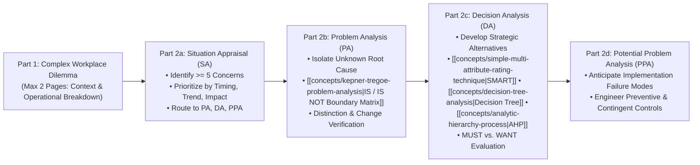
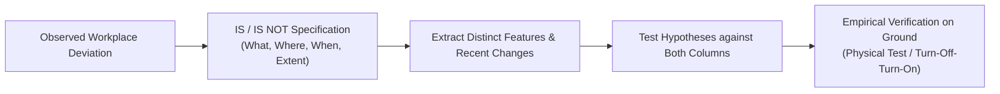
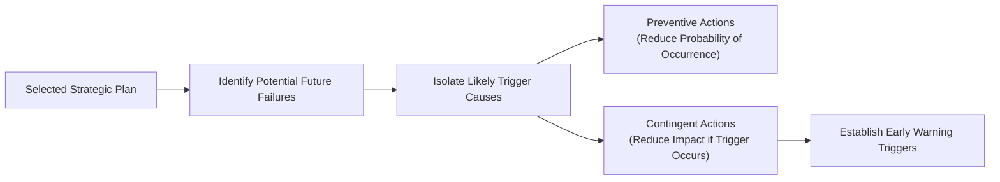

## 🧭 Executive Overview & Examination Protocol

The **MK5 Take-Home Mid-Term Examination** represents the individual synthesis capstone for the first half of the **Problem Solving, Decision Making and Negotiation** curriculum at SBM ITB. Under [[entities/valid-hasyimi|Dr. Valid Hasyimi]] and the executive teaching team, participants are tasked with applying the full suite of rational decision sciences to a live, complex operational crisis within their respective sponsoring enterprise or parent conglomerate (_BUMN / Sovereign Holding_).

This dossier establishes the authoritative methodological reference architecture for structuring an institutional-grade, five-page executive examination submission, integrating **Situation Appraisal (SA)**, **Problem Analysis (PA)**, **Decision Analysis (DA)**, and **Potential Problem Analysis (PPA)**.

---

## 📜 Official Examination Rules & Administrative Directives

> [!IMPORTANT]
> **Strict SBM ITB Academic Regulations**:
>
> - **Format**: Individual and independent work. Strict maximum limit of **5 (five) pages** of substantive text (single space, Arial 10) plus **1 page mandatory signed Academic Integrity Statement**.
> - **Submission Deadline**: Wednesday, **28 October 2026 at 23:59 WIB** via Google Classroom.
> - **Naming Convention**: `DM_Class_StudentID_YourName.pdf` (e.g., `DM_F_322_Maintainer.pdf`).
> - **Evaluation Philosophy**: Quality over quantity. Zero tolerance for unverified AI hallucination or superficial descriptive summaries.

---

## 📑 Section 1: Complex Workplace Situation Description (15 Points)

The opening section (maximum 2 pages) requires a clear, concrete description of an authentic organizational dilemma within the candidate's professional domain:

### Diagnostic Requirements

1. **Institutional Setting & Mandate**: Name the enterprise, operating division, and strategic mandate (e.g., downstream logistics, mining asset decarbonization, public healthcare supply).
2. **The Disruption / Crucible**: Document the specific operational, financial, or technical deviation that disrupted standard operating baselines (e.g., throughput decline, contract dispute, regulatory penalty).
3. **Multi-Stakeholder Tensions**: Map the divergent objectives and political friction among internal stakeholders (e.g., Operations vs. Finance vs. Board of Commissioners).
4. **Data Specificity**: Ground the narrative in verifiable baseline metrics: throughput volumes, EBITDA margins, cash runway, failure percentages, and statutory deadlines.

---

## 🔍 Section 2A: Situation Appraisal (SA) Prioritization (20 Points)

Candidates must separate the general organizational mess into a minimum of **5 discrete, actionable concerns**, evaluated across **Timing, Trend, and Impact (TTI)**:

| Concern # | Specific Operational Concern                                                | Timing (T) | Trend (T)  | Impact (I) |      Assigned Rational Process       |        Designated Governance Owner         |
| :-------: | :-------------------------------------------------------------------------- | :--------: | :--------: | :--------: | :----------------------------------: | :----------------------------------------: |
|  **C1**   | Unexplained equipment thermal degradation / operational line failure.       |  **High**  |  **High**  |  **High**  |      **Problem Analysis (PA)**       | Chief Operating Officer / Maintenance Head |
|  **C2**   | Capital allocation deadlock among competing expansion alternatives.         |  **High**  | **Medium** |  **High**  |      **Decision Analysis (DA)**      |         Investment Committee / CFO         |
|  **C3**   | Cash flow drain from slow inventory turns and vendor payment mismatches.    | **Medium** |  **High**  |  **High**  |      **Problem Analysis (PA)**       |      Treasury / Working Capital Lead       |
|  **C4**   | Regulatory compliance risk from new emissions or local content laws.        |  **High**  | **Medium** |  **High**  | **Potential Problem Analysis (PPA)** |        Legal & Compliance Director         |
|  **C5**   | Cross-holding organizational friction resisting shared-service integration. | **Medium** | **Medium** | **Medium** |      **Decision Analysis (DA)**      |        HR & Change Management Lead         |

---

## 🔬 Section 2B: Problem Analysis (PA) — Isolating the True Cause (20 Points)

Candidates select the primary operational deviation (Concern C1) and apply [[concepts/kepner-tregoe-problem-analysis|Kepner-Tregoe Problem Analysis]] using an exhaustive **IS / IS NOT Matrix**:

$$\text{Plausibility Check: } H_k \text{ must account for BOTH the IS and the IS NOT without unproven assumptions.}$$

### The 4-Dimensional Specification Framework

1. **WHAT**: Exact object/SKU and specific defect observed vs. closely related object/defect not observed.
2. **WHERE**: Exact physical/geographic location of fault vs. adjacent locations free of error.
3. **WHEN**: First observation timestamp and process cycle phase vs. prior operating windows.
4. **EXTENT**: Number of affected units, defect severity, and trend trajectory.

---

## ⚖️ Section 2C: Decision Analysis (DA) — Alternative Selection (30 Points)

Candidates resolve the primary strategic choice (Concern C2) using a formal quantitative MCDA methodology:

### Path A: Edwards' SMART Model (Swing Weighting)

When evaluating multi-attribute alternatives across qualitative and quantitative dimensions:

- Structure a value tree reflecting [[concepts/value-focused-thinking|Fundamental Objectives]].
- Execute the swing weighting protocol across the range of variation ($s_i \rightarrow w_i$).
- Normalize utilities onto $[0, 100]$ and calculate composite utility $U(A) = \sum w_i u_i$.
- Trade off benefits against capital costs on an efficient frontier.

### Path B: Decision Tree Analysis under Uncertainty

When the decision unfolds sequentially under probabilistic risk:

- Map decision nodes ($\square$), chance nodes ($\bigcirc$), and terminal payoffs.
- Execute backward induction rollback computing $\text{EMV} = \sum p_i V_i$.
- Calculate the Expected Value of Sample Information ($\text{EVSI}$) to evaluate pilot testing.

### Path C: Saaty's Analytic Hierarchy Process (AHP)

When trade-offs involve complex ratio-scale human judgments:

- Build reciprocal pairwise matrices across 1–9 comparison scales.
- Extract principal eigenvector weights $\mathbf{A} \mathbf{w} = \lambda_{\max} \mathbf{w}$.
- Prove consistency: $CI = \frac{\lambda_{\max}-n}{n-1}$, $CR = \frac{CI}{RI} < \mathbf{0.10}$.

---

## 🛡️ Section 2D: Potential Problem Analysis (PPA) (15 Points)

To safeguard execution of the chosen decision, candidates construct a complete PPA matrix:

| Potential Failure Mode            | Likely Trigger Cause                                       | Preventive Action (Reduce Likelihood)                                                | Contingent Action (Reduce Damage)                                    | Trigger Indicator                                |
| :-------------------------------- | :--------------------------------------------------------- | :----------------------------------------------------------------------------------- | :------------------------------------------------------------------- | :----------------------------------------------- |
| **Supply partner SLA default**    | Financial distress or raw material scarcity.               | Require audited financial proofs; dual-source 30% volume to secondary vendor.        | Activate pre-negotiated backup contract with approved spot supplier. | 3 consecutive shipment delays $> 48\text{ hrs}$. |
| **Frontline operator resistance** | Inadequate change enablement and perceived workload surge. | Involve unit leads in workflow design; provide performance-linked incentive bonuses. | Deploy mobile coaching task force; revise ergonomic shift rotation.  | Weekly error rate $> 5\%$ in pilot cell.         |

---

## 🔗 Related Resources & Master Curricular Hubs

- Foundations: [[courses/mk5-decision-making-negotiation/week-01/index|Week 01: Intuition vs. Deliberation]]
- Institutional Governance: [[courses/mk5-decision-making-negotiation/week-02/index|Week 02: Rational Framework & AKHLAK]]
- Diagnostic Engine: [[courses/mk5-decision-making-negotiation/week-03/index|Week 03: Kepner-Tregoe Problem Analysis]]
- Value Design: [[courses/mk5-decision-making-negotiation/week-04/index|Week 04: Value-Focused Thinking (VFT)]]
- Multi-Criteria Scoring: [[courses/mk5-decision-making-negotiation/week-05/index|Week 05: SMART Methodology]]
- Uncertainty Modeling: [[courses/mk5-decision-making-negotiation/week-06/index|Week 06: Decision Trees & Rollback]]
- Advanced Prioritization: [[courses/mk5-decision-making-negotiation/week-07/index|Week 07: Analytic Hierarchy Process (AHP)]]
- Negotiation Strategy: [[courses/mk5-decision-making-negotiation/week-08/index|Week 08: Negotiation Architecture & ZOPA]]
