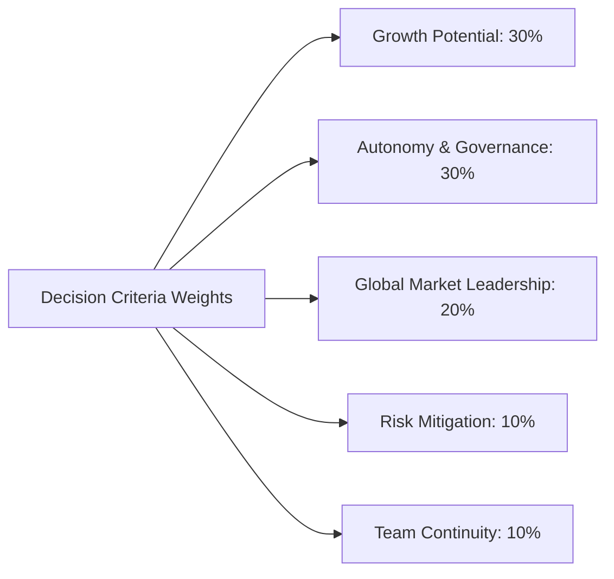

## 🎯 Assignment Mandate & Core Diagnostic Scope

The Week 01 case assignment requires syndicate teams to conduct a prescriptive decision analysis on the **Viral Nation** dilemma:

1. **Core Problem Definition**: Define whether founders Joe Gagliese and Mathew Micheli should accept an acquisition offer or remain independent in March 2020 under COVID-19 uncertainty.
2. **Framework Application**: Apply a structured prescriptive decision framework (e.g., Multi-Attribute Weighted Decision Matrix) under bounded rationality (Goodwin & Wright, 2000).
3. **Objective Weighting**: Formulate objective criteria reflecting founder aspirations, organizational resilience, and external market threats.
4. **Strategic Recommendation**: Deliver an evidence-grounded recommendation with explicit risk contingencies and trade-off defense.

> [!NOTE] Cohort Attribution
> This analysis synthesizes the reference decision model formulated by **`F9 (Class F / Syndicate 9)`** within the SBM ITB P3MD Executive MBA program.

---

## ⚖️ Prescriptive Weighted Decision Model

Under bounded rationality, human decision makers cannot process infinite contingencies; prescriptive modeling provides a transparent scoring mechanism across defined organizational objectives.

### Objective Weighting Taxonomy (Total = 100%)

Based on the founders' stated priorities to retain operational control for 3–5 years while mitigating pandemic solvency risk:

- **Growth Potential ($30\%$)**: Ability to expand client roster, enter new service lines, and scale tech platforms.
- **Autonomy & Governance ($30\%$)**: Freedom to make strategic product and personnel choices without corporate veto.
- **Global Market Leadership ($20\%$)**: Synergy to penetrate international markets (Asia-Pacific, Europe, US media).
- **Risk Mitigation ($10\%$)**: Protection of company cash flow and founder liquidity against macroeconomic collapse.
- **Team & Cultural Continuity ($10\%$)**: Retention of core creative talent and entrepreneurial culture.

---

## 📊 Comprehensive Evaluation Matrix

Scores are assessed on a standardized interval of $1$ (Poor / Unacceptable) to $10$ (Exceptional / Fully Aligned):

| Strategic Alternative                           | Growth (0.30) | Autonomy (0.30) | Global (0.20) | Risk (0.10) | Team (0.10) | Weighted Total Score | Rank  |
| :---------------------------------------------- | :-----------: | :-------------: | :-----------: | :---------: | :---------: | :------------------: | :---: |
| **Option 1: Asian Marketing Conglomerate**      |  8.0 (2.40)   |   4.0 (1.20)    |  9.0 (1.80)   | 8.0 (0.80)  | 5.0 (0.50)  |       **6.70**       |   3   |
| **Option 2: Los Angeles PR & Talent Firm**      |  7.5 (2.25)   |   6.5 (1.95)    |  7.0 (1.40)   | 7.0 (0.70)  | 8.0 (0.80)  |       **7.10**       |   2   |
| **Option 3: Global Holding Advertising Agency** |  7.0 (2.10)   |   3.0 (0.90)    |  8.5 (1.70)   | 6.0 (0.60)  | 4.0 (0.40)  |       **5.70**       |   4   |
| **Option 4: Retain Independence (Status Quo)**  |  9.0 (2.70)   |   10.0 (3.00)   |  6.0 (1.20)   | 4.0 (0.40)  | 9.0 (0.90)  |       **8.20**       | **1** |

$$\text{Weighted Utility } U(A_k) = \sum_{i=1}^{5} w_i \cdot s_{ik}$$

$$\text{Option 4 (Independence)}: (0.30 \times 9) + (0.30 \times 10) + (0.20 \times 6) + (0.10 \times 4) + (0.10 \times 9) = 2.70 + 3.00 + 1.20 + 0.40 + 0.90 = \mathbf{8.20}$$

---

## 💡 Strategic Synthesis & Syndicate Defense

### Recommended Action: Retain Strategic Independence

Syndicate 9’s model demonstrates that **remaining independent (Option 4)** achieves the highest overall alignment ($\mathbf{8.20}$ points), heavily propelled by the founders' non-negotiable requirement for operational autonomy and unconstrained upside.

### Sensitivity & Contingency Plan

1. **COVID-19 Cash Buffer**: Secure a standby working capital credit line and shift talent compensation toward performance-contingent rev-shares to absorb short-term ad spend freezes.
2. **Re-Opening Window**: Re-evaluate M&A options in Q3 2021 when digital ad spend metrics prove whether remote lifestyle acceleration is secular or transitory.
3. **Earnout Trap Avoidance**: Option 3 (Global Holding Agency) is definitively rejected due to low autonomy ($3.0$) and high vulnerability to earnout clawbacks during macroeconomic volatility.

---

## 🔗 Related Resources

- Master Lecture Hub: [[courses/mk5-decision-making-negotiation/week-01/index|MK5 Week 01 Lecture Notes]]
- Case Dossier: [[courses/mk5-decision-making-negotiation/week-01/case-viral-nation|Case Study: Viral Nation]]
- Relevant Concept: [[concepts/simple-multi-attribute-rating-technique|SMART & Multi-Attribute Rating]]
- Theory Note: [[courses/mk5-decision-making-negotiation/week-01/reading-intuition-vs-deliberation|Reading: Intuition vs. Deliberation]]
