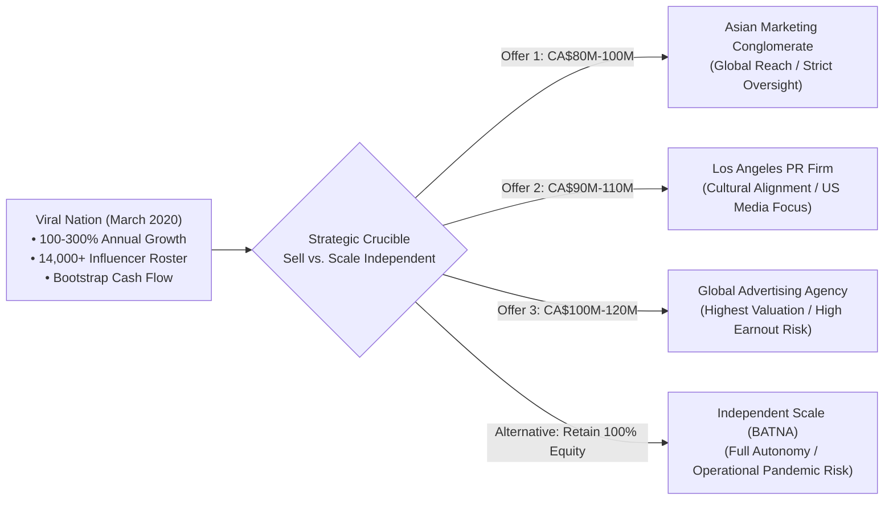

## 📋 Executive Summary

In March 2020, as the global COVID-19 pandemic declared a state of emergency across North America, **Joe Gagliese** and **Mathew Micheli**, co-founders of **Viral Nation Inc.**, faced the defining strategic decision of their entrepreneurial careers. Viral Nation, a high-growth social media talent agency and influencer marketing technology firm based in Toronto, had scaled from a bootstrapped start-up in 2014 into a dominant global player generating **100%–300% annual revenue growth**.

With over **14,000 global influencers** under contract and executing campaigns for 50 to 100 enterprise brands weekly, Viral Nation received three unsolicited acquisition offers from elite international media conglomerates valued between **CA\$80 million and CA\$120 million**. The founders confronted extreme cognitive tension: monetize life-changing personal liquidity at peak valuation before a potential pandemic-induced recession, or retain independent ownership and capture the exponential acceleration of digital e-commerce and creator economies.

---

## 🏢 Enterprise Profile & Market Position

Viral Nation was established in 2014 when social media influencer marketing was widely dismissed as an unscalable novelty. Gagliese and Micheli pioneered performance-driven influencer campaigns by coupling creator talent management with proprietary data analytics and sentiment tracking.

### Operational Scale at Decision Point (March 2020)

- **Talent Network**: Exclusive representation of elite digital creators and non-exclusive syndication across 14,000+ vetted influencers globally.
- **Enterprise Client Portfolio**: Retained agency of record for global consumer electronics, gaming, and lifestyle brands (e.g., Tencent, Activision Blizzard, Crayola, Baidu).
- **Financial Profile**: Fully self-funded without prior venture capital dilution, maintaining operating profitability and high cash conversion.
- **Growth Velocity**: Three-year compound revenue expansion exceeding 200% annually, driven by expansion into performance marketing, creative content production, and enterprise influencer software.

---

## ⚖️ Strategic Dilemma: Acquisition Options vs. Independence

The founders evaluated four mutually exclusive pathways under conditions of bounded rationality:

| Strategic Alternative                                | Valuation & Structure                                               | Key Strategic Benefits                                                                                       | Severe Risks & Friction Points                                                                               |
| :--------------------------------------------------- | :------------------------------------------------------------------ | :----------------------------------------------------------------------------------------------------------- | :----------------------------------------------------------------------------------------------------------- |
| **Option 1: Asian Marketing Conglomerate**           | CA\$80M–CA\$100M (60% Cash, 40% Earnout over 3 years)            | Massive operational access to Asia-Pacific digital advertising markets; non-compete buffers.                 | Strict centralized reporting; potential loss of creative autonomy; divergent corporate cultures.             |
| **Option 2: Los Angeles PR & Talent Firm**           | CA\$90M–CA\$110M (70% Cash, 30% Equity rollover)                 | Exceptional brand synergy with Hollywood studios, celebrity cross-over talent, and US media buyers.          | Geographic concentration in US entertainment; lower cash upfront compared to top conglomerate bids.          |
| **Option 3: Global Holding Advertising Agency**      | CA\$100M–CA\$120M (50% Cash, 50% Aggressive Performance Earnout) | Highest nominal purchase price; integration into multinational Fortune 500 corporate brand accounts.         | High risk of failing earnout hurdles under pandemic disruption; bureaucracy and corporate restructuring.     |
| **Option 4: Retain Independence (Status Quo BATNA)** | Zero immediate liquidity; 100% Equity Retained                   | Preserves complete executive autonomy; zero corporate interference; captures 100% upside from digital surge. | Extreme macro uncertainty; operational vulnerability if enterprise marketing budgets freeze during COVID-19. |

---

## 🧠 Cognitive Traps & Behavioral Dynamics

The Viral Nation decision highlights classical behavioral decision-making traps studied in managerial decision science:

1. **The Outcome Bias Trap**: Evaluating the quality of the founders' decision based solely on how the pandemic subsequently unfolded (e-commerce explosion) rather than the rationality of their choice given information available in March 2020.
2. **Loss Aversion ($2.5\times$ Asymmetry)**: The psychological pain of turning down CA\$50M+ guaranteed cash and watching the venture fail exceeds the pleasure of doubling enterprise value independently.
3. **Escalation of Commitment**: Deep personal identity and ego invested in maintaining control versus objective financial portfolio diversification.

---

## 🔗 Cross-Curricular Connections

- **[[courses/mk5-decision-making-negotiation/week-01/index|MK5 Week 01 (Foundations of Decision Making)]]**: Core classroom case for contrasting intuitive risk tolerance with deliberative multi-attribute evaluation.
- **[[courses/mk5-decision-making-negotiation/week-01/assignment-viral-nation|Syndicate 9 Worked Assignment]]**: Prescriptive weighted decision matrix and recommendation analysis.
- **[[concepts/batna-and-zopa|BATNA and ZOPA]]**: Quantifying the founders' reservation price against strategic acquisition offers.
- **[[courses/mk2-financial-management-strategy/week-07/index|MK2 Equity Valuation & Cost of Capital]]**: Discounted cash flow (DCF) and transaction multiples in high-growth tech firms.
