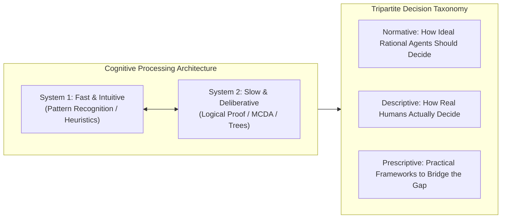
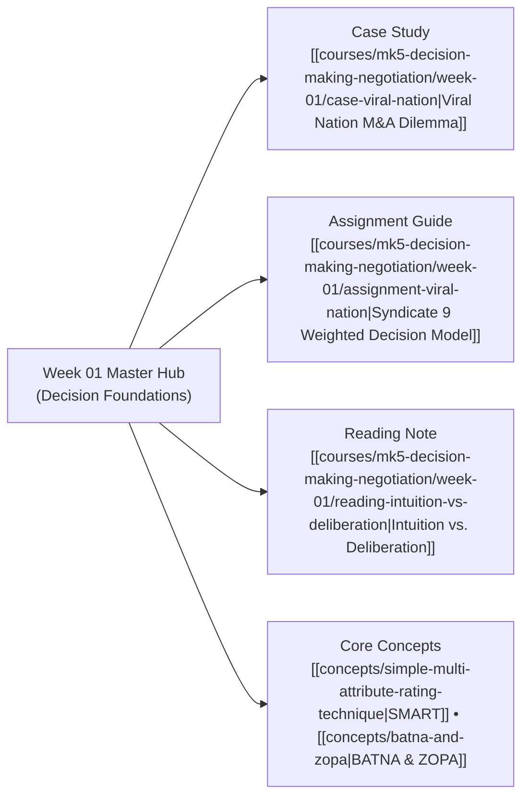

## 🧭 Executive Overview & Curricular Context

**MK5 Week 01** launches the executive study of managerial decision science at SBM ITB under [[entities/valid-hasyimi|Dr. Valid Hasyimi]]. The session dismantles the common executive assumption that high-level decision makers operate as hyper-rational calculating machines. Instead, it exposes the cognitive frictions, perceptual illusions, and emotional heuristics that influence judgment under risk and extreme market volatility.

Through diagnostic warm-up experiments, mathematical demonstrations, and the live M&A dilemma of **Viral Nation**, participants examine how intuitive cognitive shortcuts (**System 1**) interact with structured analytical deliberation (**System 2**), setting the methodological foundation for advanced rational frameworks throughout the course.

---

## 🏛️ The Tripartite Taxonomy of Decision Science

Managerial decision literature classifies decision models into three complementary paradigms:

| Paradigm                           | Philosophical Origin                                                | Core Analytical Question                                        | Methodological Tools & Role                                                                                     |
| :--------------------------------- | :------------------------------------------------------------------ | :-------------------------------------------------------------- | :-------------------------------------------------------------------------------------------------------------- | ------------------------------------------ | ------------------------------------------------------- | ---------------------------------------------------- | ------------------------------------------------------------ |
| **Normative Decision Theory**      | Economics, Game Theory, Mathematics (von Neumann-Morgenstern).      | _How should an ideal, fully informed rational agent decide?_    | Expected Utility Theory, formal axioms of transitivity and independence; defines the theoretical gold standard. |
| **Descriptive Decision Theory**    | Cognitive Psychology, Behavioral Economics (Kahneman, Tversky).     | _How do real human beings actually make choices in reality?_    | Prospect Theory, cognitive heuristics, emotion, bounded rationality; identifies systemic flaws and traps.       |
| **Prescriptive Decision Analysis** | Management Science, Decision Engineering (Goodwin, Wright, Keeney). | _How can real managers realistically improve decision quality?_ | [[concepts/simple-multi-attribute-rating-technique                                                              | SMART]], [[concepts/decision-tree-analysis | Decision Trees]], [[concepts/analytic-hierarchy-process | AHP]], and [[concepts/kepner-tregoe-problem-analysis | Kepner-Tregoe]]; pragmatic frameworks correcting human bias. |

---

## 🧠 Cognitive Mechanics: The Dual-Process Engine

Dr. Valid Hasyimi leads participants through real-time cognitive drills demonstrating the distinct energy and speed profiles of **System 1** and **System 2**:

### The Arithmetic Complexity Drill

- Problem A: $13 + 13 = 26$ (Instantaneous, effortless recall via System 1).
- Problem B: $200 - 25 = 175$ (Rapid automated subtraction).
- Problem C: $17 \times 24 = 408$ (Immediate pupil dilation, mental calculation, high energy expenditure via System 2).

### The Anchoring Experiment ($8!$ Demonstration)

When asked to guess the product of eight integers within 5 seconds:

- Group 1 presented with descending order: $8 \times 7 \times 6 \times 5 \times 4 \times 3 \times 2 \times 1 \rightarrow \text{Median Estimate: } \mathbf{2,250}$.
- Group 2 presented with ascending order: $1 \times 2 \times 3 \times 4 \times 5 \times 6 \times 7 \times 8 \rightarrow \text{Median Estimate: } \mathbf{512}$.
- Actual Mathematical Product: $8! = \mathbf{40,320}$.

> [!IMPORTANT]
> **The Anchoring Imperative**:
> The first numbers computed ($8 \times 7 = 56$ vs. $1 \times 2 = 2$) serve as powerful cognitive anchors. Even when executives know their calculation is incomplete, they fail to adjust sufficiently away from the starting anchor. In corporate deal-making and M&A negotiations, first offers heavily skew the final transaction price.

---

## ⚖️ Case Study Synthesis: Viral Nation

The session's central empirical application centers on **Viral Nation** facing three multi-million-dollar acquisition bids during the initial outbreak of COVID-19 in March 2020:

- **Dilemma**: Co-founders Joe Gagliese and Mathew Micheli must decide whether to sell their bootstrapped digital agency for CA\$80M–120M or retain independent equity.
- **Cognitive Traps Exposed**:
  1. _Outcome Bias_: Judging their choice by whether tech stocks boomed later in 2020 rather than evaluating decision quality under March 2020 pandemic ambiguity.
  2. _Loss Aversion_: Weighing downside business interruption 2.5 times more heavily than upside growth.
- **Reference Solution**: Evaluated via a prescriptive weighted decision model in [[courses/mk5-decision-making-negotiation/week-01/assignment-viral-nation|Syndicate 9 Assignment Guide]], where retaining independence achieved the highest composite utility score ($\mathbf{8.20}$ points) due to uncompromised governance autonomy.

---

## 🗺️ Module Satellite Directory

---

## 🔗 Cross-Curricular Bridges

- Course Syllabus: [[courses/mk5-decision-making-negotiation/index|MK5 Course Overview]]
- Next Lecture: [[courses/mk5-decision-making-negotiation/week-02/index|Week 02: Rational Framework & BUMN AKHLAK Core Values]]
- Lead Faculty Profile: [[entities/valid-hasyimi|Dr. Valid Hasyimi]]
- Portal Home: [[index|MBA Cohort Knowledge Base]]
