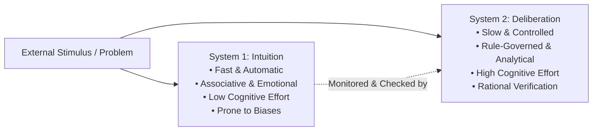

## 📖 Executive Summary

The foundational reading **"Intuition vs. Deliberation: How Decision Making Works"** examines the cognitive architecture governing human judgment under risk, time pressure, and ambiguity. Grounded in Daniel Kahneman’s dual-process cognitive psychology (_Thinking, Fast and Slow_, 2011) and Max Bazerman’s _Judgment in Managerial Decision Making_ (Wiley), the text deconstructs why experienced executives frequently fall victim to predictable cognitive failures.

Executive decision making is not a monolithic rational process; it operates as an ongoing tension between rapid associative pattern recognition (**System 1**) and effortful analytical calculation (**System 2**). Effective managerial leadership requires recognizing when intuitive expertise is reliable and when deliberative rational tools must be enforced.

---

## 🧠 Dual-Process Architecture: System 1 vs. System 2

| Feature                         | System 1 (Intuitive / Fast)                                                      | System 2 (Deliberative / Slow)                                  |
| :------------------------------ | :------------------------------------------------------------------------------- | :-------------------------------------------------------------- |
| **Cognitive Velocity**          | Rapid, near-instantaneous ($< 500\text{ ms}$).                                   | Slow, sequential, methodical.                                   |
| **Effort & Energy**             | Automatic, effortless, subconscious.                                             | Controlled, high metabolic demand, conscious.                   |
| **Underlying Mechanism**        | Associative memory, emotional heuristics, pattern matching.                      | Formal logic, mathematical calculation, rule-following.         |
| **Vulnerability**               | Susceptible to cognitive illusions, anchoring, availability bias.                | Lazy, easily fatigued, rationalizes System 1 impulses.          |
| **Appropriate Business Domain** | Immediate physical danger, high-frequency expert routines (chess, firefighting). | Capital allocation, strategic M&A, hiring, policy architecture. |

---

## 🎯 Three Classical Heuristic Traps in Management

When System 2 fails to interrogate System 1 intuitions, decision makers fall into three systematic heuristic traps identified by Tversky and Kahneman (1974):

### 1. Anchoring and Adjustment

Human estimates are disproportionately pulled toward initial numerical reference points, even when those anchors are completely arbitrary.

- _Classroom Experiment_: Estimating the product of $8 \times 7 \times 6 \times 5 \times 4 \times 3 \times 2 \times 1$ produces a median estimate of **$2,250$**, whereas presenting the sequence as $1 \times 2 \times 3 \times 4 \times 5 \times 6 \times 7 \times 8$ yields a median of only **$512$** (the true mathematical answer is **$40,320$**). In negotiations, initial bids anchor subsequent counter-offers.

### 2. Availability Heuristic

Assessing the likelihood or frequency of an event based on the ease with which instances come to mind. Recent, vivid, or emotionally salient events (e.g., an airplane crash, a sudden market collapse) cause executives to over-insure against rare risks while neglecting persistent structural operational bottlenecks.

### 3. Representativeness Heuristic

Evaluating the probability that object $A$ belongs to class $B$ based solely on how closely $A$ resembles the stereotype of $B$, ignoring underlying **base rate probabilities**. In venture capital, investors frequently over-fund charismatic founders matching historical profiles while disregarding 90% industry failure rates.

---

## 🛡️ Debiasing Protocols for Executive Governance

To prevent heuristic traps from degrading high-stakes strategic choices, organizations must institutionalize structural decision safeguards:

1. **Explicit Multi-Attribute Modeling**: Forcing executives to decompose choices into quantitative criteria using tools like [[concepts/simple-multi-attribute-rating-technique|SMART]] or [[concepts/analytic-hierarchy-process|AHP]].
2. **The "Consider the Opposite" Mandate**: Assigning a designated devil's advocate to present the strongest possible counter-thesis before finalizing major commitments.
3. **Decoupling Decision Process from Outcome**: Evaluating managerial performance based on the rigor of the decision process rather than outcome luck, neutralizing outcome bias.

---

## 🔗 Related Resources

- Master Lecture Hub: [[courses/mk5-decision-making-negotiation/week-01/index|MK5 Week 01 Lecture Notes]]
- Case Study: [[courses/mk5-decision-making-negotiation/week-01/case-viral-nation|Viral Nation M&A Dilemma]]
- Assignment Guide: [[courses/mk5-decision-making-negotiation/week-01/assignment-viral-nation|Syndicate 9 Prescriptive Decision Model]]
- Foundational Concept: [[concepts/kepner-tregoe-problem-analysis|Kepner-Tregoe Problem Analysis]]
