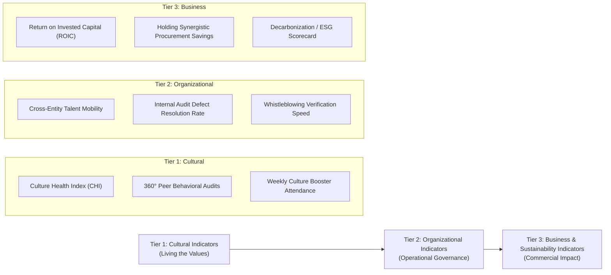
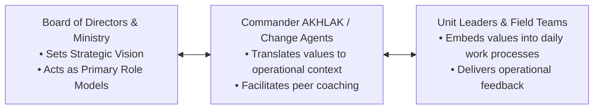

## 🎯 Assignment Scope & Executive Directives

The Week 02 syndicate assignment directs executive cohorts to resolve strategic alignment challenges in implementing **AKHLAK** within Indonesian state-owned conglomerates:

1. **Strategic Value Alignment**: Formulate a concrete roadmap aligning AKHLAK core values with long-term commercial goals (profitability, ESG, global competitiveness).
2. **Three-Tier KPI Architecture**: Design measurable performance indicators across cultural, organizational, and business sustainability levels.
3. **Change Network & Stakeholder Alliances**: Establish change management mechanisms (e.g., Commander AKHLAK) to preempt interest conflicts and drive cross-holding synergy.
4. **Adaptive Innovation Levers**: Leverage _Adaptif_ and _Kolaboratif_ to accelerate operational digitization and competitive advantage.

> [!NOTE] Cohort Attribution
> This strategic blueprint synthesizes collective executive submissions developed by **`F9 (Class F / Syndicate 9)`** within the SBM ITB P3MD Executive MBA program.

---

## 🏛️ The Three-Tier AKHLAK Performance Indicator Matrix

To overcome the cosmetic compliance trap, Syndicate 9 formulated a **Three-Tier Performance Measurement Architecture** bridging cultural behavior to commercial balance sheet impact:

### Detailed Operational Metrics

| Evaluation Tier            | Focus Area                         | Quantitative Metrics                                                                                                                          | Target Benchmark                                                    | Governance Owner                           |
| :------------------------- | :--------------------------------- | :-------------------------------------------------------------------------------------------------------------------------------------------- | :------------------------------------------------------------------ | :----------------------------------------- |
| **Tier 1: Cultural**       | Daily Behavioral Adherence         | • Culture Health Index (CHI) survey score. • 360-degree behavioral appraisal scores. • Participation rate in weekly _Culture Boosters_. | $> 85\%$ positive sentiment; $> 90\%$ weekly session compliance. | HR Directorate & Commander AKHLAK Network. |
| **Tier 2: Organizational** | Governance & Cross-Functional Work | • Inter-subsidiary talent rotation count. • Whistleblowing System (WBS) follow-up time. • Joint shared-services adoption rate.          | WBS investigation $< 14$ days; Joint procurement $> 40\%$ spend. | Chief Risk Officer (CRO) & Internal Audit. |
| **Tier 3: Business**       | Long-Term Commercial Impact        | • Holding EBITDA margin expansion. • ESG rating improvement (MSCI / Sustainalytics). • Asset turnover of consolidated holdings.         | Top-quartile industry EBITDA; Investment-grade ESG tier.         | Board of Directors & Ministry of BUMN.     |

---

## 🛡️ Strategic Change Management: Commander AKHLAK Architecture

Based on enterprise practices observed at PT Jasa Marga, PT Semen Indonesia, and PTPN III, Syndicate 9 recommends a tiered two-way communication model:

### Conflict Resolution & Multi-Stakeholder Governance

When BUMN strategic mandates conflict with localized commercial interests (e.g., executing public service obligations vs. maintaining quarterly division margins), executive management must:

1. **Preempt Friction via Transparency**: Establish explicit transfer pricing formulas and cross-holding service-level agreements (SLAs).
2. **Incentive Alignment**: Link executive bonuses not solely to standalone divisional profit, but equally to holding-wide collaborative value creation (_KPI Kolaborasi Holding_).

---

## 🔗 Related Resources

- Master Lecture Hub: [[courses/mk5-decision-making-negotiation/week-02/index|MK5 Week 02 Lecture Notes]]
- Case Study: [[courses/mk5-decision-making-negotiation/week-02/case-akhlak-bumn|Case: AKHLAK Core Values Transformation]]
- Related Reading: [[courses/mk5-decision-making-negotiation/week-02/reading-rational-framework|Reading: Rational Decision Making]]
- Lead Faculty Profile: [[entities/valid-hasyimi|Dr. Valid Hasyimi]]
