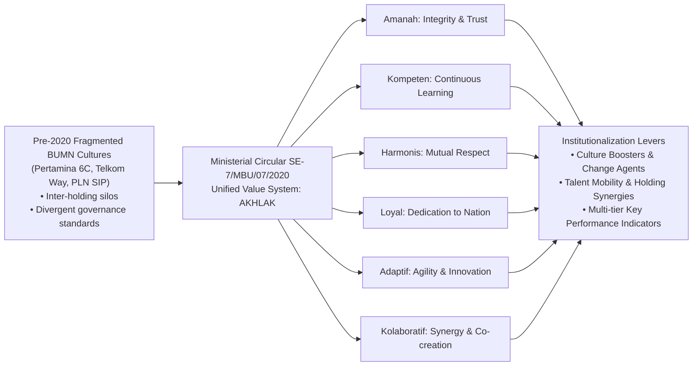

## 📋 Executive Summary

On July 1, 2020, through Circular Letter _SE-7/MBU/07/2020_, Minister of State-Owned Enterprises **Erick Thohir** declared a mandatory unified corporate value system across all Indonesian state-owned enterprises (_Badan Usaha Milik Negara / BUMN_): **AKHLAK** (_Amanah, Kompeten, Harmonis, Loyal, Adaptif, Kolaboratif_).

This ministerial intervention represented one of the largest corporate cultural transformation programs in Southeast Asia, encompassing over **100 state-owned parent corporations, hundreds of subsidiaries, and over 1.2 million personnel**. Prior to 2020, individual BUMN conglomerates operated under divergent, insular corporate cultures (e.g., Telkom’s _The Telkom Way_, Pertamina’s _6C_, PLN’s _S.I.P._), creating severe inter-holding friction, silo mentalities, and operational inefficiencies. This case examines the strategic decision-making challenges of translating symbolic cultural mandates into verifiable behavioral norms and corporate performance KPIs across diverse holding groups.

---

## 🏛️ The Six Pillars of AKHLAK

| Core Value                      | Key Behavioral Definition                                             | Primary Behavioral Indicators (_Panduan Perilaku_)                                                                                                                          | Executive Governance Application                                                             |
| :------------------------------ | :-------------------------------------------------------------------- | :-------------------------------------------------------------------------------------------------------------------------------------------------------------------------- | :------------------------------------------------------------------------------------------- |
| **Amanah** (Trustworthy)        | Upholding integrity, ethics, and fiduciary responsibility.            | 1. Fulfilling promises and commitments. 2. Responsible stewardship of public assets. 3. Adhering to laws, regulations, and moral codes.                               | Anti-corruption protocols, rigorous audit compliance, transparent procurement.               |
| **Kompeten** (Competent)        | Continuously learning and developing institutional capabilities.      | 1. Upgrading capabilities to meet changing challenges. 2. Helping peers learn. 3. Delivering highest quality output.                                                  | Professional certifications, leadership pipelines, corporate universities.                   |
| **Harmonis** (Harmonious)       | Mutual care, empathy, and respect for diversity.                      | 1. Respecting individuals regardless of background. 2. Supporting peers in times of difficulty. 3. Building a conducive and inclusive work environment.               | Cross-functional psychological safety, fair compensation, zero tolerance for discrimination. |
| **Loyal** (Loyal)               | Prioritizing national and institutional interests over self-interest. | 1. Protecting company and state reputation. 2. Willingness to make personal sacrifices for broader goals. 3. Obeying legitimate leadership decisions.                 | Alignment with national strategic programs (PSN), crisis response, corporate pride.          |
| **Adaptif** (Adaptive)          | Innovating proactively and embracing structural change.               | 1. Swiftly adjusting to macroeconomic disruptions. 2. Continuously innovating and improving processes. 3. Acting with proactive agility.                              | Digital transformation, business model pivots, decarbonization transitions.                  |
| **Kolaboratif** (Collaborative) | Fostering synergistic partnerships across ecosystems.                 | 1. Providing opportunities for multiple parties to contribute. 2. Openness to cooperation for mutual value creation. 3. Optimizing asset utilization across entities. | BUMN holding consolidation, cross-holding joint ventures, shared services.                   |

---

## ⚔️ Managerial Dilemma: Symbolism vs. Operational Reality

The strategic dilemma confronting BUMN executive leadership lies in bridging the **espoused values** vs. **lived values** divide:

1. **The Cosmetic Internalization Trap**: Organizations frequently treat AKHLAK as public relations branding (wall slogans, pins, ceremonial anthems) without altering executive promotion criteria, operational performance scorecards, or procurement incentives.
2. **Holding-Subholding Friction**: In newly formed industrial holding groups (e.g., Danantara, Mining Industry Indonesia / MIND ID, Agrinas / PTPN III, Pelindo), legacy subsidiaries resist standardizing operational processes, viewing unified mandates as corporate centralization.
3. **Measurement Complexity**: Defining objective quantitative metrics for qualitative behavioral virtues such as _Amanah_ and _Harmonis_ without reducing evaluation to performative compliance checklists.

---

## 📈 Cross-Industry Implementation Vignettes

### 1. PT Perkebunan Nusantara (PTPN Holding)

PTPN operationalized AKHLAK through the **"One PTPN, One Culture"** campaign, translating broad ministerial guidelines into agrarian operational context: _Owner's Mindset_, _Networking_, and _Excellence_. PTPN instituted weekly "Culture Boosters" every Friday to evaluate plantation estate managers on both harvest yields and team welfare metrics.

### 2. PT Jasa Marga (Persero) Tbk

Jasa Marga engineered an institutional change network appointing formal **"Commander AKHLAK"** change agents across toll-road operational branches. These leaders served as two-way conduits between corporate headquarters and frontline maintenance units, resolving toll plaza disputes through peer-led restorative dialogue.

---

## 🔗 Related Resources

- Master Lecture Hub: [[courses/mk5-decision-making-negotiation/week-02/index|MK5 Week 02 Lecture Notes]]
- Assignment Guide: [[courses/mk5-decision-making-negotiation/week-02/assignment-akhlak-transformation|Syndicate 9 AKHLAK Strategy Guide]]
- Reading Note: [[courses/mk5-decision-making-negotiation/week-02/reading-rational-framework|Reading: Rational Decision Making]]
- Lead Faculty Profile: [[entities/valid-hasyimi|Dr. Valid Hasyimi]]
