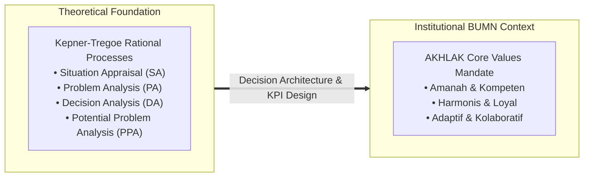
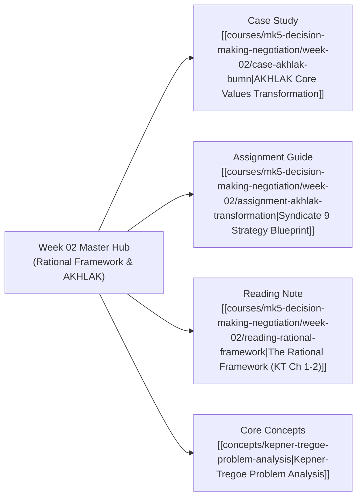

## 🧭 Executive Overview & Curricular Context

**MK5 Week 02** deepens the executive transition from cognitive psychology to structured institutional governance. Building upon the System 1 / System 2 foundations established in Week 01, this module introduces the **Rational Framework of Decision Making** formulated by Charles Kepner and Benjamin Tregoe, examining how institutional leadership structures information processing across complex organizations.

The pedagogical center of the session applies rational decision theory to the defining state-owned enterprise governance initiative of modern Indonesia: **the transformation and institutionalization of the AKHLAK Core Values (2020–2024)** across the BUMN conglomerate ecosystem. Participants analyze how values-based corporate mandates can be translated from symbolic declarations into measurable behavioral KPIs and operational decision filters.

---

## 🏛️ The Four Information Processing Routines

Executives do not suffer from a lack of data; they suffer from the absence of structured processing routines. As codified in _The New Rational Manager_, managerial effectiveness requires navigating four distinct cognitive channels:

| Rational Routine                     | Trigger Question               | Analytical Mechanism                                                                                                                                                     | Managerial Focus                                                                   |
| :----------------------------------- | :----------------------------- | :----------------------------------------------------------------------------------------------------------------------------------------------------------------------- | :--------------------------------------------------------------------------------- |
| **Situation Appraisal (SA)**         | _What is going on?_            | Separation, sorting, and prioritization of complex messes using **Timing, Trend, and Impact (TTI)**.                                                                     | Allocating executive bandwidth and assigning appropriate problem resolution paths. |
| **Problem Analysis (PA)**            | _Why did it happen?_           | Isolating the unknown physical or process cause of an unexplained performance deviation using [[concepts/kepner-tregoe-problem-analysis \| IS / IS NOT boundary logic]]. | Restoring standard baseline performance; preventing repeat failures.               |
| **Decision Analysis (DA)**           | _Which course should we take?_ | Clarifying objectives into MUST (mandatory pass/fail) and WANT (relative scoring) criteria.                                                                              | Committing scarce capital and operational resources to optimal alternatives.       |
| **Potential Problem Analysis (PPA)** | _What lies ahead?_             | Identifying future operational risks, analyzing possible trigger causes, and designing preventive and contingent actions.                                                | Safeguarding execution of strategic plans against predictable friction.            |

---

## 🏢 Case Application: Institutionalizing AKHLAK in Indonesian BUMN

The session bridges theoretical frameworks to the national BUMN ecosystem through the **AKHLAK Core Values Case Study**:

- **Context**: Ministerial Circular _SE-7/MBU/07/2020_ mandating a unified cultural compass across 100+ state-owned holdings and 1.2 million employees.
- **The Core Dilemma**: Eliminating cosmetic compliance (slogans, banners, anthems) by embedding cultural values into operational governance, talent appraisal, and capital expenditure decisions.
- **Syndicate 9 Strategic Synthesis**: As developed in [[courses/mk5-decision-making-negotiation/week-02/assignment-akhlak-transformation|Syndicate 9 Assignment Guide]], the cohort formulated a **Three-Tier Performance Indicator Architecture**:
  1. _Tier 1 (Cultural Indicators)_: Culture Health Index (CHI), 360-degree behavioral peer appraisals, and weekly _Culture Booster_ routines.
  2. _Tier 2 (Organizational Indicators)_: Cross-holding talent mobility rates, Whistleblowing System (WBS) resolution speed ($< 14$ days), and joint shared-service adoption.
  3. _Tier 3 (Business & Sustainability Indicators)_: Holding ROIC expansion, syndicated procurement cost savings, and ESG rating improvements.

---

## 🗺️ Module Satellite Directory

---

## 🔗 Cross-Curricular Bridges

- Previous Module: [[courses/mk5-decision-making-negotiation/week-01/index|Week 01: Foundations of Decision Making]]
- Next Module: [[courses/mk5-decision-making-negotiation/week-03/index|Week 03: Kepner-Tregoe Problem Analysis]]
- Course Syllabus: [[courses/mk5-decision-making-negotiation/index|MK5 Course Overview]]
- Lead Faculty Profile: [[entities/valid-hasyimi|Dr. Valid Hasyimi]]
