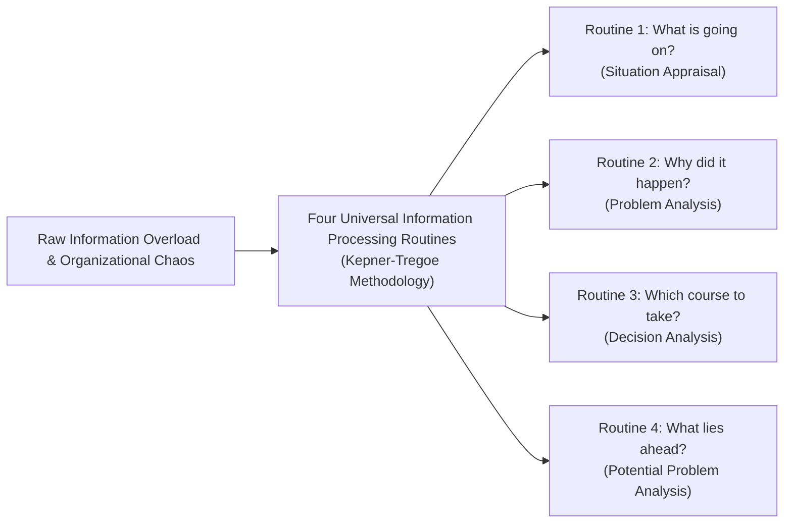

## 📖 Executive Summary

This reading synthesizes the introductory chapters of **Charles H. Kepner and Benjamin B. Tregoe's** seminal work, _The New Rational Manager_ (1981, 1997), alongside modern managerial frameworks on **Rational Decision Making and Negotiation**.

The core premise posits that managerial effectiveness is constrained not by technical specialized knowledge, but by **how managers process information**. In an era of data saturation and operational complexity, successful leaders distinguish themselves through their ability to systematically organize facts, identify true causal linkages, and structure decisions using clear criteria rather than reflexive intuition or political convenience.

---

## 🧠 The Human Mind and Rational Processing

Kepner and Tregoe observed that human beings possess an innate capacity for rational thought, but under workplace stress and cognitive overload, natural analytical instincts break down into three common operational traps:

1. **Jumping to Solutions**: Formulating an action plan before verifying the underlying cause of an operational deviation.
2. **Confusing Symptoms with Causes**: Treating visible pain points (e.g., declining sales, high employee turnover) without identifying the distinct physical or procedural changes triggering the breakdown.
3. **Unstated Criteria**: Selecting suppliers, software, or executive hires based on vague impressions rather than explicit, weighted operational requirements.

---

## 🧭 The Four Rational Processes Explained

| Process Routine                      | Underlying Psychological Drive                            | Critical Output Produced                                                                                                       | Primary Risk Mitigated                                                   |
| :----------------------------------- | :-------------------------------------------------------- | :----------------------------------------------------------------------------------------------------------------------------- | :----------------------------------------------------------------------- |
| **Situation Appraisal (SA)**         | Need to prioritize when everything feels urgent.          | Clear matrix separating complex messes into discrete, actionable issues with assigned owners.                                  | Overwhelm, paralysis by analysis, misallocation of managerial bandwidth. |
| **Problem Analysis (PA)**            | Need to know why an established standard is broken.       | Verified true cause isolated through [[concepts/kepner-tregoe-problem-analysis                \| IS / IS NOT boundary logic]]. | Costly trial-and-error repairs, recurring defects, premature blame.      |
| **Decision Analysis (DA)**           | Need to make the best balanced choice among alternatives. | Transparent scoring model evaluating options against MUST and WANT criteria.                                                   | Biased championing of pet projects, unvetted risk exposure.              |
| **Potential Problem Analysis (PPA)** | Need to protect a future plan from failure.               | Comprehensive action plan with preventive safeguards and contingent trigger points.                                            | Crisis management firefights, unhedged operational catastrophes.         |

---

## 🔗 The Bridge to Strategic Negotiation

The rational framework directly underpins strategic negotiation architecture:

- **Decision Analysis as BATNA**: A rigorous decision analysis of internal options establishes the negotiator's authentic walkaway threshold ([[concepts/batna-and-zopa|BATNA & Reservation Price]]).
- **Separating Interests from Positions**: Just as Problem Analysis uncovers the underlying root cause behind surface symptoms, principled negotiation uncovers underlying institutional interests behind rigid positional demands.
- **Criteria as Objective Standards**: Utilizing external, verifiable standards (market comps, precedent, scientific data) depersonalizes bargaining conflicts and drives integrative deal closure.

---

## 🔗 Related Resources

- Master Lecture Hub: [[courses/mk5-decision-making-negotiation/week-02/index|MK5 Week 02 Lecture Notes]]
- Case Study: [[courses/mk5-decision-making-negotiation/week-02/case-akhlak-bumn|Case: AKHLAK Core Values Transformation]]
- Assignment Guide: [[courses/mk5-decision-making-negotiation/week-02/assignment-akhlak-transformation|Syndicate 9 AKHLAK Strategy Guide]]
- Next Module: [[courses/mk5-decision-making-negotiation/week-03/index|Week 03: Kepner-Tregoe Problem Analysis]]
