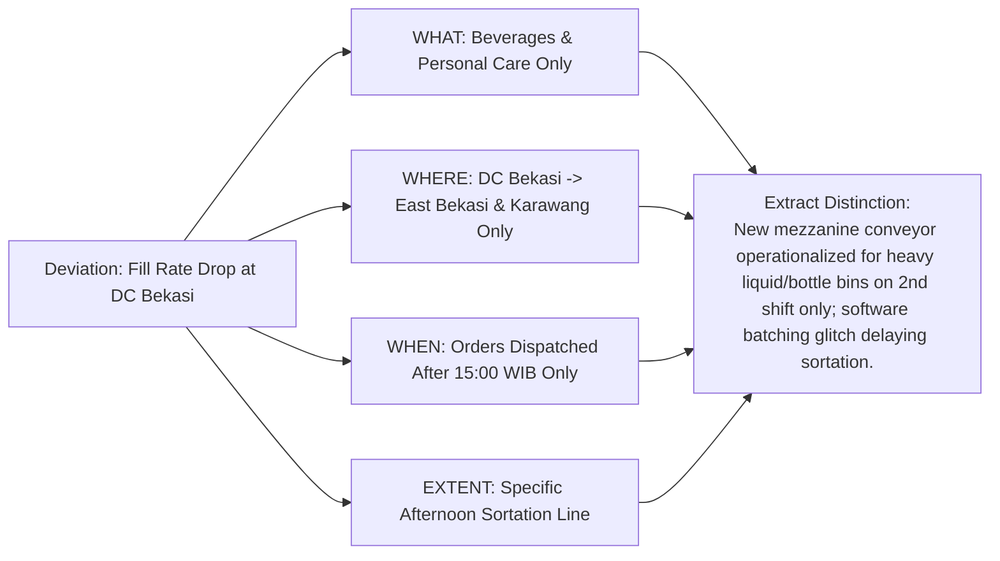

## 🎯 Assignment Mandate & Analytical Architecture

The Week 03 assignment directs executive syndicate teams to execute the complete **Kepner-Tregoe Rational Process** on the **Pasar Kita** operational breakdown:

1. **Situation Appraisal (SA)**: Separate and prioritize concurrent corporate concerns using **Timing, Trend, and Impact (TTI)**.
2. **Problem Analysis (PA)**: Construct a full **IS / IS NOT Specification Matrix** to isolate the verified root cause of the DC Bekasi order fill rate collapse.
3. **Decision Analysis (DA)**: Formulate mandatory **MUST criteria** (pass/fail hurdles) and weighted **WANT criteria** to evaluate operating strategies A–D.
4. **Potential Problem Analysis (PPA)**: Identify potential failure modes for the selected strategy and engineer preventive and contingent safeguards.

> [!NOTE] Cohort Attribution
> This diagnostic solution reflects the authentic worked submission developed by **`F9 (Class F / Syndicate 9)`** within the SBM ITB P3MD Executive MBA program.

---

## 📋 Phase 1: Situation Appraisal (SA) Prioritization Matrix

Syndicate 9 segregated Pasar Kita's operational crisis into discrete concerns, prioritized via high/medium/low ratings across Timing, Trend, and Impact:

| Major Concern                        | Specific Sub-Concern                                                                                        |   Timing   |   Trend    |  Impact  |      Rational Process Required       |
| :----------------------------------- | :---------------------------------------------------------------------------------------------------------- | :--------: | :--------: | :------: | :----------------------------------: |
| **1. Order Fulfillment Collapse**    | Fill rate drops at DC Bekasi (East Bekasi & Karawang corridors; beverages & personal care after 15:00 WIB). |  **High**  |  **High**  | **High** |      **Problem Analysis (PA)**       |
| **2. Cash Runway Depletion**         | Only 14 months of cash remaining (August 2027) vs. December 2027 EBITDA breakeven target.                   |  **High**  |  **High**  | **High** |      **Decision Analysis (DA)**      |
| **3. Operating Model Uncertainty**   | Board deadlock over selecting Strategic Options A–D for the upcoming 18-month cycle.                        |  **High**  | **Medium** | **High** |      **Decision Analysis (DA)**      |
| **4. Future Peak Season Volatility** | Anticipated demand surges during Q4 festive holidays risking secondary warehouse stock-outs.                | **Medium** | **Medium** | **High** | **Potential Problem Analysis (PPA)** |

---

## 🔍 Phase 2: Kepner-Tregoe Problem Analysis (IS / IS NOT)

### Full Specification Ledger

| Dimension             | IS (Observed Deviation)                           | IS NOT (Could be, but is not)                            | Distinction (Unique to IS)                                                                      | Relevant Change (What changed?)                                                 |
| :-------------------- | :------------------------------------------------ | :------------------------------------------------------- | :---------------------------------------------------------------------------------------------- | :------------------------------------------------------------------------------ |
| **WHAT: Object**      | Bottled Beverages & Personal Care items.          | Dry groceries, rice, cooking oil, fresh produce.         | High unit weight and liquid packaging; handled on dedicated Mezzanine Level 2.                  | Relocated beverage pick racks to Mezzanine Level 2 two weeks ago.               |
| **WHAT: Defect**      | Order picking delays and missing item line drops. | Damaged packaging, wrong SKU shipments, spoilage.        | Orders timed out in the Warehouse Management System (WMS) queue before staging.                 | WMS algorithm timeout threshold reduced from 45 to 20 minutes.                  |
| **WHERE: Facility**   | DC Bekasi.                                        | DC Tangerang, DC Jakarta Selatan, DC Bogor.              | DC Bekasi utilizes dual-level mezzanine racking; other DCs use single-level ground picking.     | Installed prototype multi-tier vertical spiral chute at DC Bekasi last month.   |
| **WHERE: Corridor**   | Delivery routes to East Bekasi & Karawang.        | Routes to West Bekasi (_Bekasi Barat_) and North Bekasi. | Longest transit distance and heavy evening highway traffic congestion (Cikampek toll corridor). | Logistics dispatch cut-off moved up 30 minutes to beat rush hour.               |
| **WHEN: Time of Day** | Dispatches after 15:00 WIB (Evening Shift).       | Morning shift dispatches (06:00–14:00 WIB).              | Evening shift operates with 40% contract agency pickers; morning uses permanent staff.          | Transitioned evening shift to third-party agency labor to reduce fixed payroll. |
| **EXTENT: Scale**     | 22% fulfillment drop across affected lines.       | 100% complete shutdown of DC Bekasi.                     | Limited specifically to evening multi-zone order consolidation bins.                            | Shift hand-over protocol was skipped between 14:30 and 15:00 WIB.               |

### Verified True Cause

The root cause is a **mechanical and procedural hand-over mismatch on Mezzanine Level 2 during the 15:00 shift changeover**: temporary agency pickers on the evening shift were not trained on the new spiral chute clearance protocol, causing heavy beverage bins to jam the conveyor sensor and trigger automatic WMS order timeout drops on long-distance Karawang routes.

---

## ⚖️ Phase 3: Decision Analysis (DA) on Operating Model

### 1. MUST Criteria (Non-Negotiable Hurdle)

- **MUST 1**: Maintain cash runway through at least December 2027 ($\ge 18$ months).
- **MUST 2**: Restore DC Bekasi fill rate to $\ge 98\%$ within 30 days.

| Alternative                                         |       MUST 1 (Runway $\ge 18$ mos)       | MUST 2 (Fill Rate $\ge 98\%$ in 30 days) |  Go / No-Go Decision   |
| :-------------------------------------------------- | :--------------------------------------: | :--------------------------------------: | :--------------------: |
| **Strategy A (Aggressive Expansion)**               |     **NO** (Shrinks runway to 8 mos)     |    **NO** (Dilutes engineering focus)    | **NO-GO (Eliminated)** |
| **Strategy B (Hub Automation)**                     | **NO** (Runway sustained to only 15 mos) |                 **YES**                  | **NO-GO (Eliminated)** |
| **Strategy C (3PL Outsourcing)**                    |        **YES** (18 months runway)        |                 **YES**                  |         **GO**         |
| **Strategy D (Phased Focus & SKU Rationalization)** |      **YES** ($> 20$ months runway)      |                 **YES**                  |         **GO**         |

### 2. WANT Criteria Evaluation (Strategies C vs. D)

- **EBITDA Acceleration ($35\%$)**
- **Operational Scalability ($25\%$)**
- **Execution Simplicity & Cultural Buy-in ($20\%$)**
- **Customer Experience & OTIF Control ($20\%$)**

Syndicate 9’s model selected **Strategy D (Phased Regional Focus & SKU Rationalization)**, delivering superior gross margin recovery and insulating cash reserves beyond 20 months.

---

## 🛡️ Phase 4: Potential Problem Analysis (PPA) for Strategy D

| Potential Problem                                     | Likely Trigger Cause                                       | Preventive Action (Reduce Probability)                                                                    | Contingent Action (Reduce Impact)                                                        |
| :---------------------------------------------------- | :--------------------------------------------------------- | :-------------------------------------------------------------------------------------------------------- | :--------------------------------------------------------------------------------------- |
| **Merchant churn from discontinued slow-moving SKUs** | Merchants rely on one-stop-shop basket convenience.        | Pre-communicate 30-day notice; offer bundled high-velocity substitute SKUs with merchant discounts.       | Implement direct vendor drop-ship fulfillment for non-core long-tail items.              |
| **Conveyor re-jamming during holiday peak volume**    | Surge in beverage case volume exceeding chute sensor load. | Re-engineer chute optical sensors; mandate certified permanent team leads on mezzanine during peak hours. | Deploy manual bypass gravity roller track alongside mezzanine chute for overflow volume. |

---

## 🔗 Related Resources

- Master Lecture Hub: [[courses/mk5-decision-making-negotiation/week-03/index|MK5 Week 03 Lecture Notes]]
- Case Study: [[courses/mk5-decision-making-negotiation/week-03/case-pasar-kita|Case Study: Pasar Kita]]
- Foundational Concept: [[concepts/kepner-tregoe-problem-analysis|Kepner-Tregoe Problem Analysis]]
- Related Concept: [[concepts/simple-multi-attribute-rating-technique|SMART & Decision Analysis]]
