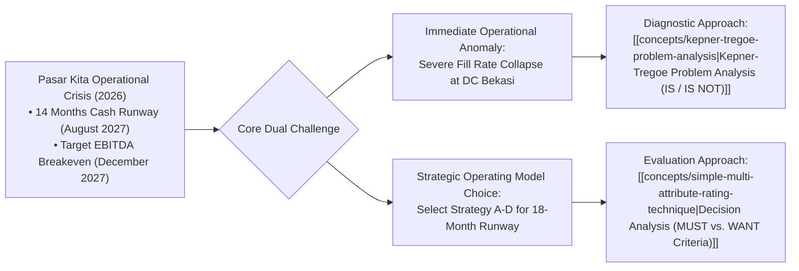

## 📋 Executive Summary

**Pasar Kita** is a high-growth Indonesian omni-channel grocery and FMCG supply platform operating automated micro-fulfillment distribution centers (DCs) across Greater Jakarta (_Jabodetabek_). In mid-2026, executive management confronted an acute operational crisis centered at its flagship **Bekasi Distribution Center (DC Bekasi)**: order fill rates collapsed dramatically across specific delivery corridors, generating unprecedented merchant churn and social media complaints.

Simultaneously, Pasar Kita faced severe strategic cash runway constraints: the company possessed only **14 months of cash runway remaining (until August 2027)**, while its board-mandated EBITDA break-even target was set for December 2027. The Board of Directors required an immediate, rigorous diagnostic audit: leadership had to determine whether the fulfillment breakdown stemmed from software routing algorithms, warehouse picker labor shortages, supplier stock-outs, or logistics fleet bottlenecks, while selecting an operating strategy (Options A–D) for the upcoming 18 months.

---

## 🔍 Diagnostic Operational Evidence: DC Bekasi

Operational audits revealed a highly specific failure pattern rather than a systemic network-wide collapse:

### 1. Geographic & Node Specificity

- **Observed (IS)**: Order fulfillment failure was strictly localized to **DC Bekasi**, specifically impacting downstream deliveries to **East Bekasi (_Bekasi Timur_) and Karawang**.
- **Not Observed (IS NOT)**: Other regional hubs—including DC Tangerang, DC Jakarta Selatan, and DC Bogor—maintained industry-standard fill rates exceeding $98.2\%$. Within DC Bekasi, delivery routes to West Bekasi (_Bekasi Barat_) and North Bekasi (_Bekasi Utara_) operated with zero reported delivery anomalies.

### 2. Product Category Specificity

- **Observed (IS)**: The fulfillment drop concentrated exclusively in **Personal Care (_Perawatan Pribadi_) and Bottled Beverages (_Minuman Ringan_)**.
- **Not Observed (IS NOT)**: Ambient dry groceries, rice, packaged cooking oils, and temperature-controlled fresh produce achieved normal 100% order pick accuracy.

### 3. Temporal Specificity

- **Observed (IS)**: Order drops occurred exclusively on orders placed and dispatched **after 15:00 WIB (Afternoon/Evening Shift)**.
- **Not Observed (IS NOT)**: Morning shift dispatches (06:00–14:00 WIB) achieved perfect on-time-in-full (OTIF) delivery metrics across all corridors.

---

## 🏛️ Strategic Dilemma: Operating Model Selection (Options A–D)

Concurrently, Pasar Kita’s Board of Directors evaluated four operational models for capital expenditure and geographic coverage:

| Operating Strategy                                          | Strategic Approach                                                                                  | Capital Outlay & Runway Impact                                   | Expected EBITDA Breakeven       |
| :---------------------------------------------------------- | :-------------------------------------------------------------------------------------------------- | :--------------------------------------------------------------- | :------------------------------ |
| **Strategy A: Aggressive Geographic Expansion**             | Open 4 new automated DCs across West Java and Central Java.                                         | High cash burn (-IDR 45B); runway shrinks to 8 months.           | Q3 2028 (Delayed, high risk).   |
| **Strategy B: Core Hub Automation & Consolidation**         | Retrofit DC Bekasi and DC Tangerang with automated conveyor pickers; pause expansion.               | Moderate investment (-IDR 18B); runway sustained to 15 months.   | Q4 2027 (Meets target).         |
| **Strategy C: Third-Party Logistics (3PL) Outsourcing**     | Outsource last-mile fleet and evening sortation to commercial express carriers.                     | Low capex, variable opex (-IDR 8B); runway extends to 18 months. | Q1 2028 (Dependent on 3PL SLA). |
| **Strategy D: Phased Regional Focus & SKU Rationalization** | Eliminate low-margin SKUs; optimize DC Bekasi shifts; targeted micro-fulfillment in dense clusters. | Minimal capex (-IDR 5B); preserves cash runway beyond 20 months. | Q3 2027 (Ahead of schedule).    |

---

## 🔗 Related Resources

- Master Lecture Hub: [[courses/mk5-decision-making-negotiation/week-03/index|MK5 Week 03 Lecture Notes]]
- Assignment Guide: [[courses/mk5-decision-making-negotiation/week-03/assignment-kt-problem-analysis|Syndicate 9 Worked KT Problem Analysis]]
- Core Methodology: [[concepts/kepner-tregoe-problem-analysis|Kepner-Tregoe Problem Analysis]]
- Pre-Assignment Studies: Classic cases including Exxon Valdez, Oh, Nuts!, and Ragin' Cajun Chicken.
