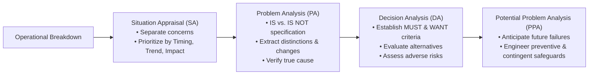
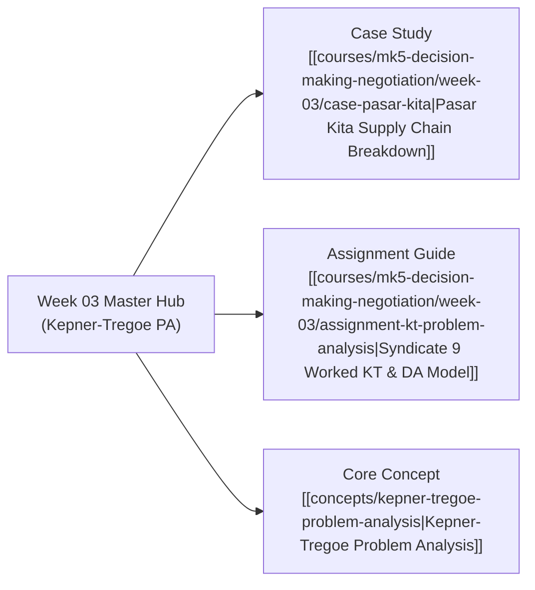

## 🧭 Executive Overview & Curricular Context

**MK5 Week 03** plunges executives into the analytical engine of rational management: the **Kepner-Tregoe (KT) Methodology**, with an intensive focus on **Situation Appraisal (SA)** and **Problem Analysis (PA)**.

Led by [[entities/valid-hasyimi|Dr. Valid Hasyimi]], the module attacks the ubiquitous corporate disease of _"jumping to solutions"_—the reactive habit of prescribing expensive capital fixes, organizational restructurings, or software patches before empirically proving what caused an operational deviation. Through historical case crucibles (**Exxon Valdez**, **Oh, Nuts!**, **Ragin' Cajun Chicken**) and the contemporary supply chain crisis of **Pasar Kita**, participants master the rigorous discipline of **IS / IS NOT boundary specification**, isolating verified true causes from misleading operational noise.

---

## 🏛️ The Mechanics of Problem Analysis (PA)

Kepner-Tregoe defines a problem with mathematical precision: **a deviation between expected performance standard (SHOULD) and observed performance (IS)** caused by an unexplained change.

### The Four Boundary Dimensions of IS / IS NOT

By rigorously bounding the problem across four axes, analysts eliminate 95% of irrelevant variables:

1. **WHAT (Identity)**: What specific unit or malfunction is observed, and what closely related entity could be malfunctioning but is completely normal?
2. **WHERE (Location)**: Where geographically or physically on the object is the defect located, and where else could it appear but is absent?
3. **WHEN (Timing)**: When in calendar time and process cycle was the defect first observed, and when could it have been observed prior to that?
4. **EXTENT (Magnitude)**: How many units or what percentage of capacity is impaired, and what is the logical boundary of the failure?

> [!IMPORTANT]
> **The Distinction and Change Law**:
> True causes reside exclusively at the intersection of a **Distinction** (what is uniquely characteristic of the IS compared to the IS NOT) and a **Change** (what altered in, on, or around that distinction shortly before the problem appeared).

---

## 💼 Core Case Application: Pasar Kita

The classroom case examines **Pasar Kita**, an Indonesian omni-channel e-grocery venture facing order fulfillment collapse at its **Bekasi Distribution Center (DC Bekasi)** while operating on a limited 14-month cash runway:

- **The Deviation**: Order fill rates dropped sharply to 78% on deliveries bound for East Bekasi and Karawang, concentrated exclusively in bottled beverages and personal care items dispatched after 15:00 WIB.
- **IS / IS NOT Resolution**: As detailed in [[courses/mk5-decision-making-negotiation/week-03/assignment-kt-problem-analysis|Syndicate 9 Worked Assignment]], the breakdown was traced not to fleet shortages or supplier delays, but to an unannounced conveyor mezzanine sensor bottleneck during evening agency shift transitions.
- **Decision Resolution**: Applying MUST criteria (runway $\ge 18$ months) eliminated aggressive expansion (Strategy A) and capital-heavy automation (Strategy B), selecting **Strategy D (Phased Regional Focus & SKU Rationalization)** to protect liquidity and restore unit profitability.

---

## 🗺️ Module Satellite Directory

---

## 🔗 Cross-Curricular Bridges

- Previous Module: [[courses/mk5-decision-making-negotiation/week-02/index|Week 02: Rational Framework & BUMN AKHLAK Core Values]]
- Next Module: [[courses/mk5-decision-making-negotiation/week-04/index|Week 04: Value-Focused Thinking (VFT)]]
- Course Syllabus: [[courses/mk5-decision-making-negotiation/index|MK5 Course Overview]]
- Lead Faculty Profile: [[entities/valid-hasyimi|Dr. Valid Hasyimi]]
