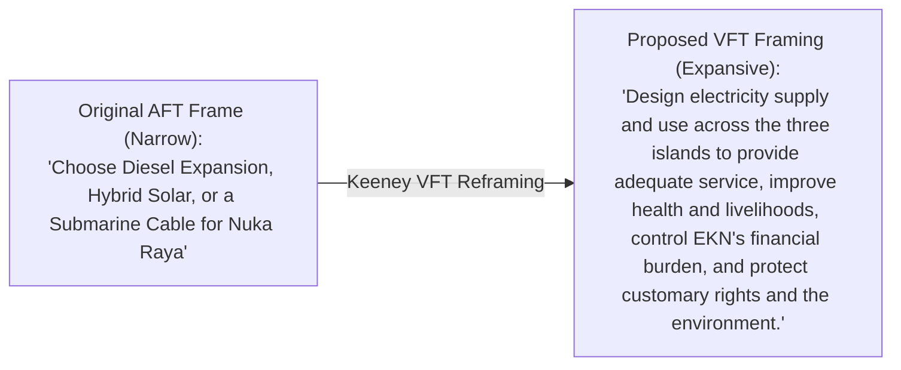
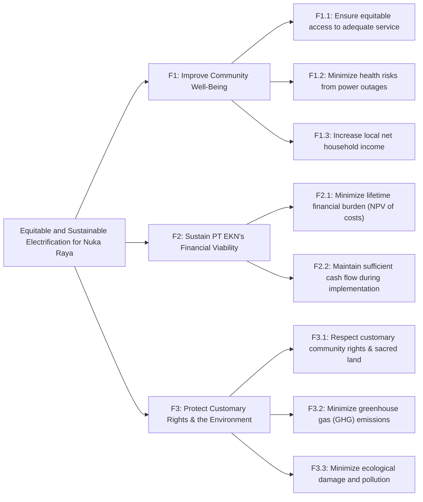
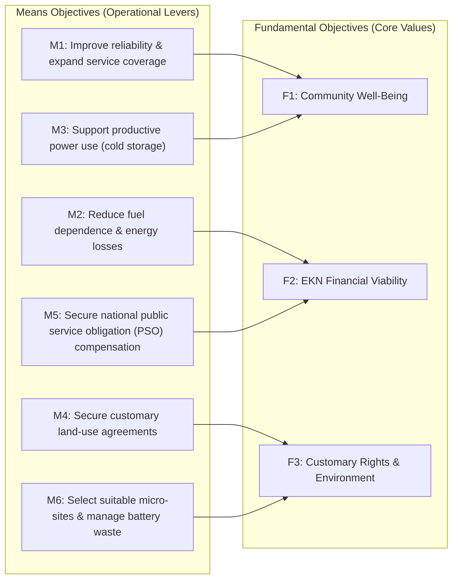

## 🎯 Assignment Mandate & Methodological Requirements

The Week 04 assignment directs syndicate teams to resolve the **Gugus Pulau Nuka Raya** electrification dilemma using Ralph Keeney’s **Value-Focused Thinking (VFT)** framework:

1. **Decision Reframing**: Reframe the decision context from a narrow choice between predefined engineering proposals into an expansive, value-driven strategic mandate.
2. **Fundamental Objectives Hierarchy**: Deconstruct enterprise, community, and environmental values into a structured multi-tier hierarchy.
3. **Means-Ends Objectives Network**: Map causal relationships showing how operational means drive fundamental ends.
4. **Strategy Generation Table**: Create innovative, hybrid alternatives overcoming the limitations of off-the-shelf options.
5. **Board Recommendation Memo**: Formulate an executive memo to the Board of Directors of PT EKN with explicit trade-off justification.

> [!NOTE] Cohort Attribution
> This strategic model and executive board recommendation reflect the authentic work developed by **`F9 (Class F / Syndicate 9)`** within the SBM ITB P3MD Executive MBA program.

---

## 🔄 Phase 1: Reframing the Strategic Decision

---

## 🌳 Phase 2: Fundamental Objectives Hierarchy

Syndicate 9 structured the overarching strategic mandate into three primary fundamental branches:

---

## 🕸️ Phase 3: Means-Ends Objectives Network

The causal lattice reveals the operational mechanisms (_Means_) required to unlock fundamental outcomes (_Ends_):

---

## 🎨 Phase 4: Strategy Generation Table & Alternative Design

By mixing tactical choices across functional decision areas, Syndicate 9 constructed **Option D: Phased Service Based on Needs**:

| Decision Area               | Option A (Diesel)      | Option B (Solar Hybrid) | Option C (Cable)      | **Option D (Phased Modular VFT Alternative)**                                                        |
| :-------------------------- | :--------------------- | :---------------------- | :-------------------- | :--------------------------------------------------------------------------------------------------- |
| **Generation Architecture** | Central diesel gensets | Central 2.5 MWp solar   | Mainland grid cable   | **Distributed rooftop/cluster solar PV on public buildings + existing diesel as backup**             |
| **Rollout Sequence**        | All islands at once    | Full buildout (18 mos)  | Single phase (48 mos) | **Phase 1: 24/7 power for clinics & ports; Phase 2: productive cold storage; Phase 3: households**   |
| **Land & Customary Model**  | Utility site lease     | Compulsory acquisition  | Coastal easement      | **Community land-use partnership; shared solar rooftops on public structures (zero displacement)**   |
| **Financing & Tariffs**     | Corporate capex        | Commercial loan         | Provincial grant      | **Staged equity + National PSO subsidy for clinics + pre-paid micro-tariffs for commercial fishing** |

---

## 📄 Phase 5: Official Recommendation Memo to the Board

> **MEMORANDUM**  
> **TO**: Board of Directors, PT Energi Kepulauan Nusantara (PT EKN)  
> **FROM**: Syndicate 9 — Group F  
> **DATE**: October 2026  
> **SUBJECT**: Strategic Electrification Roadmap for Gugus Pulau Nuka Raya
>
> ### 1. Recommendation
>
> We recommend adopting **Option D: Phased Service Based on Needs** as the development direction for Gugus Pulau Nuka Raya. Phase 1 immediately prioritizes 24/7 dedicated solar-battery power for rural health clinics (_Puskesmas_) and port cold-storage facilities, utilizing existing diesel assets strictly for emergency backup. Subsequent phases expand microgrid coverage to residential households as productive power demand matures.
>
> ### 2. Strategic Justification & Comparative Trade-offs
>
> - **Option A (Diesel Expansion)** is rejected because it perpetuates severe fuel supply vulnerabilities during monsoon disruptions and locks EKN into volatile operating subsidies.
> - **Option B (Centralized Solar)** is deferred in its centralized form due to customary land tenure disputes (_hak ulayat_) and immediate upfront cash strain (IDR 55B).
> - **Option C (Submarine Cable)** is eliminated due to prohibitive capital costs (IDR 110B) and unfeasible 48-month lead times.
> - **Option D** permits staged capital commitments matching EKN's restricted cash flow, minimizes land friction by mounting panels on civic infrastructure, and directly eliminates infant vaccine spoilage and clinic blackouts.
>
> ### 3. Risk Mitigation & Governance Triggers
>
> Prior to capital disbursement, management must: (a) verify solar micro-site easements with local Customary Councils; (b) secure Ministry PSO guarantees for public health electricity subsidies; and (c) establish safe battery end-of-life recycling agreements. Progress must be monitored quarterly against three key metrics: clinic outage hours, island electrification percentage, and cash flow breakeven.

---

## 🔗 Related Resources

- Master Lecture Hub: [[courses/mk5-decision-making-negotiation/week-04/index|MK5 Week 04 Lecture Notes]]
- Case Study: [[courses/mk5-decision-making-negotiation/week-04/case-nuka-raya|Case: Menerangi Gugus Pulau Nuka Raya]]
- Foundational Concept: [[concepts/value-focused-thinking|Value-Focused Thinking]]
- Quantitative Next Step: [[concepts/simple-multi-attribute-rating-technique|SMART Decision Analysis]]
