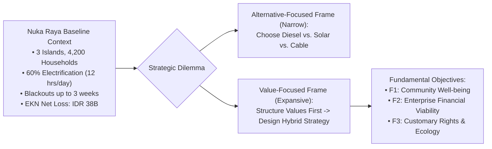

## 📋 Executive Summary

**PT Energi Kepulauan Nusantara (PT EKN)** is a specialized Indonesian regional state-owned electric utility tasked with electrifying isolated, remote, and border island communities (_wilayah 3T: Tertinggal, Terdepan, dan Terluar_). In 2026, PT EKN's Board of Directors faced an intense strategic dilemma regarding **Gugus Pulau Nuka Raya**, an archipelagic cluster of three remote islands comprising **4,200 households**.

Currently, only **60% of households are electrified**, receiving an unstable supply of **12 hours of power per day** powered by aging diesel generators. Persistent fuel delivery delays during monsoon seasons frequently cause complete blackouts lasting up to three weeks, paralyzing rural health clinics, halting seafood cold storage, and restricting economic livelihoods. Concurrently, PT EKN is under severe shareholder pressure to reverse its company-wide net losses of **IDR 38 billion** from the previous fiscal year.

Management initially framed the decision through an **Alternative-Focused Thinking (AFT)** lens: choose between expanding diesel capacity, building a hybrid solar PV system, or laying an undersea transmission cable. Applying Ralph Keeney’s **Value-Focused Thinking (VFT)** radically reframed the mandate: designing an equitable, sustainable energy ecosystem balancing community health, enterprise financial solvency, customary land rights (_hak ulayat_), and ecological preservation.

---

## 🏝️ The Archipelago Profile: Gugus Pulau Nuka Raya

The Nuka Raya cluster consists of three proximate islands with distinct socio-economic profiles:

1. **Pulau Nuka Besar (Main Island)**: Houses the district government center, primary community hospital (_Puskesmas Perawatan_), port terminal, and 2,500 households. The primary diesel power station is located here.
2. **Pulau Nuka Timur**: Home to 1,100 households primarily engaged in tuna and seaweed fisheries. Electricity is vital for operating ice-making machines and cold storage boxes to prevent post-harvest fish spoilage.
3. **Pulau Nuka Selatan**: The most isolated island with 600 households, characterized by strong customary governance (_Masyarakat Hukum Adat_) and pristine coral reef ecosystems. Electrification is currently restricted to small, privately owned gasoline generators operating 4 hours nightly.

---

## ⚡ The Initial Alternatives (The AFT Trap)

Management initially restricted its deliberation to three mutually exclusive engineering proposals:

| Proposal Dimension | Option 1: Expand Diesel Capacity                                                                              | Option 2: Centralized Solar PV + Battery Storage                                                         | Option 3: Submarine Cable Interconnection                                                                    |
| :----------------- | :------------------------------------------------------------------------------------------------------------ | :------------------------------------------------------------------------------------------------------- | :----------------------------------------------------------------------------------------------------------- |
| **Technology**     | Install three new 500 kW High-Speed Diesel (HSD) gensets.                                                     | 2.5 MWp Solar PV array + 5 MWh Lithium-ion battery system.                                               | 35 km 20 kV submarine cable from mainland regional grid.                                                     |
| **Capital Outlay** | Low initial Capex: **IDR 12 Billion**.                                                                        | High initial Capex: **IDR 55 Billion**.                                                                  | Massive Capex: **IDR 110 Billion**.                                                                          |
| **Operating Opex** | Extremely high opex: **IDR 18B/year** (HSD fuel + marine shipping).                                           | Low routine opex: **IDR 2.5B/year** (Battery replacement reserve).                                       | Minimal opex: **IDR 1.2B/year** (Maintenance & transmission fees).                                           |
| **Lead Time**      | Fast execution: **4 to 6 months**.                                                                            | Moderate execution: **12 to 18 months**.                                                                 | Complex execution: **36 to 48 months**.                                                                      |
| **Severe Risks**   | Locks EKN into volatile global oil prices and heavy carbon emissions; monsoon fuel delivery failures persist. | Requires extensive customary land acquisition (4 hectares); battery hazardous waste recycling challenge. | Dependent on provincial budget subsidies; seismic fault line across strait risks unrepairable cable rupture. |

---

## 🌿 Stakeholder Complexity & Value Conflicts

1. **Customary Traditional Council (_Lembaga Adat_)**: Demands that ancestral lands remain untouched and rejects compulsory state land acquisition for centralized utility arrays.
2. **Fisheries Cooperatives (_Koperasi Nelayan_)**: Prioritizes daytime productive electricity to run cold storage freezers during morning catch offloading.
3. **Public Health Services (_Dinas Kesehatan_)**: Demands non-negotiable 24/7 uninterruptible power for vaccine refrigeration and emergency operating theaters.
4. **Ministry of Finance & BUMN**: Demands that PT EKN curtail operational subsidies and eliminate its annual operating deficit.

---

## 🔗 Related Resources

- Master Lecture Hub: [[courses/mk5-decision-making-negotiation/week-04/index|MK5 Week 04 Lecture Notes]]
- Assignment Guide: [[courses/mk5-decision-making-negotiation/week-04/assignment-vft-nuka-raya|Syndicate 9 VFT Model & Recommendation Memo]]
- Foundational Concept: [[concepts/value-focused-thinking|Value-Focused Thinking (VFT)]]
- Analytical Bridge: [[concepts/simple-multi-attribute-rating-technique|SMART Methodology]]
