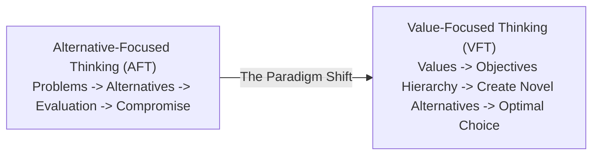
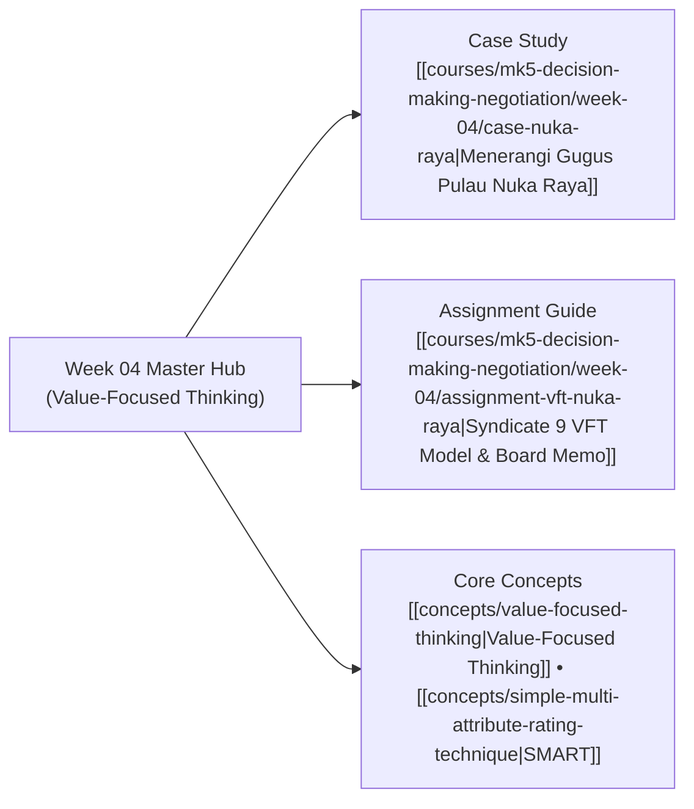

## 🧭 Executive Overview & Curricular Context

**MK5 Week 04** introduces a foundational paradigm shift in managerial decision theory: **Value-Focused Thinking (VFT)**, pioneered by Harvard decision theorist **Ralph L. Keeney**.

Taught by [[entities/valid-hasyimi|Dr. Valid Hasyimi]], the module challenges the standard corporate operating mode known as **Alternative-Focused Thinking (AFT)**. Under AFT, decision makers reactively select among visible, pre-existing alternatives (e.g., _"Which of these three vendor quotes should we accept?"_), anchoring debates to narrow compromises and missed strategic opportunities. VFT reverses the sequence: **articulate core values and fundamental objectives first, structure them rigorously, and then proactively invent superior alternatives**.

Through the archipelagic public utility case **Menerangi Gugus Pulau Nuka Raya**, participants learn to decompose competing stakeholder interests into structured objective hierarchies, construct means-ends networks, and engineer creative hybrid solutions via Strategy Generation Tables.

---

## 🏛️ Foundational Principles of Value-Focused Thinking

Ralph Keeney establishes that decision opportunities are created, not discovered. VFT enforces three fundamental analytical disciplines:

### 1. Values Over Alternatives

Alternatives are merely physical pathways to achieve desired states. What decision makers fundamentally care about are **values** (e.g., human health, institutional solvency, ecological integrity). By focusing on values first, decision makers escape the cognitive anchor of pre-packaged options.

### 2. The WITI Test: Fundamental vs. Means Objectives

To prevent circular logic, analysts utilize the **"Why Is That Important?" (WITI)** test:

- **Fundamental Objectives**: Represent essential end values; important in their own right within the decision context (e.g., _Minimize infant mortality from clinical blackouts_).
- **Means Objectives**: Important only because they drive or facilitate fundamental objectives (e.g., _Install backup batteries_).

### 3. Strategy Generation Tables

Rather than choosing between rigid, monolithic proposals, analysts deconstruct decisions into functional dimensions (columns) containing tactical options (rows). Innovative strategies are created by linking synergistic choices across dimensions, unlocking win-win hybrid solutions.

---

## ⚡ Case Study Synthesis: Menerangi Gugus Pulau Nuka Raya

The session's central empirical application centers on **PT EKN (Energi Kepulauan Nusantara)** resolving the rural electrification dilemma of the **Nuka Raya** island cluster:

- **The Conflict**: Balancing public service obligations across 4,200 households on three isolated islands (suffering 3-week blackouts during monsoons) against PT EKN’s accumulated annual deficit of IDR 38 billion and indigenous customary land rights (_hak ulayat_).
- **The AFT Trap**: The Board initially debated whether to buy more diesel gensets, build an expensive centralized solar farm, or lay an undersea cable.
- **VFT Breakthrough**: As demonstrated in [[courses/mk5-decision-making-negotiation/week-04/assignment-vft-nuka-raya|Syndicate 9 Assignment Guide]], reframing the mandate generated **Option D (Phased Service Based on Needs)**—providing immediate 24/7 solar-battery microgrids for rural health clinics and fishing cold-storage on existing civic structures, while phasing household residential expansion as local demand matures.

---

## 🗺️ Module Satellite Directory

---

## 🔗 Cross-Curricular Bridges

- Previous Module: [[courses/mk5-decision-making-negotiation/week-03/index|Week 03: Kepner-Tregoe Problem Analysis]]
- Next Module: [[courses/mk5-decision-making-negotiation/week-05/index|Week 05: SMART & Swing Weighting]]
- Lead Faculty Profile: [[entities/valid-hasyimi|Dr. Valid Hasyimi]]
- Course Overview: [[courses/mk5-decision-making-negotiation/index|MK5 Syllabus & MOC]]
