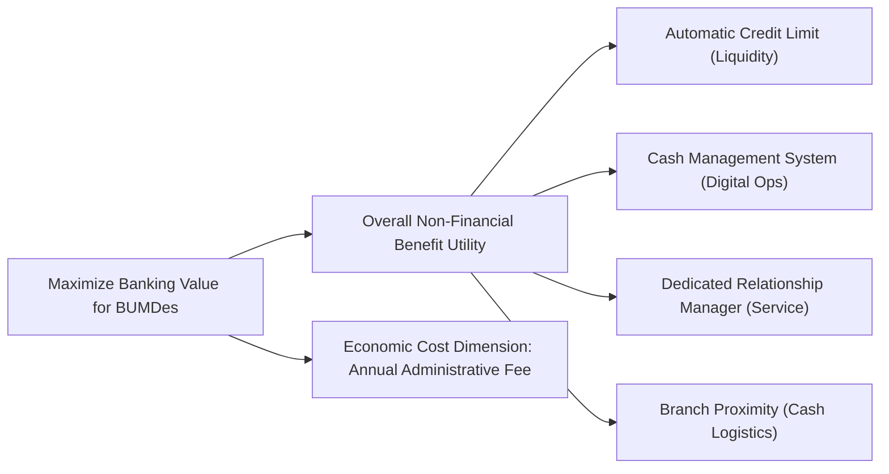
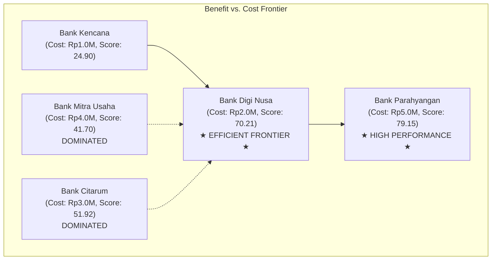

## 🎯 Assignment Mandate & Core Scope

The Week 05 assignment directs syndicate teams to execute the complete **8-Stage Simple Multi-Attribute Rating Technique (SMART)** on the **BUMDes Bumi Lestari** commercial bank procurement dilemma:

1. **Decision Context & Stakeholders**: Identify the decision maker (Pak Asep Hidayat) and governance constraints (Village Head & Badan Pengawas BUMDes).
2. **Value Tree & Attribute Definitions**: Structure benefit attributes and normalize single-attribute performance utility curves ($0$ to $100$).
3. **Swing Weighting Derivation**: Derive unnormalized and normalized attribute weights via explicit range-based thought experiments.
4. **Aggregate Utility Synthesis**: Calculate overall weighted benefit utility $U(A_j) = \sum w_i u_i(x_{ij})$ for all 5 banking candidates.
5. **Cost-Benefit Frontier & Sensitivity Analysis**: Trade off overall benefit utility against annual administrative costs and calculate critical weight switching thresholds.

> [!NOTE] Cohort Attribution
> This decision analysis model reflects the authentic worked submission developed by **`F9 (Class F / Syndicate 9)`** within the SBM ITB P3MD Executive MBA program.

---

## 📐 Stage 1–3: The SMART Attribute Structure

Pak Asep defined four core non-financial benefit attributes, keeping annual administrative fees as the economic cost dimension:

---

## ⚖️ Stage 4–5: Swing Weighting Derivation

The committee established attribute weights by imagining an alternative with the worst performance across all dimensions and evaluating the relative value of swinging each attribute from worst to best:

| Attribute Dimension            | Worst Level (Anchor)        | Best Level (Target)              | Raw Swing Rating ($s_i$) |      Normalized Weight ($w_i$)      | Rank |
| :----------------------------- | :-------------------------- | :------------------------------- | :----------------------: | :---------------------------------: | :--: |
| **Automatic Credit Limit**     | Minimal micro credit line   | High pre-approved credit line    |         **100**          | $100 / 235 \approx \mathbf{0.4255}$ |  1   |
| **Cash Management System**     | Manual offline batch portal | Real-time automated API portal   |          **70**          | $70 / 235 \approx \mathbf{0.2979}$  |  2   |
| **Dedicated Relationship Mgr** | Shared call center support  | Dedicated senior agricultural RM |          **45**          | $45 / 235 \approx \mathbf{0.1915}$  |  3   |
| **Branch Proximity**           | 45 km (Bandung City Center) | 3 km (Lembang Sub-district)      |          **20**          | $20 / 235 \approx \mathbf{0.0851}$  |  4   |
| **Total**                      | —                           | —                                |         **235**          |             **1.0000**              |  —   |

$$\sum_{i=1}^{4} w_i = 0.4255 + 0.2979 + 0.1915 + 0.0851 = 1.0000$$

---

## 📊 Stage 6: Performance Utility Scoring & Aggregate Synthesis

Single-attribute utilities are scored on a normalized scale $[0, 100]$ based on operational performance:

| Attribute ($w_i$)               | Bank Citarum | Bank Parahyangan | Bank Digi Nusa | Bank Kencana | Bank Mitra Usaha |
| :------------------------------ | :----------: | :--------------: | :------------: | :----------: | :--------------: |
| **Automatic Credit ($0.4255$)** |  70 (29.79)  |   100 (42.55)    |   80 (34.04)   |   0 (0.00)   |    40 (17.02)    |
| **Cash Management ($0.2979$)**  |  20 (5.96)   |    30 (8.94)     |  100 (29.79)   |  60 (17.87)  |    20 (5.96)     |
| **Dedicated RM ($0.1915$)**     |  80 (15.32)  |   100 (19.15)    |   20 (3.83)    |  10 (1.92)   |    80 (15.32)    |
| **Branch Proximity ($0.0851$)** |  10 (0.85)   |    100 (8.51)    |   30 (2.55)    |  60 (5.11)   |    40 (3.40)     |
| **Aggregate Benefit Score**     |  **51.92**   |    **79.15**     |   **70.21**    |  **24.90**   |    **41.70**     |
| **Benefit Rank**                |    **3**     |      **1**       |     **2**      |    **5**     |      **4**       |
| **Annual Fee (Cost)**           | **IDR 3.0M** |   **IDR 5.0M**   |  **IDR 2.0M**  | **IDR 1.0M** |   **IDR 4.0M**   |

---

## 📈 Stage 7–8: Benefit vs. Cost Trade-Off & Sensitivity Analysis

### Strategic Dilemma: Bank Digi Nusa vs. Bank Parahyangan

- **Bank Mitra Usaha and Bank Citarum are strictly dominated**: they deliver lower utility scores than Bank Digi Nusa while charging higher annual fees.
- **The Incremental Cost-Benefit Trade-Off**:
  - Moving from Bank Digi Nusa (Score: 70.21, Cost: Rp2.0M) to Bank Parahyangan (Score: 79.15, Cost: Rp5.0M) costs **IDR 3.0 Million annually for an incremental gain of only 8.94 utility points**.
  - Rate of benefit exchange: $\text{Incremental Cost per Utility Point} = \frac{\text{Rp } 3,000,000}{8.94} \approx \text{Rp } 335,570 \text{ / point}$.

### Sensitivity Threshold

If the decision maker's priority weight for **Branch Proximity** increases above $w_{\text{proximity}} > 0.28$, Bank Parahyangan dominates unconditionally. However, given BUMDes's strategic push into online retail and multi-unit digital reconciliation, **Bank Digi Nusa represents the most cost-effective, future-ready commercial partner**.

---

## 🔗 Related Resources

- Master Lecture Hub: [[courses/mk5-decision-making-negotiation/week-05/index|MK5 Week 05 Lecture Notes]]
- Case Study: [[courses/mk5-decision-making-negotiation/week-05/case-bumdes-bumi-lestari|Case: BUMDes Bumi Lestari]]
- Core Concept: [[concepts/simple-multi-attribute-rating-technique|SMART Methodology]]
- Alternative MCDA Tool: [[concepts/analytic-hierarchy-process|Analytic Hierarchy Process (AHP)]]
