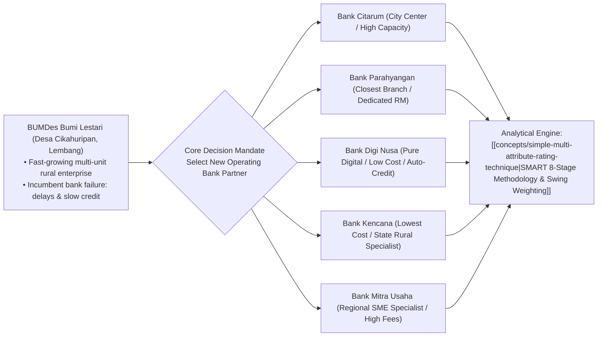

## 📋 Executive Summary

**BUMDes Bumi Lestari** (_Badan Usaha Milik Desa_) is an exemplary, multi-unit rural community enterprise located in **Desa Cikahuripan, Kecamatan Lembang, Kabupaten Bandung Barat**. Operating across commercial eco-tourism, dairy farming logistics, organic agro-processing, and village micro-credit, the enterprise generated rapid revenue growth, straining its financial operations.

In 2026, **Pak Asep Hidayat**, Managing Director of BUMDes Bumi Lestari, confronted severe operational bottlenecks with the enterprise’s incumbent banking partner: persistent electronic transaction clearance delays, frequent turnover of assigned bank relationship officers, and an unacceptably slow 60-day turnaround on seasonal working capital credit approvals. With board approval from the Village Head (_Kepala Desa_) and the Village Supervisory Board (_Badan Pengawas BUMDes_), Pak Asep initiated a formal procurement review to select a new primary operating bank from **five commercial banking institutions**.

The selection dilemma required a rigorous quantitative methodology capable of reconciling qualitative service factors with direct fee structures: the **Simple Multi-Attribute Rating Technique (SMART)** using swing weighting.

---

## 🏢 Profile of the Five Banking Candidates

The selection committee evaluated five commercial banking institutions licensed by Otoritas Jasa Keuangan (OJK):

| Banking Institution  | Annual Administrative Cost | Branch Proximity to Lembang                         |        Dedicated Relationship Manager         |           Automatic Working Capital Credit Limit           |              Digital Cash Management System              |
| :------------------- | :------------------------: | :-------------------------------------------------- | :-------------------------------------------: | :--------------------------------------------------------: | :------------------------------------------------------: |
| **Bank Citarum**     |    **IDR 3.0 Million**     | Farthest: 45 km (Bandung City Center).              |     **Yes** (Assigned dedicated officer).     |  High limit facility (Double Bank Mitra Usaha baseline).   |  **No** (Standard commercial portal; manual batching).   |
| **Bank Parahyangan** |    **IDR 5.0 Million**     | Closest: 3 km (10 mins in Lembang Sub-district).    | **Yes** (Experienced senior agricultural RM). |    Highest facility limit (Double Bank Citarum limit).     |        **No** (Traditional desktop web banking).         |
| **Bank Digi Nusa**   |    **IDR 2.0 Million**     | Digital service offices; no cash branch in Lembang. |  **No** (24/7 Priority call center support).  | Pre-approved dynamic API credit based on transaction flow. | **Yes** (Advanced real-time automated corporate portal). |
| **Bank Kencana**     |    **IDR 1.0 Million**     | Sub-branch: 15 km (Bandung Barat Regency).          |   **No** (Shared branch customer service).    |          Modest micro-enterprise credit ceiling.           |  **Yes** (Basic mobile corporate banking application).   |
| **Bank Mitra Usaha** |    **IDR 4.0 Million**     | Regional branch: 25 km (North Bandung).             | **Yes** (Dedicated SME relationship officer). |   Standard collateralized working capital loan facility.   |       **No** (Legacy electronic banking terminal).       |

---

## ⚖️ Strategic Attribute Taxonomy & Trade-off Tensions

Pak Asep and the supervisory committee established four primary non-financial benefit attributes, holding annual administrative fees as the cost trade-off dimension:

1. **Branch Proximity & Physical Accessibility**: Critical for daily cash deposits generated by eco-tourism ticket counters and dairy cooperative milk collection points.
2. **Dedicated Relationship Manager (RM)**: High managerial priority for accelerating credit approvals, navigating compliance paperwork, and resolving transaction disputes on-site.
3. **Automatic Working Capital Credit Facility**: Crucial for smoothing seasonal harvest cash flow mismatches without undergoing repeated collateral appraisals.
4. **Digital Cash Management System**: Essential for integrating multi-unit revenue tracking across eco-tourism ticketing, village retail kiosks, and vendor remittances.

---

## 🔗 Related Resources

- Master Lecture Hub: [[courses/mk5-decision-making-negotiation/week-05/index|MK5 Week 05 Lecture Notes]]
- Assignment Guide: [[courses/mk5-decision-making-negotiation/week-05/assignment-smart-bumdes|Syndicate 9 SMART Decision Model]]
- Foundational Concept: [[concepts/simple-multi-attribute-rating-technique|SMART Methodology & Swing Weighting]]
- Complementary MCDA Tool: [[concepts/analytic-hierarchy-process|Analytic Hierarchy Process (AHP)]]
