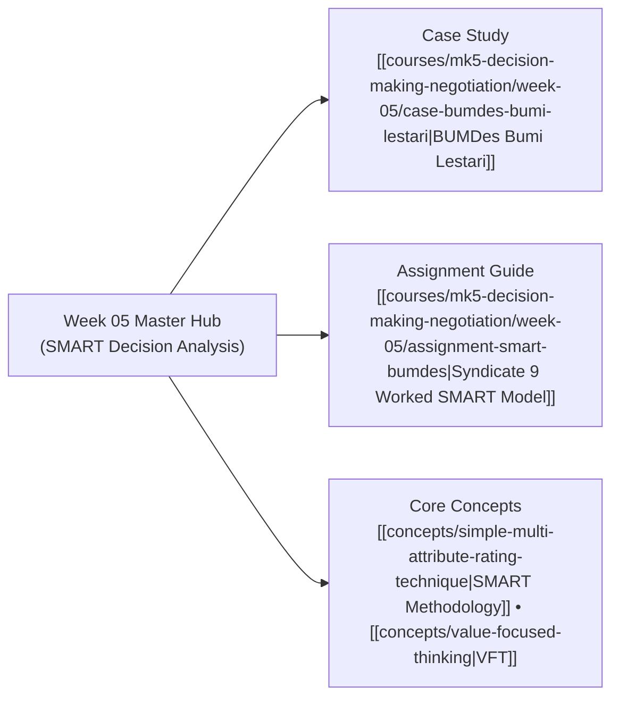

## 🧭 Executive Overview & Curricular Context

**MK5 Week 05** introduces the quantitative toolkit of **Multi-Criteria Decision Analysis (MCDA)** through the **Simple Multi-Attribute Rating Technique (SMART)**, formulated by Ward Edwards and codified for executive management by Goodwin & Wright (2000).

Taught by [[entities/valid-hasyimi|Dr. Valid Hasyimi]], the session addresses decisions where alternatives cannot be evaluated solely on monetary return, but involve qualitative trade-offs, service levels, operational convenience, and strategic capabilities. The module dismantles the flawed practice of arbitrary weighting by mastering **swing weighting**—an explicit cognitive protocol anchoring attribute importance in the empirical spread between worst and best performance states.

Through the commercial procurement case of **BUMDes Bumi Lestari**, participants construct an 8-stage linear additive decision model, build benefit-cost efficient frontiers, and perform mathematical sensitivity analysis to defend resource commitments before executive boards.

```mermaid
flowchart LR
    Prob["Complex Multi-Attribute Choice"] --> S1["Stage 1: Identify Decision Maker"]
    S1 --> S2["Stage 2: Define Discrete Alternatives"]
    S2 --> S3["Stage 3: Structure Value Tree (Attributes)"]
    S3 --> S4["Stage 4: Assign Performance Utilities (0-100)"]
    S4 --> S5["Stage 5: Derive Swing Weights"]
    S5 --> S6["Stage 6: Calculate Aggregate Utility: U = SUM(w_i * u_i)"]
    S6 --> S7["Stage 7: Trade-off Benefit vs. Cost Plane"]
    S7 --> S8["Stage 8: Sensitivity Analysis & Switching Thresholds"]
```

---

## 🏛️ The Eight Stages of SMART

The SMART methodology provides an audit-proof, transparent analytical sequence:

1. **Identify the Decision Maker**: Clarify who has statutory decision authority, who advises, and whose preferences must be modeled.
2. **Identify Alternatives**: Define discrete, actionable courses of action.
3. **Identify Relevant Attributes**: Structure non-redundant, measurable evaluation dimensions representing fundamental objectives ([[concepts/value-focused-thinking|VFT]]).
4. **Assess Single-Attribute Utilities**: Normalize physical raw units (kilometers, hours, binary features) onto a uniform interval $[0, 100]$.
5. **Determine Attribute Weights via Swing Weighting**: Anchor subjective weights in the empirical range between worst and best performance levels.
6. **Calculate Aggregate Utility**: Compute the linear weighted sum:
   $$U(A_j) = \sum_{i=1}^{n} w_i \cdot u_i(x_{ij}) \quad \text{where} \quad \sum_{i=1}^{n} w_i = 1.0$$
7. **Take Provisional Decision (Benefit vs. Cost)**: Separate non-financial benefit utility from financial costs to plot alternatives on a 2D trade-off plane.
8. **Conduct Sensitivity Analysis**: Vary attribute weights across $[0, 1]$ to calculate critical switching points where rank order changes.

---

## ⚖️ Case Study Synthesis: BUMDes Bumi Lestari

The empirical centerpiece examines **BUMDes Bumi Lestari** in Lembang, West Java, selecting a primary commercial bank partner to replace an underperforming incumbent:

- **The Trade-Off Dilemma**: Balancing annual service costs against branch proximity (for daily agricultural cash deposits), automated working capital limits (for seasonal cash flow), and digital cash management APIs.
- **Dominated Alternatives**: As proven in [[courses/mk5-decision-making-negotiation/week-05/assignment-smart-bumdes|Syndicate 9 Assignment Guide]], Bank Mitra Usaha and Bank Citarum were mathematically dominated—delivering lower utility than Bank Digi Nusa while charging higher fees.
- **The Strategic Compromise**: Bank Parahyangan achieved the highest overall benefit score ($79.15$) but carried the highest annual cost (Rp5.0M). Bank Digi Nusa delivered an optimal balance ($70.21$ benefit points at only Rp2.0M fee), establishing the benchmark on the cost-benefit efficient frontier.

---

## 🗺️ Module Satellite Directory

---

## 🔗 Cross-Curricular Bridges

- Previous Module: [[courses/mk5-decision-making-negotiation/week-04/index|Week 04: Value-Focused Thinking (VFT)]]
- Next Module: [[courses/mk5-decision-making-negotiation/week-06/index|Week 06: Decision Analysis — Decision Tree & Uncertainty]]
- Course Syllabus: [[courses/mk5-decision-making-negotiation/index|MK5 Course Overview]]
- Lead Faculty Profile: [[entities/valid-hasyimi|Dr. Valid Hasyimi]]
