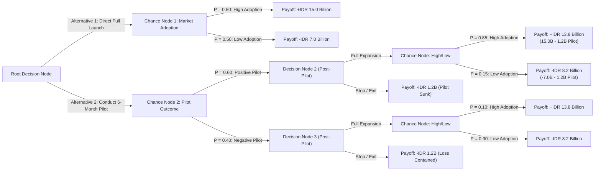
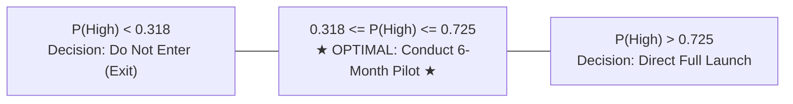

## 🎯 Assignment Mandate & Core Quantitative Scope

The Week 06 assignment directs syndicate teams to evaluate the **IndoPorta di Maluku** capital expansion dilemma using **Decision Tree Analysis under Uncertainty**:

1. **Decision Tree Architecture**: Structure the chronological sequence of decision nodes ($\square$), chance nodes ($\bigcirc$), and terminal payoffs.
2. **Backward Induction (Rollback Algorithm)**: Calculate Expected Monetary Value (EMV) across chance nodes and identify optimal decision paths.
3. **Valuation of Information**: Derive Expected Value of Perfect Information (EVPI) and Expected Value of Sample Information (EVSI) for the 6-month pilot trial.
4. **Sensitivity & Tornado Analysis**: Test the robustness of the decision against shifts in market adoption probabilities ($P(\text{High})$) and pilot testing costs.
5. **Board Recommendation**: Provide concrete managerial guidance to Arya Wiratama and IndoPorta's Board of Directors.

> [!NOTE] Cohort Attribution
> This decision tree model and mathematical rollback analysis reflect the authentic worked submission developed by **`F9 (Class F / Syndicate 9)`** within the SBM ITB P3MD Executive MBA program.

---

## 🌳 Chronological Decision Tree Architecture

---

## 🧮 Mathematical Rollback Calculation (Backward Induction)

### Step 1: Evaluating Alternative 1 (Direct Full Commercial Launch)

At Chance Node 1, probabilities of market adoption without sample testing are $P(\text{High}) = 0.50$ and $P(\text{Low}) = 0.50$:

$$\text{EMV}(\text{Direct Launch}) = (0.50 \times +\text{Rp } 15.0\text{B}) + (0.50 \times -\text{Rp } 7.0\text{B}) = +7.5\text{B} - 3.5\text{B} = \mathbf{+\text{IDR } 4.0 \text{ Billion}}$$

---

### Step 2: Evaluating Alternative 2 (Conduct 6-Month Pilot)

#### A. If Pilot Outcome is Positive ($P(\text{Pos}) = 0.60$):

Under updated Bayesian sample testing, a positive pilot indicates strong localized adoption ($P(\text{High} \mid \text{Pos}) = 0.85, P(\text{Low} \mid \text{Pos}) = 0.15$):

- _Expand Branch_:
  $$\text{EMV}(\text{Expand} \mid \text{Pos}) = (0.85 \times +13.8\text{B}) + (0.15 \times -8.2\text{B}) = +11.73\text{B} - 1.23\text{B} = \mathbf{+\text{IDR } 10.50 \text{ Billion}}$$
- _Stop Branch_: Payoff is $-\text{IDR } 1.2 \text{ Billion}$.
- _Optimal Choice at Decision Node 2_: $\max(10.50, -1.2) = \mathbf{+\text{IDR } 10.50 \text{ Billion}}$ (**Expand**).

#### B. If Pilot Outcome is Negative ($P(\text{Neg}) = 0.40$):

Under a negative pilot, market reluctance is confirmed ($P(\text{High} \mid \text{Neg}) = 0.10, P(\text{Low} \mid \text{Neg}) = 0.90$):

- _Expand Branch_:
  $$\text{EMV}(\text{Expand} \mid \text{Neg}) = (0.10 \times +13.8\text{B}) + (0.90 \times -8.2\text{B}) = +1.38\text{B} - 7.38\text{B} = \mathbf{-\text{IDR } 6.00 \text{ Billion}}$$
- _Stop Branch_: Payoff is $-\text{IDR } 1.2 \text{ Billion}$.
- _Optimal Choice at Decision Node 3_: $\max(-6.00, -1.20) = \mathbf{-\text{IDR } 1.20 \text{ Billion}}$ (**Prune Expand; Select Stop**).

#### C. Folding Back Chance Node 2 (Total Pilot EMV):

$$\text{EMV}(\text{Pilot}) = P(\text{Pos}) \cdot \text{EMV}^*(\text{Pos}) + P(\text{Neg}) \cdot \text{EMV}^*(\text{Neg})$$

$$\text{EMV}(\text{Pilot}) = (0.60 \times +10.50\text{B}) + (0.40 \times -1.20\text{B}) = +6.30\text{B} - 0.48\text{B} = \mathbf{+\text{IDR } 5.82 \text{ Billion}}$$

---

### Step 3: Comparative Analysis & Root Choice

$$\text{EMV}(\text{Pilot}) = +\text{IDR } 5.82\text{B} > \text{EMV}(\text{Direct Launch}) = +\text{IDR } 4.00\text{B}$$

$$\text{Incremental Expected Gain of Pilot} = 5.82\text{B} - 4.00\text{B} = \mathbf{+\text{IDR } 1.82 \text{ Billion}}$$

The 6-month pilot trial yields **IDR 1.82 Billion higher expected monetary value** than an immediate full launch, because it purchases an asymmetric **real option to exit** if the market proves unfavorable, capping downside losses at IDR 1.2B.

---

## 💎 Information Valuation: EVPI and EVSI

### 1. Expected Value of Perfect Information (EVPI)

If a clairvoyant consultant could reveal true market adoption beforehand:

- If High Adoption ($P = 0.50$): Launch immediately $\rightarrow +\text{IDR } 15.0\text{B}$.
- If Low Adoption ($P = 0.50$): Do not launch $\rightarrow \text{IDR } 0.0\text{B}$.

$$\text{EMV}(\text{with Perfect Information}) = (0.50 \times 15.0\text{B}) + (0.50 \times 0.0\text{B}) = +\text{IDR } 7.50 \text{ Billion}$$

$$\text{EVPI} = \text{EMV}(\text{with Perfect Information}) - \text{EMV}(\text{without Information}) = 7.50\text{B} - 4.00\text{B} = \mathbf{\text{IDR } 3.50 \text{ Billion}}$$

### 2. Expected Value of Sample Information (EVSI)

Gross value of pilot trial excluding testing expenditure:

$$\text{EVSI} = (\text{EMV}(\text{Pilot}) + C_{\text{pilot}}) - \text{EMV}(\text{Direct}) = (5.82\text{B} + 1.20\text{B}) - 4.00\text{B} = \mathbf{\text{IDR } 3.02 \text{ Billion}}$$

$$\text{Expected Net Gain of Sampling (ENGS)} = \text{EVSI} - C_{\text{pilot}} = 3.02\text{B} - 1.20\text{B} = \mathbf{+\text{IDR } 1.82 \text{ Billion}}$$

---

## 📊 Sensitivity Analysis (Tornado Sensitivity)

Syndicate 9 performed sensitivity tests on baseline market success probability $P(\text{High})$:

- **Threshold 1 ($P = 0.318$)**: Below 31.8% success probability, even the pilot is unprofitable.
- **Threshold 2 ($P = 0.725$)**: Only if management is more than 72.5% certain of high adoption does an immediate direct launch become superior to a pilot. Given extreme cold-chain uncertainty in Maluku ($P \approx 50\%$), the pilot is overwhelmingly optimal.

---

## 💡 Syndicate 9 Final Board Recommendation

1. **Authorize 6-Month Pilot**: Allocate IDR 1.2 Billion to deploy mobile modular reefer containers at Pelabuhan Ambon rather than building fixed concrete facilities.
2. **Establish Explicit Go / No-Go Gates**: Proceed to full IDR 7B expansion only if the pilot achieves: (a) $> 70\%$ container utilization by Month 4; (b) zero compressor spoilage incidents; and (c) contracted volume with at least 3 local fishing aggregators.
3. **Competitive Preemption**: Use the pilot as an active commercial demonstration to sign exclusive port offload agreements, blunting Nusantara Coldlink's inroads.

---

## 🔗 Related Resources

- Master Lecture Hub: [[courses/mk5-decision-making-negotiation/week-06/index|MK5 Week 06 Lecture Notes]]
- Case Study: [[courses/mk5-decision-making-negotiation/week-06/case-indoporta|Case Study: IndoPorta di Maluku]]
- Foundational Concept: [[concepts/decision-tree-analysis|Decision Tree Analysis]]
- Related Concept: [[concepts/analytic-hierarchy-process|AHP Methodology]]
