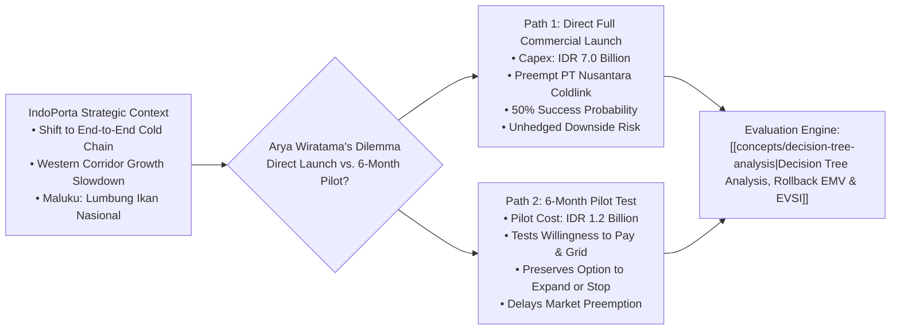

## 📋 Executive Summary

**PT Pelabuhan Nusantara Logistik (IndoPorta)** is a logistics and supply chain sub-holding under Indonesia’s state-owned port conglomerate ecosystem. In 2026, **Arya Wiratama**, the newly appointed Director of Business Development at IndoPorta Logistik, confronted a pivotal strategic expansion decision: establishing a dedicated **Cold Chain Logistics Hub at Pelabuhan Ambon, Maluku**.

The investment represented a cornerstone of IndoPorta's transition from a conventional marine terminal operator into an integrated end-to-end logistics solutions provider. While container volume growth in western Indonesian corridors was stagnating, the national government’s policy to designate Maluku as the **National Fish Granary (_Lumbung Ikan Nasional_)** offered vast volume potential. However, severe operational risks abounded: local port electrical grids were prone to brownouts, refrigerated (_reefer_) containers were scarce, scheduled feeder shipping to Java remained irregular, and local fishing cooperatives had never paid commercial cold-storage tariffs.

Arya championed aggressive, immediate entry to preempt private competitor **PT Nusantara Coldlink**, which had begun operations in 2024. Senior conservative board directors urged caution, recommending a **6-month pilot trial** to test market willingness-to-pay and ecosystem readiness before committing full capital expenditure.

---

## 🐟 The Regional Operational Context: Maluku Fisheries

Maluku represents one of the richest marine fisheries zones in the world (WPP-NRI 714, 715, and 718). However, due to the lack of an integrated regional cold chain:

- **Post-Harvest Loss**: Up to 35% of fresh fish landings suffer thermal degradation, forcing fishermen to sell high-grade yellowfin tuna and skipjack at distressed local market prices.
- **Infrastructure Deficits**: Pelabuhan Ambon experienced periodic electrical voltage fluctuations, threatening reefer container compressors.
- **Logistics Imbalance**: Reefer containers arriving full of imported perishable foods from Surabaya or Jakarta frequently returned westward empty (_backhaul deficit_), doubling maritime freight costs.

---

## ⚔️ Internal Board Dynamics & Decision Conflict

The Board of Directors fractured into two distinct strategic camps:

| Decision Camp                            | Champion & Alignment                                                  | Core Strategic Thesis                                                                                                                                                                  | Major Vulnerability / Blind Spot                                                                                            |
| :--------------------------------------- | :-------------------------------------------------------------------- | :------------------------------------------------------------------------------------------------------------------------------------------------------------------------------------- | :-------------------------------------------------------------------------------------------------------------------------- |
| **Camp 1: Aggressive Commercial Launch** | **Arya Wiratama** (Young, private sector background, growth mandate). | _First-Mover Speed_: Nusantara Coldlink is locking up commercial fishing contracts. Delaying 6 months surrenders market share. Immediate full launch achieves minimum efficient scale. | Overlooks infrastructure fragility; risks catastrophic IDR 7B capital write-off if fishermen refuse tariffs or power fails. |
| **Camp 2: Staged Experimental Pilot**    | **Senior Operations Director** (BUMN veteran, risk-averse).           | _Real Options Discipline_: A 6-month pilot at IDR 1.2B tests tariff acceptance and grid reliability. If results are negative, IndoPorta exits with losses capped at IDR 1.2B.          | Competitor expands capacity during trial; pilot scale may fail to demonstrate full operational network efficiencies.        |

---

## 📊 Payoff Parameters & Uncertainty Matrix

Financial modeling identified two primary States of Nature (SON) governing market response:

- **State of Nature 1: High Market Adoption ($P = 0.50$)**
  - Fishermen and local aggregators pay commercial storage fees; reefer vessel routes stabilize.
  - Net Payoff under Full Launch: **$+\text{IDR } 15.0 \text{ Billion}$** (NPV over 5 years).
- **State of Nature 2: Low Market Adoption ($P = 0.50$)**
  - Catch landed outside Ambon; power interruptions damage stock; fishermen bypass facility.
  - Net Payoff under Full Launch: **$-\text{IDR } 7.0 \text{ Billion}$** (Capital loss and operating deficits).

---

## 🔗 Related Resources

- Master Lecture Hub: [[courses/mk5-decision-making-negotiation/week-06/index|MK5 Week 06 Lecture Notes]]
- Assignment Guide: [[courses/mk5-decision-making-negotiation/week-06/assignment-indoporta-decision-tree|Syndicate 9 Worked Decision Tree & Rollback Analysis]]
- Foundational Concept: [[concepts/decision-tree-analysis|Decision Tree Analysis]]
- Related Concept: [[concepts/simple-multi-attribute-rating-technique|SMART Methodology]]
