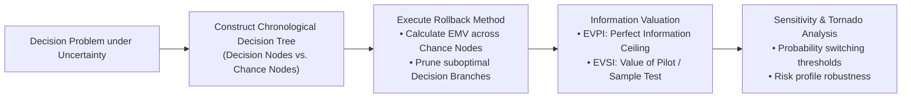
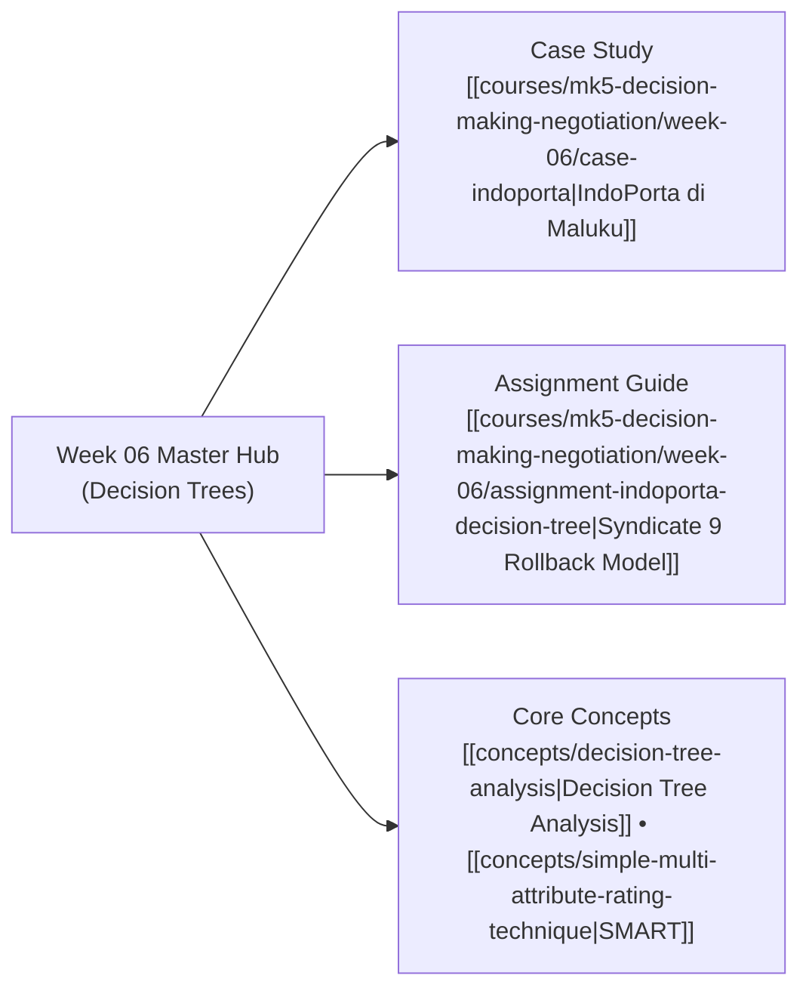

## 🧭 Executive Overview & Curricular Context

**MK5 Week 06** transitions decision analysis from multi-attribute certainty into the realm of **probabilistic risk and temporal uncertainty**. Led by [[entities/valid-hasyimi|Dr. Valid Hasyimi]], the module introduces **Decision Tree Analysis (DTA)** as a graphical and mathematical framework for structuring high-stakes capital investments unfolding across multiple sequential stages.

Executives frequently struggle to value flexibility, treating investments as all-or-nothing gambles. Decision trees force leaders to separate strategic choices under their direct control (**Decision Nodes**) from external states of nature controlled by markets or competitors (**Chance Nodes**). By deploying the **rollback algorithm (backward induction)**, leaders calculate **Expected Monetary Value (EMV)** and quantify the exact economic value of phased testing, market pilots, and real options.

The module culminates in the real-world infrastructure dilemma of **IndoPorta di Maluku: Uji Coba atau Langsung Ekspansi?**, resolving internal corporate board deadlock between aggressive first-mover expansion and staged risk-mitigated pilot deployment.

---

## 🏛️ Analytical Mechanics: Decision Trees & Information Economics

### 1. Elements of the Tree

- **Decision Nodes ($\square$)**: Points where management exercises strategic choice. Branches are evaluated by **maximizing expected payoff**.
- **Chance Nodes ($\bigcirc$)**: Uncertain event outcomes outside management's control. Branches represent mutually exclusive states of nature evaluated by **probability-weighted summation**:
  $$\text{EMV} = \sum_{i=1}^{m} p_i \cdot V_i \quad \text{where} \quad \sum p_i = 1.0$$
- **Terminal Nodes ($\triangle$)**: End states containing cumulative net cash flows or utility.

### 2. Valuing Imperfect Tests: EVPI vs. EVSI

- **Expected Value of Perfect Information (EVPI)** establishes the theoretical upper limit on what management should spend on intelligence:
  $$\text{EVPI} = \text{EMV}_{\text{with Perfect Information}} - \text{EMV}_{\text{baseline}}$$
- **Expected Value of Sample Information (EVSI)** measures the practical value added by an imperfect pilot study:
  $$\text{EVSI} = (\text{EMV}_{\text{Pilot}} + C_{\text{pilot}}) - \text{EMV}_{\text{Direct}}$$
  A pilot is economically rational if and only if its **Expected Net Gain of Sampling ($\text{ENGS} = \text{EVSI} - C_{\text{pilot}}$) is strictly positive**.

---

## 🚢 Case Study Synthesis: IndoPorta di Maluku

The classroom application centers on state-owned port logistics sub-holding **IndoPorta** evaluating an investment in a **Cold Chain Hub at Pelabuhan Ambon**:

- **The Strategic Conflict**: Business Development Director Arya Wiratama championed an immediate IDR 7.0 Billion commercial launch to preempt competitor PT Nusantara Coldlink. Conservative board members urged an IDR 1.2 Billion 6-month trial due to unproven local tariff willingness and grid unreliability.
- **Rollback Proof**: As calculated in [[courses/mk5-decision-making-negotiation/week-06/assignment-indoporta-decision-tree|Syndicate 9 Assignment Guide]], the 6-month pilot delivered an $\text{EMV}$ of **$+\text{IDR } 5.82 \text{ Billion}$**, compared to only **$+\text{IDR } 4.00 \text{ Billion}$** for direct launch.
- **The Power of the Real Option**: The pilot generates an incremental net gain of **IDR 1.82 Billion** because it purchases an asymmetric option to exit if demand is low, containing downside capital destruction from $-\text{IDR } 7\text{B}$ to $-\text{IDR } 1.2\text{B}$.

---

## 🗺️ Module Satellite Directory

---

## 🔗 Cross-Curricular Bridges

- Previous Module: [[courses/mk5-decision-making-negotiation/week-05/index|Week 05: SMART & Swing Weighting]]
- Next Module: [[courses/mk5-decision-making-negotiation/week-07/index|Week 07: Analytic Hierarchy Process (AHP)]]
- Lead Faculty Profile: [[entities/valid-hasyimi|Dr. Valid Hasyimi]]
- Course Syllabus: [[courses/mk5-decision-making-negotiation/index|MK5 Syllabus & MOC]]
