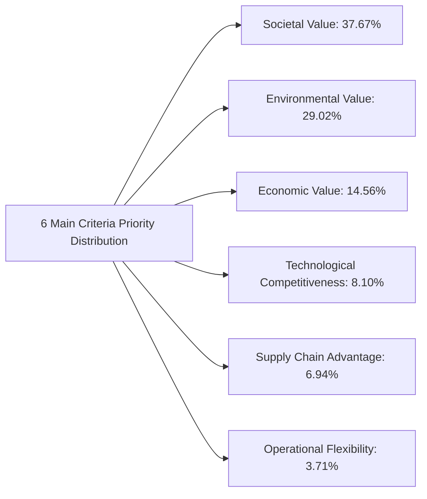
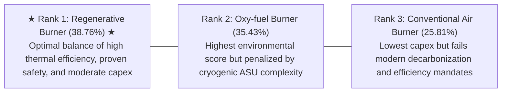

## 🎯 Assignment Mandate & Quantitative Scope

The Week 07 assignment directs syndicate teams to execute a full **Analytic Hierarchy Process (AHP)** for **Pertamina Kilang Nusantara**:

1. **Criteria Pairwise Comparison Matrix**: Build the $6 \times 6$ positive reciprocal judgment matrix for primary criteria and calculate relative priority weights via principal eigenvector extraction.
2. **Mathematical Consistency Verification**: Calculate the principal eigenvalue $\lambda_{\max}$, Consistency Index ($CI$), and verify that the Consistency Ratio satisfies the strict threshold **$CR < 0.10$**.
3. **Subcriteria Synthesis**: Deconstruct 28 detailed subcriteria across the 6 parent pillars, calculating both local priority weights and global composite weights.
4. **Alternative Synthesis & Ranking**: Synthesize alternative performance vectors across the three combustion technologies (Conventional Air, Regenerative, Oxy-fuel) to determine the definitive board recommendation.

> [!NOTE] Cohort Attribution
> This mathematical model and consistency proof reflect the authentic worked submission developed by **`F9 (Class F / Syndicate 9)`** within the SBM ITB P3MD Executive MBA program.

---

## 🔢 Phase 1: Main Criteria Pairwise Comparison Matrix

The $6 \times 6$ judgment matrix compares the six strategic pillars: **Economic (E)**, **Societal (S)**, **Environmental (L)**, **Supply Chain (SC)**, **Technological (T)**, and **Operational Flexibility (F)**:

$$
\mathbf{A} = \begin{bmatrix}
 & \mathbf{E} & \mathbf{S} & \mathbf{L} & \mathbf{SC} & \mathbf{T} & \mathbf{F} \\
\mathbf{E} & 1.000 & 0.333 & 0.333 & 3.000 & 3.000 & 3.000 \\
\mathbf{S} & 3.000 & 1.000 & 2.000 & 5.000 & 5.000 & 7.000 \\
\mathbf{L} & 3.000 & 0.500 & 1.000 & 5.000 & 5.000 & 5.000 \\
\mathbf{SC} & 0.333 & 0.200 & 0.200 & 1.000 & 1.000 & 3.000 \\
\mathbf{T} & 0.333 & 0.200 & 0.200 & 1.000 & 1.000 & 5.000 \\
\mathbf{F} & 0.333 & 0.143 & 0.200 & 0.333 & 0.200 & 1.000
\end{bmatrix}
$$

---

## 📐 Phase 2: Priority Vector Derivation & Consistency Proof

### 1. Principal Priority Vector ($w$)

Computing the normalized principal eigenvector yields the relative priority weights:

$$
\mathbf{w} = \begin{bmatrix}
w_E \\ w_S \\ w_L \\ w_{SC} \\ w_T \\ w_F
\end{bmatrix} = \begin{bmatrix}
\mathbf{0.1456} \quad (14.56\%) \\
\mathbf{0.3767} \quad (37.67\%) \\
\mathbf{0.2902} \quad (29.02\%) \\
\mathbf{0.0694} \quad (6.94\%) \\
\mathbf{0.0810} \quad (8.10\%) \\
\mathbf{0.0371} \quad (3.71\%)
\end{bmatrix} \quad \text{where} \quad \sum w_i = 1.0000
$$

> [!NOTE] Key Strategic Insight
> **Societal Value ($37.67\%$) and Environmental Value ($29.02\%$) together account for $66.69\%$ of the total decision weight**. Process safety, worker health, and emissions reductions overwhelmingly dominate short-term financial capital expense.

### 2. Consistency Index ($CI$) and Consistency Ratio ($CR$)

Computing the matrix vector product $\mathbf{A} \mathbf{w}$:

$$\mathbf{A} \mathbf{w} \approx \begin{bmatrix} 0.9577 \\ 2.4414 \\ 1.8841 \\ 0.4431 \\ 0.5238 \\ 0.2312 \end{bmatrix}$$

Evaluating $\lambda_{\max}$:

$$\lambda_{\max} = \frac{1}{6} \sum_{i=1}^{6} \frac{(\mathbf{A} \mathbf{w})_i}{w_i} \approx \mathbf{6.3883}$$

Calculating Consistency Index ($CI$) for $n = 6$:

$$CI = \frac{\lambda_{\max} - n}{n - 1} = \frac{6.3883 - 6}{6 - 1} = \frac{0.3883}{5} = \mathbf{0.0777}$$

Using Saaty’s empirical Random Index for $n = 6$, $RI = \mathbf{1.24}$:

$$CR = \frac{CI}{RI} = \frac{0.0777}{1.24} = \mathbf{0.0626} \quad (6.26\%)$$

$$\mathbf{CR = 0.0626 < 0.10 \quad \checkmark \quad \text{CONSISTENCY CONDITION FULLY SATISFIED}}$$

---

## 📊 Phase 3: Global Subcriteria Priorities (Top 5 of 28)

Global weight is derived by multiplying parent criterion priority by the local subcriterion eigenvector weight:

$$\text{Global Priority} = w_{\text{Parent}} \times w_{\text{Local}}$$

| Rank  | Subcriterion Dimension             | Parent Criterion          | Local Weight | Global Weight | Strategic Justification                                         |
| :---: | :--------------------------------- | :------------------------ | :----------: | :-----------: | :-------------------------------------------------------------- |
| **1** | **Process Health & Safety**        | Societal Value ($0.3767$) |  $46.48\%$   |  **17.51%**   | Eliminates flame impingement and hydrocarbon rupture risk.      |
| **2** | **Replacing Harmful Emissions**    | Environmental ($0.2902$)  |  $45.83\%$   |  **13.30%**   | Drastically cuts stack $\text{NO}_x$ and particulate emissions. |
| **3** | **Employee Learning & Competence** | Societal Value ($0.3767$) |  $32.73\%$   |  **12.33%**   | Operator upskilling for advanced combustion telemetry.          |
| **4** | **Return on Investment (ROI)**     | Economic Value ($0.1456$) |  $51.68\%$   |   **7.53%**   | Fuel gas energy savings amortizing capital outlay.              |
| **5** | **Thermal & Material Yield**       | Environmental ($0.2902$)  |  $24.98\%$   |   **7.25%**   | Maximizing furnace thermal transfer efficiency.                 |

---

## 🏆 Phase 4: Alternative Technology Synthesis & Final Ranking

Synthesizing all 28 subcriteria priorities across the three technology alternatives:

| Evaluation Tier                      | Conventional Air Burner (Rp180B) | Regenerative Burner (Rp240B) | Oxy-fuel Burner (Rp300B) |
| :----------------------------------- | :------------------------------: | :--------------------------: | :----------------------: |
| **Economic Composite (14.56%)**      |            **0.485**             |            0.325             |          0.190           |
| **Societal Composite (37.67%)**      |              0.210               |          **0.460**           |          0.330           |
| **Environmental Composite (29.02%)** |              0.120               |            0.380             |        **0.500**         |
| **Supply Chain Composite (6.94%)**   |            **0.620**             |            0.260             |          0.120           |
| **Technological Composite (8.10%)**  |              0.140               |            0.380             |        **0.480**         |
| **Operational Flexibility (3.71%)**  |            **0.550**             |            0.300             |          0.150           |
| **FINAL COMPOSITE PRIORITY**         |            **0.2581**            |          **0.3876**          |        **0.3543**        |
| **FINAL RANKING**                    |            **Rank 3**            |     **Rank 1 (WINNER)**      |        **Rank 2**        |

---

## 💡 Syndicate 9 Executive Recommendation

Syndicate 9 recommends that Pertamina Kilang Nusantara procure and install the **Regenerative Burner System (Technology 2)**:

1. **Superior Value Equilibrium**: Achieves the highest composite priority score ($\mathbf{0.3876}$), delivering a $25\%$ reduction in fuel gas consumption while avoiding the extreme cryogenic operational hazards of pure oxygen handling.
2. **Risk-Controlled Innovation**: The regenerative system directly resolves the flame stability failures of the 2022 project through proven flue-gas ducting, providing a safe bridge toward refinery decarbonization targets.

---

## 🔗 Related Resources

- Master Lecture Hub: [[courses/mk5-decision-making-negotiation/week-07/index|MK5 Week 07 Lecture Notes]]
- Case Study: [[courses/mk5-decision-making-negotiation/week-07/case-pertamina-kilang-nusantara|Case Study: Pertamina Kilang Nusantara]]
- Foundational Concept: [[concepts/analytic-hierarchy-process|Analytic Hierarchy Process (AHP)]]
- Alternative MCDA Tool: [[concepts/simple-multi-attribute-rating-technique|SMART Methodology]]
