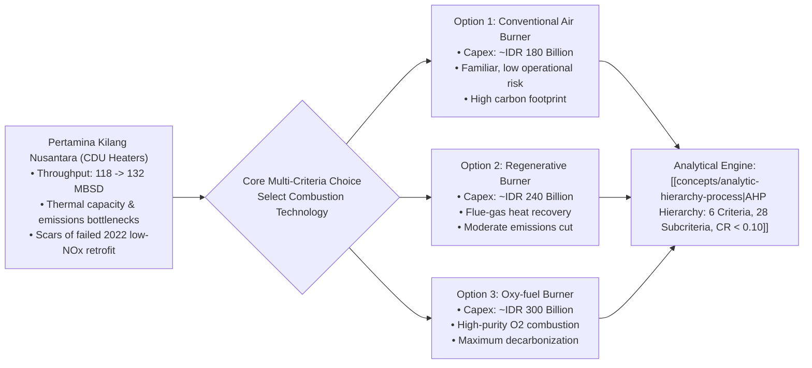

## 📋 Executive Summary

**PT Pertamina Kilang Nusantara (PKN)**, a flagship operating unit under [[entities/pt-pertamina|PT Pertamina (Persero)]]’s refining and petrochemical sub-holding, operates critical crude distillation units (CDU) processing strategic energy supplies for western Indonesia. In late 2026, PKN’s executive engineering and asset integrity committee faced an urgent capital investment decision: **selecting and retrofitting the primary combustion burner technology across its heavy CDU fired heaters**.

Between 2022 and 2024, crude processing throughput expanded from **118 MBSD to 132 MBSD** (_Thousand Barrels per Stream Day_), pushing atmospheric fired heaters beyond optimal thermal design limits. This operational strain generated escalating refinery fuel gas consumption, excessive greenhouse gas emissions, and elevated nitrogen oxide ($\text{NO}_x$) output under strict national environmental scrutiny.

Management carried severe psychological scar tissue from a **failed 2022 low-$\text{NO}_x$ burner retrofit**, where unexpected flame instability and localized tube hot spots forced unscheduled shutdowns and capital write-offs. Consequently, evaluating replacement combustion systems required balancing complex trade-offs across capital expense, process safety, energy efficiency, local industrial capability, and decarbonization goals via the **Analytic Hierarchy Process (AHP)**.

---

## 🏭 Operational Crucible: The CDU Fired Heater Challenge

Crude Distillation Units (CDU) represent the thermal gateway of petroleum refining, heating raw crude oil to approximately $360^\circ\text{C}$ prior to atmospheric fractionator entry. The fired heaters consume up to **60% of total refinery self-generated energy**, making them the primary source of refinery operational expenditure and carbon emissions.

### The 2022 Retrofit Failure

In 2022, PKN attempted an aggressive low-$\text{NO}_x$ staged-fuel retrofit to comply with initial Ministry of Environment and Forestry (_KLHK_) mandates. However, the installation suffered severe operational defects:

- Inadequate flame aerodynamics caused the flame to impinge directly on radiant tube banks (_flame impingement_).
- Severe local tube hot spots developed, risking catastrophic hydrocarbon rupture.
- The engineering team was forced to throttle intake, write off the retrofit capital, and restore conventional configurations. This historical crucible heightened the board's aversion to untested technical risk.

---

## ⚡ The Three Combustion Technology Alternatives

The engineering task force shortlisted three distinct technology pathways:

| Engineering Parameter    | Technology 1: Conventional Air Burner                               | Technology 2: Regenerative Burner                                                                                                   | Technology 3: Oxy-fuel Burner                                                                                                  |
| :----------------------- | :------------------------------------------------------------------ | :---------------------------------------------------------------------------------------------------------------------------------- | :----------------------------------------------------------------------------------------------------------------------------- |
| **Combustion Principle** | Standard ambient air combustion with optimized fuel-gas nozzles.    | Cyclic regenerator beds capturing thermal energy from exhaust flue gas to preheat incoming combustion air to $> 800^\circ\text{C}$. | Pure oxygen ($> 95\% \text{ O}_2$) supplied by an air separation unit (ASU), eliminating atmospheric nitrogen from combustion. |
| **Capital Investment**   | **IDR 180 Billion** (Lowest capex, standard replacement).           | **IDR 240 Billion** (Moderate capex, regenerator valving and ducts).                                                                | **IDR 300 Billion** (Highest capex, oxygen cryogenic plant and piping).                                                        |
| **Thermal Efficiency**   | Baseline: $82\% - 85\%$.                                            | High: $90\% - 93\%$ (Significant fuel gas savings).                                                                                 | Superior: $> 95\%$ (Extreme heat transfer density).                                                                            |
| **Emissions Profile**    | Standard $\text{CO}_2$ and $\text{NO}_x$ emissions.                 | $20\% - 25\%$ reduction in total fuel consumption and $\text{CO}_2$.                                                                | Near-zero direct stack $\text{NO}_x$; flue gas is high-purity $\text{CO}_2$ ready for Carbon Capture and Storage (CCS).        |
| **Operational Risk**     | Proven, familiar to refinery operators; zero technical uncertainty. | Moderate operational complexity; switching valves require frequent maintenance.                                                     | High complexity; cryogenic oxygen handling protocols and strict flame monitoring required.                                     |

---

## ⚖️ The Multi-Criteria Evaluation Hierarchy

To eliminate personal bias and political lobbying among engineering factions, PKN structured evaluation across **six primary criteria** spanning economic, social, environmental, supply chain, technological, and operational dimensions:

1. **Economic Value Creation (E)**: Investment ROI, fuel cost savings, lifecycle maintenance cost.
2. **Societal Value Creation (S)**: Process safety, employee occupational health, community safety zones.
3. **Environmental Value Creation (L)**: Stack emissions reduction, replacement of hazardous materials, climate compliance.
4. **Supply Chain Advantage (SC)**: Domestic component level (_TKDN_), vendor reliability, spare parts availability.
5. **Technological Competitiveness (T)**: Future-proof scalability, digital automation integration, patent longevity.
6. **Operational Flexibility (F)**: Multi-fuel fuel gas tolerance, turn-down ratio, ease of maintenance.

---

## 🔗 Related Resources

- Master Lecture Hub: [[courses/mk5-decision-making-negotiation/week-07/index|MK5 Week 07 Lecture Notes]]
- Assignment Guide: [[courses/mk5-decision-making-negotiation/week-07/assignment-ahp-combustion-system|Syndicate 9 Worked AHP Model]]
- Foundational Concept: [[concepts/analytic-hierarchy-process|Analytic Hierarchy Process (AHP)]]
- Corporate Profile: [[entities/pt-pertamina|PT Pertamina (Persero)]]
