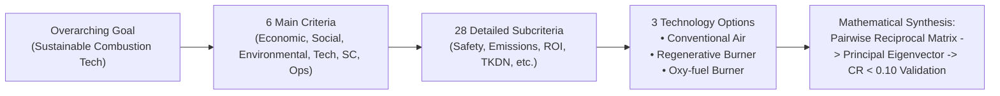
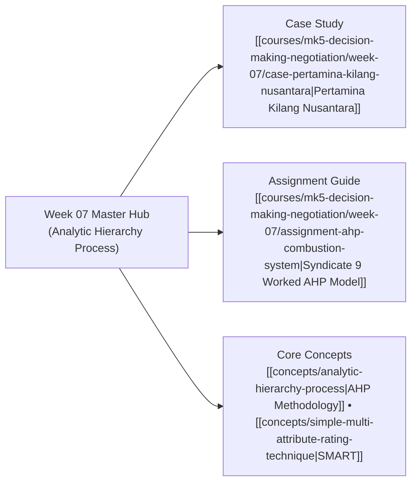

## 🧭 Executive Overview & Curricular Context

**MK5 Week 07** delivers the advanced mathematical capstone of quantitative multi-criteria decision making: the **Analytic Hierarchy Process (AHP)**, formulated by mathematician **Thomas L. Saaty**.

Led by [[entities/valid-hasyimi|Dr. Valid Hasyimi]], the module addresses complex capital allocation problems where decision attributes cannot be placed on simple linear scoring scales, but require **ratio-scale pairwise comparisons**. Unlike heuristic methods, AHP integrates a formal mathematical safeguard: computing the **principal eigenvalue ($\lambda_{\max}$)** and **Consistency Ratio ($CR$)** to detect and control contradictions in human managerial judgment.

The pedagogical crucible centers on [[entities/pt-pertamina|PT Pertamina (Persero)]]’s refining sub-holding in the case **Pertamina Kilang Nusantara: Selecting a Sustainable Combustion Technology**. Participants construct positive reciprocal matrices across 6 primary criteria and 28 subcriteria, mathematically proving consistency ($CR = 0.0626 < 0.10$) to select the optimal fired heater technology.

---

## 🏛️ Mathematical Mechanics of Saaty's AHP

AHP operates through three rigorous mathematical steps:

### 1. The 1–9 Fundamental Pairwise Scale

Judgments compare element $i$ to element $j$ using Saaty’s 9-point scale ($1 = \text{Equal}$, $3 = \text{Moderate}$, $5 = \text{Strong}$, $7 = \text{Very Strong}$, $9 = \text{Absolute}$), forming an $n \times n$ positive reciprocal matrix $\mathbf{A}$ where $a_{ji} = 1/a_{ij}$.

### 2. Eigenvector Priority Derivation

The relative priority vector $\mathbf{w}$ is the normalized right principal eigenvector satisfying:
$$\mathbf{A} \mathbf{w} = \lambda_{\max} \mathbf{w} \quad \text{where} \quad \sum_{i=1}^{n} w_i = 1.0$$

### 3. The 10% Consistency Gate ($CR < 0.10$)

Inconsistency in human comparisons is quantified via the Consistency Index ($CI$) and scaled against empirical Random Index ($RI$):
$$CI = \frac{\lambda_{\max} - n}{n - 1} \quad \implies \quad CR = \frac{CI}{RI}$$
If $CR \le 0.10$, the decision weights are statistically robust; if $CR > 0.10$, pairwise judgments must be re-evaluated.

---

## 🏭 Case Study Synthesis: Pertamina Kilang Nusantara

The classroom case examines **Pertamina Kilang Nusantara** selecting a replacement combustion burner for its Crude Distillation Units following an expansion from 118 to 132 MBSD:

- **The Multi-Criteria Tension**: Balancing initial capital expenditure against thermal efficiency, worker safety, and national decarbonization mandates.
- **The Priority Dominance**: As proven in [[courses/mk5-decision-making-negotiation/week-07/assignment-ahp-combustion-system|Syndicate 9 Assignment Guide]], Societal Value ($37.67\%$) and Environmental Value ($29.02\%$) accounted for two-thirds of the total decision weight.
- **The Winning Technology**: The **Regenerative Burner** won first place ($\mathbf{38.76\%}$ composite score), outranking the high-capex Oxy-fuel Burner ($35.43\%$) and baseline Conventional Burner ($25.81\%$).

---

## 🗺️ Module Satellite Directory

---

## 🔗 Cross-Curricular Bridges

- Previous Module: [[courses/mk5-decision-making-negotiation/week-06/index|Week 06: Decision Trees & Uncertainty]]
- Next Module: [[courses/mk5-decision-making-negotiation/week-08/index|Week 08: Negotiation Architecture, BATNA & ZOPA]]
- Corporate Entity Profile: [[entities/pt-pertamina|PT Pertamina (Persero)]]
- Course Syllabus: [[courses/mk5-decision-making-negotiation/index|MK5 Syllabus & MOC]]
