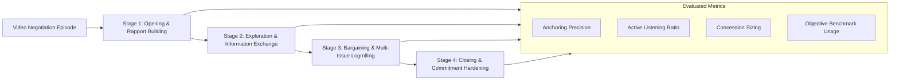
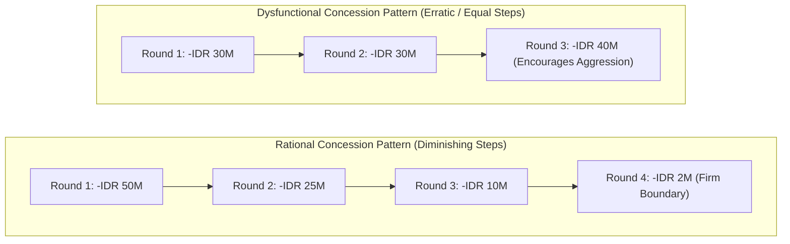

## 🎯 Assignment Mandate & Observational Protocol

The Week 08 negotiation assignment directs executive cohorts to conduct a rigorous micro-behavioral and tactical analysis of a recorded commercial bargaining interaction:

1. **Contextual Stakeholder Mapping**: Define parties, stated positions, underlying interests, and initial power asymmetries.
2. **Opening Tactics & Anchoring Behavior**: Track initial offers, non-verbal leakage, and immediate counter-anchoring moves.
3. **Information Elicitation & Questioning Strategy**: Evaluate whether negotiators utilize open investigative questions or aggressive interrogation.
4. **Concession Patterns & Logrolling**: Graph the trajectory and timing of concessions across multiple traded issues.
5. **Impasse Management & Closure**: Assess how negotiators navigate deadlock threats, leverage their [[concepts/batna-and-zopa|BATNA]], and formalize agreements.

> [!NOTE] Cohort Attribution
> This behavioral analysis rubric synthesizes diagnostic frameworks applied by **`F9 (Class F / Syndicate 9)`** within the SBM ITB P3MD Executive MBA program.

---

## 🔍 Video Analysis Diagnostic Scorecard

### Micro-Behavioral Indicator Matrix

| Behavioral Dimension          | Effective Mastery (Integrative)                                                                                                            | Pathological Behavior (Distributive / Defective)                                           | Executive Impact on ZOPA                                                       |
| :---------------------------- | :----------------------------------------------------------------------------------------------------------------------------------------- | :----------------------------------------------------------------------------------------- | :----------------------------------------------------------------------------- |
| **Initial Stance & Demeanor** | Professional, calm, inquisitive; establishes warm relational baseline.                                                                     | Defensive, arrogant, hostile; threatens immediate walkaway.                                | Establishes trust; expands willingness to disclose true constraints.           |
| **Opening Offer Execution**   | Grounded ambitious anchor supported by objective precedent or market data.                                                                 | Extreme, absurd opening without factual basis (_insulting offer_).                         | High anchor shifts counterpart's reservation point without triggering impasse. |
| **Listening & Questioning**   | Asks diagnostic open questions (_"What is the priority behind this timeline?"_); 70/30 listening ratio.                                    | Interrupts constantly; delivers long argumentative monologues.                             | Uncovers latent interests; enables multi-issue packaging and logrolling.       |
| **Concession Dynamics**       | Decreasing incremental concessions ($100 \rightarrow 50 \rightarrow 20 \rightarrow 5$); always conditional (_"If you... then we can..."_). | Large, unreciprocated concessions; sudden erratic capitulations under minor time pressure. | Signals approaching reservation price; extracts mutual value for every trade.  |
| **Deadlock Handling**         | Shifts focus to shared superordinate goals; unbundles contested single issues into sub-components.                                         | Issues ultimatums; attacks counterpart's integrity or competence.                          | Preempts premature impasse; preserves collaborative problem-solving climate.   |

---

## 📊 Concession Trajectory Modeling

In professional bargaining, the pattern of concessions communicates critical structural information:

> [!TIP] Tactical Rule on Concession Sizing
> Never make equal or expanding concessions. Equal concessions ($30\text{M} \rightarrow 30\text{M} \rightarrow 30\text{M}$) communicate to the counterpart that your reserve is vast and bottomless, encouraging them to prolong bargaining. Diminishing steps ($50\text{M} \rightarrow 25\text{M} \rightarrow 10\text{M} \rightarrow 2\text{M}$) signal that you are approaching your hard reservation ceiling.

---

## 💡 Syndicate Diagnostic Takeaways

1. **Information Asymmetry is the True Currency**: The party that asks the most incisive questions and listens attentively captures the largest share of cooperative surplus.
2. **Never Bargain Issue-by-Issue**: Single-issue bargaining inevitably devolves into zero-sum distributive positional warfare. Always package terms across price, delivery schedule, payment terms, and warranty.
3. **BATNA Clarity Grants Psychological Immunity**: Knowing your exact outside alternative protects negotiators from emotional manipulation and coercive anchoring tactics.

---

## 🔗 Related Resources

- Master Lecture Hub: [[courses/mk5-decision-making-negotiation/week-08/index|MK5 Week 08 Lecture Notes]]
- Reading Note: [[courses/mk5-decision-making-negotiation/week-08/reading-principled-negotiation|Principled Negotiation (Getting to Yes)]]
- Core Concept: [[concepts/batna-and-zopa|BATNA and ZOPA]]
- Course Overview: [[courses/mk5-decision-making-negotiation/index|MK5 Syllabus & MOC]]
