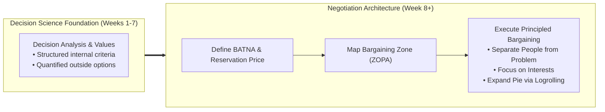
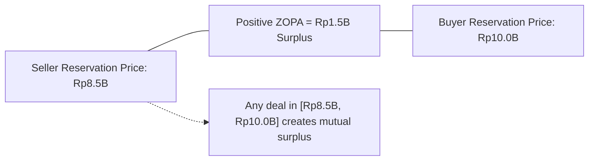
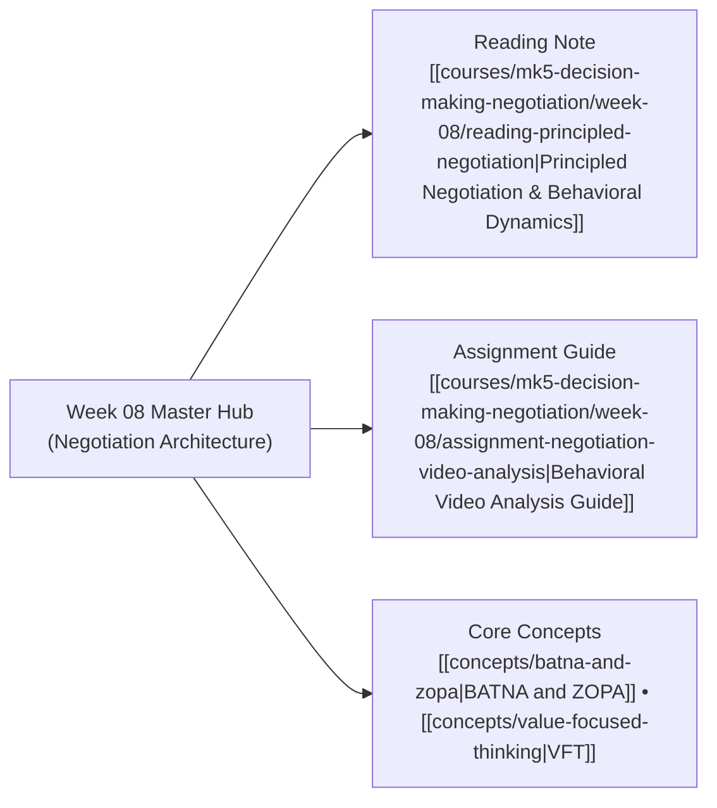

## 🧭 Executive Overview & Curricular Context

**MK5 Week 08** marks the strategic pivot of the course: transitioning from unilateral decision analysis into the dynamic, multi-agent domain of **Strategic Negotiation**.

Led by [[entities/valid-hasyimi|Dr. Valid Hasyimi]], the module integrates cognitive decision science with interpersonal and inter-organizational deal-making. Drawing upon foundational literature from the Harvard Negotiation Project (Roger Fisher, William Ury, and Bruce Patton) and Leigh Thompson's behavioral bargaining research, the session provides executives with an analytical architecture for deconstructing deals: establishing **Best Alternative to a Negotiated Agreement (BATNA)**, calculating **Reservation Prices ($RP$)**, mapping the **Zone of Possible Agreement (ZOPA)**, and avoiding classical behavioral traps such as the **Winner’s Curse** and reactive devaluation.

---

## 🏛️ The Structural Geometry of Negotiation

Strategic negotiations are bounded by three immutable mathematical parameters:

### 1. BATNA (Best Alternative to a Negotiated Agreement)

A negotiator's BATNA is the course of action available if current discussions terminate in an impasse. BATNA is **external, unilateral, and actionable**. Crucially, a BATNA is not an aspiration; it is the reality of what will happen without a deal.

### 2. Reservation Price ($RP$)

The reservation price is the quantified walkaway threshold. It represents the point of absolute indifference between signing the agreement and walking away to execute the BATNA:
$$RP_{\text{Buyer}} = \text{Maximum Willingness to Pay} \quad (\text{Price Ceiling})$$
$$RP_{\text{Seller}} = \text{Minimum Acceptable Value} \quad (\text{Price Floor})$$

### 3. ZOPA (Zone of Possible Agreement)

The overlap between buyer and seller reservation prices:
$$\text{ZOPA} = \left[ RP_{\text{Seller}}, RP_{\text{Buyer}} \right]$$

- **Positive ZOPA ($RP_{\text{Buyer}} \ge RP_{\text{Seller}}$)**: A mutually beneficial deal space exists. Total cooperative surplus is $RP_{\text{Buyer}} - RP_{\text{Seller}}$.
- **Negative ZOPA ($RP_{\text{Seller}} > RP_{\text{Buyer}}$)**: No rational agreement is possible without changing terms or logrolling additional issues.

---

## 🎯 Distributive Claiming vs. Integrative Value Creation

| Negotiation Dimension        | Distributive Bargaining (_Slicing the Pie_)           | Integrative Negotiation (_Expanding the Pie_)                                    |
| :--------------------------- | :---------------------------------------------------- | :------------------------------------------------------------------------------- |
| **Number of Issues**         | Single issue (typically pure price).                  | Multiple issues (price, volume, payment terms, risk allocation, timing).         |
| **Relationship Orientation** | Transactional, adversarial, short-term.               | Long-term, cooperative, institutional partnership.                               |
| **Information Strategy**     | Conceal reservation price and true constraints.       | Open disclosure of underlying interests and priorities.                          |
| **Tactical Mechanism**       | Extreme opening anchors, stubborn concession holding. | **Logrolling**: Trading low-cost concessions for high-value gains across issues. |
| **Outcome Nature**           | Zero-sum; one party’s gain is the other’s loss.       | Win-win; creates new joint economic surplus.                                     |

---

## 🗺️ Module Satellite Directory

---

## 🔗 Cross-Curricular Bridges

- Previous Module: [[courses/mk5-decision-making-negotiation/week-07/index|Week 07: Analytic Hierarchy Process (AHP)]]
- Mid-Term Synthesis: [[courses/mk5-decision-making-negotiation/mid/index|Mid-Term Examination Comprehensive Dossier]]
- Lead Faculty Profile: [[entities/valid-hasyimi|Dr. Valid Hasyimi]]
- Course Syllabus: [[courses/mk5-decision-making-negotiation/index|MK5 Syllabus & MOC]]
