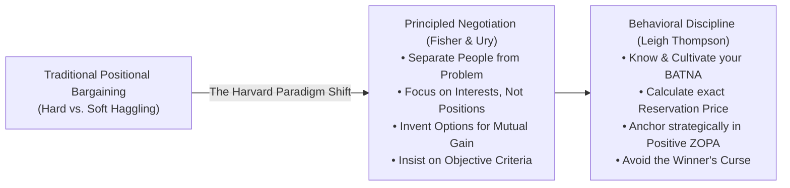

## 📖 Executive Summary

This reading synthesizes the foundational texts of modern strategic negotiation: **Roger Fisher, William Ury, and Bruce Patton's** _Getting to Yes: Negotiating Agreement Without Giving In_ (Harvard Negotiation Project / Penguin) and **Leigh Thompson's** _The Mind and Heart of the Negotiator_ (Pearson).

Strategic negotiation is defined as an interactive decision-making process undertaken when two or more parties seek to allocate resources, structure transactions, or resolve conflicts, but cannot achieve their objectives unilaterally. The literature deconstructs the traditional binary dilemma between "soft" accommodating bargaining and "hard" adversarial posturing, presenting **Principled Negotiation** as a method to decide issues on their merits rather than through haggling or pressure tactics.

---

## 🏛️ The Four Pillars of Principled Negotiation

Fisher, Ury, and Patton formulate four core tenets that alter the dynamics of interpersonal and inter-corporate dispute resolution:

### 1. Separate the People from the Problem

Negotiators are human beings with emotions, deeply held values, and distinct perceptual filters. Participants must attack the substantive problem together rather than attacking each other.

- _Tactical Rule_: Disentangle substantive business issues from relational dynamics; acknowledge emotions explicitly and validate legitimate perceptions without conceding commercial terms.

### 2. Focus on Interests, Not Positions

**Positions** are what negotiators declare they want (e.g., _"We require a 15% price cut"_); **Interests** are the underlying needs, desires, and fears that motivate those positions (e.g., _"We need to manage quarterly cash flow variance"_).

- _Tactical Rule_: For every position asserted, ask _"Why?"_ and _"Why not?"_ to uncover compatible, non-conflicting underlying interests.

### 3. Invent Options for Mutual Gain (Expand the Pie)

Negotiators frequently assume a fixed-pie bias—believing that any gain for one party represents an equivalent loss for the other.

- _Tactical Rule_: Decouple the act of **inventing options** from the act of **evaluating/deciding**. Use brainstorming and multi-issue bundling to design trade-offs where parties exchange low-cost concessions for high-value gains (**Logrolling**).

### 4. Insist on Objective Criteria

When interests are directly opposed, resolve deadlock using independent, fair standards rather than a test of wills.

- _Tactical Rule_: Ground price formulas, delivery penalties, and valuation terms in verifiable external benchmarks: market comps, replacement costs, industry index rates, professional appraisal standards, or court precedents.

---

## 🧠 Behavioral Traps in Bargaining (Leigh Thompson)

Leigh Thompson identifies four psychological pitfalls that routinely cause experienced executives to destroy value at the bargaining table:

| Cognitive Pitfall              | Behavioral Mechanism                                                         | Damaging Consequence                                                                              | Corrective Countermeasure                                                                          |
| :----------------------------- | :--------------------------------------------------------------------------- | :------------------------------------------------------------------------------------------------ | :------------------------------------------------------------------------------------------------- |
| **The Winner's Curse**         | Counterpart immediately accepts an aggressive first offer.                   | Buyer immediately feels remorse, suspecting hidden defects (_"What do they know that I don't?"_). | Thoroughly research valuations and counterpart cost structures beforehand; calibrate initial bids. |
| **Leaving Money on the Table** | Settling prematurely for an obvious compromise (_splitting the difference_). | Fails to discover integrative multi-issue trade-offs; leaves unexploited surplus.                 | Never settle issue-by-issue; negotiate packages of issues simultaneously.                          |
| **Hubris / Overconfidence**    | Believing one's position is completely unassailable.                         | Rejects reasonable compromises; provokes unnecessary impasses and expensive litigation.           | Conduct pre-negotiation role-play drills from the counterpart's perspective.                       |
| **Reactive Devaluation**       | Dismissing or devaluing a concession simply because the opponent offered it. | Spurns advantageous proposals due to distrust of the counterpart's motives.                       | Evaluate concessions based strictly on objective merit and internal utility criteria.              |

---

## 🔗 Related Resources

- Master Lecture Hub: [[courses/mk5-decision-making-negotiation/week-08/index|MK5 Week 08 Lecture Notes]]
- Assignment Guide: [[courses/mk5-decision-making-negotiation/week-08/assignment-negotiation-video-analysis|Cohort Video Analysis Guide]]
- Core Concept: [[concepts/batna-and-zopa|BATNA and ZOPA]]
- Decision Science Precursor: [[concepts/value-focused-thinking|Value-Focused Thinking]]
