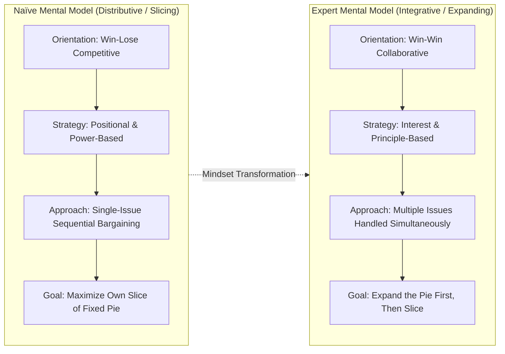
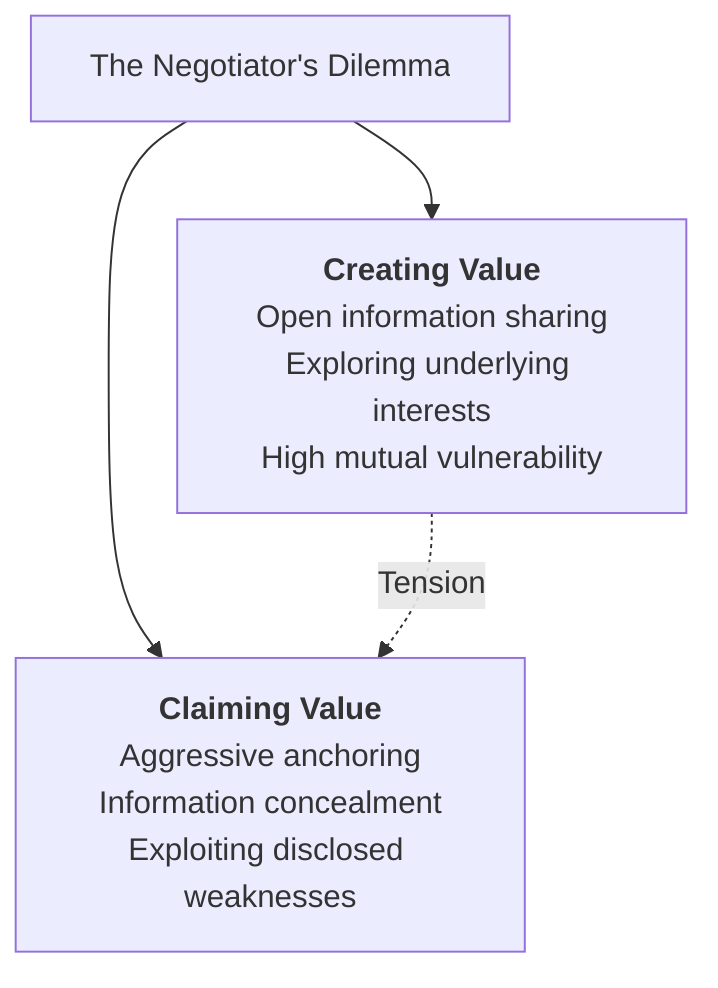
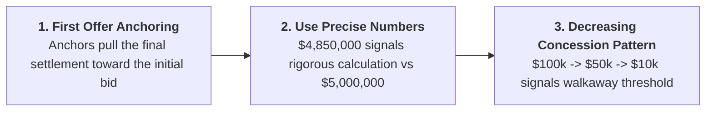

> [!NOTE] Curricular & Faculty Metadata
>
> - **Course:** MK5 Problem Solving, Decision Making and Negotiation — Week 09
> - **Lead Faculty:** Prof. Dr. Utomo Sarjono Putro, Dr. Valid Hasyimi (School of Business and Management, Institut Teknologi Bandung)
> - **Primary Curricular Spine:** `archive/courses/mk5/week-09/[For Students] Negotiation Dilemma Creating and Claiming Value P3MD.pptx.pdf` (Prof. Utomo Sarjono Putro)
> - **Foundational Literature:**
>   - David A. Lax & James K. Sebenius (1986), _The Manager as Negotiator: Bargaining for Cooperation and Competitive Gain_
>   - Leigh Thompson (2012), _The Mind and Heart of the Negotiator (5th Edition)_
>   - Max H. Bazerman & Don A. Moore (2013), _Judgment in Managerial Decision Making_

---

## 1. Executive Overview: The Mental Models of Negotiators

The session opens by contrasting the cognitive orientations that negotiators bring to the bargaining table. Most untrained corporate executives operate under a **Naïve Mental Model** that views negotiation as an adversarial brawl over fixed resources:

| Dimension               | Naïve Negotiator (Value Claiming Model)                        | Expert Negotiator (Value Creating Model)                           |
| :---------------------- | :------------------------------------------------------------- | :----------------------------------------------------------------- |
| **Orientation**         | **Competitive**: Win/Lose zero-sum posture.                    | **Cooperative**: Win/Win positive-sum posture.                     |
| **Strategic Stance**    | Positional; aggressive demands backed by institutional power.  | Principle-based; focused on underlying stakeholder interests.      |
| **Primary Goal**        | **"Slice the Pie"**: Capture maximum immediate value.          | **"Expand the Pie, Then Slice"**: Maximize joint surplus.          |
| **Bargaining Approach** | Single issue at a time; sequential, stubborn price haggling.   | Multiple issues simultaneously; packaging trades across clauses.   |
| **Offer Architecture**  | Single, rigid offers; _"Take it or leave it"_.                 | Multiple Equivalent Simultaneous Offers (**MESOs**).               |
| **Temporal Horizon**    | Short-term transaction; indifferent to long-term relationship. | Long-term strategic alliance; building compounding social capital. |

---

## 2. Behavioral Warm-Up: The Thumb Wrestling Paradox

To shatter the assumption that competition is inevitable, Prof. Utomo Sarjono Putro engages the cohort in a one-minute warm-up game: **Thumb Wrestling**.

- **Rules**: Pin the partner's thumb for a point. You have 60 seconds to score as many points as possible.
- **Naïve Competitive Default**: Most pairs tense their muscles and fight furiously for 60 seconds, ending in mutual exhaustion with scores like $3\text{ to }2$ or $1\text{ to }1$. They assume that your partner's gain requires your loss.
- **Collaborative Breakthrough**: Unlocking the positive-sum potential requires both partners to abandon resistance and rapidly tap each other's thumbs back and forth cooperatively, generating scores of **$30\text{ to }30$ or $40\text{ to }40$**.

The exercise proves that **treating the counterparty as an adversary artificially caps total value creation**.

---

## 3. The Negotiator's Dilemma (Lax & Sebenius)

As established in the [[concepts/value-creation-and-claiming|Value Creation vs. Value Claiming]] framework, all negotiations contain a fundamental structural tension:

If both parties share information openly, they discover joint trades and achieve the **Pareto Optimal Frontier**. However, if Party A shares authentic information while Party B aggressively claims value, Party A is severely exploited. Consequently, defensive negotiators default to claiming value, trapping both parties in sub-optimal compromise.

---

## 4. Tactical Engines of Value Creation

Expert negotiators deploy four specific mechanisms to expand the pie:

### 1. Unbundling Single Issues into Multi-Issue Packages

Never negotiate a contract solely on price. A single-issue negotiation is mathematically zero-sum. Unbundle price into five negotiable sub-elements:

- Delivery lead times and expediting fees
- Payment terms ($30\text{ days}$ vs $90\text{ days}$ liquidity)
- Warranty durations and SLA response guarantees
- Volume rebate tiers
- Intellectual property licensing and co-branding

### 2. Logrolling (Trading Across Asymmetric Priorities)

Logrolling trades issues that are of **low cost to you but high value to the counterparty**, in exchange for concessions that are of **high value to you but low cost to them**.

### 3. Contingent Contracts (Betting on Differences)

When parties disagree on future forecasts (e.g. project completion date, sales growth), do not argue about whose prediction is right. Structure a **contingent contract**:

$$
\text{Contract Price} = \text{Base Rate} + \text{Performance Bonus if KPI is Met}
$$

### 4. Multiple Equivalent Simultaneous Offers (MESOs)

Rather than presenting a single proposal, present **three alternative package deals** that you have pre-calculated to yield identical utility to your firm:

- _Package 1_: Premium price + expedited 2-week delivery + standard warranty.
- _Package 2_: Lower price + standard 6-week delivery + 3-year extended warranty.
- _Package 3_: Moderate price + flexible milestone payments + co-marketing rights.

When the counterparty chooses Package 2, they reveal their true underlying interest without feeling cornered.

---

## 5. Tactical Engines of Value Claiming

Once the pie has been expanded, the negotiator must claim a fair share:

1. **The Anchoring Effect**: Empirical research confirms that the final settlement price is strongly correlated with the first reasonable offer on the table. The anchor acts as a cognitive focal point.
2. **Precision in Anchoring**: Bidding a precise number (e.g., $\text{Rp } 4.87\text{ Billion}$ instead of $\text{Rp } 5.0\text{ Billion}$) signals to the counterparty that the figure is backed by detailed cost accounting, significantly reducing counter-bids.
3. **Concession Management**: Concessions should be granted incrementally and must always be matched by a reciprocal concession from the counterparty (_"If we concede on X, what can you do for us on Y?"_). Concession amounts should diminish over time to signal proximity to your [[concepts/batna-and-zopa|Reservation Price]].

---

## 6. Strategic Implications for BUMN & Indonesian Enterprise Leadership

1. **Overcoming Rigid Procurement Silos**: In Indonesian State-Owned Enterprises, public procurement audits (BPK, BPKP) often incentivize procurement officers to act as rigid, single-issue price hackers. Leaders must educate audit and governance teams on multi-issue total cost of ownership (TCO) packaging.
2. **Joint Venture Negotiations with Multinational Partners**: When Indonesian conglomerates negotiate EPC or energy transition contracts with foreign consortiums, foreign partners often leverage MESOs and logrolling. Indonesian executives must move beyond defensive posturing to proactively design packaging options.

---

## 🔗 Week 09 Direct Curricular Bridges

- Flagship Concept: [[concepts/value-creation-and-claiming|Value Creation vs. Value Claiming Framework]]
- Core Geometry: [[concepts/batna-and-zopa|BATNA and ZOPA Architecture]]
- Prior Module: [[courses/mk5-decision-making-negotiation/week-08/index|Week 08: Negotiation Foundations: Architecture, BATNA & ZOPA]]
- Return to [[courses/mk5-decision-making-negotiation/index|MK5 Course Overview Hub]]
