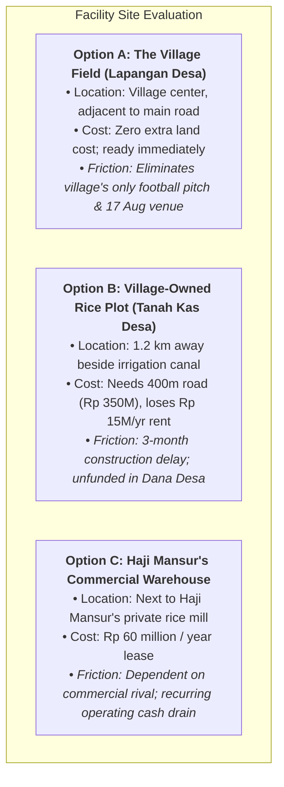
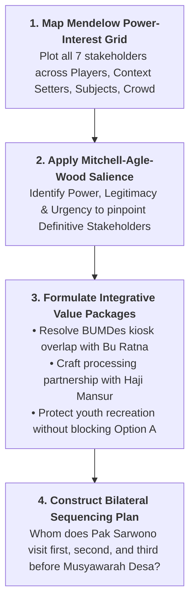
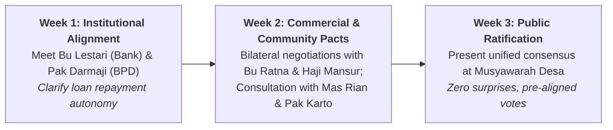

> [!IMPORTANT] Cohort Pre-Class Negotiation Brief (_"Ini Peta, Bukan Jawaban"_)
> **Audience:** P3MD Batch I Soedirman Cohort  
> **Academic Mode:** Pre-Class Analytical Architecture & Negotiation Map  
> **Purpose:** This dossier compiles the complete stakeholder statements, village economic parameters, facility location trade-offs, and coalition frameworks for the **Koperasi Desa Merah Putih (KDMP)** case—**without prescribing final syndicate presentation positions or deal terms**.

---

## 1. Case Protagonist & Decision Mandate

You step into the shoes of **Pak Sarwono**, a respected rice farmer cultivating 1.5 hectares in **Desa Sawah Makmur**. In 2025, the 260 members of the newly established village cooperative elected you as Chair of the Board.

Working alongside you is **Mbak Dewi**, the professional cooperative manager recruited through the 2026 national program of 30,000 KDMP managers and employed by a state-owned enterprise on a fixed-term contract.

The cooperative is ready to launch its core commercial operations: purchasing and drying harvested grain, and operating a village retail depot for certified seed, fertilizer, and basic staples. To unlock the **Rp 3 billion state bank loan**, the cooperative requires:

1. Approved business feasibility plans.
2. Legally certified land documentation for a **1,000 m² operational facility**.

The building site will be decided at a **Village Deliberation Meeting (_Musyawarah Desa_) in three weeks**, requiring formal approval from the **Village Consultative Council (_Badan Permusyawaratan Desa_ / BPD)**. As chair, Pak Sarwono must determine **who to negotiate with, in what strategic order, and what reciprocal value each party requires**.

---

## 2. Master Village Fact Pack: Desa Sawah Makmur

### Demographic & Agricultural Profile

| Village Dimension                              |            Metric / Parameter            | Operational Significance for KDMP                                         |
| :--------------------------------------------- | :--------------------------------------: | :------------------------------------------------------------------------ |
| **Total Village Households**                   |           **1,850 households**           | Broad community base; diverse non-farming interests.                      |
| **Small Farmers & Agricultural Labourers**     |           **~700 households**            | Core constituency; vulnerable to seasonal liquidity shortages.            |
| **Paddy Cultivation Area**                     |             **620 hectares**             | Yields two major harvests per year; high grain volume potential.          |
| **Current KDMP Active Membership**             |             **260 members**              | Substantial initial base, but represents only ~37% of farming households. |
| **Local Grain Traders (_Tengkulak_)**          | **4 operators** (2 own local rice mills) | Controlled local grain trade for 25 years; provide informal credit.       |
| **Farmer Groups (_Kelompok Tani_ / Gapoktan)** |   **9 groups** united in 1 federation    | Key organized grassroot agricultural leadership.                          |
| **Annual Village Fund (_Dana Desa_)**          |        **~Rp 1.2 billion / year**        | Vital municipal capital; BPD fears loan repayment encumbrance.            |

---

### Comparison of Grain Marketing Channels

Understanding why smallholders currently sell to informal middlemen (_tengkulak_) is critical for KDMP's commercial viability:

| Commercial Factor            | Selling to Local Trader (_Tengkulak_)                | Selling to KDMP Cooperative                                      |
| :--------------------------- | :--------------------------------------------------- | :--------------------------------------------------------------- |
| **Purchasing Price**         | Rp 6,400 – Rp 6,600 / kg (varies by moisture)        | **Rp 6,500 / kg** (standardized for quality grain)               |
| **Collection Logistics**     | **Trader collects directly from the paddy field**    | **Farmer must transport grain to KDMP drying floor**             |
| **Payment Terms**            | **Immediate cash on the spot**                       | **Bank transfer / cash within 3 working days**                   |
| **Input Financing (_Ijon_)** | **Lends cash for seed & fertilizer before planting** | **No advances currently available** (savings unit planned later) |

---

### The Three Facility Site Options (1,000 m² Requirement)

---

## 3. Stakeholder Intelligence: The Seven Voices

| Stakeholder     | Formal Role                             | Stated Perspective & Hidden Agenda                                                                                                                                                   |
| :-------------- | :-------------------------------------- | :----------------------------------------------------------------------------------------------------------------------------------------------------------------------------------- |
| **Pak Darmaji** | Chair of Village Council (BPD)          | _"We support the cooperative. But if part of the Village Fund goes to loan repayments, we still have to find money for farm roads and irrigation residents asked for."_              |
| **Haji Mansur** | Leading Grain Trader & Mill Owner       | _"I have bought from these farmers for 25 years and lent them money for seed when they needed it. I am not against the cooperative, but I would like to know where I fit."_          |
| **Bu Ratna**    | Director of Village Enterprise (BUMDes) | _"Our fertiliser kiosk has served farmers since 2019, and its profit goes into village income. We would like to agree who does what, so that we don't compete."_                     |
| **Pak Karto**   | Smallholder Farmer (Gapoktan)           | _"A fair price is welcome. But at planting time I need cash for seed, and the trader is there when I need him."_                                                                     |
| **Mas Rian**    | Captain of Village Youth Football Club  | _"The field is where we play, and where the village holds its events. We heard it may be used for the building. We would like to be heard before anything is decided."_              |
| **Mbak Dewi**   | Manager of KDMP (SOE Employee)          | _"My company's target is for us to start buying grain before the next harvest. Every month of delay makes the business plan harder to meet. I rely on you to navigate the village."_ |
| **Bu Lestari**  | Account Officer at State Bank Branch    | _"We can release the loan once the business plan and land documents are complete. We also look at whether the plan is realistic."_                                                   |

---

## 4. Analytical Roadmap for Syndicate Strategy

---

### 🔍 Analytical Focus 1: Power-Interest Mapping & Potential Traps

1. **The Dangerous Illusion of Option A:**
   - Option A looks tempting on paper (zero financial cost, central road frontage).
   - However, building on the village sports pitch antagonizes **Mas Rian and the youth**, turning sympathetic **Subjects** into an aggressive, disruptive political force during _Musyawarah Desa_.
2. **The BPD Financial Trap (Pak Darmaji):**
   - The state bank loan cannot be perceived as cannibalizing the _Dana Desa_ infrastructure budget. Pak Sarwono must structure the KDMP business plan so cooperative commercial revenues cover repayments independently.

---

### 🤝 Analytical Focus 2: Integrative Solutions (Expanding the Pie)

- **Partnering with Haji Mansur:** Rather than attempting to eliminate Haji Mansur as a competitor (distributive war), explore an **integrative partnership**:
  - Can KDMP contract Haji Mansur's unused mill capacity or rent his warehouse temporarily (Option C) to meet Mbak Dewi's pre-harvest deadline?
  - Can Haji Mansur act as a licensed grain aggregator for KDMP?
- **Dividing Boundaries with BUMDes (Bu Ratna):**
  - Establish a non-compete protocol: BUMDes retains retail consumer goods and localized fertilizer distribution, while KDMP focuses on bulk grain commercialization and institutional off-taking.

---

### 🗓️ Analytical Focus 3: Pak Sarwono's 3-Week Sequencing Roadmap

---

## 🔗 Related Portals

- Master Lecture Hub: [[courses/mk5-decision-making-negotiation/week-10/index|Week 10: Rational Negotiation & Stakeholder Analysis]]
- Core Lattice Concept: [[concepts/stakeholder-analysis-negotiation|Stakeholder Analysis & Power-Interest Dynamics]]
- Course Syllabus Hub: [[courses/mk5-decision-making-negotiation/index|MK5 Course Index]]
