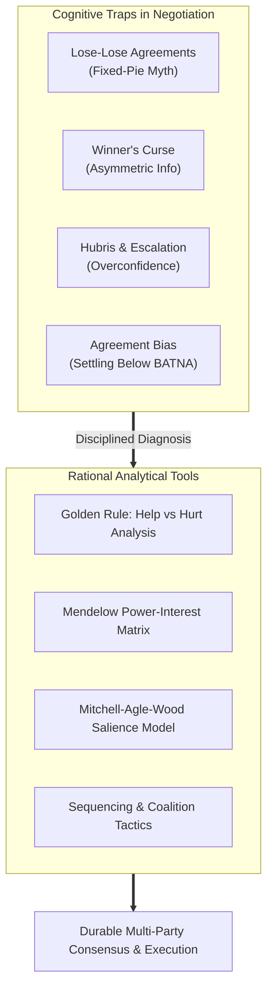
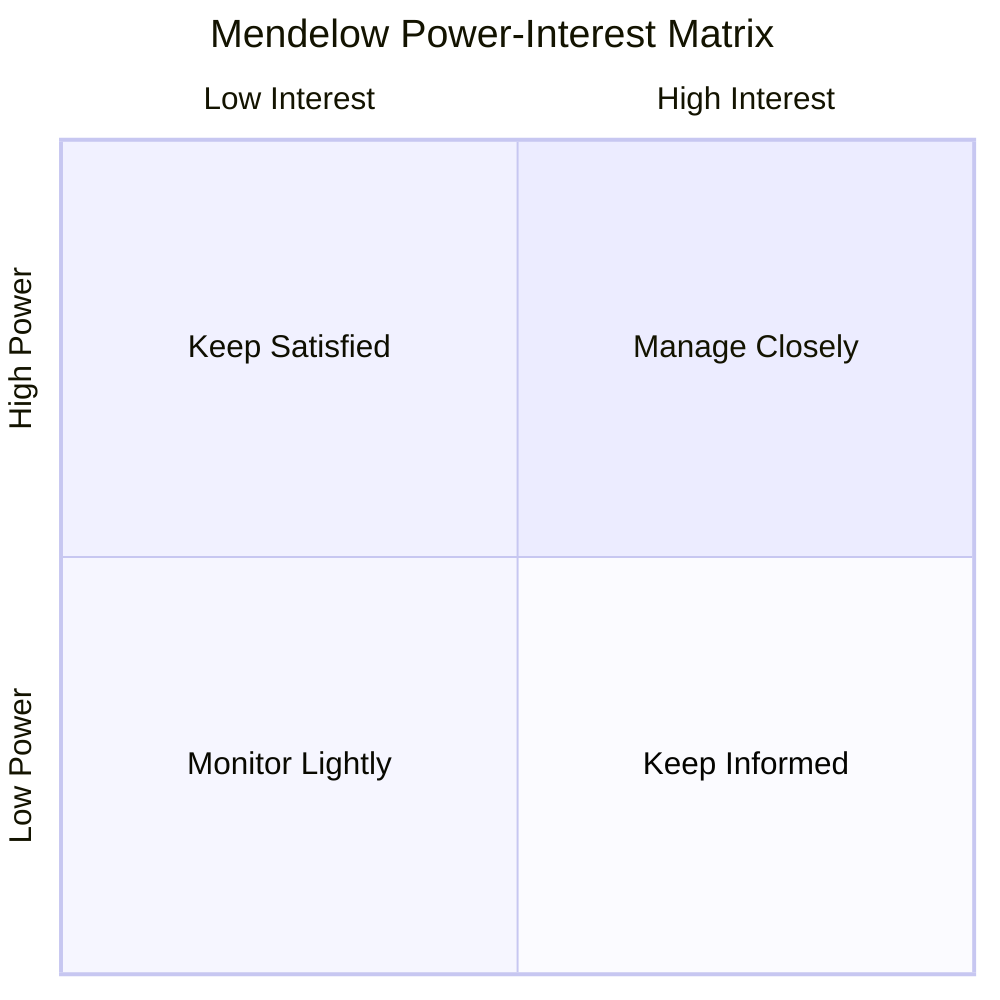
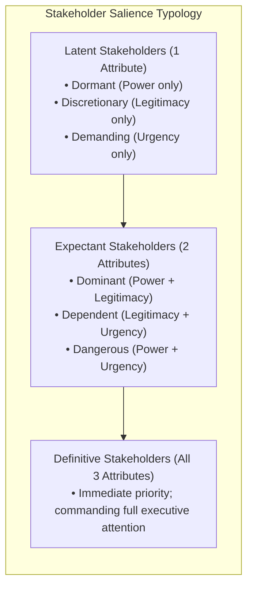
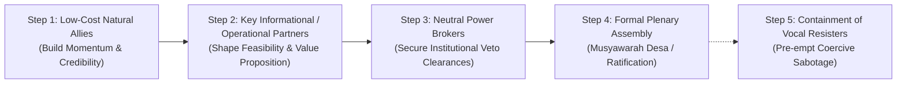

> [!NOTE] Curricular & Faculty Metadata
>
> - **Course:** MK5 Decision Making & Negotiation — Week 10
> - **Faculty:** Prof. Dr. Utomo Sarjono Putro, Dr. Valid Hasyimi (School of Business and Management, Institut Teknologi Bandung)
> - **Primary Curricular Spine:** `archive/courses/mk5/week-10/Rational Negotiation and Stakeholder Analysis P3MD.pptx.pdf`
> - **Accompanying Case Handout:** `archive/courses/mk5/week-10/Stakeholder Analysis Handout.docx.pdf`
> - **Foundational Literature:**
>   - Max H. Bazerman & Margaret A. Neale (1992), _Negotiating Rationally_, Free Press.
>   - Aubrey L. Mendelow (1991), _Environmental Scanning: The Impact of the Stakeholder Concept_.
>   - Ronald K. Mitchell, Bradley R. Agle, & Donna J. Wood (1997), _Toward a Theory of Stakeholder Identification and Salience: Defining the Principle of Who and What Really Counts_, Academy of Management Review.
>   - James K. Sebenius (1996), _Sequencing to Build Coalitions: With Whom Should I Talk First?_, Harvard Business School.

---

## 1. Executive Summary: The Rational Negotiator's Mindset

Week 10 shifts focus from two-party transactional bargaining to **multi-party, multi-stakeholder strategic negotiation**. In public governance, state-owned enterprises (BUMN), and community-level economic interventions, decisions are rarely made between two isolated actors sitting across a table. Instead, agreements must survive complex webs of internal and external stakeholders, each holding differing degrees of authority, legitimacy, social capital, and urgency.

### The Golden Rule of Rational Negotiation

> "To negotiate rationally, you must understand not merely what you want, but what the other parties need, how they perceive value, and what actual power they hold to help you achieve your goal or hurt your initiative if excluded."

Untrained executives negotiate from an internal viewpoint: _What is my target, and how can I persuade them?_ The rational negotiator adopts an external viewpoint: _What are their structural constraints, who do they answer to, and what side payments, procedural dignity, or face-saving mechanisms do they require to say yes?_

---

## 2. The Four Classic Negotiation Traps

Negotiators consistently fall victim to four systematic cognitive errors documented by Bazerman and Neale:

| Trap                       | Core Mechanism                                                                                     | Behavioral Manifestation                                                                              | Strategic Remedy                                                                                                  |
| :------------------------- | :------------------------------------------------------------------------------------------------- | :---------------------------------------------------------------------------------------------------- | :---------------------------------------------------------------------------------------------------------------- |
| **1. The Lose-Lose Trap**  | Assuming total conflict of interest (_mythical fixed-pie_ assumption).                             | Failing to recognize complementary interests; leaving substantial joint gains unharvested.            | Active diagnostic questioning; sharing low-risk information; packaging multi-issue trades (logrolling).           |
| **2. The Winner's Curse**  | Severe information asymmetry where one side knows significantly more about the asset's true value. | Opponent instantly accepts your opening bid; immediate buyer's remorse ("What did I overlook?").      | Rigorous due diligence before bidding; anchoring based on objective valuation benchmarks, not intuition.          |
| **3. Hubris & Escalation** | Pride, ego, and sunk cost bias overpowering rational economic calculations.                        | Walking away from deals superior to BATNA; engaging in aggressive bidding wars to "win at all costs". | Pre-committing to strict reservation prices; assigning an independent "devil's advocate" to challenge escalation. |
| **4. Agreement Bias**      | Innate psychological drive for closure and fear of interpersonal confrontation.                    | Signing bad agreements simply to achieve a "successful" deal; settling for terms far below BATNA.     | Clear definition of BATNA prior to entering the room; walking away when the expected deal value is negative.      |

---

## 3. Stakeholder Analysis Architecture

When navigating multi-party initiatives—such as village cooperatives, regional infrastructure projects, or SOE joint ventures—stakeholder mapping provides the analytical foundation.

### The Mendelow Power-Interest Grid

The Mendelow Matrix categorizes stakeholders along two structural axes: **Power** (capacity to block, facilitate, or dictate outcomes) and **Interest** (the extent to which the stakeholder cares about or is affected by the outcome).

| Quadrant                         | Power / Interest Profile      | Typical Institutional Actor                                                     | Engagement & Communication Strategy                                                                                |
| :------------------------------- | :---------------------------- | :------------------------------------------------------------------------------ | :----------------------------------------------------------------------------------------------------------------- |
| **Manage Closely (Key Players)** | **High Power, High Interest** | Village Head (_Kepala Desa_), Regulatory Board, Lead Commercial Bank.           | Deep bilateral alignment, active participation in governance, co-design of terms, continuous executive contact.    |
| **Keep Satisfied**               | **High Power, Low Interest**  | Traditional Landowners, Regional Regulators, Senior BUMN Directors.             | Meet formal institutional criteria, avoid triggering opposition, provide clear risk mitigation guarantees.         |
| **Keep Informed**                | **Low Power, High Interest**  | Smallholder Farmers, Village Youth Groups (_Karang Taruna_), Local Shopkeepers. | Transparent town halls, regular informational updates, consultative forums; harness as vocal grassroots champions. |
| **Monitor**                      | **Low Power, Low Interest**   | Peripheral Village Residents, Distant Suppliers, General Public.                | Periodic public notices, broadcast communications; minimal resource allocation unless status shifts.               |

---

### The Mitchell, Agle, & Wood Stakeholder Salience Model

Power and interest provide a 2D snapshot, but stakeholder dynamics change over time. The **Salience Model** evaluates stakeholders across three operational attributes:

1. **Power:** The ability of the party to impose its will through coercive (physical/force), utilitarian (financial/material), or normative (symbolic/prestige) means.
2. **Legitimacy:** The perceived social validity, legal standing, or moral appropriateness of the stakeholder's claim within the community.
3. **Urgency:** The degree to which the stakeholder's claim calls for immediate attention (time sensitivity + criticality).

> [!WARNING] The Risk of the "Dangerous" Stakeholder
> A stakeholder possessing **Power and Urgency without Legitimacy** (a _Dangerous Stakeholder_, such as an aggrieved informal middleman or militant faction) will frequently resort to coercive tactics or sabotage if ignored. Rational negotiators proactively address dangerous stakeholders through isolation, targeted side-payments, or legal-normative containment before high-stakes plenary meetings.

---

## 4. Multi-Party Negotiation Sequencing & Coalition Tactics

In multi-party negotiation, holding a general assembly without pre-alignment is organizational suicide. James Sebenius's sequencing framework demonstrates that **the order in which parties are approached dictates the final equilibrium**.

### Strategic Rules of Sequencing

1. **Front-End Alignment Before Plenary Ratification:** Never present a controversial proposal in a large public forum (_Musyawarah Desa_, Board Meeting, or Shareholder Assembly) without pre-securing the required voting coalition in bilateral preliminary sessions.
2. **Sequential Consensus Building:**
   - Begin with low-resistance stakeholders whose interests naturally align with the initiative.
   - Use their early buy-in as social proof to demonstrate viability to skeptical neutrals.
   - Address potential veto-holders individually in private settings where face-saving trade-offs can be negotiated without public scrutiny.
3. **Dismantling Blocking Coalitions:**
   - Identify the underlying motivations of opposing factions: Are they defending economic rents, social status, or procedural fairness?
   - Offer targeted, legitimate compensations (e.g., guaranteed supply quotas, specialized employment, or transparent oversight seats) to peel moderate members away from intransigent leaders.

---

## 5. Indonesian Rural & BUMN Context: _Musyawarah Desa_ and KDMP

In the context of the **Koperasi Desa Merah Putih (KDMP)** national initiative and village governance under Law No. 6/2014 on Villages:

- **Institutional Coexistence:** KDMP operations must coordinate with village institutions—the _Badan Permusyawaratan Desa_ (BPD), the _Kepala Desa_, agricultural user groups (_Gapoktan_), and local micro-entrepreneurs.
- **Cultural Deliberation (_Musyawarah Mufakat_):** While Western negotiation literature emphasizes transactional contracts and legal enforcement, Indonesian rural negotiation relies heavily on **procedural respect (_unggah-ungguh_), communal fairness (_gotong royong_), and consensus building**.
- **The Role of the BUMN Professional:** BUMN managers deployed to rural cooperatives act as institutional bridges. They must balance strict commercial accountability (bank feasibility metrics, collateral requirements, audit standards) with local socio-cultural legitimacy.

---

## 6. Curricular Navigation & Case Assignment

- **Cohort Pre-Class Brief:** Reconstruct the complete village fact pack, stakeholder inventory, and strategic negotiation roadmap in:
  - `[[courses/mk5-decision-making-negotiation/week-10/case-koperasi-desa-merah-putih|Cohort Pre-Class Negotiation Brief: Koperasi Desa Merah Putih — Desa Sawah Makmur]]`
- **Core Conceptual Knowledge Base:**
  - `[[concepts/stakeholder-analysis-negotiation|Stakeholder Analysis & Power-Interest Dynamics in Negotiation]]`
- **Previous Session Connection:**
  - `[[courses/mk5-decision-making-negotiation/week-09/index|Week 09: The Negotiation Dilemma — Creating Value vs. Claiming Value, Logrolling & MESO Tactics]]`
