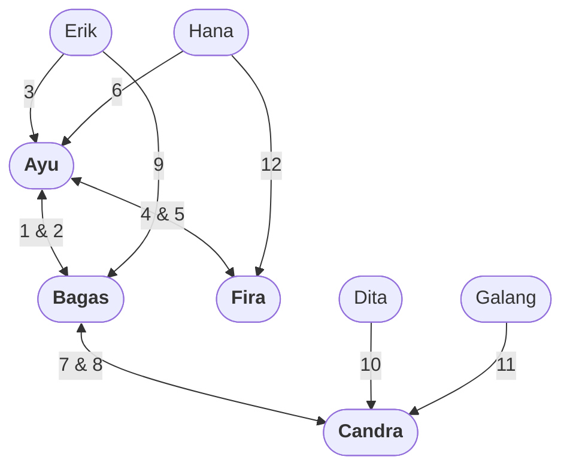
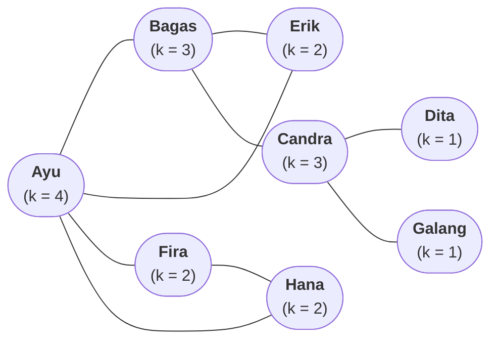

> [!NOTE] Cohort Attribution & Academic Mode
> **Analysis & Model Synthesis by:** `F9 (Class F / Syndicate 9)`  
> **Academic Status:** Post-Class Worked Solution & Model Analytical Debrief  
> **Problem Source:** MK6 Business Analytics — Session 08 / 09 People Analytics Assignment (`09-assignment.pdf`)

---

## 🎯 Executive Problem Setup

A regional branch office of **eight employees** ($N = 8$) conducted a 360-degree feedback pilot. Each employee nominated specific colleagues from whom they sought performance feedback and professional development guidance.

The task requires drawing and measuring the resulting social network entirely by hand—without code or specialized graph software—to diagnose informal influence, collaborative clustering, and isolation risks across the branch.

### The Raw Nomination Edge List (12 Directed Nominations)

| Edge # | Initiating Employee (Source) | Nominated Colleague (Target) | Edge # | Initiating Employee (Source) | Nominated Colleague (Target) |
| :----: | :--------------------------- | :--------------------------- | :----: | :--------------------------- | :--------------------------- |
| **1**  | Ayu                          | Bagas                        | **7**  | Candra                       | Bagas                        |
| **2**  | Bagas                        | Ayu                          | **8**  | Bagas                        | Candra                       |
| **3**  | Erik                         | Ayu                          | **9**  | Erik                         | Bagas                        |
| **4**  | Fira                         | Ayu                          | **10** | Dita                         | Candra                       |
| **5**  | Ayu                          | Fira                         | **11** | Galang                       | Candra                       |
| **6**  | Hana                         | Ayu                          | **12** | Hana                         | Fira                         |

---

## 🗺️ Step 1 & Step 3: Network Topology Visualization

### 1. Directed Feedback Network (12 Directed Nominations)

### 2. Undirected Collaboration Network (9 Unique Pair Ties)

When collapsing reciprocal ties and single nominations into undirected relationships where at least one party sought feedback:

---

## 📊 Step 2 & Step 4: Complete Centrality & Density Calculations

### The Master Network Metrics Table

| Employee Node | In-Degree ($k_{\text{in}}$) | Out-Degree ($k_{\text{out}}$) | Undirected Degree ($k$) | Key Connected Peers in Undirected Graph |
| :------------ | :-------------------------: | :---------------------------: | :---------------------: | :-------------------------------------- |
| **Ayu**       |            **4**            |             **2**             |          **4**          | Bagas, Erik, Fira, Hana                 |
| **Bagas**     |            **3**            |             **2**             |          **3**          | Ayu, Candra, Erik                       |
| **Candra**    |            **3**            |             **1**             |          **3**          | Bagas, Dita, Galang                     |
| **Dita**      |            **0**            |             **1**             |          **1**          | Candra                                  |
| **Erik**      |            **0**            |             **2**             |          **2**          | Ayu, Bagas                              |
| **Fira**      |            **2**            |             **1**             |          **2**          | Ayu, Hana                               |
| **Galang**    |            **0**            |             **1**             |          **1**          | Candra                                  |
| **Hana**      |            **0**            |             **2**             |          **2**          | Ayu, Fira                               |
| **Total Sum** |           **12**            |            **12**             |         **18**          | **Sum of Degrees = $2 \times E = 18$**  |

### Network Parameters & Density Calculation

- **Total Nodes ($N$)**: $8$
- **Total Directed Edges ($E_{\text{dir}}$)**: $12$
- **Total Undirected Edges ($E_{\text{undir}}$)**: $9$
- **Maximum Possible Undirected Edges ($E_{\max}$)**: Calculated as \( E\_{\max} = \frac{N(N-1)}{2} = \frac{8 \times 7}{2} = \mathbf{28} \).
- **Network Density ($D$)**:
  Dividing actual observed undirected edges by the combinatorial maximum potential connections yields:
  $$
  D = \frac{E_{\text{undir}}}{E_{\max}} = \frac{9}{28} \approx \mathbf{0.3214 \quad (32.14\%)}
  $$

---

## 💡 Step 5: Executive Analytical Interpretation

### a. Who has the highest in-degree and degree?

**Ayu** holds both the highest in-degree ($k_{\text{in}} = 4$) and the highest undirected degree ($k = 4$). Half of the branch (Bagas, Erik, Fira, Hana) actively sought her feedback, establishing Ayu as the preeminent **informal opinion leader, mentor, and psychological anchor** of the office.

### b. Which employees did no one nominate?

**Dita, Erik, Galang, and Hana** received **zero incoming nominations** ($k_{\text{in}} = 0$). While they actively sought feedback from others ($k_{\text{out}} \ge 1$), their peers did not seek their perspective. This signals either junior tenure, technical silo isolation, or lack of social capital within the branch.

### c. Which pairs nominated each other?

Three pairs exhibited **mutual, reciprocal trust ties**:

1. **Ayu $\longleftrightarrow$ Bagas** (Edges 1 & 2)
2. **Ayu $\longleftrightarrow$ Fira** (Edges 4 & 5)
3. **Bagas $\longleftrightarrow$ Candra** (Edges 7 & 8)

### d. Is the network dense or sparse?

With a density of **$D = 0.3214$ ($32.14\%$)**, the network is relatively **sparse** compared to a complete network ($D = 1.0$), where every employee would interact with all seven colleagues. This sparsity is not necessarily pathological; it reflects healthy functional clustering.

However, the network reveals a critical structural vulnerability: **Bagas acts as the sole structural broker / bridge** connecting Candra's cluster (Dita, Galang) with Ayu's cluster (Erik, Fira, Hana). If Bagas departs, Candra's sub-group becomes completely disconnected from the rest of the branch.

---

## 🔗 Related Knowledge Bridges

- Master Curricular Hub: [[courses/mk6-business-analytics/week-08/index|MK6 Week 08: People Analytics & Organizational Network Modeling]]
- Foundational Concept: [[concepts/organizational-network-analysis|Organizational Network Analysis (ONA)]]
- Strategic Organization Design: [[concepts/organizational-dna-framework|Organizational DNA Framework]]
- HR Architecture: [[concepts/ulrich-hr-model|Dave Ulrich HR Business Partner Model]]
