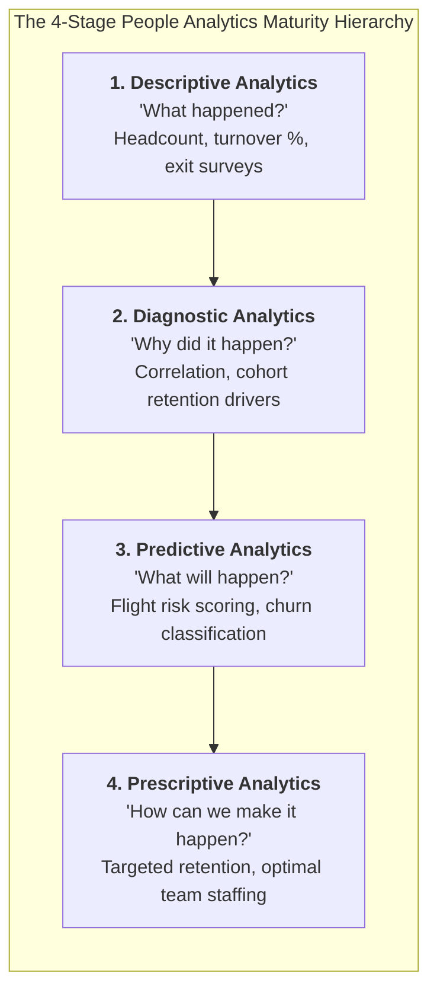
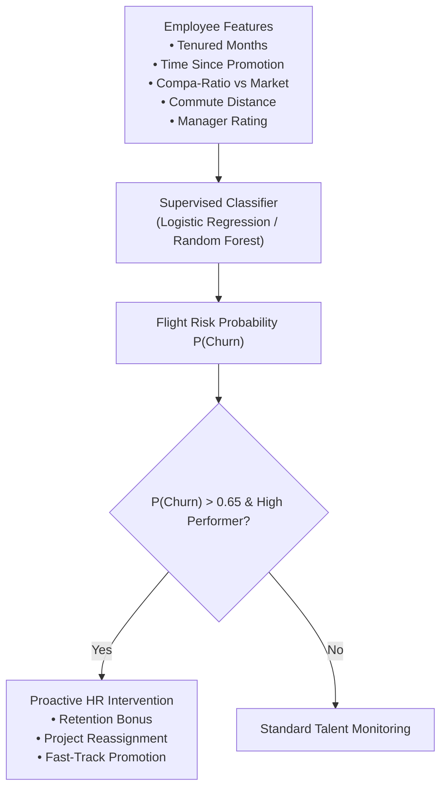
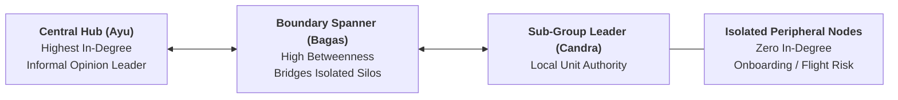

> [!NOTE] Curricular & Faculty Metadata
>
> - **Course:** MK6 Applied Business Analytics — Week 08
> - **Academic Host:** SBM ITB — _Direktorat Pendidikan Profesional Berkelanjutan_
> - **Lead Lecturer:** Dr. Eng. Manahan Siallagan
> - **Teaching Team:** Dr. Shimaditya Nuraeni, M. Apriandito Arya Saputra, MBA, Bagus Rullym, MM, Tyas Larassati
> - **Primary Curricular Spine:** `archive/courses/mk6/week-08/W8_People_Analytics.pptx` (SBM ITB Master Deck)
> - **Direct Satellites & Problem Sets:**
>   - [[courses/mk6-business-analytics/week-08/assignment-people-analytics-ona|Post-Class Debrief: Hand-Calculated Organizational Network Analysis (ONA) & 360-Degree Feedback]]

---

## 1. Executive Overview: The Rise of Evidence-Based Human Capital

Historically, human resource decisions—hiring, executive promotions, compensation increments, and retention interventions—were governed primarily by executive gut feeling, charisma, and subjective supervisor bias.

**People Analytics** (also termed Talent Analytics or Workforce Analytics) fundamentally transforms this practice by applying statistical modeling, machine learning, and network science to employee behavioral data. Rather than replacing human judgment, People Analytics equips leaders with empirical evidence to answer critical enterprise questions:

- _Which operational factors truly drive unwanted employee attrition?_
- _Who are the invisible linchpins driving collaboration across departmental silos?_
- _How can the enterprise design compensation and promotion systems that maximize meritocracy and productivity?_

---

## 2. Core Functional Domain: Predicting & Managing Employee Attrition

Unplanned attrition of high-performing talent imposes severe financial penalties: direct recruiting costs, onboarding lag, and loss of tacit institutional knowledge. The lecture models employee flight risk using predictive classification algorithms:

### Key Statistical Drivers of Employee Churn

1. **Compa-Ratio Disparity**: When an employee’s base salary falls significantly below the market median for their job family.
2. **Promotion Stagnation**: Exceeding 36 months in an identical grade band without horizontal rotation or promotion.
3. **Manager Volatility**: High variance in team satisfaction scores under specific business unit supervisors.

---

## 3. Structural Domain: Organizational Network Analysis (ONA)

While traditional HR databases measure individual attributes (tenure, education, appraisal scores), they completely fail to capture the **relational fabric** of an organization.

As explored in our flagship concept on [[concepts/organizational-network-analysis|Organizational Network Analysis (ONA)]], an enterprise functions as a living social network. ONA mathematically models this informal topology:

### Core Centrality Metrics in ONA

| Network Metric                    | Mathematical Formulation                                      | Enterprise Interpretation                                                                                         |
| :-------------------------------- | :------------------------------------------------------------ | :---------------------------------------------------------------------------------------------------------------- |
| **In-Degree ($k_{\text{in}}$)**   | Number of incoming collaboration ties directed toward a node. | **Prestige / Expertise**: High in-degree nodes are the trusted informal experts sought out by peers for guidance. |
| **Out-Degree ($k_{\text{out}}$)** | Number of outgoing ties initiated by a node.                  | **Sociability / Information Seeking**: Indicates proactive communication or reliance on peer support.             |
| **Network Density ($D$)**         | $D = \frac{2E}{N(N-1)}$ (for undirected networks).            | **Cohesion & Flow**: High density accelerates consensus; low density signals severe departmental silos.           |
| **Betweenness Centrality**        | Proportion of shortest paths passing through a node.          | **Information Gatekeeper / Broker**: Nodes spanning structural holes. If they leave, clusters become isolated.    |

In our worked debrief for [[courses/mk6-business-analytics/week-08/assignment-people-analytics-ona|Week 08 Hand-Calculated ONA]], participants computed the density ($32.14\%$) and centrality distributions across an 8-employee branch trial, uncovering a critical single-point-of-failure broker.

---

## 4. Ethical Governance, Algorithmic Bias & Data Privacy (UU PDP)

The deployment of People Analytics introduces profound ethical and legal responsibilities under Indonesia’s **Personal Data Protection Law (UU No. 27/2022 - UU PDP)**:

1. **Surveillance vs. Trust**: Tracking employee keystrokes, email sentiment, or badge movements without transparent consent destroys psychological safety and organizational commitment.
2. **Algorithmic Bias**: Predictive hiring algorithms trained on historical corporate data risk encoding historical gender, ethnic, or demographic biases into automated screening filters.
3. **Actionable Transparency**: Employees must have the right to understand why an algorithmic model flagged them for flight risk or promotion bypass.

---

## 🔗 Week 08 Direct Curricular Bridges

- Post-Class Problem Debrief: [[courses/mk6-business-analytics/week-08/assignment-people-analytics-ona|Hand-Calculated ONA & 360-Degree Feedback Debrief]]
- Flagship Concept: [[concepts/organizational-network-analysis|Organizational Network Analysis (ONA) Architecture]]
- Organization Design: [[concepts/organizational-dna-framework|Organizational DNA Framework]]
- HR Architecture: [[concepts/ulrich-hr-model|Dave Ulrich HR Business Partner Model]]
- Next Lecture: [[courses/mk6-business-analytics/week-09/index|Week 09: Operations Analytics & Supply Chain Lead-Time Simulation]]
- Return to [[courses/mk6-business-analytics/index|MK6 Course Overview Hub]]
