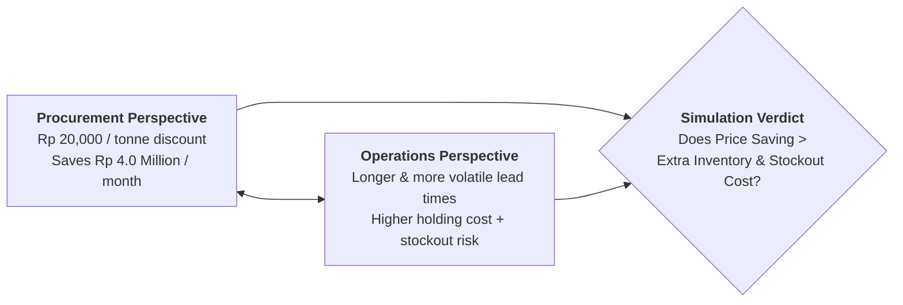
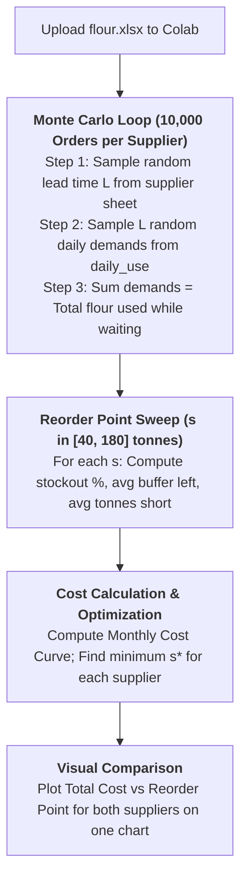

> [!IMPORTANT] Cohort Pre-Class Study Brief (_"Ini Peta, Bukan Jawaban"_)
> **Audience:** P3MD Batch I Soedirman Cohort  
> **Academic Mode:** Pre-Class Analytical Framework & Simulation Architecture Guide  
> **Source Case:** Operations Analytics: Choose a Flour Supplier (`flour.xlsx` & `08-assignment.pdf`)  
> **Purpose:** This brief equips participants to build, execute, and interpret the Python Monte Carlo inventory simulation in Google Colab by mapping empirical resampling logic, cost formulas, and economic trade-offs—**without pre-empting individual Colab outputs or final switch decisions**.

---

## 🎯 Case Narrative & Decision Context

A large-scale commercial bakery operates with the following baseline operational rhythms:

- **Daily Consumption**: Approximately **$8\text{ tonnes of flour}$** per working day.
- **Replenishment Cycle**: Orders **$100\text{ tonnes}$** at a time, ordering approximately **twice a month** (monthly volume $= 200\text{ tonnes}$).
- **The Supplier Dilemma**:
  - **Current Supplier**: Premium price of **$\text{Rp } 9.00\text{ Million per tonne}$**. Fast and reliable delivery times.
  - **New Supplier**: Discounted price of **$\text{Rp } 8.98\text{ Million per tonne}$** ($\text{Rp } 20{,}000/\text{tonne}$ discount), promising to save **$\text{Rp } 4.0\text{ Million per month}$** on purchase costs. However, its historical delivery times are longer and substantially less regular.

The executive question: **Does the $\text{Rp } 4\text{ Million}$ monthly procurement discount justify the higher safety stock holding costs and increased risk of catastrophic oven shutdown?**

---

## 📊 Dataset Structure & Cost Parameters

The accompanying workbook `flour.xlsx` contains three empirical worksheets:

| Sheet Name         | Historical Contents                                                                           | Statistical Interpretation                                                          |
| :----------------- | :-------------------------------------------------------------------------------------------- | :---------------------------------------------------------------------------------- |
| `daily_use`        | Flour consumed across **300 working days** (Columns: `day`, `tonnes`).                        | Empirical distribution of daily bakery production demand ($d_t$).                   |
| `current_supplier` | Delivery lead times across **40 past shipments** (Columns: `delivery`, `days`).               | Empirical lead-time distribution for the incumbent supplier ($L_{\text{current}}$). |
| `new_supplier`     | Delivery lead times across **40 shipments** to other customers (Columns: `delivery`, `days`). | Empirical lead-time distribution for the prospective supplier ($L_{\text{new}}$).   |

### Cost Function Equations

| Cost Component               | Unit Cost Parameter                            | Mathematical Formulation in Python                                                                                                                                          |
| :--------------------------- | :--------------------------------------------- | :-------------------------------------------------------------------------------------------------------------------------------------------------------------------------- |
| **Inventory Holding Cost**   | **$\text{Rp } 180{,}000$ per tonne per month** | $\text{Holding Cost} = 0.18 \times \Big( 50 + \bar{I}_{\text{left}}(s) \Big)$ _(Average cycle stock $= 100/2 = 50\text{ tonnes}$ plus buffer stock left upon delivery)_ |
| **Stockout / Downtime Cost** | **$\text{Rp } 3{,}000{,}000$ per tonne short** | $\text{Stockout Cost} = 3.0 \times \bar{S}(s) \times 2\text{ orders/month}$ _(Each tonne short causes 2 oven hours downtime @ Rp 1.5M/hr)_                              |
| **Total Monthly Cost**       | Sum of Holding and Stockout costs              | $\text{Total Cost}(s) = \text{Holding Cost}(s) + \text{Stockout Cost}(s)$ (in Millions Rp)                                                                                  |

---

## 🛠️ Step-by-Step Google Colab Simulation Architecture

Participants are not required to code the algorithm from scratch; an LLM generates the script, which you run and audit in Google Colab.

### The 4 Mandatory Text Cell Deliverables

At the top of your shared Google Colab notebook, provide concise answers to the four core questions:

1. **Optimal Reorder Points**: Report the optimal reorder point ($s^*$), the lowest monthly cost, and the stockout probability for both the current and new supplier. _(Note: Each supplier must have its own distinct $s^_$; the legacy 64-tonne rule must not be applied blindly)\*.
2. **Cost Difference vs. Price Discount**: Calculate the net variance:
   $$
   \Delta\text{Operational Cost} = \text{Cost}^*( \text{New} ) - \text{Cost}^*( \text{Current} )
   $$
   Compare this variance against the **$\text{Rp } 4.0\text{ Million}$** monthly purchase savings.
3. **Executive Decision (Switch vs. Stay)**: State your final recommendation in 2–3 sentences with clear economic justification.
4. **Break-Even Incentive Threshold**: Compute the exact price discount per tonne ($\text{Rp } X/\text{tonne}$) at which switching to the new supplier becomes economically viable.

---

## 💡 Pre-Class Stress-Testing Checklist

- [ ] Did you simulate **10,000 independent orders** to ensure statistical stability in the tail distribution?
- [ ] Did you verify that daily usage is sampled **with replacement** from the 300-day historical record?
- [ ] Did you inspect the U-shaped cost curve to confirm that the minimum cost point ($s^*$) was successfully located within the $[40, 180]$ range?
- [ ] Is your Google Colab sharing setting set to **"Anyone with the link can view"**?

---

## 🔗 Related Knowledge Bridges

- Master Curricular Hub: [[courses/mk6-business-analytics/week-09/index|MK6 Week 09: Operations Analytics & Supply Chain Lead-Time Simulation]]
- Foundational Concept: [[concepts/operations-lead-time-simulation|Operations Lead-Time Simulation Architecture]]
- Prior Module: [[courses/mk6-business-analytics/week-08/index|Week 08: People Analytics & Organizational Network Modeling]]
- Operations Inventory Theory: [[courses/mk4-operations-supply-chain-management/week-08/index|MK4 Week 08: Lean Operations & Waste Elimination]]
