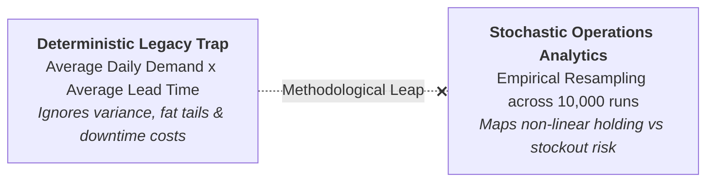
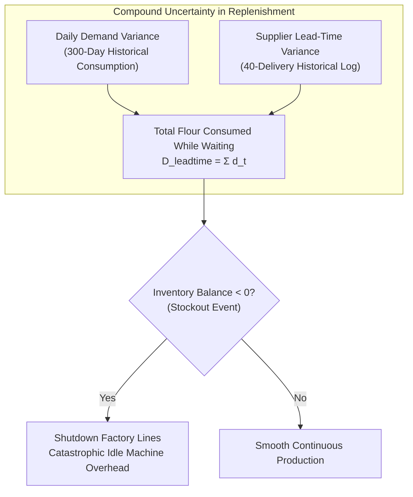
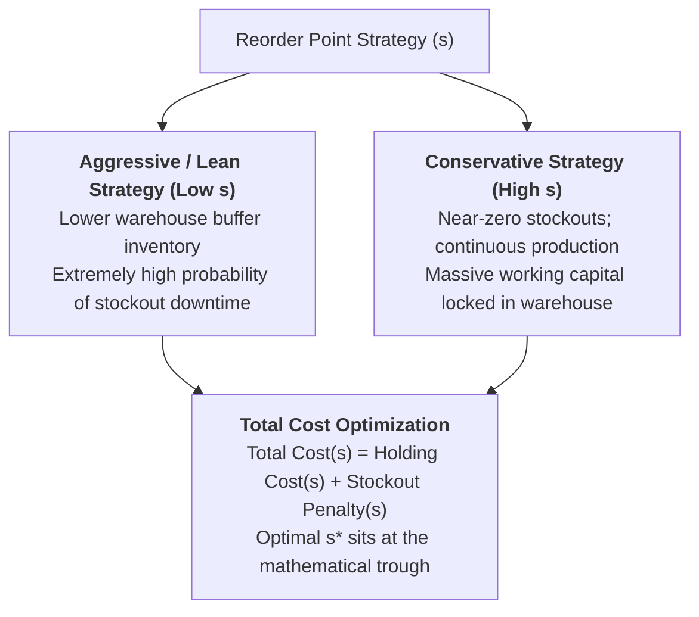

> [!NOTE] Curricular & Faculty Metadata
>
> - **Course:** MK6 Applied Business Analytics — Week 09
> - **Academic Host:** SBM ITB — _Direktorat Pendidikan Profesional Berkelanjutan_
> - **Lead Lecturer:** Dr. Eng. Manahan Siallagan
> - **Teaching Team:** Dr. Shimaditya Nuraeni, M. Apriandito Arya Saputra, MBA, Bagus Rullym, MM, Tyas Larassati
> - **Primary Curricular Spine:** `archive/courses/mk6/week-09/W9_Operations_Analytics.pdf` (SBM ITB Master Deck)
> - **Direct Satellites & Problem Sets:**
>   - [[courses/mk6-business-analytics/week-09/assignment-flour-supplier-simulation|Cohort Pre-Class Brief: Flour Supplier Simulation & Stochastic Operations Analytics]]

---

## 1. Executive Overview: From Static Formulas to Stochastic Simulation

In classical operations management, inventory reorder points and safety stock levels are routinely calculated using static, deterministic textbook equations (such as the standard economic order quantity or normal-distribution buffer formulas).

These models suffer from a fatal operational defect known in decision science as **The Flaw of Averages** (Sam Savage):

> _"Plans based on average assumptions are wrong on average."_

In real-world manufacturing and supply networks, lead times do not conform to tidy, bell-shaped Gaussian curves. They exhibit asymmetric skewness, port congestion delays, severe weather disruptions, and fat-tailed logistical bottlenecks. As established in the lecture spine, **Operations Analytics** uses [[concepts/operations-lead-time-simulation|Operations Lead-Time Simulation]] with Monte Carlo empirical data bootstrapping to evaluate the true financial risk profile of operational choices.

---

## 2. Foundations: The Anatomy of Lead-Time Uncertainty

When an enterprise places a purchase replenishment order with a supplier, the total demand during the replenishment cycle is the compound sum of two independent stochastic variables:

1. **Daily Demand Rate ($d_t$)**: How much raw material the plant consumes each day.
2. **Supplier Lead Time ($L$)**: How many days elapse from order placement until the material physically arrives at the unloading dock.

$$
\text{Total Lead-Time Demand} = \sum_{t=1}^L d_t
$$

---

## 3. The Non-Linear Cost Convex Curve

For any chosen **Reorder Point ($s$)**, the operations executive manages a direct trade-off between working capital tie-up and machine downtime penalties:

### The Total Monthly Cost Objective Function

$$
\text{Total Monthly Cost}(s) = C_h \times \left( \frac{Q}{2} + \bar{I}_{\text{left}}(s) \right) + C_s \times \bar{S}(s) \times N_{\text{orders}}
$$

- **Holding Component ($C_h$)**: Scales linearly with the average inventory in the warehouse ($Q/2$ cycle stock plus the average buffer stock left upon delivery arrival $\bar{I}_{\text{left}}$).
- **Stockout Component ($C_s$)**: Scales exponentially when $s$ is lowered. In continuous manufacturing (such as commercial baking, smelting, or chemical refining), running out of raw materials does not merely delay sales—it forces furnaces and ovens to idle, costing millions of Rupiah per hour in overhead.

---

## 4. The Flour Supplier Decision Dilemma

The class translates simulation theory into practice through the case examined in our [[courses/mk6-business-analytics/week-09/assignment-flour-supplier-simulation|Flour Supplier Simulation Brief]]:

| Operational Dimension        | Incumbent Supplier                                                                     | Challenger Supplier                                                                    | Operational Impact                                                                   |
| :--------------------------- | :------------------------------------------------------------------------------------- | :------------------------------------------------------------------------------------- | :----------------------------------------------------------------------------------- |
| **Contract Price per Tonne** | $\text{Rp } 9.00\text{ Million}$                                                       | $\text{Rp } 8.98\text{ Million}$                                                       | **$\text{Rp } 4.0\text{ Million/month}$ procurement savings** on 200 tonnes.         |
| **Delivery Reliability**     | Highly consistent ($2\text{--}3\text{ days}$)                                          | Volatile ($1\text{--}7\text{ days}$)                                                   | Forces the plant to hold significantly larger safety buffers.                        |
| **Simulation Methodology**   | Resample $L$ from 40 historical deliveries; sum $L$ days from 300 daily usage records. | Resample $L$ from 40 challenger deliveries; sum $L$ days from 300 daily usage records. | Run 10,000 independent trials across reorder points $s \in [40, 180]\text{ tonnes}$. |
| **Procurement Fallacy**      | Procurement awards contract based on invoice price.                                    | Total operational costs (holding + stockout) exceed invoice savings.                   | **The supplier that looks cheaper on the invoice is more expensive in operations.**  |

---

## 5. Strategic Implications for BUMN & National Food Logistics

1. **Procurement Silos in State Enterprises**: In large state-owned enterprises (e.g. Perum BULOG, PT Pupuk Indonesia), procurement Key Performance Indicators (KPIs) often measure purchasing managers exclusively on unit price discounts. Operations Analytics proves that selecting a cheaper, unreliable supplier can inflict operational downtime losses far exceeding the purchase discount.
2. **Resilience vs. Lean Fragility**: Highly optimized supply chains that eliminate all buffer stock in pursuit of "zero inventory" are catastrophically vulnerable to lead-time variance. Monte Carlo simulation allows executives to scientifically size buffer stocks to survive macro geopolitical and logistical shocks.

---

## 🔗 Week 09 Direct Curricular Bridges

- Cohort Pre-Class Guide: [[courses/mk6-business-analytics/week-09/assignment-flour-supplier-simulation|Cohort Pre-Class Brief: Flour Supplier Simulation Analysis]]
- Flagship Concept: [[concepts/operations-lead-time-simulation|Operations Lead-Time Simulation Architecture]]
- Prior Module: [[courses/mk6-business-analytics/week-08/index|Week 08: People Analytics & Organizational Network Modeling]]
- Operations Inventory Theory: [[courses/mk4-operations-supply-chain-management/week-08/index|MK4 Week 08: Lean Operations & Waste Elimination]]
- Return to [[courses/mk6-business-analytics/index|MK6 Course Overview Hub]]
