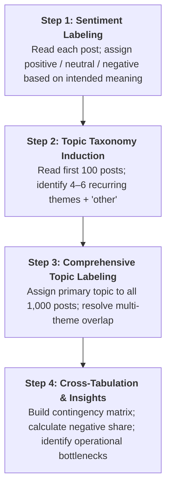

> [!IMPORTANT] Cohort Pre-Class Assignment Brief (_"Ini Peta, Bukan Jawaban"_)
> **Audience:** P3MD Batch I Soedirman Cohort  
> **Academic Mode:** Pre-Class Analytical Architecture & Annotation Guide  
> **Purpose:** This brief establishes the data schema, annotation rules, topic induction taxonomy, and contingency table methodology for the **BrandX 1,000 Social Media Posts** assignment—**without providing pre-labeled rows, completed contingency counts, or pre-written submission text**.

---

## 1. Assignment Mandate & Operational Context

Before an enterprise trains a supervised machine learning classifier or deploys an automated Natural Language Processing (NLP) pipeline, human analysts must establish high-integrity **ground truth data**. Automated tools fail when exposed to cultural nuances, slang, irony, and conversational noise without rigorous human annotation benchmarks.

In this assignment, a brand monitoring team has collected **1,000 social media posts** mentioning the fictional enterprise **BrandX** across four primary platforms during October 2026:

- **X (formerly Twitter):** High velocity, concise complaints, real-time tracking mentions.
- **Instagram:** Visual product reactions, lifestyle comments, customer support queries.
- **TikTok:** Short-form video reactions, viral consumer sentiment, informal colloquial slang.
- **Google Maps:** Structured store and location reviews, detailed operational feedback.

### Strict Methodological Constraint

> [!WARNING] No Code or Automated Labelling Allowed
> Per faculty guidelines, **code (Python/R/regex) and automatic labelling tools (ChatGPT/LLMs/APIs) may NOT be used** to populate the dataset. Students must read and label every post by hand using a spreadsheet application (Excel/Google Sheets) to experience firsthand the cognitive ambiguity, edge cases, and fatigue inherent in human text annotation.

---

## 2. Dataset Schema & Structure (`posts.xlsx`)

The dataset is located in `archive/courses/mk6/week-10/posts.xlsx` and contains 1,000 rows formatted with six standardized columns:

| Column Name |     Data Type     | Populated By | Description / Field Rules                                                     |
| :---------- | :---------------: | :----------: | :---------------------------------------------------------------------------- |
| `id`        |      Integer      |    System    | Post identifier running sequentially from `1` to `1,000`.                     |
| `date`      | Date (YYYY-MM-DD) |    System    | Publication date between `2026-10-01` and `2026-10-31`.                       |
| `platform`  | Categorical Text  |    System    | Source channel (`X`, `Instagram`, `TikTok`, or `Google Maps`).                |
| `text`      |  Free-form Text   |    System    | The raw customer post written in conversational Indonesian.                   |
| `sentiment` | Categorical Text  | **Student**  | **To be filled by hand:** `positive`, `neutral`, or `negative`.               |
| `topic`     | Categorical Text  | **Student**  | **To be filled by hand:** Assigned category from your defined topic taxonomy. |

### Illustrative Text Samples from the Raw Dataset

```text
Row 42: "Tas dari @BrandX kualitasnya oke banget, sesuai foto"
Row 43: "Cara ajukan retur jam tangan gimana min? Terima kasih."
Row 44: "Resi skincare sudah keluar tapi belum ada update, normal gak ya? Thx"
Row 45: "Chat CS @BrandX dari kemarin gak dibalas. Mohon solusinya"
Row 46: "Beli celana di brandx, sekali pakai langsung jebol. Bagus banget kualitasnya 🙃"
Row 47: "Ukuran rice cooker gak sesuai deskripsi, kekecilan. Kapok"
Row 48: "Mantap @BrandX, paketnya cuma telat seminggu 👏"
Row 49: "Kapan ada diskon celana lagi min? Mohon infonya ya."
Row 50: "Ukuran skincare gak sesuai deskripsi, kekecilan. Kapok"
```

---

## 3. Four-Step Annotation & Analysis Protocol



### Step 1: Label the Sentiment (`sentiment`)

- Read each post carefully and enter `positive`, `neutral`, or `negative`.
- **Target Entity:** The label must reflect the opinion expressed specifically about **BrandX** or its products/services.
- **Inquiry vs Complaint:** A factual or logistical question containing no emotional valence (e.g., _"Cara ajukan retur jam tangan gimana min? Terima kasih."_) must be labeled **`neutral`**.
- **Sarcasm / Irony Rule:** Sarcasm must be labeled by its **intended pragmatic meaning**, never by its literal surface words:
  - _"Bagus banget kualitasnya 🙃"_ $\rightarrow$ **`negative`** (emoji and context indicate premature failure).
  - _"Mantap @BrandX, paketnya cuma telat seminggu 👏"_ $\rightarrow$ **`negative`** (delayed delivery celebrated sarcastically).

### Step 2: Induce Topic Categories from the First 100 Posts

- Read posts `1` through `100` to detect emerging operational clusters.
- Establish mutually exclusive and collectively exhaustive categories. Typical clusters in consumer retail include:
  1. _Product Quality & Sizing_ (durability, materials, specifications, defects).
  2. _Shipping & Delivery_ (tracking, courier delays, damaged packaging).
  3. _Customer Service & Inquiries_ (chat responsiveness, admin support, return processing).
  4. _Pricing, Promos & Stock_ (discount availability, price perception, out-of-stock items).
  5. _`other`_: Reserved strictly for posts that fit none of the established operational themes.
- For each topic, write **one formal, precise sentence defining its scope and boundaries**.

### Step 3: Label the Topic across all 1,000 Posts (`topic`)

- Apply your defined taxonomy consistently across every row from `1` to `1,000`.
- **Primary Focus Rule:** If a post mentions multiple dimensions (e.g., _"CS ramah tapi barangnya cacat"_), assign the topic that represents the **primary driver or dominant sentence core** of the post.

### Step 4: Cross-Tabulate and Analyze

- Using Excel Pivot Tables or `COUNTIFS` formulas, generate a **Contingency Matrix**:

| Topic Taxonomy   | Positive ($n$) | Neutral ($n$) | Negative ($n$) | Total Posts | % Negative Share |
| :--------------- | :------------: | :-----------: | :------------: | :---------: | :--------------: |
| _Topic A_        |      ...       |      ...      |      ...       |     ...     |       ...%       |
| _Topic B_        |      ...       |      ...      |      ...       |     ...     |       ...%       |
| _Topic C_        |      ...       |      ...      |      ...       |     ...     |       ...%       |
| _Topic D_        |      ...       |      ...      |      ...       |     ...     |       ...%       |
| _other_          |      ...       |      ...      |      ...       |     ...     |       ...%       |
| **Total Corpus** |    **...**     |    **...**    |    **...**     |  **1,000**  |     **...%**     |

- Identify:
  1. The topic commanding the **largest total volume of posts** (dominant consumer focus).
  2. The topic with the **highest percentage share of negative sentiment** ($\frac{\text{Negative}}{\text{Total for Topic}}$), isolating the critical operational failure point.

---

## 4. Submission Deliverables & Rubric

### Deliverable Checklist (Google Classroom Upload)

1. **Completed Spreadsheet (`posts.xlsx`):**
   - 1,000 rows fully labeled; zero empty cells in `sentiment` or `topic`.
   - Exact allowable sentiment strings: `positive`, `neutral`, `negative` (lowercase, no trailing spaces).
2. **One-Page Executive Summary (PDF / Document):**
   - Table of topic names with clear, one-sentence boundary definitions.
   - Complete Contingency Table crossing Topics $\times$ Sentiment (with row/column totals and percentage shares).
   - **Three Quantitative Findings**, each explicitly anchored by concrete numbers (e.g., _"Topic X represented 42% of all negative feedback, with 128 out of 180 posts expressing dissatisfaction with delivery delays"_).
3. **Difficult Posts Analysis (Three Case Studies):**
   - Select exactly three posts from the 1,000-post corpus that presented acute labeling dilemmas (e.g., sarcasm, strong negation, mixed sentiment).
   - Quote the full Indonesian text, state the chosen sentiment and topic labels, and provide a clear 2–3 sentence analytical rationale.

### Academic Evaluation Criteria

| Evaluation Dimension      | Weight / Focus  | Rigorous Standard                                                                                                                                                        |
| :------------------------ | :-------------: | :----------------------------------------------------------------------------------------------------------------------------------------------------------------------- |
| **Completeness**          |   Gate Check    | All 1,000 posts possess valid sentiment and topic labels.                                                                                                                |
| **Taxonomy Clarity**      |   Core Method   | Topic boundaries are unambiguous, mutually exclusive, and applied with high inter-row consistency.                                                                       |
| **Mathematical Accuracy** |  Quantitative   | Contingency cell counts, row totals, column totals, and percentage shares reconcile exactly to 1,000.                                                                    |
| **Analytical Nuance**     | Strategic Depth | Executive findings draw logical managerial conclusions from data; difficult post justifications demonstrate deep command of negation, irony, and conversational context. |

---

## 5. Curricular Connections

- **Master Lecture Hub:** `[[courses/mk6-business-analytics/week-10/index|Week 10: Big Data Analytics & Social Media Text Mining]]`
- **Underlying Concept:** `[[concepts/social-media-text-analytics|Social Media Text Analytics & NLP Mining]]`
- **Previous Operations Session:** `[[courses/mk6-business-analytics/week-09/assignment-flour-supplier-simulation|Week 09: Flour Supplier Lead-Time Simulation]]`
