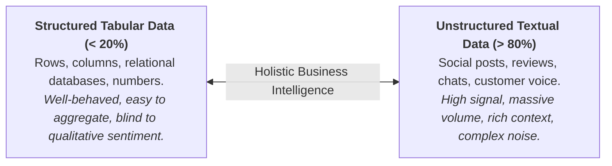
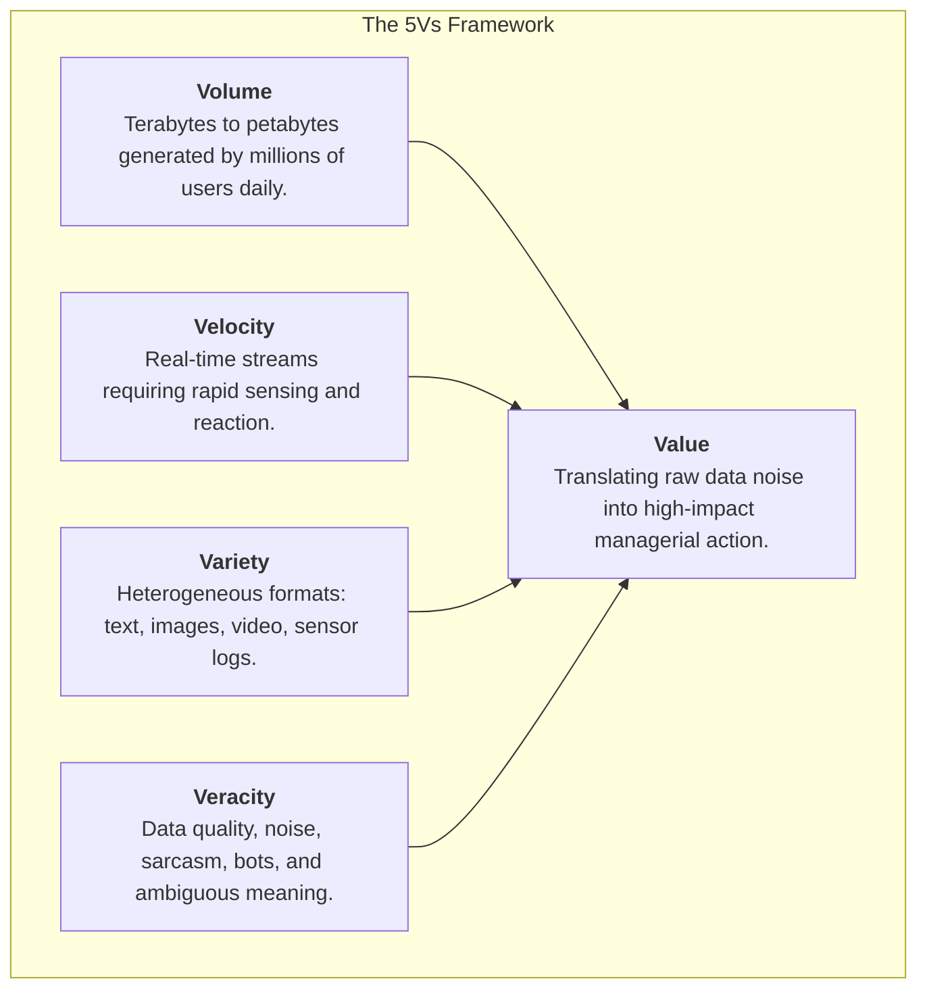
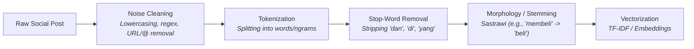
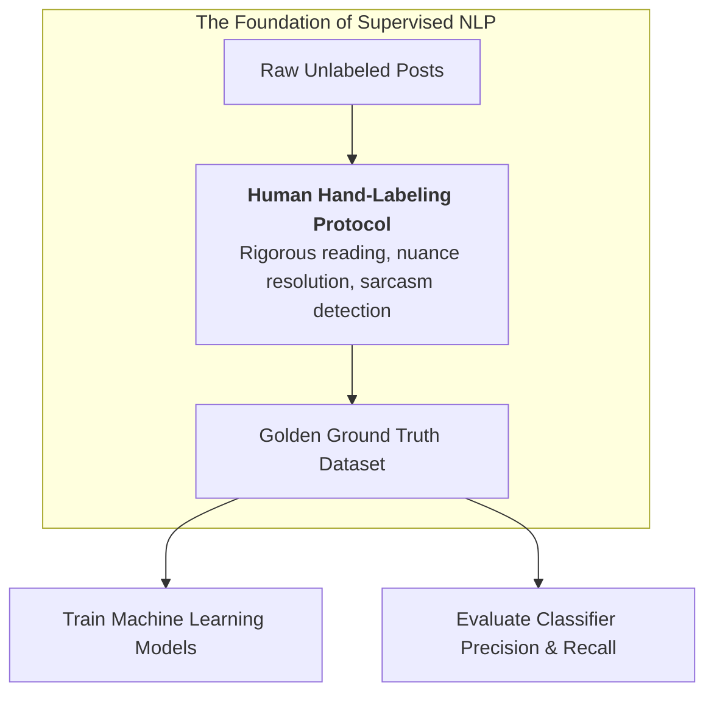
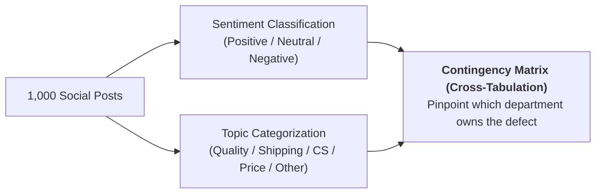

> [!NOTE] Curricular & Faculty Metadata
>
> - **Course:** MK6 Applied Business Analytics — Week 10
> - **Academic Host:** SBM ITB — _Direktorat Pendidikan Profesional Berkelanjutan_
> - **Lead Faculty:** Dr. Eng. Manahan Siallagan
> - **Teaching Team:** Dr. Shimaditya Nuraeni, M. Apriandito Arya Saputra, MBA, Bagus Rullym, MM, Tyas Larassati
> - **Primary Curricular Spine:** `archive/courses/mk6/week-10/W10_Big_Data_Analytics_tanpa_kunci.pdf`
> - **Accompanying Assignment:** `archive/courses/mk6/week-10/10-assignment.pdf` & `archive/courses/mk6/week-10/posts.xlsx`
> - **Foundational Literature:**
>   - Bing Liu (2020), _Sentiment Analysis: Mining Opinions, Sentiments, and Emotions_, Cambridge University Press.
>   - Christopher D. Manning, Prabhakar Raghavan, & Hinrich Schütze (2008), _Introduction to Information Retrieval_, Cambridge University Press.
>   - Doug Laney (2001), _3D Data Management: Controlling Data Volume, Velocity, and Variety_, META Group (Gartner).

---

## 1. Executive Overview: From Tabular Numbers to Unstructured Text

Throughout Weeks 1 to 9 of Applied Business Analytics, analytical workflows focused predominantly on **structured tabular data**—financial statements, inventory balances, lead-time day counts, sales quantities, and regression matrices.

However, in modern enterprise environments, **over 80% of generated corporate data is unstructured**. It resides in free-form customer reviews, call center audio transcripts, social media posts, field maintenance logs, WhatsApp support chats, and regulatory filings.

Week 10 introduces the methodologies required to convert messy, unstructured human language into structured, quantitative metrics that inform strategic decision-making and operational remediation.

---

## 2. Foundations: The 5Vs Architecture of Big Data

Big Data is defined not merely by storage size, but by five operational dimensions that demand specialized analytical architectures:

| Dimension    | Description                           | Social Media Analytics Challenge                                     | Strategic Countermeasure                                       |
| :----------- | :------------------------------------ | :------------------------------------------------------------------- | :------------------------------------------------------------- |
| **Volume**   | Scale of data generation.             | Ingesting tens of thousands of brand mentions across platforms.      | Automated web scraping, distributed storage, cloud warehouses. |
| **Velocity** | Speed at which new data accumulates.  | Viral consumer complaints escalating into PR crises within hours.    | Real-time social listening feeds, automated alert triggers.    |
| **Variety**  | Structural diversity of data types.   | Mixed platforms: short tweets, long reviews, videos, photo comments. | Multi-channel data integration, cross-platform harmonization.  |
| **Veracity** | Reliability and truthfulness of data. | Slang, typos, sarcasm, astroturfing, fake reviews, bot accounts.     | Rigorous text preprocessing, human-in-the-loop validation.     |
| **Value**    | Economic or operational utility.      | Data lakes becoming "data swamps" with zero executive utility.       | Linking topic sentiment directly to operational root causes.   |

---

## 3. The Natural Language Processing (NLP) Pipeline

Transforming raw human language into computational vectors requires a multi-stage sequential pipeline:

### 1. Cleaning & Noise Removal

Social media posts contain abundant non-lexical artifacts: URLs (`https://...`), platform handles (`@BrandX`), punctuation strings (`?!?!`), and tracking symbols. These are normalized or filtered using regular expressions.

### 2. Tokenization & N-Grams

Tokenization segments continuous character strings into individual lexical tokens $T = \{w_1, w_2, \dots, w_n\}$. To preserve context such as negation, pipelines extract $n$-grams ($n=2$ or $n=3$):

- _Unigrams ($n=1$):_ `["tidak", "ramah"]` $\rightarrow$ loses relational modifier.
- _Bigrams ($n=2$):_ `["tidak_ramah"]` $\rightarrow$ preserves inverted valence.

### 3. Stop-Word Removal & Morphological Stemming

Common functional words (conjunctions, prepositions) provide zero topical discrimination and are filtered out. For Indonesian text, affix-heavy grammar requires morphological root extraction (e.g., via the _Sastrawi_ stemming algorithm):

- `pengiriman` $\rightarrow$ `kirim`
- `dikecewakan` $\rightarrow$ `kecewa`
- `memperbaiki` $\rightarrow$ `baik`

### 4. Mathematical Weighting: TF-IDF

To quantify the diagnostic power of term $t$ in post $d$ within corpus $D$:

$$
\text{TF-IDF}(t, d, D) = \frac{f_{t,d}}{\sum_{t' \in d} f_{t',d}} \times \log\left(\frac{|D|}{|\{d \in D : t \in d\}|}\right)
$$

---

## 4. Sentiment Analysis & The Necessity of Human Ground Truth

Enterprises classify sentiment using two complementary approaches:

1. **Lexicon-Based Models:** Matching words against predefined positive/negative dictionaries. Fast and transparent, but brittle when facing conversational irony, slang, or context shifts.
2. **Supervised Machine Learning / Deep Learning:** Training models (Naïve Bayes, Support Vector Machines, BERT/IndoBERT) on historical examples.

> [!IMPORTANT] The Golden Rule of Human Annotation
> **No automated model can perform better than the quality of the training data supplied to it.** Human hand-labeling forces analysts to confront semantic ambiguity, dialect variations, and contextual pragmatics. Hand-labeled benchmarks remain the gold standard against which all enterprise AI solutions are audited.

### Three Classic Annotation Dilemmas

1. **Sarcasm and Inverted Meaning:**
   - _"Beli celana di brandx, sekali pakai langsung jebol. Bagus banget kualitasnya 🙃"_
   - The literal words say _"Bagus banget"_, but the intended pragmatic sentiment is sharply **`negative`**.
2. **Negation Flipping:**
   - _"Resi keluar tapi belum ada update, pengiriman gak cepat"_
   - A naïve unigram parser scores _"cepat"_ as positive; human evaluators correctly link the negation _"gak cepat"_ as **`negative`**.
3. **Factual Inquiries (Zero Polarity):**
   - _"Cara ajukan retur jam tangan gimana min? Terima kasih."_
   - Politeness markers (_"Terima kasih"_) do not make this post positive; it is an informational logistical query and must be labeled **`neutral`**.

---

## 5. Topic Discovery & Contingency Analysis

Analyzing sentiment in isolation yields shallow insights (e.g., _"35% of customer posts are negative"_). Strategic value emerges when sentiment is cross-tabulated with operational categories:

### Computing the Negative Share Metric

To isolate which operational area causes the sharpest customer dissatisfaction, analysts calculate the **Negative Sentiment Share** for each topic $i$:

$$
\text{Negative Share}_i = \frac{\text{Negative Posts in Topic } i}{\text{Total Posts in Topic } i} \times 100\%
$$

A topic with relatively few total mentions (e.g., billing errors) might exhibit an 85% negative share, signaling an acute, high-severity failure that requires immediate operational intervention.

---

## 6. Strategic BUMN Application: Social Sensing & Public Trust

For Indonesian State-Owned Enterprises (BUMN) operating critical public infrastructure—such as PT Kereta Commuter Indonesia, PLN, Pertamina, or Bank Mandiri—social media text analytics serves as an **early-warning sensory network**:

- **Real-Time Incident Detection:** Automated alerts on spikes in negative keywords (e.g., _"gangguan signal"_, _"mati lampu"_, _"antrean loket"_) alert operations directors before incidents escalate into mainstream media scandals.
- **Service Failure Root-Cause Attribution:** Distinguishing whether public dissatisfaction stems from infrastructure breakdowns (Operations), staff conduct (HR/Customer Service), or policy announcements (Corporate Communications).
- **Public Governance Accountability:** Fulfilling transparency and citizen satisfaction mandates under BUMN public service obligation (PSO) frameworks.

---

## 7. Curricular Navigation & Satellites

- **Hands-on Student Assignment:** Complete data schema, 4-step labeling protocol, and reporting rubric:
  - `[[courses/mk6-business-analytics/week-10/assignment-social-media-text-analytics|Cohort Pre-Class Brief: BrandX Social Media Text Analytics & Hand-Labeling Protocol]]`
- **Core Conceptual Knowledge Base:**
  - `[[concepts/social-media-text-analytics|Social Media Text Analytics & NLP Mining]]`
- **Previous Session Connection:**
  - `[[courses/mk6-business-analytics/week-09/index|Week 09: Operations Analytics & Supply Chain Lead-Time Simulation]]`
- **Cross-Curricular Bridge:**
  - `[[concepts/statistical-process-control|Statistical Process Control & Quality Engineering]]` (MK4 — Quality engineering via attribute defect tracking).
