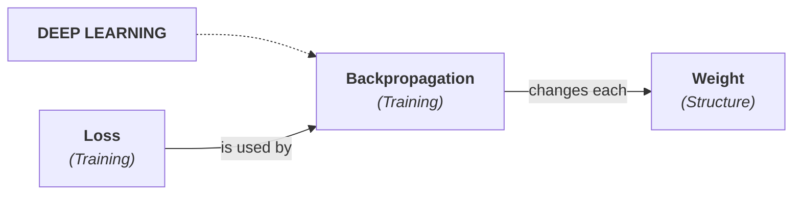

> [!IMPORTANT] Cohort Pre-Class Assignment Brief (_"Ini Peta, Bukan Jawaban"_)
> **Audience:** P3MD Batch I Soedirman Cohort  
> **Academic Mode:** Pre-Class Structural & Conceptual Guide (Individual Task)  
> **Purpose:** This brief maps the mandatory 15-term inventory, three conceptual clusters, arrow-phrasing grammar, and self-audit rubric for **Session 11 Assignment: Draw a Concept Map of Deep Learning**—**without providing a completed copy-pasteable 15-term diagram or pre-written arrow sentences**.

---

## 1. Assignment Mandate & Deliverable Format

In Session 11, rather than writing Python code or training a spreadsheet model, students must demonstrate **conceptual synthesis** by constructing a hand-drawn **Concept Map of Deep Learning**.

| Requirement Dimension   | Official Specification (`11-assignment.pdf`)                                                   |
| :---------------------- | :--------------------------------------------------------------------------------------------- |
| **Task Mode**           | Individual task — **drawn by hand on one sheet of paper**.                                     |
| **Center Anchor**       | Write **`Deep learning`** in the middle of the sheet.                                          |
| **Layout Freedom**      | Spatial layout is yours to design (radial, layered, or clustered), provided all rules are met. |
| **Required Vocabulary** | All **15 mandatory terms** across 3 groups must appear on the sheet.                           |
| **Submission Artifact** | A clear, legible **photo of your handwritten sheet**.                                          |

---

## 2. The 15 Mandatory Terms Across Three Groups

Every term below must appear explicitly on your concept map. Use the **Conceptual Role** column to verify you understand _what each term does_ before deciding how to connect it.

### Group A: Neural Network Structure (5 Terms)

| Term                    | Plain-English Role in Deep Learning                                                                                        | Related Lecture Anchor                                                                           |
| :---------------------- | :------------------------------------------------------------------------------------------------------------------------- | :----------------------------------------------------------------------------------------------- |
| **Neuron**              | Fundamental computing unit that multiplies inputs by weights, adds a bias, and applies an activation function.             | [[courses/mk6-business-analytics/week-11/index#32-anatomy-of-an-artificial-neuron\|Section 3.2]] |
| **Weight**              | Learned multiplier on an incoming connection that determines how strongly an input influences a neuron's output.           | [[courses/mk6-business-analytics/week-11/index#32-anatomy-of-an-artificial-neuron\|Section 3.2]] |
| **Bias**                | Learned constant offset added to the weighted sum to shift a neuron's decision boundary.                                   | [[courses/mk6-business-analytics/week-11/index#32-anatomy-of-an-artificial-neuron\|Section 3.2]] |
| **Activation function** | Non-linear transformation (ReLU, Sigmoid, Tanh) applied to the weighted sum so stacked layers can model curved boundaries. | [[courses/mk6-business-analytics/week-11/index#33-activation-functions\|Section 3.3]]            |
| **Layer**               | Organized column of neurons (input, hidden, or output) that transforms representations step by step.                       | [[courses/mk6-business-analytics/week-11/index#34-layers-and-combining-neurons\|Section 3.4]]    |

### Group B: Training (5 Terms)

| Term                | Plain-English Role in Deep Learning                                                                                | Related Lecture Anchor                                                                                 |
| :------------------ | :----------------------------------------------------------------------------------------------------------------- | :----------------------------------------------------------------------------------------------------- |
| **Loss**            | Error metric measuring how far the network's predicted outputs are from actual ground-truth labels.                | [[courses/mk6-business-analytics/week-11/index#35-the-training-loop\|Section 3.5]]                     |
| **Backpropagation** | Algorithm that propagates the loss backward to compute how much each weight contributed to the error.              | [[courses/mk6-business-analytics/week-11/index#35-the-training-loop\|Section 3.5]]                     |
| **Epoch**           | One complete forward-and-backward pass over the entire training dataset.                                           | [[courses/mk6-business-analytics/week-11/index#35-the-training-loop\|Section 3.5]]                     |
| **Learning rate**   | Step-size hyperparameter governing how aggressively gradient descent updates weights after each error measurement. | [[courses/mk6-business-analytics/week-11/index#36-gradient-descent-and-learning-rate\|Section 3.6]]    |
| **Overfitting**     | Failure mode where training loss approaches zero while test loss rises because the model memorized training noise. | [[courses/mk6-business-analytics/week-11/index#38-overfitting-and-weight-interpretation\|Section 3.8]] |

### Group C: Convolutional Neural Network (5 Terms)

| Term                  | Plain-English Role in Deep Learning                                                                                             | Related Lecture Anchor                                                                                    |
| :-------------------- | :------------------------------------------------------------------------------------------------------------------------------ | :-------------------------------------------------------------------------------------------------------- |
| **Convolution**       | Sliding operation that multiplies a small filter across local pixel neighborhoods to detect spatial patterns.                   | [[courses/mk6-business-analytics/week-11/index#42-images-as-grids-and-parameter-efficiency\|Section 4.2]] |
| **Filter**            | Small grid of learned weights (e.g., $3 \times 3$) reused across every position in an image to detect edges or shapes.          | [[courses/mk6-business-analytics/week-11/index#43-filters-and-feature-maps\|Section 4.3]]                 |
| **Feature map**       | 2D output grid generated by sliding a filter across an image, showing _where_ a pattern appears.                                | [[courses/mk6-business-analytics/week-11/index#43-filters-and-feature-maps\|Section 4.3]]                 |
| **Pooling**           | Downsampling operation (such as $2 \times 2$ max pooling) that shrinks feature maps and preserves detection under small shifts. | [[courses/mk6-business-analytics/week-11/index#44-max-pooling-and-hierarchical-features\|Section 4.4]]    |
| **Transfer learning** | Strategy that reuses a pre-trained CNN's early edge/shape layers and retrains only its final layers on a new task.              | [[courses/mk6-business-analytics/week-11/index#45-transfer-learning\|Section 4.5]]                        |

---

## 3. Arrow-Grammar Rules & Faculty Worked Fragment

To earn full marks, your concept map cannot be a spiderweb of unlabeled lines. Every connection must satisfy **three structural rules**:

1. **Directed Sentence Arrows:** Every arrow must include a short linking phrase so that `Source Node --[phrase]--> Target Node` reads as a grammatically valid, factually accurate sentence.
2. **Zero Orphan Nodes:** Every one of the 15 terms must have **at least one** labeled arrow connected to it.
3. **Cross-Group Bridges (Minimum 2):** At least **two arrows** must connect terms belonging to _different_ groups (for example, linking a **Training** term to a **Neural network structure** term, or a **CNN** term to a **Structure** or **Training** term).

### Faculty Seed Example (3 of 15 Terms)

`11-assignment.pdf` provides the starting seed below—demonstrating how a single chain satisfies the sentence-arrow rule and creates a cross-group bridge (**Training** $\rightarrow$ **Neural network structure**):

- **Sentence 1:** _"Loss is used by backpropagation."_
- **Sentence 2:** _"Backpropagation changes each weight."_ (Cross-group bridge: **Training** $\rightarrow$ **Neural network structure**.)

> [!TIP] Design Strategy for the Remaining 12 Terms
> Before drawing on paper in pen, sketch a rough layout in pencil:
>
> - Place **`Deep learning`** in the center and branch into the three clusters (**Structure**, **Training**, **CNN**).
> - Look for natural **cross-group bridges**—for instance, how **Filter** connects to **Weight**, how **Layer** connects to **Convolution** or **Transfer learning**, or how **Epoch** relates to **Overfitting**.
> - Read every arrow aloud from tail to head. If it does not form a clear English (or consistent academic) sentence, rewrite the linking phrase.

---

## 4. Pre-Submission Self-Audit Rubric

Verify your photographed sheet against the exact three assessment criteria stated in `11-assignment.pdf`:

- [ ] **15-Term Completeness:** Count all nodes on your sheet—are `Deep learning` plus all **15 terms** (5 Structure + 5 Training + 5 CNN) clearly written and spelled accurately?
- [ ] **100% Labeled Arrows:** Does **every single arrow** have a readable linking phrase, and does **every term** have at least one arrow?
- [ ] **Cross-Group Bridges & Truthfulness:** Are there **at least two arrows** joining terms from _different_ groups, and is every arrow-sentence factually true (e.g., _backpropagation_ adjusts _weights_, not _epochs_; _pooling_ shrinks _feature maps_, not _learning rates_)?
- [ ] **Photo Legibility:** Is the photo well-lit, uncropped, and sharp enough for the teaching team to read every linking phrase?

---

## 🔗 Companion Study Resources

- [[courses/mk6-business-analytics/week-11/index|MK6 Week 11 Master Lecture Hub: Deep Learning & Neural Network Foundations]]
- [[concepts/artificial-neural-network|Concept Deep Dive: Artificial Neural Networks & Backpropagation]]
- [[concepts/convolutional-neural-network|Concept Deep Dive: Convolutional Neural Networks (CNN) & Transfer Learning]]
